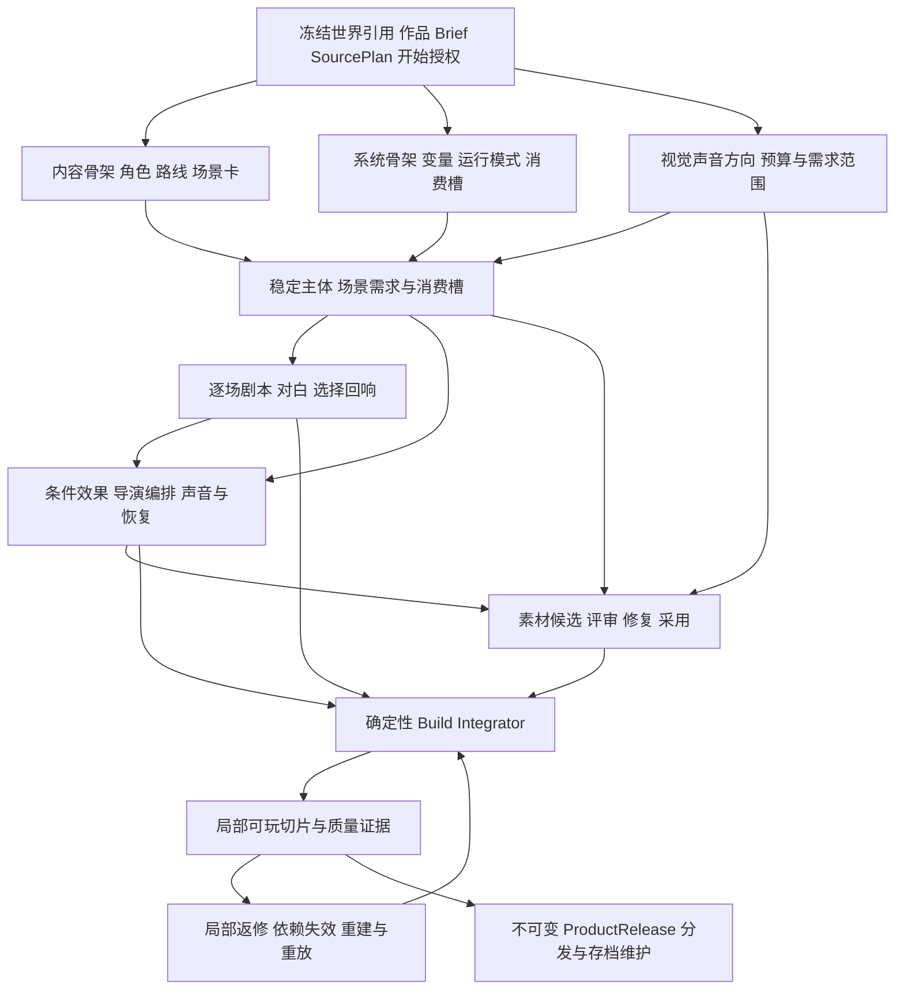

# AVG 三条生产流程的商业对标与研发路线研究

> 版本：1.5.1 · 日期：2026-10-13 · 权威层级：L4 研究与代码核对证据。
> 产品：AVG/Galgame。关联：总纲 §6、E-AVG-01。
> 代码核对基线：`516a98bff7cb03eab2414aecfcd0ce92102cbf9e`，已迁到包含 origin/main `45c541e9` 的独立工作树；相较最初核对提交，AVG 代码未变。
> 状态：已补头部成品基准、主创方法访谈、专业 Agent/Skill 方法草案、原创正反例、官方视频帧采样、系统/媒资矩阵与联合评测方案。完整场景动态/声音与实际生成效果尚未验证。未实施新功能，未生产或验收商业作品。施工现由 AVG 专项 L2 契约与工作包裁决。

建议把 AVG 的后续目标确定为：**作者能够用 StoryForge 制作有鲜明人物、有效分支和完整视听节奏的原创视觉小说，从剧本修订一直交付到可独立游玩的冻结版本。** 人物关系驱动的悬疑或情感故事是首轮候选，尚未证明优于角色恋爱路线或其它题材。题材须经内容、视听、投入和目标玩家试验选择，不能成为 AVG 数据模型的限制。

**当前只能判断这条路线值得进行小范围验证，不能判断已经确定可行。** 来源检索和代码阅读建立了产品方向及技术复用依据；尚缺逐场视听拆解、实际生产调用、可用素材比例、人工返修工时、独立玩家结果和作品销售。成功商业作品证明相应作品存在需求，并不证明本项目能复制其效果和收益。

当前最需要增强的是三条线之间的专业交接：内容线提供可演出的场景和选择；系统线把它们变成确定性规则、演出编排和玩家操作；媒资线按稳定主体与消费槽生产美术和声音。以关键场景的表现质量、作者修改效率和真实玩家体验决定扩展顺序。

**质量目标以头部 AVG 成品为参照。** 本文将“顶尖 AVG 模型”理解为成品及其制作范式；文本、图像和音频生成模型的选型另以真实任务评测决定。小范围验证只缩减作品规模，不降低人物、对白、构图、声音和可玩性的目标。专业岗位、可执行系统和适配媒资必须在同一 Build 中接受联合评审，三个部门各自完成不能代表作品效果成立。

继续研究的具体证据与方法见[专业制作方法、场景观察与 Skill 校准研究](AVG-PROFESSIONAL-METHODS-20261013.md)：主创访谈、三部官方公开视频的 47 个提取帧/24 个实际查看帧、生成方法及参考图接口核对、七张方法卡与原创微场景。它补充了专业方法的内容，仍不是实际作品验收。

对话、物品/证据、存档及其它玩法，立绘/图标/场景/配音需求和自动配置的专项对照见[游戏系统与媒资全流程研究](AVG-SYSTEMS-AND-MEDIA-RESEARCH-20261013.md)。该轮按 `097ba563` 核对代码、读取具体版本的官方机制资料并查看一张大逆转裁判操作图，补足此前概述；仍未实际操作商业游戏或运行真实图片/配音生产。

2026-10-13 研究收口为 [AVG 正式产品契约](../products/AVG.md)、[实施计划](../roadmap/AVG-IMPLEMENTATION-PLAN.md)和[工作包卡](../roadmap/AVG-WORK-PACKAGE-CARDS.md)。本报告保留论据与研究快照；发生范围/顺序差异时按 L2，不把研究登记当作软件或作品完成。

## 1 任务边界与三个流程

总纲所说的三个流程是 **S3.1 的游戏内容制作、产品系统配置、媒资生产**，共同进入确定性的 Build Integrator。它们与 `S1 世界封存 → S2 产品定向 → S3 产品执行` 是两个层次。[总纲 §6](../PROJECT-MASTER-CHARTER.md#6-世界引擎之上的衍生产品)

| 项目 | 本轮及后续边界 |
|---|---|
| 生命周期 | 本轮研究 AVG 产品能力研发；后续用具体作品检验能力。软件开发工时、作品制作工时、作品市场结果分别记录 |
| 阶段 | S2 确认体验、规模、预算和开始授权；三条制作线属于 S3.1；试玩、发布、存档维护继续属于 S3 |
| owner | AVG Work 拥有剧本、路线、系统配置、演出、媒资、Build、ProductRelease、Session 和存档 |
| 世界引用 | 只读准确 WorldRelease，经 AVG requirement adapter、冻结 SourcePlan 和实际 Context Manifest 读取 |
| 交接物 | WorldReference、ConfirmedProductBrief、ProductSourcePlan → 本产品受治理 Artifact → ProductBuild → ProductRelease 与 SourceManifest |
| 媒资 owner | AVG 作品及其 production/build/release；世界只提供语义依据 |
| 本轮范围 | 历史追溯、商业案例、代码闭包、研发方向、工作包与验收建议。产品代码和浏览器作者数据未改动 |

正式 AVG 继续遵守世界衍生产品链路。S2 可以先保存没有世界的构想；正式制作仍需冻结来源。作者新创作的剧情和演出归 AVG，不自动改变世界或原小说。[上层产品契约](../products/UPPER-PRODUCTS.md)

## 2 历史需求及仍应保留的决定

Git 归档中的 `AVG-1-VISUAL-NARRATIVE-DESIGN.md` 已经明确背景、多人立绘、CG、四类音频、有限 2D Cue、历史、自动、已读快进、存档、纯文字降级与作者时间线。它还明确：剧情真相和演出分离，AI 媒资先成为候选，玩家运行不依赖模型。历史材料使用清理前提交 `5679dada86d102c9b55b8d897bf0a8ff5795d1b3` 追溯，不能恢复其中旧表、旧产品分类和世界拥有媒资的发布路径。

后续 `GAME-PRODUCTION-PIPELINE-BLUEPRINT-V3.md` 强调自动拆需求、实际绑定素材、可玩 Preview、有限重试、不可变发布和商业媒资证据。2026-09-15 的 `50bd6baa` 接上 AVG 作者入口、修订和玩家；`5b9e78e1` 收束一级导航。当前事实以代码和能力基线为准。

10 月 8—9 日的历史对话还提出两点：收入希望来自实际作品；用剧情和立绘取胜需要认真投入。本研究按这两个方向设计投入上限、外部试玩和扩展闸门。成人向曾作为市场假设出现，尚无销量、净收入或团队适配证据支持将其定为首作路线。

| 历史目标 | 本轮处理 |
|---|---|
| 商业 AVG 的整体体验 | 保留为质量目标，并拆成场景、路线、演出、声音、玩家操作和交付证据 |
| 作者导入和 AI 生产媒资 | 继续并存；按参考图实传、实际字节、权利、费用和采用结果验收 |
| 剧情逻辑与演出分离 | 保留；静音、减少动态、图片降级不能改变选择、旗标和结局 |
| 任意 Beat 预览和局部修改 | 增强为作品级生产反馈循环，修改后只重建真正受影响的依赖闭包 |
| 一次生成完整游戏 | 改进为来源评估、角色与路线设计、分场、对白、演出、媒资、切片和修订的专业流程 |
| 工程验收与商业完成 | 分别记录；历史 IMPLEMENTED 标签只能说明当时的工程交付 |

## 3 当前代码能做什么及主要差距

当前 `E-AVG-01` 为 partial；内置《雾港：失潮钟声》是预写作品，其存在不提升通用生成能力的商业成熟度。[能力基线](../roadmap/CAPABILITY-BASELINE.md)

| 闭包位置 | 当前证据 | 后续判断 |
|---|---|---|
| 作者入口 | [AvgPage](../../src/pages/AvgPage.tsx)、[navigation](../../src/components/avg/navigation.ts)：作品库、世界、制作台、版本、游玩；S2 草稿可无世界保存 | 保留现有入口，在制作台内增强场景工作流 |
| 产品定向 | [authoring-contract](../../src/lib/avg/authoring-contract.ts)：身份、开场、体验、时长、结局、路线/变量描述、画幅、视听等级 | 目前适合轻量意图表达；需要专业剧本、演出和资产范围的结构化约束 |
| 会谈读取 | [consultation](../../src/lib/avg/consultation.ts) 与 `avg.consult.v1`：读取 `avg.authoring`；提示明确尚未读取世界原文 | 会谈已有候选确认；后续世界适配评估须经正式网关，不能仅加强提示词后声称已懂世界 |
| 世界来源 | [AVG_WORLD_REQUIREMENT_ADAPTER_V1](../../src/lib/product/world-requirement-adapters.ts)、production Context Gateway | 复用现有来源、权限、版本与渐进读取体系 |
| 候选及正式采纳 | [FIELD_REGISTRY](../../src/lib/registry/field-registry.ts) 已登记 Production Brief、Plan、Artifact 等写口；[adoption](../../src/lib/product-production/adoption.ts) 管发布采纳 | 新 AVG 产物应接该边界，禁止另建 AI/DB 写入口 |
| 内容生产 | [createProductProductionPlanV3](../../src/lib/product-production/plan.ts)：AVG 仍走通用设计、叙事、产品模块和媒资需求路径 | 缺少与 AVG 对应的专业分工和中间产物；不能把文字冒险专属生产图原样复制过来 |
| 默认组装 | [production-executor](../../src/lib/product-production/production-executor.ts) 的 RuntimePackage 组装按素材类型生成基础 Cue | 引用绑定已经存在，逐场景导演设计仍需增强 |
| 演出运行 | [AVG 类型](../../src/lib/types/avg.ts)、[applyAvgCue](../../src/lib/avg/runtime.ts)、[cue-timeline](../../src/lib/avg/cue-timeline.ts)：白名单 Cue、舞台状态、快照；等待按 Cue 顺序累加 | 增强语音/文字/动画之间的调度和确定性恢复语义 |
| 作者返修 | [prepareAvgRevisionV1 / runAvgRevisionV1](../../src/lib/avg/revision-production.ts)：作者修订进入新版本，保护身份、来源、旧 Build 和素材归属 | 已有可靠入口；当前修订仍以整包方案为主，应定位场景及受影响产物 |
| 媒资生命周期 | [editor-service](../../src/lib/avg/editor-service.ts)、[PROJECT_TABLES](../../src/lib/registry/project-tables.ts)：AVG 草稿素材、共享 Blob、备份与重映射 | 保留完整生命周期；新增表之前先证明现有 Artifact 无法承载 |
| 媒资检查 | [media-quality-policy](../../src/lib/product-production/media-quality-policy.ts)、runtime verifier：尺寸、alpha、音频响度/峰值/循环及 hash 证据 | 技术可用已有门；人物一致、构图、情绪和声音表现还需实际内容评审 |
| 玩家路径 | [AvgGamePlayer](../../src/components/text-game/AvgGamePlayer.tsx)：目录、详情、舞台、历史、快进、自动、检查点、独立存档 | 日常阅读基础已有；作品封面、路线回放、鉴赏、分通道声音和演出体验可继续完善 |
| 分发 | [ProductDistributionBundleV2](../../src/lib/product-platform/distribution-bundle.ts) 已有冻结 release 与媒资的自包含分发基础 | AVG 作者备份、可导入分发包、独立离线播放器、Steam 发行是不同交付；最后两项仍需专项验证 |
| 测试 | [AVG E2E](../../tests/e2e/avg-integration.spec.ts)、R-AVG2～5 与生产/媒资回归 | 证明相应路径有测试；其中会谈拦截和预写 fixture 不能证明真实模型文学/视听质量 |

最应优先处理的五个具体差距：

1. **通用叙事产物粒度偏粗。** 人物弧、场景冲突、路线差异、信息揭示、对白修订缺少 AVG 专属生产交接。扩大字数容易扩大返工。
2. **默认 Cue 编译偏向素材挂接。** 当前角色槽位按数组序号轮转左/右/中，音频使用通用音量 0.7，基础 Cue 多在 Beat 前执行。这能接通素材，但无法代替镜头、走位和情绪节奏设计。
3. **声音还缺导演级调度。** StageAudio 是 HTML audio 播放；自动推进在文字完成及 Cue 等待完成后再等 650ms，没有绑定语音结束。当前 reducer 每个音频类别保留一个 activeAudio 项，复杂叠加 SFX、交叉淡化和配音自动阅读需要专门契约。
4. **角色表情和作品包装可继续提升。** show-actor 用完整 asset 替换角色状态；分层表情与身体组合尚不能由资源类别名称推定已实现。目录详情仍使用通用书本图形和场景/对白/Cue 数量，需要作品封面、简介、真实时长、内容提示及重玩价值。
5. **S2、生产能力和商业证据需要对齐。** 播放类型已有 voice，S2 音频等级目前只有 none/music-sfx；商业候选的 intent/adapter 标志不等于逐作品体验、费用、权利和外部分发已验收。

进一步核对 [ProductMediaRequestV1、assertRequest 与实际 adapter 请求](../../src/lib/product-production/media-adapters.ts) 后，还存在两项必须在立项前区分的能力边界：

- **角色参考文字与参考图片实传不同。** 当前 AVG 使用的通用生成请求没有参考图片字节/引用输入，已实现图片 adapter 的请求体主要是文本 Prompt 和尺寸等参数。不能以角色锚点元数据推定已经实现参考图编辑、换表情或稳定复现人物。授权导入的同一角色素材是现有路径；自动生成一致变体需要新合同和实际传输/质量证据。其它产品的专用媒体流程不构成本路径的证明。
- **播放导入语音与自动配音生产不同。** 通用 ProductMediaClassV1 只有 image/music/sfx，assertRequest 的 sfx 类型只接受 sfx/ambience；[executeAudioTask](../../src/lib/product-production/production-executor.ts) 将非 bgm 需求归入 sfx。当前播放器的 voice 槽不能证明该生成链已经支持 TTS、说话人控制和逐句配音。需要专用语音能力合同，或在切片中明确使用授权导入的配音。

以上是本次源码核对结果，未扩大为缺陷修复任务。实现时应为这些场景取得定向反例证据。

## 4 商业作品对标

研究样本分为头部作品、细分制作方法和相邻互动叙事三层。先用头部作品设定品质及商业参照，再用细分作品研究能否缩小制作范围。表中“可吸收方向”是结合源码的研发推论；官方宣传和商店功能描述不等于本项目质量认证。

### 4.0 头部作品基准与官方商业证据

| 主要对标 | 已核实内容 | 应深入拆解的方向 |
|---|---|---|
| [Fate/stay night REMASTERED](https://typemoon.com/products/f-sn/introduction/) | TYPE-MOON 官方列明 Fate、Unlimited Blade Works、Heaven's Feel 三条角色路线；当前重制版本基于 Realta Nua | 共通事件如何在不同人物关系和主题下形成不同路线；来源事实、路线知识、选择和演出怎样协同。只对标这部视觉小说，FGO 手游收入不能作为它的商业数据 |
| [命运石之门 原作](https://store.steampowered.com/app/412830/STEINSGATE/) | 官方商店说明手机触发系统影响剧情、多个结局、30～50 小时阅读内容 | 日常铺垫、信息权限、伏笔和因果回收；手机式有限交互怎样服务故事。原作与使用动画的 ELITE 分开研究 |
| [CLANNAD](https://store.steampowered.com/app/324160/CLANNAD/)、[Summer Pockets REFLECTION BLUE](https://store.steampowered.com/app/3418570/) | Key 的角色视觉小说；RB 官方说明新增角色路线、不同结局、语音及可跳过的小游戏 | 日常、群像与角色路线的情绪积累；音乐动机、声优覆盖、重复阅读和章节规模 |
| [千恋＊万花](https://store.steampowered.com/app/1144400/SenrenBanka/) | 柚子社恋爱视觉小说；官方商店列明多语言与日语配音、美术/音乐/角色相关获奖 | 角色辨识、立绘/表情生产、共通线与角色线、阅读操作和作品包装；在取得实际逐场材料前，不据宣传推定具体演出质量或制作成本 |
| [月姬 重制版](https://tsukihime-en.com/)、[魔法使之夜](https://mahoyo-en.com/product/) | 月姬包含 Arcueid 与 Ciel 两篇故事；官方资料强调演出与音乐；魔法使之夜列出视觉编排及制作岗位 | 作为高品质 2D 演出目标，拆解画面层次、镜头、表情、停顿、声音及每场资产消耗 |
| [逆转裁判三部曲](https://store.steampowered.com/app/787480/Phoenix_Wright_Ace_Attorney_Trilogy/)、[弹丸论破](https://www.spike-chunsoft.com/games/danganronpa-trigger-happy-havoc/) | 官方功能涵盖案件/调查；弹丸论破包含调查、学级裁判、证词交锋和时机/反应系统 | 证据如何转换为可执行规则，推理反馈怎样连接角色冲突；专有小游戏只在作品需要时研究 |
| [十三机兵防卫圈](https://13sar.jp/system/) | 多视角叙事、战斗与事件/档案回顾 | 信息揭示、事件重读和多视角进度；其战斗系统单独识别，不能直接扩入 AVG 基线 |

下面的数字均来自官方，保留统计日期和口径，不做份数相加或当前销量外推：

| 官方证据 | 统计范围 | 能支持的结论 |
|---|---|---|
| [Capcom 系列销售数据](https://www.capcom.co.jp/ir/english/business/salesdata.html)：2026-06-30 逆转裁判累计 1,500 万份 | 系列累计、多款作品与平台 | 案件叙事产品有成熟系列需求；不能当作单作销量或新团队预期 |
| [Spike Chunsoft 公告](https://www.spike-chunsoft.com/news/danganronpa-series-surpasses-10-million-units-shipped-worldwide/)：截至 2025-12-10 超过 1,000 万份 | 系列五款作品累计出货，含外传/衍生作 | 有规模化商业样本；出货口径不能改写成单款终端销量 |
| [ATLUS 公告](https://www.atlus.co.jp/news/22119/)：2023-08-31 宣布超过 100 万份 | 十三机兵全世界累计销售 | 多视角叙事与混合系统有成功单作参照；不等于本项目需要同等系统规模 |
| [Aniplex 公告](https://www.aniplex.co.jp/news/detail/?id=65102)：2024-03-24 说明月姬重制版国内超过 30 万份 | 日本国内累计实体出货及下载销售 | 高品质 2D 视觉小说有商业证据；不借用海外或 Fate 其它产品收入 |
| [Quantic Dream 公告](https://blog.quanticdream.com/11-million-sales-for-detroit-become-human/)：2025-02-27 说明 Detroit 已在 2025 年前超过 1,100 万份 | Detroit: Become Human 单作、多平台累计销售 | 可作相邻互动叙事的商业与制作规模参照，不能当作轻量 2D AVG 的成本或成功率 |

Scarlet Hollow、BUSTAFELLOWS、Coffee Talk 等保留为细分方法参考。它们分别有关系系统、乙女路线、有限交互和制作复盘的价值；主流品牌认知、整个 AVG 品类的市场规模和收益预测需要独立证据。

### 4.1 角色与情感叙事

| 商业样本及来源 | 可核实的产品特点 | 对 StoryForge 的启发与投入边界 |
|---|---|---|
| [CLANNAD](https://store.steampowered.com/app/324160/CLANNAD/) | 角色关系与家庭经历；词条百科、进度查看、语音和美术 | 角色日常需要推动关系和后续情绪；先完善角色弧、回收与词条，长篇体量后置 |
| [ATRI My Dear Moments](https://store.steampowered.com/app/1230140/ATRI_My_Dear_Moments/) | 海面上升背景下的少年与机器人故事；官方列出剧本、美术指导、音乐、动画和背景岗位 | 清晰核心关系与统一视觉方向值得借鉴；人物、美术、声音必须围绕同一体验目标 |
| [海市蜃楼之馆](https://store.steampowered.com/app/303310/The_House_in_Fata_Morgana/) | 跨时代的哥特悬疑和悲剧；本商店语言表未列完整配音 | 文字、独特画风和音乐也能构成完整定位；配音是否必需由作品决定 |
| [饿殍 明末千里行](https://store.steampowered.com/app/2593370/?l=schinese) | 中文原创历史旅行题材，明确主角目标、同行人物、选择和真相；提供 Demo | 中文主题、人物关系和道德困境有具体样本；历史题材考证及声音/美术投入仍需认真规划 |
| [恋爱绮谭 不存在的真相](https://store.steampowered.com/app/1777430/) | 都市悬疑与恋爱；发行方说明 40 万字、对白全配音、听完约 14 小时 | 国内作品也要求完整视听交付；该规模只作远期参照，不能套成第一阶段指标 |

### 4.2 分支与信息揭示

| 商业样本及来源 | 可核实的产品特点 | 对 StoryForge 的启发与投入边界 |
|---|---|---|
| [STEINS GATE ELITE](https://www.spike-chunsoft.com/games/steinsgate-elite/) | 高概念时间故事、分支结局；使用既有动画及新结局动画 | 先研究因果、选择与揭示顺序；大量既有动画是其资源前提，不能直接视为低成本模板 |
| [Slay the Princess The Pristine Cut](https://serenityforge.com/games/slay-the-princess) | 选择改变叙事，手绘风格、完整配音；新版加入路线、结局和回顾图库 | 少地点也能有高密度分支，但绘制、对白、配音及回归工作量仍很大；适合借鉴选择回响 |
| [Scarlet Hollow](https://store.steampowered.com/app/1609230/Scarlet_Hollow/) | 人物特质影响对白，动态关系与大量角色/环境变体；分期交付 | 关系不必只有好感一条轴；先用少量有剧情用途的维度，控制状态组合和持续维护成本 |
| [PARANORMASIGHT](https://www.square-enix-games.com/en_US/home/choose-fates-paranormasight-seven-mysteries-honjo) | 多人物命运、调查/对话、360 度环境背景与选择 | 将“玩家知道什么、什么时候知道”纳入路线设计；360 度交互须由作品需求和性能验证决定 |
| [逆转裁判三部曲](https://store.steampowered.com/app/787480/Phoenix_Wright_Ace_Attorney_Trilogy/) | 法庭案件叙事；章节选择、自动阅读、故事模式及音乐/美术鉴赏 | 关键推理节点要有规则和可理解反馈；故事辅助模式与普通自动阅读应分别配置 |
| [AI 梦境档案 涅槃肇始](https://www.spike-chunsoft.com/games/ai-the-somnium-files-nirvana-initiative/) | 双调查者的悬疑冒险；官方维护记录包含音效、镜头、口型、动画和性能调整 | 借鉴信息与演出协同、发布后修复；3D 演出与探索将显著扩大系统和资产范围 |

### 4.3 电影式角色路线与少量交互

| 商业样本及来源 | 可核实的产品特点 | 对 StoryForge 的启发与投入边界 |
|---|---|---|
| [魔法使之夜](https://store.steampowered.com/app/2052410/WITCH_ON_THE_HOLY_NIGHT/) | 高清画面、全配音，动画图形元素用于日常和战斗；官方强调视觉编排 | 借鉴镜头、光线、停顿和声音共同形成场景；先做少数高表现力场景，逐步扩展资源种类 |
| [BUSTAFELLOWS](https://store.steampowered.com/app/1494470/BUSTAFELLOWS/) | 悬疑与角色恋爱路线、多结局、动画表现、完整日语声优；有 Demo | 共通剧情与角色专属剧情要有各自目标；演出与 UI 对角色辨识度也有贡献 |
| [BUSTAFELLOWS season2](https://store.steampowered.com/app/3026310/BUSTAFELLOWS_season2/) | 五条角色故事、回放流程图、额外章节、人物服装场景变化与配音 | 作者路线图与玩家已解锁路线回顾应分开；图库及额外章节来自可校验解锁状态 |
| [Coffee Talk](https://store.steampowered.com/app/914800/Coffee_Talk/) | 调制饮品影响故事分支，像素视觉、爵士与 lo-fi 氛围 | 少量交互可以表达人物关系；每个交互先证明叙事用途和完整反馈，避免增加独立经营负担 |
| [VA 11 HALL A](https://store.steampowered.com/app/447530/VA11_HallA_Cyberpunk_Bartender_Action/) | 饮品制作承载选择与分支，PC-98 风格视觉和酒吧叙事 | 将动作与剧情后果绑定值得借鉴；具体玩法作为 AVG 可选模块，先完成确定性契约 |

### 4.4 相邻产品的参考范围

[十三机兵防卫圈](https://13sar.jp/system/) 把十三人视角的叙事、战斗和档案回顾结合。可研究多视角揭示和已见事件回放；战斗、十三条主角线、专属动画应视为另一量级的制作负担。

[As Dusk Falls 的开发者 GDC 介绍](https://www.gdcvault.com/play/1028903/A-Narrative-Multiverse-The-Branching) 强调在宏观上设计分支树，在写作时把每条路线当作有角色、情绪和主题的故事。它支持“每条实际路线要独立成立”的方法选择。本轮只读取公开介绍，未观看完整讲座；其互动剧的系统规格不直接进入 AVG。

这些样本共有的价值是明确体验与协调的制作选择。它们的引擎、资产规模、团队和商业条件不同，不能把所有机制相加后当作一个 AVG 必备清单。

### 4.5 头部质量基准如何转成生成目标

下表的作品是主要参照组，不宣称这些作品在所有维度都优于其它作品。“生成判据”是本项目的研究设计，尚未用实际产物获得成绩。官方页面支持作品的路线、形式或功能；文学与演出评价仍需逐场阅读、观看、聆听和玩家评审。

| 质量维度 | 主要参照及已核实依据 | 我们要评审的实际结果 | 当前最直接的缺口 |
|---|---|---|---|
| 人物与情感积累 | [CLANNAD](https://store.steampowered.com/app/324160/CLANNAD/)、[Summer Pockets RB](https://store.steampowered.com/app/3418570/) 的人物、路线和情感叙事定位 | 人物欲望、顾虑、行为和关系变化成立；关键情绪由此前事件积累，玩家能解释自己为何在意 | 角色圣经、关系弧、分场写作、独立对白与内容审校尚无 AVG 专项生产合同 |
| 路线的独立价值 | [Fate/stay night 官方介绍](https://typemoon.com/products/f-sn/introduction/) 明确三条女主角路线 | 每条路线有独立冲突、关系变化和主题回答；共通场景在不同路线具有可解释的新意义 | 路线设计与执行条件仍缺独立交接，容易把结局当作末尾替换文本 |
| 信息揭示与选择 | [STEINS;GATE 原版](https://store.steampowered.com/app/412830/STEINSGATE/) 的电话触发与非线性结果 | 玩家当时可知道什么、为何选择、何时看到回响、另一条路线提供什么新信息都有证据 | 缺少信息/角色知识状态与路线图的联合审查；不能只增加可达节点 |
| 逐场视听导演 | [魔法使之夜](https://mahoyo-en.com/product/) 将剧本/导演、作画/图形、美术背景、演出脚本、程序和音乐列为明确制作职责；[月姬](https://tsukihime-en.com/) 为高演出参照 | 文本、表情、构图、镜头、静默、音乐与声音共同完成戏剧变化；手动与自动阅读都成立 | 默认 Cue 组装没有专业导演产物；语音结束与推进缺乏协调 |
| 角色与画面的一致性 | [千恋＊万花](https://store.steampowered.com/app/1144400/SenrenBanka/)、TYPE-MOON 官方人物与画面展示 | 同一角色连续表情/姿态/CG 可辨认，服装、比例、线条、色彩和背景视角协调 | 当前通用图像请求不携带参考图，角色锚点元数据不足以实现一致性 |
| 声音的叙事作用 | Key/TYPE-MOON 的配音与音乐制作信息；[Coffee Talk 作曲开发日志](https://medium.com/toge-productions/coffee-talk-devlog-3-lo-fi-music-album-in-a-game-4f2b6de7bb73) 说明音乐与作品定位一体规划 | 主题与变奏、进出点、静默、环境层、音效重点、角色语气均有场景用途，重要信息可听清 | 有音频消费底座，但没有 AVG 声音导演、真实试听审校和自动配音闭环 |
| 玩家阅读与重访体验 | [逆转裁判三部曲](https://store.steampowered.com/app/787480/Phoenix_Wright_Ace_Attorney_Trilogy/) 的章节/故事模式与鉴赏；[十三机兵](https://13sar.jp/system/) 的回顾结构 | 历史、语音回听、已读快进、存档、路线回顾和鉴赏互相配合，重访不损坏本轮状态 | 当前基本历史/快进/存档不等于完整商业播放器，跨周目解锁与回放边界待设计 |
| 有意义的专属交互 | [逆转裁判](https://store.steampowered.com/app/787480/Phoenix_Wright_Ace_Attorney_Trilogy/)、[弹丸论破](https://www.spike-chunsoft.com/games/danganronpa-trigger-happy-havoc/) 的调查和推理 | 若作品选择调查/证据等交互，玩家理解操作与剧情后果，错误行动仍有可理解反馈 | 基础 AVG 的选项系统不能自动等同这些专属玩法；按作品另立有界模块 |

主基准按作品 Brief 选择：情感作品重点比较人物和对白，分支悬疑重点比较揭示与回响，高演出作品重点比较构图与时序。基础阅读、角色一致性和状态正确性跨模式都要成立；不把其它类型的全部玩法塞进每部作品。

### 4.6 已查看的官方画面与可推导的制作要求

本次实际查看了《魔法使之夜》[官方 Gallery](https://mahoyo-en.com/gallery/) 中的 `img_gallery01/03/06.jpg`，以及《十三机兵》[官方系统页](https://13sar.jp/system/) 的角色选择展示图。观察限于这些静态图，未据此评价转场时长、镜头运动、对白节奏或混音。

| 已查看图 | 可直接观察的内容 | 对本产品的设计推论 |
|---|---|---|
| 魔法使之夜 Gallery 01 | 前伸的手占据大面积前景，人物眼睛与亮色特效形成重点 | 关键画面需要视线、景别和前景层级；“一张正面立绘放中央”不足以覆盖这些需求 |
| Gallery 03 | 双人处在左侧近景，右侧远景保留危险与光束；前后景共同说明空间关系 | CG 需求应包含人物相对位置、动作关系、空间和视觉重点，随后验证是否适合文字层 |
| Gallery 06 | 两个人物以剪影呈现，明亮而虚化的背景占据主要画面 | 画面用途可决定舍弃面部细节；不应把大脸、复杂细节和更多特效当作每场戏的质量目标 |
| 十三机兵角色选择展示 | 选中人物突出于后方剪影组，名称、进度和菜单置于稳定区域 | 界面美术也要服务当前操作与信息层级；这是选择界面的证据，不是剧情镜头证据 |

静态观察已经支持增加构图合同和画面评审；完整场景的时间、声音、交互仍需下文逐场研究，不能将这四张图称作完成了九场动态拆解。

## 5 从商业样本转成制作原则

### 5.1 每场戏都要有可感知的变化

场景卡至少回答：谁想得到什么、谁或什么阻止他、玩家此时知道什么、这场戏如何改变关系/信息/目标、哪一拍最值得演出。角色圣经包含欲望、矛盾、隐瞒、关系变化和说话习惯；对白需要潜台词、动作和差异化声音。

Scarlet Hollow 的开发者复盘说明，早期介绍虽然完成信息和教学目标，仍缺情绪钩子；为见全角色而安排的跑腿也被删改。[开发者改写复盘](https://blacktabbygames.medium.com/5-rewrites-that-made-scarlet-hollow-a-better-game-5e12358b7f55)

研发推论：生成流程应能删掉低价值场景、重写开场和调整角色登场时机。质量检查同时看单场冲突与整条路线，不能只验字数和图连通。

### 5.2 选择要产生可辨认的回响

为重要选择记录即时回应、后续场景变化、结局贡献及玩家可用的判断依据。允许部分选项只表达态度，但必须在设计中声明；关键选择需要真正影响后续信息、关系、行动或结局。汇流之后保留必要差异，避免每个选项都扩大为一整条新路线。

Scarlet Hollow 的开发者解释了为何从简单赞同/反对积分转向多个关系维度：同一句话的含义会随既有关系改变，单轴容易诱导玩家寻找固定正确答案。[关系系统设计](https://blacktabbygames.medium.com/creating-a-dynamic-relationship-system-in-scarlet-hollow-eb175aa899a8)

研发推论：先支持信任、坦诚等少量有真实剧情用途的变量，所有条件和效果由代码验证。人物的关系设计可以丰富，执行规则仍应保持有限、可测试。

### 5.3 美术投入围绕人物与剧情重点分配

先确认角色基准图、剪影、色板、材质、背景空间与 UI 语言，再生产姿态和表情。表情变化、服装和光线必须对应同一个稳定角色。CG 用于关系转折、真相揭示和高潮；背景应有可重用的构图与昼夜/天气需求，避免逐句生成。

魔法使之夜的官方资料把视觉编排、动画脚本、美术监督、背景和音乐分别列为制作职责。[官方制作资料](https://mahoyo-en.com/product/)

研发推论：角色一致性、构图及场景用途优先于图片数量和像素尺寸。模型能生成图片不代表能稳定产出一整部作品；参考图实传、透明边缘、连续场景身份和修复成本都要实测。

### 5.4 音乐与声音承担剧情节奏

为作品制定音乐主题、人物/关系动机、环境声层、关键 SFX 和需要安静的时刻。内容线说明情绪目标，系统线拥有通道与时序，媒资线提供符合长度、循环和音色要求的音频。配音可全量、重点场景或无配音；配置与实际覆盖一致。

Coffee Talk 的音乐制作访谈介绍了统一风格下的作曲、编配和混音；其玩法复盘也显示，饮品系统需要反复调整才能正确推动剧情。[音乐制作](https://medium.com/toge-productions/coffee-talk-devlog-3-lo-fi-music-album-in-a-game-4f2b6de7bb73)、[玩法迭代](https://medium.com/toge-productions/coffee-talk-devlog-4-brewing-the-gameplay-mechanics-and-latte-art-feature-3c6c1fdf7116)

海市蜃楼之馆还把音乐作为独立可销售交付，原声页面列出 68 首曲目。[官方原声商品](https://store.steampowered.com/app/458790/The_House_in_Fata_Morgana_Original_Soundtrack/)

研发推论：优先补声音编排、分通道控制、语音等待和循环恢复。是否委托音乐、生成候选、使用授权曲库，由作品质量和费用比较决定；生成供应商不是唯一制作路径。

### 5.5 修改和预览必须成为主操作

| 作者工具来源 | 可核实的能力 | 适用于本项目的选择 |
|---|---|---|
| [Ren'Py 音频](https://www.renpy.org/doc/html/audio.html)、[语音](https://www.renpy.org/doc/html/voice.html)、[自动阅读配置](https://www.renpy.org/doc/html/config.html#auto-forward-mode) | 通道、渐入渐出、队列、逐句语音标识与角色静音；自动阅读可等待声音 | 借鉴对白稳定 ID、声音调度和用户偏好；先增强当前播放器，外部导出再单独验证 |
| [Naninovel Story Editor](https://naninovel.com/guide/editor)、[配置](https://naninovel.com/guide/configuration) | 场景脚本、故事图、浏览器草稿预览、修改脚本后热重载 | 采用场景选择、剧本编辑、舞台预览、属性检查的一体工作流；保留 Artifact 和发布版本边界 |
| [TyranoBuilder](https://tyranobuilder.com/) | 拖拽式制作、浏览器导出、镜头控制等 | 浏览器 AVG 有商业工具参照；可以先做声明式场景导演，不必从专业视频编辑器起步 |
| [Live2D 发布许可](https://www.live2d.com/en/sdk/license/) | SDK 发布有许可分类；可扩展应用有单独要求 | 放在可选增强。StoryForge 工具和固定游戏须分别核对适用分类，不能套用普通小型游戏豁免 |

当前 React/TypeScript Runtime、三注册表、来源治理和 Blob 基础值得继续使用。第一阶段保留它们并增强 AVG 专属生产、导演和播放器。Ren'Py/Naninovel 可作为对照；若未来增加导出 adapter，必须逐项验证 Cue、变量、来源、资产和存档语义映射，不能产生第二套内容真相。

Ren'Py 官方也记录了 Web 平台的图片加载、音视频和线程限制，因此更换引擎并不会自然解决浏览器交付问题。[Web 平台说明](https://www.renpy.org/doc/html/web.html)

### 5.6 专业工具补充的系统与制作参照

| 能力 | 官方文档已核实的实现形式 | StoryForge 的适配方向 |
|---|---|---|
| 角色分层与变体 | [Ren'Py Layered Images](https://www.renpy.org/doc/html/layeredimage.html) 用属性组组合服装、头发和表情；[Naninovel Characters](https://naninovel.com/guide/characters) 支持层组合与姿态 | 先定义身份、姿态、表情和坐标基准；整图变体与分层角色分开声明，不能把切换整图称为分层合成 |
| 逐句配音生产 | [Naninovel Voicing](https://naninovel.com/guide/voicing) 通过稳定文本标识映射语音，并导出演员/录音用文本；单次 voice 命令与完整自动配音工作流不同 | 为对白建立稳定绑定、文本版本、音色/演员和情绪合同，覆盖回听、修订失效和语言差异 |
| 演出边写边看 | [Ren'Py Interactive Director](https://www.renpy.org/doc/html/director.html) 在运行场景中编辑图像、转场和声音并预览，剧本及逻辑仍用对应编辑方式 | AVG 场景工作台应让作者检查实际 Build 中的演出，调整后重放当前场景；不依赖只看 JSON |
| 解锁与鉴赏 | [Naninovel Unlockable Items](https://naninovel.com/guide/unlockable-items) 分开全局解锁与当前会话，支持 CG 变体组、音乐及条目回顾 | 明确本作品跨周目收藏状态和某个存档的剧情状态；发布版本和数据迁移归本产品，不做全平台共享变量 |
| 本地化与资源变体 | [Ren'Py Translation](https://www.renpy.org/doc/html/translation.html)、[Naninovel Localization](https://naninovel.com/guide/localization) 分别治理对白、界面、图片/声音等 | 在稳定文本 ID、术语和人物声音上设计增量翻译；先验证中文主作，后续语言包不能改分支条件 |
| 分支汇流与改稿 | [inkle 的 Writing with ink](https://github.com/inkle/inky/blob/master/app/resources/Documentation/WritingWithInk.md) 明确分支、汇流和此前选择的后续消费 | 路线计划同时表达分叉、局部变体、汇流及持久回响，作者能修改；图形上有边不等于剧情有意义 |
| 可动角色制作 | [Live2D 官方制作流程](https://docs.live2d.com/en/cubism-editor-manual/workflow/) 要求拆分和补全可动部件，再建模、制作动画和导出 | 自动出一张人物图不等于取得可用 Live2D 模型；资产生产、参数、动作、运行适配分别立合同并验证 |

这些文档证明能力有成熟制作参照，不证明 StoryForge 已支持。尤其 Naninovel 当前 Characters 文档还说明特定 Live2D SDK 版本存在集成限制；采用任何增强方案前须核对准确版本，不能依据宣传页推断即插即用。

## 6 产品方向和目标顺序

| 方向 | 建议顺序 | 进入条件 |
|---|---|---|
| 人物关系驱动的悬疑/情感 AVG，有限关键选择，重点场景演出 | 首轮候选，尚未确立市场优先性 | 小角色集、少地点、明确故事钩子和关系冲突；与角色恋爱路线按相近投入比较后再选择 |
| 共通线加角色路线的 Galgame/乙女作品 | 第二验证方向 | 路线、对白差异、表情与关系变量已证明可维护；每条路线有独立主题和价值 |
| 线性视觉小说、单线高演出作品 | 同一 AVG 能力的后续模式 | 质量门应按作品契约表达，避免为了通用 graph 门被迫制造无意义选项 |
| 调查、证据或饮品等一个核心叙事交互 | 可选增强 | 交互完整、可理解且确实服务剧情；专属规则和 UI 验证闭环 |
| Live2D、分层角色动画、视频、360 背景 | 按表现瓶颈进入 | 实测当前表情/镜头方案不足；模型或资产制作、许可、性能及恢复成本可承担 |
| 全动画、3D 探索、复杂战斗、多玩法组合 | 远期 | 完整作品和外部反馈支持扩大团队/预算；需单独立项论证 |

第一批目标按四层递进：

1. **产品能力层：** 作者能可靠地修订场景、路线、变量、演出和素材，理解变化影响，并交付新版本。
2. **制作效果层：** 同一切片里的角色、文本、画面、声音、选择和恢复形成完整体验；真实模型和媒资供应商有证据。
3. **作品层：** 一部范围可控的完整原创 AVG，通过作者及独立玩家验收；第二个不同题材样本证明通用性。
4. **商业层：** Demo、商店素材、独立包、定价试验、市场反馈和实际到账分别取得证据。

## 7 三条线的具体改进流程

本节给出目标专业分工，**全部新增 Agent/Skill ID 和工件名称均为提案，尚未注册或实现**。现有 `avg.consult.v1` 是 S2 会谈，不能承担以下岗位的实现证明。各岗位以独立职责、输入输出和质量方法登记；同类场景可由同一岗位分批执行，不要求每个岗位常驻，也不按岗位数量宣称效果更好。

共享制作治理建议由 `avg-production-director` / `avg.production-supervision.v1` 起草制作监督工件：作品质量目标、选用基准、场景范围、已登记岗位、预算、作者决定和退出条件。`avg-source-editor` / `avg.source-adaptation.v1` 起草来源审计与改编边界，区分世界已知事实、作者新增设定、未知信息和禁止披露内容。冻结调度、调用次数、ID、版本、权限及正式状态继续由确定性系统执行，主 Agent 无权动态扩大任务和预算。

治理方法复用 [Harness 质量标准](../HARNESS-QUALITY-STANDARD.md)；现有[文字冒险岗位合同](../products/text-adventure-production/02-AGENT-TEAM-AND-SKILLS.md)只作为独立职责、工件交接和审校权限的内部参照。AVG 的路线、剧本和导演工件要自行设计，不复制其十九岗位、三幕规格或任务系统。

### 7.1 游戏内容制作线

流程：冻结来源与缺口评估 → 创意/主题 → 角色与关系弧 → 路线与信息揭示图 → 场景卡 → 分场剧本 → 对白与潜台词修订 → 选择回响 → 文学/可玩双审查 → 作者确认。

| 提议岗位 / 核心 Skill | 有界输入 | 独占候选工件与专业方法 | 不允许承担的职责 |
|---|---|---|---|
| `avg-story-architect` / `avg.story-design.v1` | Brief、改编边界、相关世界证据 | 故事圣经：体验承诺、主题疑问、核心冲突、欲望/代价、因果链、铺垫回收及结局候选 | 不直接写全部分场或正式运行规则 |
| `avg-cast-director` / `avg.cast-bible.v1` | 故事圣经、来源人物、作者约束 | 角色圣经：行动动机、矛盾、关系弧、知识边界、声音锚点；用行动和措辞区分人物 | 不向世界回写新人物事实，不将所有角色写成同一种声音 |
| `avg-route-designer` / `avg.route-reveal-plan.v1` | 故事/角色圣经、作品运行模式 | 路线与揭示计划：共通线、分叉/汇流、路线独有价值、信息顺序、结局因果、选择及回响位置 | 不用末尾换结局代替路线，不代写条件执行器 |
| `avg-scene-designer` / `avg.scene-plan.v1` | 路线计划、人物知识和前后事件 | 场景卡包：本场目标、阻碍、策略变化、信息/关系变化、情绪拍、选择代价、视觉声音意图 | 不用概括性剧情梗概代替可写场景，不凭空扩大角色/地点预算 |
| `avg-scene-writer` / `avg.scene-script.v1` | 指定场景卡、角色声音、前后场摘要和最小来源 | 分场剧本：可见正文、对白、叙述、选择措辞和局部反应；每场按戏剧动作推进，避免重复解释 | 不改变量类型、条件和效果；不把大段小说叙述直接塞进对白框 |
| `avg-dialogue-editor` / `avg.dialogue-pass.v1` | 原剧本、角色锚点、场景目的 | 对白修订包与逐条理由：声音辨识、潜台词、自然衔接、节奏、信息密度；可定位原句和新句 | 不改剧情事实、路线、执行规则和稳定 ID，不凭润色改变人物所知 |
| `avg-continuity-editor` / `avg.content-review.v1` | 定稿候选、来源证据、路线/知识状态投影 | 内容问题单：动机/因果/知识矛盾、失效伏笔、路线价值、表达和节奏问题；独立于 producer Run | 不直接修订生产工件，不用泛泛评分或自述通过代替证据 |

剧情 Skill 应把方法写到可执行的工作步骤。例如场景设计先确认“谁想得到什么、对方如何阻止、人物何时改变策略”，再确认玩家获得的新信息及关系变化；对白编辑按人物逐句检查话术与潜台词；路线设计从此前决定回推结局依据，并标注玩家何时能感知其后果。只写“你是专业编剧”没有这些方法、输入和输出，不构成专业 Skill。

最低内容工件合同建议如下。名称是逻辑合同，最终 Artifact key、schema 与 adoption 校验由 AVG-00 决定，均归 AVG Work。

| 工件 | 必须表达的关系 | 可确定性检查的部分 | 仍需专业/人类评审的部分 |
|---|---|---|---|
| 故事/角色圣经 | 来源引用、人物动机与关系、作品不变量、故事因果与主题承诺 | 身份和来源闭合、必填、版本、范围、锁定约束 | 人物是否有吸引力、情绪是否积累、主题是否通过故事成立 |
| 路线/揭示计划 | 稳定 route/scene/choice/ending ID；信息获得与回收；选择即时/延迟回响；分叉、汇流、解锁 | 引用和可达性；有界状态空间覆盖；终态判定规则无歧义；不可达/无后果引用报告 | 每条路线是否值得玩、选择代价是否公平可理解、谜底是否铺垫充分 |
| 场景卡 | 时间/地点/在场者、进入与离开时的知识/关系、策略与转折、画面/声音重点、资源需求 | ID、上游版本、人物在场与已知信息约束、必需交接项 | 场景是否有变化、节奏与戏剧张力是否成立 |
| 分场与对白包 | 稳定 beat/line 标识、speaker、文本 revision、前后拍、选择文案、局部反应 | 说话者、引用、文本长度/布局警告、规则写入隔离、修订差异 | 角色声音、语言质感、潜台词、幽默/日常/高潮的具体效果 |
| 内容问题单 | 问题位置、引用证据、严重性、负责岗位、允许修改的字段与受影响依赖 | 定位有效、准确工件版本、生产者与评审者分离 | 审校意见是否合理，作者是否接受修订 |

场景卡至少给系统及媒资线这些信息：稳定 scene/beat/character/location ID、在场者、已知信息、剧情变化、关键选择、表情/姿态需求、画面重点和声音意图。内容线描述人物紧张，不能直接指定未验证音量公式或任意脚本。

长篇与小说转剧本已有的叙事知识可以用于只读来源或已证明中立的公共能力；AVG 自己拥有改写后的可玩剧本、路线和结局，不接管源 Work。

专业能力需用任务评测建立：同一人物写日常、对峙和脆弱时刻是否保持辨识；同一事件在不同路线是否提供新意义；埋伏笔后经过数场能否自然回收；一句对白改稿是否改变知识或人物动机。结构校验只覆盖其中可执行部分。

### 7.2 产品系统配置线

流程：作品运行模式 → 有限变量与状态 → 选择条件/效果和解锁 → 导演需求及消费槽 → 声音/舞台调度 → 编译 → 路线重放 → 存档与发布兼容验证。

两类专业岗位有明确分工：`avg-system-designer` / `avg.system-plan.v1` 产出运行模式、变量、规则、解锁和玩家操作的候选；`avg-performance-director` / `avg.scene-direction.v1` 产出指定场景的演出方案。前者读取路线及选择意图，后者读取定稿场景、艺术/声音方向和已冻结消费槽；都不得生成任意 JS/Python、修改世界或直接执行副作用。

| 系统能力 | 对标落点 | 目标合同/运行行为 | 验收必须实际覆盖 |
|---|---|---|---|
| 路线与状态 | Fate 路线、STEINS;GATE 选择后果；ink 汇流方法 | 变量类型/初值/范围、可见/可用条件、效果、路线和终态；局部回应与持久影响分开表达 | 两路线、汇流后早期决定仍生效、锁定路线、终态规则、非法变量与死路反例；大型图不能用几个已知路径声称穷举 |
| 物品、证据与知识 | 大逆转裁判 PS4 官方操作图、逆转裁判5 操作说明、十三机兵关键词机制；详见专项系统研究 | 实物定义/持有/状态、查看/使用/出示与目标反馈；知识/话题另有语义；icon/detail/剧情特写分别绑定消费者 | 重复获得/查看、错误目标、数量/状态边界、未公开内容、存档重放；纯阅读与调查模式分别验证，不能以背景/UI 图证明库存已支持 |
| 舞台与角色 | 商业角色视觉小说；Ren'Py/Naninovel 的属性/姿态 | 角色基准、姿态/表情、位置/比例/朝向、层与焦点；整图或分层模式显式选择 | 连续表情不跳位、多人遮挡、背景与 CG 切换、恢复相同舞台；素材预加载失败可解释 |
| 导演编排 | 魔法使之夜/月姬的演出目标 | 每拍有目的、画面重点、动作/静默、文字揭示和声音进出；绑定声明式白名单 Cue 与资源槽 | 实际场景重放能看到变化；删除装饰性 Cue 后是否仍成立；不可用素材/未知命令/无限等待阻断 |
| 阅读和语音同步 | Ren'Py 自动阅读配置与 Naninovel 逐句语音 | 文本完成、必要演出完成、语音完成的推进策略；手动打断、自动、已读快进各有语义 | 长短语音、加载迟到、点击连发、选择时停止、无语音、语音失败、减少动态；当前 650ms 自动推进不能替代这一合同 |
| 声音调度 | Ren'Py 音频通道；专业场景混音 | BGM、环境、语音和多实例 SFX；淡入出、叠加/替换/队列、声音焦点、用户分通道设置 | 雨声中纸张 SFX 与对白可并存；语音不被误替换；切场无残留；音频被浏览器阻止后可恢复 |
| 历史与重访 | 逆转裁判章节体验、十三机兵回顾、商业 VN 回听 | 按本次实际阅读次序记录历史；语音回听；已解锁场景只读回放；从合法检查点另开路线 | 回放不污染原会话变量；未解锁内容不泄露；已读快进正确；可返回当前进度 |
| 存档与作品版本 | 冻结 ProductRelease 底座与专业 VN 状态恢复 | 存档绑定 release；叙事、舞台与持续音频恢复策略明确；一次性 SFX/已结束语音不因读档重放 | CG/多人舞台/淡化中保存及读档、关闭重开、旧版本和素材更换；持续音频重启或偏移恢复按冻结策略测试 |
| 跨周目鉴赏与作品菜单 | 商业画面/音乐回顾与 Naninovel 解锁 | 封面、标题、继续、设置、CG/音乐/结局收藏；当前剧情状态与作品级解锁分离 | 新游戏/读档不会错误遗失收藏；版本升级有映射；玩家界面不显示内部 key 和治理计数 |
| 排版、设备与本地化 | 商业阅读体验及 Ren'Py/Naninovel 多语言制作 | 字体、姓名/标点、文本框、点击/键盘/触屏；语言文本/音频变体按稳定标识绑定 | 桌面/移动布局、长句、菜单、字体缺失、静音与减少动态；翻译不改变条件与数值规则 |
| 可选专属玩法 | 逆转裁判/弹丸论破的调查推理 | 只在 Brief 选择的调查/证据等模块内定义输入、条件、反馈、失败推进与存档 | 该玩法的完整用户路径；不能因为普通选择可运行，就宣称实现调查/法庭系统 |

导演工件不能只是资产到 Cue 的机械转换。它需要表达“此拍希望玩家注意什么、视觉/声音如何强调、推进依赖哪些事件、允许何种打断”，再由编译器验证数值、时长、引用、白名单和状态恢复。例如“人物回避时让玩家看到信件”需要构图与焦点方案；“音乐淡出后才回答”需要可调度的声音事件；“选项出现前留一拍静默”需要受限等待及选择阻断规则。

演出编排是系统线的配置职责。内容线提供目的，媒资线提供资产，组装器生成正式跨线引用。它不新增第四条创意线，也不允许 Cue 改写叙事变量。

### 7.3 媒资生产线

流程：视觉/声音方向与预算 → 稳定角色及地点参考 → 需求清单和消费槽 → 生成/委托/授权导入候选 → 技术检查 → 连续场景内容评审 → 修复与选择 → 作者采用 → 新资产版本与绑定 → 实际 Build 播放验证。

| 提议岗位 / 核心 Skill | 读取 | 核心候选与责任 |
|---|---|---|
| `avg-art-director` / `avg.visual-bible.v1` | Brief、人物/场景、初步演出需求、作者参考 | 视觉圣经：画风、线条、色彩、人物比例、画幅、空间/光照、构图与 UI 风格；确定角色基准和复用策略 |
| `avg-character-designer` / `avg.character-assets.v1` | 视觉圣经、角色基准、明确动作/情绪槽 | 角色资产制作 Brief：身份特征、服装、坐标/裁切/锚点、必要姿态和表情；按参考能力提交有界生成/编辑任务 |
| `avg-environment-designer` / `avg.environment-assets.v1` | 场景空间、构图、视觉圣经 | 地点资产制作 Brief：相机视角、透视、角色站位区、光源、时间/天气变体及可复用细节 |
| `avg-key-art-designer` / `avg.key-art-plan.v1` | 关键情绪/行动、人物参考、导演方案 | 关键 CG、标题/封面的独立任务 Brief：主体/动作关系、视觉重点、景别和文字安全区；明确哪些原有资产可复用 |
| `avg-sound-director` / `avg.sound-plan.v1` | 剧情拍、情绪变化、初步演出需求、声音预算 | 声音圣经与需求：主题/变奏、乐器/音色定位、BGM 进出与静默、环境层、SFX 重点、循环和混音用途 |
| `avg-voice-director` / `avg.voice-performance.v1` | 定稿对白、人物声音、场景潜台词 | 配音制作包：稳定句 ID、文本版本、演员/音色、读音、呼吸/停顿、情绪方向与上下句关系；启用配音模式才调度 |
| `avg-visual-reviewer` / `avg.visual-review.v1` | 实际图片、已确认参考、连续场景合成、最小剧情 | 可定位的视觉问题单；检查身份、比例、动作、表情、透视、遮挡和重点；无图像输入时不能出视觉达标结论 |
| `avg-audio-reviewer` / `avg.audio-review.v1` | 实际音频、配音制作包、目标场景播放 | 声音问题单：听清程度、语气/读音、音色一致、截断、循环、配乐适配；必须有可用音频观察能力或人工试听证据 |

以上岗位负责意图、制作合同与评审；图像、音乐、音效、TTS/录音/委托的实际执行由各 provider/import adapter 完成。LLM 产出了一段优秀 Prompt，不等于产出了合格图像或声音。凭据、传输、重试和资产入库由确定性服务持有，不能交给岗位自由调用。

| 资产家族 | 必须补出的制作约束 | 候选验收方式 | 当前事实 / 研发缺口 |
|---|---|---|---|
| 角色基准与连续变体 | 身份/衣着、色板、姿态、脸部情绪、裁切、透明边、锚点和视觉方向 hash | 同屏比较基准和各变体，再在多人连续场景查看；单张漂亮不代表一致 | 导入可用；通用生成无参考图片实传，必须先证明实际编辑/参考能力或使用人工一致素材 |
| 背景与时间/天气变体 | 同一地点空间、透视、光源、人物站位、前后景和文本框区域 | 原地点及所有变体一起看，再合成角色检查比例/视角/光照 | 图片生成与导入已有底座，缺 AVG 空间基准与连续构图合同 |
| 关键 CG 与封面/UI | 对应剧情转折、人物动作关系、视觉重心、景别、局部变体、文字安全区 | 先评价是否完成场景用途，再检查画面；CG 与实际对白/声音联合重放 | 有消费类别，缺专业构图和在场景内的艺术评审；分辨率不足以判断质量 |
| 头像、物品 icon/detail 与界面资源 | 稳定主体/物件、公开信息、变体状态、显示尺度及具体消费者；与立绘/CG 的身份一致 | 实际列表/详情/文本框/菜单中检查；小尺寸辨识、检查内容和交互状态分别评价 | 现有通用 ui 自动组装为 stage overlay；没有完整物品/头像/UI consumer binding。详见专项系统/媒资研究，不能仅添加图片完成 |
| 音乐主题与变奏 | 对应人物/主题、情绪弧、进入/退出、可循环段、与对白的密度关系 | 实际试听及场景混音；检查重复、进出和安静段是否损坏效果 | music adapter 存在，自动选择与场景声音方向、实际艺术质量未证明 |
| 环境与 SFX | 空间、远近、层次、同步事件、并发/持续、停机和复用 | 场景内聆听；一段环境声与多音效、语音共同检查 | sfx/ambience 生成入口存在；当前按 channel 单槽的状态无法直接代表多实例混音 |
| 逐句语音 | 句 ID + 文本 revision + 角色/演员 + 语言 + 情绪；上下句语气一致；作者确认音色 | 逐句试听及连续对话；错误读音、情绪突变、剪切、自动推进/回听与改稿失效分别测 | 能导入并播放 voice；通用自动音频入口不接受 voice，不能宣称已支持自动 TTS |
| 分层/可动人物 | 拆分/补全层、姿态/表情参数、动作、材质/模型、渲染合同与恢复 | 所有目标组合、动画/淡化/遮挡、性能和读档实际验证 | 当前整图角色状态不同于分层/Live2D；依据瓶颈另验证，不靠增加 Prompt 承诺 |

需求清单还记录必要/可选、消费场景、复用范围、制作方式、成本上限、权利和允许降级。参考模型/图片/音色必须在真实生成请求与 receipt 中留下消费证据；参数名存在或 hash 已登记不能替代实际传输与结果一致性。

优先级是角色辨识与连续一致 → 有剧情用途的姿态/表情 → 背景构图和空间一致 → 关键 CG → 声音与混音 → 复杂动画。声音基础与场景演出可早期并行规划，不能等全部图片完成才补音乐。

真实资产评审同时检查角色身份、服装、动作、画面层级、声音情绪与使用场景。现有 hash、尺寸、alpha、LUFS 和 loop 门继续作为技术约束，不能独自证明美术或音乐好。

### 7.4 依赖与组装

三条线先共同冻结主体与资源范围，再进行细化：故事/角色/路线给出场景目的，系统确定状态与消费槽，美术/声音确定制作基准。剧本定稿后再锁定逐句语音；导演可以先用占位资产验证构图和时序，但商业候选必须换成真正接受的素材重审。

统一交接建议使用以下逻辑字段，具体 schema 在 AVG-00 冻结：

| 交接范围 | 必需关联 | owner 和校验 |
|---|---|---|
| 全部工件 | Work/production/build、schema/版本、上游工件 hash、来源 manifest、producer/Skill/Prompt/模型版本、receipt | 系统生成真实 lineage/hash/manifest；模型不能自报冻结版本或通过状态 |
| 剧本到规则 | scene/beat/choice ID、选择意图、即时与延迟回响、信息/关系变化、路线/终态目标 | 内容岗位拥有语义，系统岗位提议形式化条件/效果，确定性编译器负责引用与执行约束 |
| 剧本到导演/媒资 | character/location、情绪拍、动作关系、画面与声音重点、稳定消费槽、必要/可选 | 只有被采纳的场景与主体进入正式生产；新增需求须可见地改变范围和费用 |
| 导演到运行 | beat/line 触发锚点、Cue/通道、角色/资产槽、推进依赖、打断与恢复策略 | 白名单编译为 runtime 可执行形式，禁止隐藏任意脚本及叙事副作用 |
| 资产到 Build | requirement/slot、角色/地点身份、变体、媒体与参考 hash、实际 provider/import 证据、质量与权利 | 必需槽都有接受的真实资产；不靠文件名猜绑定，不把未经审查的候选当正式素材 |
| 语音到文本 | 稳定句标识、文本 hash/revision、语言、speaker、演员/音色、片段 hash、时长 | 文本修订保留标识但使旧语音失效；同一句话的不同演法不能被错误合并 |

最终由确定性 Build Integrator 组装内容、规则/导演与媒资；`avg-experience-reviewer` / `avg.experience-review.v1` 只能对实际可玩 Build 提供独立问题单和试玩方案。作者和真实玩家评审整段体验。各工件、运行证据和反馈必须对应准确 Build，不将旧版本的好评沿用到修改后的作品。

### 7.5 返修必须穿过正确的依赖

| 修改 | 最小必要返修与复核 | 应保留的已接受成果 |
|---|---|---|
| 改一句对白而剧情事实不变 | 文本及独立对白审查；对应语音和翻译 stale；导演的文字/语音节奏重查 | 稳定句 ID、角色基准、背景、未受影响的路线和资产 |
| 改一处选择的条件/后果 | 规则、相关路线/结局、因果内容及重放覆盖；必要时改选项文案 | 与该条件无关的图片、音乐及其它场景，不整包重生成 |
| 改人物服装或基准形象 | 新视觉基准获确认；相关表情/姿态/CG 与场景合成失效，重新校验采用 | 旧 Build/release 的原资产和存档；无关角色、剧本与地点 |
| 配音语气不对，词句不变 | 配音制作包、该句/相邻句演法、声音评审与导演时间 | 文本事实、分支规则、视觉素材和不相关声音 |
| 一场戏没有张力 | 先定位人物动机/场景动作、导演重点或声音原因；由问题 owner 改本工件并展开依赖 | 不能预设多加特效/更多 CG 能解决，也不能让审校 Agent 自由改所有部门 |

作者能看见受影响工件、费用和差异，锁定已认可成果。上游变化造成的 stale 要明确显示；锁定不能绕过依赖失效，系统也不能自动覆盖。允许批量评审同类候选，但高影响方向、角色基准、范围变化和最终发布仍须作者决定。

### 7.6 专业 Skill 的可审查交付形式

每个 Skill 需随版本交付岗位方法、输入/输出 schema、基准方法卡、原创正反例、评审 rubric 与回归/真实评测案例。方法卡标出商业参照的准确版本、片段位置、实际观察、推论及未观察项；把观察转成生产方法，不能用产品简介填充“优秀案例库”。

输入优先复用已登记的 `product-production.brief`、`product-production.artifact-inputs` 与世界 Gateway。AVG 的场景局部、图片/音频、修复反馈若需专属投影，先登记对应 context source；不得让新 Skill 手拼整部世界和历史全文。候选写口继续受 `FIELD_REGISTRY` / `AdoptionSchema` / `adopt()` 治理；新工件 schema 与 product adapter 的白名单必须同步增加。Artifact、任务、媒体和新增表均由 `PROJECT_TABLES` 保证生命周期。

Run Contract 冻结输入工件版本/hash、上下文目录及读取上限、唯一候选写域、输出规模、provider/model、调用/token/时间/费用与尝试上限。分场按稳定场景包分批，同一 Skill 的失败修复是有界新 attempt。结构错误只按 Harness 允许的定向 repair 处理；创作重写作为作者可见的新任务，不能以“追求质量”无限自动重发。

必需反例包括空来源、关键事实晚出现、人物知识越界、不可达结局、无效资源、超大输出、stale、provider 失败/结果未知、预算不足、刷新恢复、错 Work、拒绝与采纳后下游生效。视觉/声音评审还要验证真正收到对应媒体，而非仅收到 Prompt、文件名或技术 metadata。

### 7.7 进一步研究收敛出的制作合同

主创访谈和画面观察要求增加以下逻辑合同；本节为提案，不宣称当前定向草稿、生成请求或 Cue 已包含这些字段。

| 合同 | 需要明确的内容 | 影响与先后关系 |
|---|---|---|
| 叙事视角与镜头规则 | 叙事焦点/知识边界、视觉镜头形态、允许的旁观/回忆/CG 例外、空间与视线关系 | S2 冻结作品方向，场景/导演/出图共同消费；第一人称叙述不等于所有画面必须主视角 |
| 场景与回响 | 人物具体行动、当下用途、关系/信息变化、回响锚点、后场及路线消费 | 剧情 Skill 写出可检查的变化；独立编辑保留人物与路线的声音，不用统一腔调抹平区别 |
| 构图与资产家族 | 主体关系、景别/文字区域、角色与地点基准、连续变体、允许变化、参考实际消费及 hash | 先定需求和镜头，再生产对应素材；世界只供语义，参考图片仍归 AVG Work |
| 配音与声音表演 | 句标识/文本版本、言语行动、情绪原因与潜台词、上下句、画面/音乐参考、实际音频和推进依赖 | 专业表演指导、真实片段与播放器时序分别验证；文本修订使对应语音及必要时序失效 |
| 跨线一致性审查 | 剧本与实际消息/证据/人物知识状态、舞台、声音、选择及恢复 | 评审消费准确 Build 的真实投影和媒体；问题回到相应 owner，按依赖返修 |

落地方法见[七张岗位方法卡及三线示例](AVG-PROFESSIONAL-METHODS-20261013.md)。已有研究支持分层生成与专业共写；效果、采用率和投入仍须按 §11.4 对照，不以岗位名称或论文成绩代替。

## 8 作者实际操作应怎样完善

继续使用作品库 → 制作台 → 发布与版本 → 游玩的一级结构。制作台重点提供以下操作：

1. 定向时看清故事目标、主角与关系、规模、视听方向、预算、来源缺口和完成条件，再明确开始。
2. 制作时看三条线的产物与依赖、已消费素材、待确认决定、费用与阻塞；进度从真实任务回执投影。
3. 编辑时以场景为中心：路线图选场 → 对白编辑 → 舞台预览 → 演出及媒资检查。保留必要的变量页和资产库，但让作者能在一场戏内完成主要工作。
4. 评审问题能定位到具体 scene/beat/choice/cue/asset，提供作者直接编辑和有限候选修复；修改前说明后续影响。
5. 试玩与发布时看到准确版本、有效质量证据、已知限制、必须资产、兼容情况和目标分发包。

玩家看到作品封面、简介、内容提示、新游戏/继续、沉浸舞台和按需菜单。已解锁路线、CG/音乐鉴赏、语音回听可以逐步提供；内部 key、事件序号和治理诊断保留在作者检查面。

## 9 一场戏的交接示例

以下是新创的设计示例，用来说明职责；不是现有世界事实或已经生产的作品。

场景：暴雨夜，档案员发现同行者隐瞒了一封信。玩家决定当面追问还是暂时替他保密。

| 剧情拍 | 内容线 | 系统与演出配置 | 媒资消费 |
|---|---|---|---|
| 进入 | 地点、两人关系和当前任务简短建立 | 场景初态、文字节奏、背景进入和环境声启动 | 同一室内背景、两角色既定姿态、雨声 |
| 发现 | 信件上的细节与此前说法冲突 | 信息旗标由正式剧情事件取得；镜头突出细节 | 信件局部素材或关键 CG、轻微纸张声 |
| 对峙 | 同行者回避，档案员提出具体问题 | 表情切换、焦点移动、音乐淡出、短停顿 | 同一人物紧张表情、音乐停止后的环境声 |
| 选择 | 两种行动各有合理代价 | 选项条件/效果；自动播放停下；选择前检查点 | 选择 UI，重要文字不依赖音效传达 |
| 回响 | 当面追问或保密改变即时回应和后续关系 | 确定性状态变化；不同对白/表情；后续场景消费变量 | 已有角色资产复用，两种声音/表情编排 |

该场景同时验收三种结果：玩家理解了冲突；选择真正产生差异；读档、静音或减少动态后逻辑一致。它比资产数量或 Cue 种类更接近整体体验目标。

## 10 建议研发工作包

以下为研究阶段的建议子单元快照。现已由 E-AVG-01 的正式 L2 计划/工作包卡收口，并补入版本/参考/voice 基础包、规则/媒体子包和首场景；具体施工以前述 L2 为准，作品生产另记账。

| 顺序及建议 ID | 交付内容 | 依赖与完成判据 |
|---|---|---|
| AVG-00 专项契约 | AVG 运行模式、三线范围、逻辑产物、专业岗位/Skill 合同、头部质量基准、作者旅程、联合评测与首切片规格 | 复用本次基线；明确 S2 与 S3、owner、注册表和旧数据兼容；选定基准及可观察片段，建立唯一 AVG 施工入口 |
| AVG-01 内容生产 | 故事、角色/关系弧、路线/揭示、场景卡、分场写作、独立对白编辑与内容审校的 Skill 和 Artifact | AVG-00；真实文本模型得到可编辑切片，专业生产与通用基线对照，刷新/失败恢复和来源边界正确 |
| AVG-02 规则与导演 | 系统设计和导演 Skill；有限变量、选择和解锁、逐 Beat 编排、白名单编译与反例 | AVG-01 的稳定主体；场景目的被实际演出消费，非法引用/副作用阻断，纯文字逻辑等价 |
| AVG-03 声音与播放 | 自动/快进/语音协调，分通道、淡化、叠加 SFX、预加载和恢复 | AVG-02；有声场景、快速切页、读档、后台返回及声音失败有明确结果 |
| AVG-04 真实媒资 | 美术/声音/配音专业合同与独立审校；角色基准与变体、背景/CG、参考图实际消费和逐句语音 | 骨架稳定后与 AVG-02/03 部分并行；实际 provider 或授权导入取得连续场景、可用率、返修、成本和权利证据 |
| AVG-05 场景工作台 | 场景选择、剧本/舞台联动、Cue 编辑、问题定位和依赖闭包返修 | AVG-01～04；作者能更改对白/表情/分支，正确保留或使下游失效，旧发布不变 |
| AVG-06 可玩切片验收 | 一个 15～30 分钟作品切片、完整三线、两个差异结果和外部试玩 | AVG-05；同时取得结构、真实内容、视听、恢复与人类反馈；失败先返修同一切片 |
| AVG-07 作品交付 | 独立播放器/离线包、标题/鉴赏/路线回顾、版本存档、Demo 与商店材料 | 切片通过且分发目标冻结；不携带作者配置/密钥/未公开源世界；隔离安装、离线与升级验证 |
| AVG-08 通用性及规模 | 第二题材与第二运行模式验证，再扩到完整作品和专业增强 | 前述闭环稳定；能复用生产能力而不硬编码首作，取得维护、成本和外部反馈 |

建议先打通 **AVG-00 → AVG-01/02 → 一场 3～5 分钟的完整场景 → AVG-03/04/05 → AVG-06**。这场短戏包含表情、镜头、BGM、环境声、SFX、少量逐句语音、关键选择及读档，能尽早发现三线交接问题。之后才扩大到 15～30 分钟切片。

首轮先确认素材导入和现有播放器能完成短戏，再验证自动生成路径。参考图编辑、TTS 若不能通过本产品实际 adapter 和质量门，应明确留作缺口；不能先承诺首场景已经能够全自动生产。专项契约与短实验设计可以先完成，大规模施工须等待下节的可行性证据。

《雾港》适合作旧版本/旧素材回归样本；首个新切片检验真实生成与修改；第二个不同题材样本检验通用性。三者不要混用为同一项验收。

Shared schema、三注册表、世界 gateway、公共生产协议或锁文件的变化先形成小范围基础提交并串行验证。AVG 分支只改必要 adapter、Skill、私有产物、作者 UI、演出和运行逻辑；共享 executor 的调整必须复验受影响产品。

## 11 切片规格和验收目标

本节为建议预注册指标，需在具体作品 Brief 中冻结。数值用于控制范围和检验目标，不能当作行业标准或当前成绩。

### 11.1 首切片范围

- 单次正常游玩 15～30 分钟；先实测阅读及演出时长，再调整文本。
- 1 个核心冲突、2～3 名主要人物、3～4 个可复用背景主体。
- 2～3 个关键选择、2 个有实质差异的结果；至少一个早期选择在后续场景回响。
- 每名主要人物先有基准形象与 4～6 个剧情必要表情，姿态按场景需要生产。
- 2～3 张关键 CG、标题封面与基本 UI；3～4 段可复用音乐、必要环境声及 8～12 个 SFX。
- 配音先覆盖一段关键场景，验证逐句绑定、演员/音色一致、读档和自动阅读后再扩大。

数量是示例范围，可以按 Brief 缩减或替换；必需项、品质及引用闭合保持清晰。小切片也需要成品感，允许降级必须如实展示。

### 11.2 四种不同的验收

| 验收 | 必需证据 |
|---|---|
| 机器可执行 | 角色/场景/选项/Cue/资产引用有效；覆盖两结果和关键条件反例；事件重放一致，非法条件/越权和悬空资源拒绝 |
| 作者接受 | 作者完整试玩并确认人物动机、语言、关系变化、场景表现、来源边界及采用素材；问题定位和修订记录可复查 |
| 独立玩家验证 | 建议至少 8 名目标读者；记录原始 n/N、游玩时长、理解问题、停顿/退出点和评分；至少 6 人无指导完成，剧情/人物/演出各项中位数目标 4/5 |
| 分发准备 | 精确 release 的权利、费用、内容说明、纯玩家包、设备表现、离线和存档升级验证；目标平台审核和真实市场结果另记 |

独立试玩还要求至少 6/8 能用自己的话解释核心冲突和关键选择后果，至少 4/8 表示愿意尝试另一条结果。小样本只决定是否继续试验，应保留失败反馈；这些数字不是销售预测。

声音关闭、减少动态、素材缺失、浏览器音频被阻止、读档和切后台都不能损坏剧情。发布必需素材缺失时，按冻结契约阻断发布或使用明确允许的降级；不能把无声/占位路径冒充该作品已达视听目标。

性能建议先冻结具体设备与环境：桌面和移动端各一档；30 分钟连续游玩无崩溃、卡死或持续内存增长；已缓存场景切换目标 p95≤300ms。若选择 Web Demo，可试设 10Mbps 冷启动下首个可读画面≤8 秒、首屏必要资产≤6MB、完整包≤100MB；初装下载与安装后的离线启动分别测量，超过预算先定位和调整。

代码施工按现行 AGENTS 执行定向回归、架构/表/AI Manual/TS/build、CI 和必要隔离 E2E。真实文学、媒体质量、人类试玩与市场门必须单独取得，CI 不能替代。

### 11.3 顶尖成品参照下的质量评审

完整作品的目标是所选商业参照体现的专业完成度，第一场戏和短切片只是尽早测出差距。不能把“成功生成 JSON”“达到资产数量”或“8 人中有人喜欢”解释为接近顶尖作品。先为每个参照维度建立方法卡和评审锚点，再以相同方法评审原创候选。

| 维度 | 低质量问题的可定位表现 | 要达到的专业结果 | 观察证据 |
|---|---|---|---|
| 人物/关系 | 同样语气、口头宣布情感、行为与动机冲突 | 行动和措辞体现不同欲望与顾虑，关系变化可追溯到事件 | 同一人物在日常/冲突/脆弱场景的对白；读者解释人物与关系 |
| 因果/揭示 | 无依据反转、凭空知道信息、伏笔未回收 | 揭示既能改变理解又有此前依据，人物与玩家知识受控 | 路线/信息图、具体原句及其前后场、另一条路线的新增意义 |
| 选择/路线 | 选项是同义句、无可理解代价、汇流抹掉后果 | 玩家理解行动，获得即时反应及规定的后续回响；每条路线独立成立 | 选择前语境、两次实际重放、后续消费和玩家口述；线性作品此项按 Brief 标为不适用 |
| 语言/节奏 | 说明文对白、重复总结、情绪词堆积、长段压住画面 | 文本适合阅读界面，人物通过回应和潜台词交流，铺陈/静默/转折服务场景 | 独立对白审校、实际阅读时长、跳读/停顿点和读者具体反馈 |
| 美术/构图 | 同人不同脸、服装/比例漂移、透视和光照不合、重点被 UI 遮挡 | 角色和地点连续一致，关键画面具有明确主体与空间，风格与作品目的协调 | 实际参考与变体对照、连续合成画面、准确 Build 的截图 |
| 演出/声音 | 无关镜头、每句同样转场、声音突然截断、配乐遮住对白 | 剧本、焦点、表情、镜头、静默和混音共同完成情绪变化 | 实际连续场景的画面/声音与时间记录，手动/自动两种阅读 |
| 系统/玩家体验 | 读档变状态、快进丢必要事件、界面泄露技术 key、重玩困难 | 用户可理解地阅读、选择、重访、设置和恢复，视听降级不改变剧情规则 | 操作任务、条件反例、隔离浏览器、旧版本存档与无指导试玩 |
| 整体完成度 | 单独剧本/图片看似不错，结合后意图不清或情绪落空 | 玩家能理解场景、辨认人物、感受转折，并认为整段体验值得继续 | 针对准确 Build 的完整试玩与独立评价，不接受各部门分数简单相加 |

评审记录参照方法、具体位置、差距及严重性，可用“明显不足/可接受/接近所选参照”分档，但必须先冻结锚点并保留意见分歧。未观察记为未知，不写成达标。剧情硬矛盾、角色明显漂移、关键语音失效、规则或恢复错误属于阻断问题，不能用画面或音乐高分抵消。

商业作品与新作的题材、篇幅、熟悉度和资产投入不同。对照须注明场景位置、前情说明、阅读时长、语言和播放方式，不能拿名作高潮与无铺垫开场混比；品牌、IP 和声优辨识可能影响评分，须记录。首轮小样本用于决定返修和下一步投入，不用于宣称达到同等商业品质。

### 11.4 真实生成实验：验证岗位方法和模型，而非只验证流程

| 实验 | 控制条件与比较 | 记录与决策 |
|---|---|---|
| 内容专业化 | 三种原创 Brief：人物情感、分支揭示、高演出冲突；分别比较当前通用路径、专业写作路径、加入独立编辑/审校的路径。相同来源/长度/输出要求，先固定总预算，再记录实际差异 | 每条件先试三个独立生成样本，属于试验性采样，不是统计保证；比较人物/因果/语言/路线问题、作者采用与返修工时，验证专业拆分是否产生可感知收益 |
| 文本模型路由 | 固定同一 Skill、输入与总预算后比较候选 `provider + model`；不把换 API Key 算作换模型 | 保存实际路由、参数、原始响应、失败、截断、采用率、质量意见、延时与成本；模型名称或自评不能替代输出效果 |
| 角色媒资 | 同一已确认角色基准、目标画幅和场景槽，对照纯文本生成、具备实传能力的参考/编辑生成、人工或授权素材；一次只改变可说明的因素 | 检查至少一组连续表情/姿态及关键 CG；记录每次请求的实际参考输入、淘汰与返修；不让挑出的单张成功图掩盖失败比例 |
| 声音与语音 | 同一人物定稿对白，包含日常、对峙和安静的情绪；比较候选音色/演员/供应方式，固定文本与导演用途 | 实际试听读音、潜台词、上下句衔接、噪音/剪切；配乐单独试听后还需在场景中测；无音频观察能力则留待人工审听 |
| 导演的联合价值 | 先使用同一份已接受剧本与媒资，对比默认 Cue 组装和专门导演编排；避免同时换故事、图片和声音造成归因混乱 | 两种阅读模式、连续体验与恢复；玩家指出注意到什么、情绪变化及卡顿/截断，确认导演增强是否有用 |
| 全流程效率 | 对同一实际作品进行对白、表情、规则三类修改；比较原整包修订路径与拟议依赖修订路径 | 总工时、调用/媒资费用、失效和保留范围、作者点击/返工、重建后质量；以采用的成品计投入，失败/淘汰成本全部纳入 |

评测入口也要声明正式 production 或有限 evaluation 边界，遵守对应 Harness；不为采样建立未登记调用或写口。生成器与评审器分开身份和 Run。若称“独立模型评审”，须记录不同的 provider/model 路由及真实运行，不能以另一个 Key、fixture 或同一模型的自审冒充；文学和艺术结论仍要作者与目标玩家支持。

当前上述实验均未执行，本研究没有生成模型的有效排名、商业剧本采用率、角色一致性成功率或配音质量结果。下一步选型以这些任务的实际数据决定，不能先规定一个“最强模型”覆盖所有专业岗位。

## 12 投入和商业验证

### 12.1 商店快照能说明什么

以下是 2026-10-13 访问页面显示的美元标价及指定语言评测字段，受页面缓存、地区、版本与促销影响；用途是观察商业定位，不用于估算销量或本项目建议售价。

| 商品来源 | 页面标价 | 访问页面显示的评测范围 |
|---|---|---|
| [饿殍](https://store.steampowered.com/app/2593370/?l=schinese) | $9.99 | 简体中文 47,181 条，94% 好评 |
| [Coffee Talk](https://store.steampowered.com/app/914800/Coffee_Talk/) | $12.99 | 本表不使用评测数字作跨语言比较 |
| [海市蜃楼之馆](https://store.steampowered.com/app/303310/The_House_in_Fata_Morgana/) | $24.99 | 英文 2,154 条，95% 好评 |
| [BUSTAFELLOWS](https://store.steampowered.com/app/1494470/BUSTAFELLOWS/) | $39.99 | 页面 All Reviews 970 条，86% 好评 |
| [魔法使之夜](https://store.steampowered.com/app/2052410/WITCH_ON_THE_HOLY_NIGHT/) | $39.99 | 英文 1,451 条，97% 好评 |
| [CLANNAD HD Edition](https://store.steampowered.com/app/324160/CLANNAD/) | $44.99 | 该购买选项不与本页其它捆绑包混算 |

这些是选定样本的标价和用户评价，不能证明题材平均成功率、实际销量、净利润或 AI 制作接受度。成熟 IP、团队、宣传、发行和本地化条件存在明显差异。成人向更易销售的历史想法仍是未验证假设。

### 12.2 首切片的投入控制

先用制作台能力降低整理、排错和返工；最终剧本、美术及声音仍需作者判断。不要把模型调用价当作作品全部成本。

以下是首场景的待测台账。作品生产与 AVG 软件能力研发分别记录；前者记录剧本、少人物/少地点的媒资、演出、修订和重点配音，后者记录新增合同、adapter、编辑器、运行及验证的投入。

| 作品生产项 | 首场景必须测量的内容 |
|---|---|
| 剧本、角色/路线设计及人工编辑 | 初稿可用比例、人工改写时间、影响后续产物的修改 |
| 美术候选、角色一致、修复及采用 | 候选次数、连续变体通过率、修复时间、每个可用资产成本 |
| 场景演出编排与试玩调整 | 单场 Cue 编排时间、预览/重建等待、反复调整的原因 |
| 音乐、环境声、SFX 与重点配音 | 可用片段、授权/生成费用、逐句校对与混音时间 |
| 独立试玩、问题修订和版本回归 | 每个问题修复时间、受影响路线、旧档检查和重新验收 |
| Demo 包与展示材料 | 分发适配、安装/离线/升级测试、商店展示所需额外工作 |

现阶段没有校准后的工期、团队产能或完整成本。正式预算应根据首场景实测结果、固定内容规模和返修余量形成；线性按分钟放大也需要在较长切片复核。

现金预算需要在取得具体模型、资产、声音及分发报价后冻结。记账至少包括生产调用/失败、候选淘汰、委托或授权、返修、分发、推广和实际到账。每轮记录人工编辑后可用产物比例、每个可用资产成本、每个实际游玩分钟制作工时及返工来源。

盈亏算式：现金回本份数＝固定现金成本÷每份实际净到账；含工时回本份数＝（固定现金成本＋投入工时×自定时薪）÷每份实际净到账。仅作示例，若现金 5,000 元、120 小时、时薪 80 元、每份净到账 20 元，则分别需 250 份与 730 份；这些输入不是报价、售价或销量预测。

### 12.3 平台及扩展闸门

Steam 当前区分玩家消费的预生成 AI 内容与运行时生成内容，前者也需要申报；叙事、美术、声音和本地化均在说明范围。本研究推荐首批作品使用制作期 AI 和冻结内容，让玩家直接游玩，并把来源与权利证据随交付准备。[Steam 内容调查](https://partner.steamgames.com/doc/gettingstarted/contentsurvey)

Steam Direct 每个新 app 费用为 100 美元或等值；达到 1,000 美元调整后总收入后可在后续付款中回收，另有适用税费。它只是发行成本的一项。[Steam Direct](https://partner.steamgames.com/doc/gettingstarted/appfee)

Steam Demo 有关联正式游戏的独立 App ID、构建和发布配置，不能把作者端备份当作已完成的商店试玩版。[Demo 官方说明](https://partner.steamgames.com/doc/store/application/demos)

继续/收缩标准：

- 首场景成立，切片质量达到目标，玩家能够解释角色和选择，返工及费用在预设范围内：扩到 60～120 分钟的首个完整作品。
- 核心冲突和人物反馈弱：优先重写开场、角色和选择，随后重编受影响演出，暂停扩大资产。
- 文字成立但视听弱：集中修复少数关键场景、人物一致和混音，保留已合格内容。
- 玩家操作、读档或资产绑定有严重问题：先补确定性系统与恢复，扩大制作前再次验收。
- 连续两轮主要修改仍未达到冻结目标，或费用/工时超上限：缩小题材与演出范围，重新定向；不能通过增加字数、角色或新技术掩盖问题。

完整作品通过后，再研究 3～5 小时作品、多角色路线、Live2D 等扩展。问卷购买意愿、愿望单和真实销售分别记录；稳定收入必须由持续实际净到账证明。

## 13 可行性还需要哪些证据

| 维度 | 当前判断 | 下一项必要证据 |
|---|---|---|
| 基础技术 | 叙事、演出、Blob、版本及存档有现成底座；专业生成、参考图与配音仍有边界 | 同一场景完成编译、声音同步、读档、素材替换和旧版本保护；取得真实运行记录 |
| 内容质量 | 专业生产流程有依据；不能证明指定模型可稳定产出商业剧本 | 同一冻结来源分别制作悬疑/情感和角色恋爱短稿，与作者编辑基线比较；评审具体人物、场景和选择问题 |
| 连续视听 | 现有素材可导入并播放；生成一致性及完整演出尚未校准 | 一个角色的稳定表情/姿态组及连续场景、实际声音片段，在准确 Build 中评审；记录失败和修复 |
| 作者效率 | 工作流设计可论证；投入节省未测 | 作者完成一次对白、一项表情和一个分支修改，记录全流程工时、重建范围和二次返工 |
| 生产经济性 | 没有有效成本/工期实测 | 实际调用、授权、人工、失败及淘汰全部计入；未知费用单列，不能当作零 |
| 市场与收益 | 头部作品有官方成功案例；本项目原创作品无市场证据 | 目标玩家盲评、游玩和重玩反馈；后续 Demo、购买行为与实际到账逐项取得 |

视听对标还需逐场拆解：从 Fate/命运石之门、Key/柚子社、月姬/魔法使之夜三组中各选一个日常、冲突和高潮场景，记录角色变化、画面层、Cue 时序、音频进出、文字/语音同步、复用与独有资产，以及选择/快进/读档操作。公开片段不足时只描述实际可见部分，不能据商店简介评价镜头或混音效果。本次尚未完成这项拆解。

本轮已实际查看三部官方宣传视频的带时间码画面，详见[观察表与索引](AVG-PROFESSIONAL-METHODS-20261013.md)。这些是 PV/OP，不能把剪辑中的文字、停留和音乐展示直接解释为完整游戏的演出或操作语义。新增主创方法及生成研究则用于校准专业流程，未在本产品复跑。

### 13.1 研究覆盖与尚欠证据

| 问题 | 本轮完成的研究 | 还不能宣称完成的部分 |
|---|---|---|
| 对标是否使用头部成品 | Fate、STEINS;GATE、Key、柚子社、TYPE-MOON 主参照；官方功能和有日期/范围的商业证据 | 未通玩全部样本；九场动态/声音/操作拆解仍缺实际记录，不能据知名度评价所有细节 |
| 剧情是否具有专业方法 | 岗位职责、唯一 Skill、逻辑工件；主创方法与生成研究核对；七张方法草案及日常/冲突/回响原创例子 | 新岗位未注册，方法卡与正反例尚未经专业作者/玩家校准；效果未与通用路径和人工稿比较 |
| 系统是否足以表现作品 | 路线、导演、舞台、阅读/语音、混音、回访/解锁、存档/版本、设备与本地化；新增物品/证据/话题/调查矩阵及官方操作图观察 | 拟议增强未实施；商业系统未实际操作；完整时序、复杂舞台、声音、物品及跨版本恢复未取得新 Build 证据 |
| 媒资是否满足成品目标 | 前轮四张官方静态图、三部 PV/OP 的 24 个查看帧；新增 icon/detail/头像/UI 等用途、生产到自动配置的完整目标及当前 Cue 编译边界 | 不具备完整游戏场景动态与声音评审；真实参考编辑、配音、连续素材及全部 consumer 的自动生成/配置质量、可用率未实测 |
| 三条线是否最终合成效果 | 共同主体、消费槽、逐句语音绑定、确定性组装、准确版本评审和依赖返修合同 | 新生成作品没有闭环样本；预写《雾港》和已有自动回归不能填补此项 |
| 是否可据此决策方向 | 可选模式、渐进工作包、预算台账和实验设计已明确 | 只能决定开展哪些研发/验证，不能决定已达顶尖、全自动可行或盈利确定 |

“研究覆盖三方面”与“效果可行性已证实”分别记录。后续研究首先补齐准确片段的方法卡和专业 Skill 正反例，再执行真实生成和联合 Build 验证；任一薄弱环节都需返修或明确限制，不能以资料数量替代。

进入全面研发的条件是：至少一个完整短场景技术闭环成立，内容及角色素材有可接受的实际结果，作者修改能完成且工时有记录，费用上限可控。若其中一项失败，应先限定导入素材/人工编辑等可用模式或修复该项，不宣称三条线已形成商业生产能力。

## 14 推荐从哪里开始

**AVG-00 正式设计已形成并完成内容复审；下一代码单元为 AVG-BASE-00A 公共版本承载，同期准备 AVG-CAL-00 质量/投入锚点。** L2 1.1.0 把来源/故事/路线、系统骨架、分场和导演分成无循环增量，提前专业化对照和导入首戏，完整工厂/工作台/跨周目分别验收。完整商业场景/音频观察、真实生成与首戏/切片仍按计划取证，没有因此完成可行性或商业验收。

该路径保留已有来源、Harness、媒资、发布与 runtime 底座，逐步把“能生产并播放”提升为“作者能有效制作、修改和交付一部作品”。首切片的题材和规模作为验证集合；产品的长期目标仍是制作多种原创 AVG。

## 15 证据范围与复核要求

本次核对了总纲、上层产品契约、能力基线、当前 AVG 入口及数据/生产/播放/测试闭包，读取 Git 历史并核对历史用户原话。外部材料包括官方商业页面、发行方功能描述、开发者复盘、制作工具文档和 Steamworks 规则。

后续研究增加主创的直接访谈陈述、一手生成论文/作者说明及厂商参考图接口与条款。访谈中的自评、厂商宣传和论文实验各有范围；其方法推论列在补充研究，不能直接升级为本产品的专业或商业证据。

商业样本按具体版本引用，例如 STEINS GATE ELITE、The Pristine Cut 与 BUSTAFELLOWS season2；功能不能移用于同系列所有版本。动态价格、语言、促销与评测只保留本次页面快照意义。Scarlet Hollow 的较早博客与当前商店在章节规划上存在时间差，本研究未以旧规划确定现行章节数量。

研究未购买或通玩全部样本，也未完成实际音频聆听、完整游戏场景逐镜动态评测或本项目真人试玩。第 4.6 节是官方静态图片观察；补充研究为实际提取/查看的官方宣传帧。其它视听目标来自明确归因的制作说明、工具文档及研发推论。已核实公开功能不等于复现了其效果，公开评价不等于本项目市场验证。

本轮文档交付检查覆盖文档权威登记、本地引用、表格、采样索引/hash、工作树差异和内容一致性。后续实作使用最终代码、具体 Build 和真实来源/媒资证据重新验证，不能把本报告当作实现完成证明。
