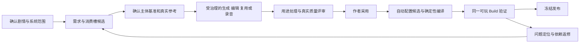

# AVG 游戏系统与媒资生产、自动配置研究

> 版本：1.0.0 · 日期：2026-10-13 · L4 研究与本地化设计提案。
> 产品/生命周期：AVG/Galgame 产品能力研发；正式作品制作仍走 S2 定向 → S3 执行。
> 代码核对：`097ba563fd690ad773facb482814121ad03fcfe1`；与上游 `646beba1` 比对，本文涉及的 AVG/生产/媒资/运行源码闭包未变。
> 上位研究：[三条生产流程与研发路线](AVG-PRODUCTION-RESEARCH-20261013.md)、[专业制作方法](AVG-PROFESSIONAL-METHODS-20261013.md)。
> 本轮实际证据：读取商业产品官方说明、操作资料、引擎/供应商文档，视觉查看一张大逆转裁判官方 PS4 操作图；只读核对 AVG 代码。未实际操作这些商业游戏，未聆听音频，未运行真实生图/TTS 或生产本项目作品。

前两轮已研究路线、舞台、声音、阅读和存档，但物品/证据、图标、专属交互及媒资自动配置只作概述。本轮补齐这些设计维度，不能把此前概述称为逐系统验证。

研发方向是：**成熟的阅读、选择、舞台、声音与存档底座，加作品明确选择的专属玩法；媒资从剧情/系统需求开始，通过真实参考和候选生产，按明确用途自动绑定，再在可玩版本中验收。** 物品系统是否启用、是否有数量/消耗、是否能调查或出示，由作品模式决定。纯视觉小说也可以使用道具 CG，无需同时建立背包或案件推理。

AVG Work 拥有生产配置、剧本、参考与候选；冻结发布媒资及运行媒资继续遵守已有 release/runtime owner 约束。WorldRelease 只供冻结语义读取。本文新增模块、字段、工件和步骤均未注册为正式能力；进入 AVG 专项 L2 契约及路线图后才能施工。

## 1 商业作品按具体机制对比

以下选择头部或知名作品作为不同能力的参照，不提出全品类排名。作品知名度和商业口径见主研究 §4.0；本表描述的是官方材料所支持的具体机制，不能把同系列不同版本混用。

| 作品/明确版本 | 本轮一手材料支持的机制 | 本地化设计判断 |
|---|---|---|
| [Fate/stay night REMASTERED](https://typemoon.com/products/f-sn/introduction/) | 官方列出三条人物路线及基于 Realta Nua 的重制/多语言范围 | 内容路线和正式状态联动；此页面不足以确认存档槽数或 Flowchart 操作，相关细节保持未知 |
| [STEINS;GATE 原作英文版](https://steins-gate.com/)及[主创系统访谈](https://dengekionline.com/elem/000/000/212/212275/index-3.html) | 手机交互影响分支；主创讨论邮件回复及信息记录的一致性 | 手机消息作为独立交互模块，正文、回复、时点、已读和后果都需正式数据；普通菜单不能证明实现 phone trigger |
| [Summer Pockets REFLECTION BLUE，Steam 版](https://store.steampowered.com/app/3418570/) | 路线/结局、可跳过小游戏、多语言及触控；日语配音，主角仅部分场景有声 | 声音覆盖与玩法选用分别配置；该版小游戏不能移用于不含小游戏的手机版 |
| [月姬重制版官方资料](https://typemoon.com/products/tsukihime/guidelines/en.html) | Gallery、Ending List、Flowchart 被官方列为具体内容 | 设置防剧透的鉴赏/路线回顾；该来源只证实存在这些模式，不证明跳转、回滚或存档槽规则 |
| [大逆转裁判 编年史，PS4 官方操作图](https://game.capcom.com/manual/daigyakutensaiban1_2/en/ps4/1/) | 调查、话题已访问标记、证据/人物档案、进一步检查/出示、对白历史、存读档；自动播放与故事模式不同 | 物品/证据必须连接正式交互和知识状态；阅读自动推进与自动解题须作为不同模式治理 |
| [逆转裁判5，3DS 官方操作说明](https://www.nintendo.com/hk/3ds/aceattorney_dualdestinies/pdf/Ace_Attorney_5_OPSeet_en_R15.pdf) | 调查时移动/询问/检查/出示；法庭时追问及证据反驳；错误出示影响信赖 | 证据的目标与规则是玩法核心；按明确作品规则提供反馈、失败与恢复，不套用通用好感度 |
| [弹丸论破2：Goodbye Despair，发行方说明](https://www.spike-chunsoft.com/games/danganronpa-2-goodbye-despair/) | 调查线索、证据与论点匹配、反论交锋和时机/反应玩法 | 反驳、计时、难度、失败反馈属于专属模块；当前有限选择不具备这些能力 |
| [十三机兵防卫圈，Switch 官方系统说明](https://13sar.jp/switch/) | Cloud Sync 使用记忆的关键词/信息；多视角、事件重访及逐步解锁档案 | 关键词/知识不等同于实物库存；回顾、解锁与当前角色知识分别建模，战斗不进入 AVG 通用底座 |

大逆转裁判操作图已实际查看，观察及原图 hash 见[索引](evidence/avg-systems-media-20261013/official-manual-observation.json)。网页主要正文为图片，不能因为 HTML 只有标题便声称已读完整机制；本轮通过原图核对。其自动播放推进对白，故事模式还会回答问题；这一差别用于校准本项目模式合同。

未核实的槽数、完整读档边界、输入延迟、游戏内混音、各平台行为继续列为待观察。官方功能说明与操作图不能替代实际操作。

## 2 系统能力范围与当前基线

建议冻结三个可组合的制作范围：阅读与演出底座、人物路线模块、调查/物品/消息等专属模块。作品 Brief 决定启用项和版本，Build 声明确实具备的能力；生成模型不能自行添加任意代码或未支持的玩法。

| 系统 | 目标设计内容 | 当前 AVG 代码事实/缺口 |
|---|---|---|
| 对话与阅读 | 句/说话人身份、显示姓名、文本框模式、逐字/整句、输入优先级、文本/语音/演出推进 | [播放器](../../src/components/text-game/AvgGamePlayer.tsx)已有逐字、姓名、手动/自动及已读快进；自动推进未等语音结束，匿名显示、排版模式等需专项合同 |
| 历史与回听 | 实际阅读顺序、重访记录、句版本及语音回听；回看不写当前状态 | 当前历史按全稿 beats 筛已读 key，未形成完整的事件次序/重复访问与语音回听投影 |
| 选择、路线与关系 | 类型化变量、条件/效果、即时及延迟反馈、路线解锁和汇流；知识与关系分开 | [条件/效果](../../src/lib/types/narrative-blueprint.ts)及正式 choice command 有底座；布尔变量不等于专门关系/证据/库存系统 |
| 物品与证据 | 定义、获得/持有、状态、查看/使用/出示、反馈、合法数量或唯一实例 | [AVG adapter](../../src/lib/product-production/product-adapters.ts)只声明 narrative/presentation；未提供 AVG 库存、证据栏和专属交互模块。其他产品的库存不直接接管 AVG |
| 地点与调查热点 | 地点入口、热点区域/键盘顺序、可见/可用条件、已检查状态和后续信息 | 显示背景已支持；背景 PNG 不等于可检查区域和调查运行规则 |
| 话题、消息与知识 | 话题/关键词/消息身份、已知条件、回复、已读、时间及触发后果 | 有限叙事状态可作为基础，尚无商业作品式 phone/话题交互的专属合同和 UI |
| 舞台与导演 | 角色外观、站位/朝向、层、景别、转场、焦点、事件依赖及打断 | [Cue 与舞台类型](../../src/lib/types/avg.ts)支持整图/全舞台 camera；完整角色布局、复杂事件协调待补 |
| 配音与声音 | 逐句/角色音色、多通道、进入退出、循环、混音、回听与失效 | voice 可导入和播放；[StageAudio](../../src/components/avg/StageAudio.tsx)没有向推进器报告结束，通用生产请求不接受 voice |
| 存读档与恢复 | 自动、快速、手动槽、缩略图/进度、版本 pin、舞台/声音/库存恢复 | [store](../../src/stores/avg-game-player.ts)已有开始/选择后的自动检查点、手动检查点及分支恢复；需完善面向玩家的槽/快速存读和恢复合同 |
| 作品收藏与回顾 | 已读、结局/CG/音乐解锁、路线回顾、防剧透、跨周目进度 | 当前 readBeatKeys 属于运行 presentation；完整作品级收藏/解锁策略及 UI 尚待设计 |
| 标题、菜单与设置 | 继续/新游戏/章节、文本速度/字体、分通道/角色音量、控制与设置持久化 | 有库、菜单、总音量及部分偏好；播放器 Preferences 在组件 state，缺完整设置持久化和细分声道合同 |
| 信息档案与目标 | 可读词条、案件进度、提示层次、已知事实与未公开事实分开 | 来源读取及变量存在；不能直接把完整源世界内容显示为玩家词典 |
| 模式、帮助与难度 | 自动阅读、故事/辅助模式分别授权；专属玩法的失败、重试、提示与可达性 | 自动阅读已有；自动解题、计时玩法和独立难度并未因它而成立 |
| 本地化与可访问性 | 文本/声音语言独立、长句/字体、触屏/键盘、降低动态、非颜色唯一信息 | 有键盘推进、部分触控适配、静音/纯文字/减少动态；完整字体、语言与可访问性矩阵未验收 |

这是代码基线核对与目标矩阵，不是新模块已经实现。没有必要为每个作品启用所有系统，尤其计时裁判、3D 物品旋转、复杂小游戏和角色动画须有明确作品需求。

## 3 对话系统需要独立的运行合同

建议将一句话的稳定身份与文本版本分开：`lineKey` 不随轻微修订变更，但 `textRevision/hash` 必须更新。说话人的内部身份、当前显示名和允许公开的信息分别表达，避免人物尚未揭名时由姓名框剧透。

当前一拍一句时，既有 `beatKey` 可以承担该稳定身份；`lineKey` 是本文逻辑称呼，是否需要逐句拆分由 AVG-00 裁决，不复制第二套剧情标识体系。

| 项目 | 必须冻结的行为 | 正反例 |
|---|---|---|
| 显示与输入 | 旁白/对白的布局、文字安全区、全屏/框式模式的支持范围；首次点击显全文、后续推进等输入规则 | 长句不遮关键证据；打开存档或选择菜单时，空格/点击不得穿透推进 |
| 推进 | 文字完成、必要演出完成、实际语音结束或声明超时；手动打断、自动、快进分别处理 | 长语音不被固定 650ms 截断；语音失败有明确处理；选择时自动阅读停下 |
| 历史 | 以实际消费事件建立次序、访问实例、文本/声音版本；回听不触发剧情效果 | 返回旧地点时出现第二次对话记录；只把全稿已读句排列出来不足以表达真实阅读次序 |
| 配音绑定 | `lineKey + speaker + locale + textHash + performanceRevision` 对应准确 clip | 两句相同文字但演法不同可用不同片段；改文本不得沿用未复核的旧配音 |
| 纯文字及辅助模式 | 声音/画面关闭后，同一正式剧情和选择仍成立；必要视觉线索有可读替代 | 无声不丢信息；辅助解题须消费作者确认的解题规则，不能让 runtime AI 猜答案 |

参照 [Naninovel 1.21 Voicing](https://naninovel.com/guide/voicing)的稳定文本标识、录音文档及语音映射：自动播放已有音频的机制与音频生产分别设计。本项目的文本变更失效策略仍须独立实现和验证。

## 4 物品、证据与知识分别定义

建议首先支持三类用途：普通道具、调查证据、关键词/消息。它们可共享列表或详情组件，但正式状态及命令语义不同。以下是逻辑合同草案，不是新建一张全产品万能物品表。

| 合同 | 需要表达的内容 |
|---|---|
| 定义 | 稳定 item/evidence/topic key，名称与公开描述版本，类别，唯一/数量规则，可能状态，图标/详情消费槽；未公开描述不能因拿到图而自动公开 |
| 持有/发现 | 所属会话、持有人/容器、数量或实例、获得来源事件；物理持有与知道事实分开 |
| 状态 | 密封/打开/损坏等作品允许枚举，合法转换及前置条件；事实不能由图片生成结果反向决定 |
| 行动 | 查看/使用/交给/出示/询问的合法目标，是否消耗、效果、即时文本与后续消费；每次由确定性命令执行 |
| 媒资 | 列表 icon、详情图、检查区域/层、剧情特写可以来自同一物件基准，但各有用途、尺寸和版本 |
| 恢复 | 获得/使用/出示事件可重放；读档恢复数量、状态和知识，不重复获得或消费；旧 release 继续引用旧定义与媒资 |

以本研究原创雨夜档案场景为例：发现密封信、查看邮戳、登记或私下保留是不同动作。邮戳知识可以增加，但寄信人/信内文仍未知；出示密封信通常不必销毁证据，是否消耗由合同决定。重复查看不重复获得物品；错误目标要反馈，且不凭空改成“正确证据”。

图标只表示物件，不承担全部证据内容。关键日期等文字由正式 UI 排版，或使用经过核对的详情资产；生图的字迹不能成为未校验的案件真相。需要进一步检查时，明确有限区域/转动/展开能力；第一阶段可采用静态详情及标定热点，不先承诺 3D 模型。

人物关系数值、消息已读、题目结论也不能混入物品数量。作品不选调查模块时，同一信封仅作为剧情道具/CG 使用，不出现隐含库存命令。

## 5 存档需要覆盖哪些状态

[Ren'Py 8.5.4 存读档说明](https://www.renpy.org/doc/html/save_load_rollback.html)区分内部舞台/音乐与作品状态，并明确不同版本存档兼容没有保证；[Persistent Data](https://www.renpy.org/doc/html/persistent.html)单独处理收藏等跨次游玩信息。TYPE-MOON 的[旧 PC 支持资料](https://www.typemoon.com/support/help.html)也区分存档及配置/已读/鉴赏信息；该历史文件格式不移用于当前重制版。

| 保存范围 | StoryForge 的目标及复用边界 |
|---|---|
| 正式来源 | pin Build/Release、叙事/规则/媒资 hash；正式运行绑定不可变 release，Build 只供受治理预览 |
| 会话剧情 | 位置/句/选择、变量、路线、人物知识、启用的库存/消息/话题状态；未知模块或版本不能静默丢弃 |
| 事件和检查点 | 复用事件序列、state hash、checkpoint 验证和分支；不要另存一套不同结果的变量快照 |
| 舞台与声音 | 背景、角色/表情、构图、CG、持续声音及恢复策略；一次性音效或已结束语音不得无条件重放 |
| 作品进度 | 已读、结局/CG/音乐解锁与防剧透策略另有作用域；新游戏/回档是否保留由产品合同明确 |
| 玩家偏好 | 文字/声音语言、字体/速度、声道/角色音量、输入和减少动态；它们不充当剧情变量 |
| 槽位表现 | 手动/自动/快速槽、名称/时间/章节/缩略图、保护/覆盖及导出恢复；槽引用合法 checkpoint，不复制另一套 runtime |

当前已实现 `ensureAutomaticCheckpoint`、`saveCheckpoint`、`verifyProductRuntimeCheckpoint` 和从检查点 fork 会话。优化应在这个底座上提供玩家可理解的存读档，不将新增命名/缩略图/快捷操作误报为重新实现存档引擎。

保存粒度必须声明为句起点、完成拍或其它合法检查点；若不支持恢复半句文字/动画/配音进度，应回到明确安全点。持续音乐是从偏移恢复还是重新起播也需明确，不能将浏览器 audio/DOM 的暂态直接当作已可序列化的存档。

必要场景：选择前后、获得/使用物品前后、检查证据前后、语音或转场中保存、关闭重开、快速多次点击、损坏/缺失数据、旧版本与换素材。必须同时检查剧情、知识/库存和表现；显示恢复了场景图不代表恢复正确。跨版本迁移需要显式版本映射和证据，不能只替换图片名或套用新脚本。

## 6 媒资需求从用途开始，而不是从图片数量开始

商业成品提供质量与用途参照；公开资料不足以证明它们采用 AI 生图或自动生产全部媒资。本项目自动化路径另参考引擎资源/语音映射、实际供应商接口和当前代码。

需求由定稿场景、系统模块及导演方案共同产生：稳定主体、使用时点、画面/声音目的、允许信息、消费位置、复用范围、必要程度及预算。角色参考图和物件/地点基准先确认，再细化连续家族；参考-only 资产不必进入 runtime。

| 媒资家族 | 制作需求与参考 | 生成/制作及审查 | 自动配置的目标消费者 |
|---|---|---|---|
| 角色基准/设定参考 | 身份、衣服、比例、色板、允许变化、朝向及场景需求 | 原创设计/授权参考，作者先确认；不照搬商业游戏人物 | 产品参考目录，后续真实图像请求；默认不作为每拍展示资产 |
| 立绘姿态/表情/服装变体 | 同一人物基准与动作目的，统一画布、裁切、透明边、锚点 | 实际参考/编辑、必要抠图及边缘检查，整组并排及背景合成评审 | `actor + appearance/pose + costume` 槽；导演决定位置/切换/隐藏 |
| 对话头像/人物档案图 | 人物身份基准、头像裁切、公开姓名及状态 | 按实际显示大小比较辨识度；与立绘/CG 一致 | 对话/档案 UI；头像与舞台立绘的消费者不同 |
| 物品图标 | 物件稳定定义/状态、材质/轮廓/色板、列表尺寸和透明/背景政策 | 在真实小尺寸列表检查辨识度、边缘及选中/禁用状态 | item/evidence 列表槽；不编译成全屏 overlay |
| 物品详情/证据检查图 | 同一物件基准，允许显示的细节/热点/状态 | 可读细节、封口/日期/痕迹及已知边界核对；文字由正式排版保证 | evidence/detail/inspect 槽；静态、分层、3D 能力分别声明 |
| 场景背景及时间/天气变体 | 地点空间基准、相机视角、前后景、人物站位区、光照与文字安全区 | 使用同地点参考进行编辑/制作，角色放回场景检查透视和比例 | `location + time/weather/view` 槽，跨场景复用 |
| 关键 CG/道具特写 | 准确剧情拍、人物/物件参考、动作关系及重点 | 多主体一致、手部/视线/空间与秘密可见性评审 | 指定 scene/beat 的 CG 槽，退出/回到舞台策略明确 |
| UI/标题/菜单资源 | 主题、字体/安全区、组件状态/缩放、必要切片规则 | 清晰交互文字由 UI 渲染；装饰图、控件皮肤、封面区分用途 | 具体菜单/控件/标题槽；宣传图另有消费者 |
| 图鉴、地图/案件关系图 | 正式条目/节点/解锁条件、图标和可见信息 | 数据文字/连接优先确定性排版，插图按条目采用 | archive/map/caseboard 模块；未启用模块不生成虚假消费槽 |
| BGM/主题与变奏 | 人物/场景用途、密度、进入退出、循环及声音基准 | 生成/委托/授权导入，实际试听及对白混音 | 场景音乐 Cue、允许的鉴赏槽；不能仅按“悲伤”随意匹配 |
| 环境与一次性 SFX | 场所、远近、事件、并发/持续、停止和循环 | 单独及场景内试听，循环/截断/对白遮盖检查 | 持续环境通道或具体事件 SFX；恢复策略不同 |
| 逐句配音 | 定稿对白 ID/hash、角色音色、语言、读音、潜台词/上下句、允许留白 | TTS/录音/委托候选，实际试听、连续对话、长度与修订核对 | 正式 line/locale/performance 槽及推进事件；可回听 |
| 可选分层角色/视频 | 已选表现方案、可动部件/参数、模型/镜头与性能合同 | 分层/建模/动画/编码及全部用途组合验证 | 专用 renderer；现有整图 PNG 和 Cue 不证明已支持 |

角色/背景的命名外观、位置/朝向与 actor record 可参考 [Naninovel Characters](https://naninovel.com/guide/characters)和[Backgrounds](https://naninovel.com/guide/backgrounds)。它们支持资源组织和渲染配置，不承担本产品剧情事实或作品 owner。具体画幅、小图标尺寸和坐标应按所选设备/renderer 冻结；本研究不拿供应商默认分辨率充当美术标准。

物件可以有一个被确认的身份基准，再生产密封/打开等细节版本、列表缩略图及剧情特写；能由确定性裁切/缩放复用时应记录复用，不能把所有用途都重新随机生图。裁切也需验证关键部分未被裁掉；同一张图不能未经复核同时充当所有消费者。

岗位责任亦须补到这些用途：物件美术岗位拥有物件基准及 icon/detail 生产 Brief；UI 美术岗位拥有控件/主题资源 Brief；系统设计拥有交互和合法 consumer，导演拥有舞台/镜头意图，确定性组装器拥有正式映射。可复用专业媒体 Brief 的结构，但各候选仍有唯一 owner，不由这些岗位互相改对方规则或正式数据。具体 Skill ID 与写域在 AVG-00 注册前仍为提案。

## 7 从需求到自动配置的闭环

当前已有 requirements、provider/import 候选、质量/rights、Blob、preview binding、组装和 release 底座。下表区分已有的技术自动化与拟议专业完善。

| 环节 | 目标产物及处理 | 当前状态/要补的内容 |
|---|---|---|
| 1 系统/剧情定向 | 确定启用模块、人物/物件/地点、语言与表现；作者确认范围 | 复用 S2 Brief/SourcePlan；新增系统 profile 需形成 AVG 契约 |
| 2 提取需求 | AI 提议需求清单；确定性校验主体、拍/动作、用途、覆盖与必要/可选 | [requirements parser](../../src/lib/product-production/production-executor.ts)已有 `mediaKind/sceneTag/beatKey/characterAnchorRefs`；缺物品/消费者及完整变体逻辑 |
| 3 参考与家族 | 基准确认、参考 owner/ref/hash、身份/构图/姿态用途及允许变化 | 目前角色锚点主要是文本；产品图片需要独立媒体输入合同 |
| 4 制作任务 | 可见的生成/编辑/复用/导入方式、候选数、预算/尝试上限与能力冻结 | 复用 Harness/任务调度；不因某 API 支持参考便认定当前 adapter 已支持 |
| 5 真实生成/编辑/录音 | 实际参考字节和准确 provider/model/voice 进入请求；receipt/原始失败留存 | [ProductMediaRequestV1](../../src/lib/product-production/media-adapters.ts)没有输入图或逐句 voice 字段；voice 不在通用自动音频路径中 |
| 6 制作后处理 | 必要的透明边、裁切/缩放、音频切分/循环/对齐，保留原始候选与父版本 | 已有技术分析及特定 adapter 的角色抠图分支；不能推定所有 provider/用途都已支持后处理，不能静默重画 |
| 7 质量与采用 | 技术检查 + 家族/场景视觉或声音评审 + 作者采用；返修限定受影响项 | 复用现行注册候选与 adoption；Prompt/hash/尺寸不能替代看图/听音 |
| 8 配置候选 | 主体/变体/消费者到接受 asset 的映射，角色布局/热点/UI/逐句音频及 Cue 参数 | 当前按 kind/beat 自动生成基本 Cue；物品/UI 等需专用 consumer binding 与 renderer 能力 |
| 9 确定性编译 | 校验 Work/Build、版本/hash、用途/类型、覆盖、可见性、允许降级及引用 | [AVG validator](../../src/lib/avg/runtime.ts)、[adoption](../../src/lib/product-production/adoption.ts)已有资源/Build 完整性检查；扩展不能绕过这些门 |
| 10 同一 Build 体验 | 戏剧意图、文字区/构图、声音/选择、物品行动、性能和存读档一起验证 | 需取得真实产物与连续体验；自动通关不是艺术或人物表现验收 |
| 11 修订与冻结 | 最小依赖失效、局部补产、作者复核、新 Build/release；旧发布保留 | 复用版本和来源底座；新增消费者、句版本/变体及模块依赖须纳入失效规则 |

循环是可见的新任务及有界尝试，不能无限自动再生。系统可以整理需求、选合法已采用资源、生成映射/配置候选和报告缺口；范围扩大、基准修改、采用及发布继续遵守现行作者授权。自动配置不代表自动替作者批准候选或发布。

### 7.1 当前自动组装的准确边界

`production-executor.ts` 的组装依据每个资产的 `beatKey/kind`：背景 → `set-background`；角色 → `show-actor`；CG → `show-cg`；UI → `set-overlay`；音频 → `play-audio`。AVG 会拒绝不存在的 Beat。角色初始站位按角色索引循环分配左/右/中；音频默认音量为 .7，BGM/ambience 循环。

这是有用的初始自动配置，尚未表达完整导演、物品栏、证据详情、菜单皮肤或逐句配音合同。不能把 item icon 标成 `ui` 后就期望它进入背包；现有分支会把它变成舞台覆盖层。封面/宣传/参考资产也必须声明消费者，不能因为都是图片便插到对白节拍。

升级建议在需求与 binding 中明确 `subjectRef + variant + consumerDomain/slot + allowedKnowledge + lifecycle`，再按 renderer 能力编译。以上字段是草案；是否扩展已有协议、使用 AVG 自有扩展以及兼容策略，需由专项 L2/基础单元裁决，不先改公共 enum。

## 8 参考图与配音的真实供应路径

图像候选可研究 [BFL FLUX.2 输入图编辑](https://docs.bfl.ai/flux_2/flux2_image_editing)、[Gemini 图像输入/编辑](https://ai.google.dev/gemini-api/docs/image-generation)；技术与许可边界详见专业方法研究 §4.1。它们只是可用技术路线的证据，不是本作品效果排名。参考模型/人物的文字描述、候选 metadata 与真正输入字节分别记录。

| 声音路线 | 本次官方文档支持 | 适配与质量待证 |
|---|---|---|
| 演员/授权录音导入 | [Naninovel Voicing](https://naninovel.com/guide/voicing)以文本标识组织录音资料和 clip 映射 | 演员制作包与素材可先建立人工基准；本项目仍要证明正确绑定、试听、改稿失效和恢复 |
| Azure Speech | [SSML 声音控制](https://learn.microsoft.com/en-us/azure/ai-services/speech-service/speech-synthesis-markup-voice)及[HD 语音说明](https://learn.microsoft.com/en-us/azure/ai-services/speech-service/high-definition-voices)提供不同音色/模型的表演和时间能力 | 按准确音色、语言、地区和模型声明支持项；不把某音色支持的情绪、停顿或 timing 推定为全部音色支持 |
| ElevenLabs Text to Dialogue | [文档](https://elevenlabs.io/docs/overview/capabilities/text-to-dialogue)允许逐 turn 选择 `voice_id` 和指导表达，也明确结果可变化；商业使用需符合相应付费方案和输入权利要求 | 连续表演可列为实验；整段多角色音频需真实句段切分/对齐证据，不能平均分总时长。供应商建议再生不成为无限重试授权 |

语音合同需冻结准确文本、读音表、人物声音、潜台词/上下句、语音/输出格式、片段长度与作用域；保留实际音频及处理 lineage。稳定 line ID 保留映射身份，文本 hash 保证版本正确；情绪指导修订也会使相应演法需要复核。

如果供应商给词/句 timing，需核对与实际音频一致；没有 timing 时只能使用经过验证的对齐或手工切点，不能用字数猜。配音可逐句，也可按小段共演后拆分，但上下文、衔接、成本及局部修改收益须实际比较。此轮未发生成请求、未选择采购服务、未试听，因此不宣称 TTS 已有专业演员效果或最佳型号。

## 9 原创例子的跨系统、媒资与存档联动

沿用专业方法研究中的雨夜档案设定，以下是**调查模式的设计草案**，并非当前生成包。纯阅读模式下这场戏只用对白/CG，不出现这些库存操作。

| 功能消费者 | 拟议需求/配置 | 必须核对的关系 |
|---|---|---|
| 室内舞台 | 同地点雨夜背景；林汐/沈祈相应姿态表情 | 基准服装/比例、桌面空间和文字安全区一致 |
| 密封信的物品栏 | `item.letter.icon.sealed` → 被采用的小图标 | 绑定 `item:letter` 的密封状态；看见图标不意味着已读信内文 |
| 证据详情 | `item.letter.detail.postmark` → 详情图 + 正式日期文字/热点 | 正式 examine 才记录发现；封口保持完整，不凭生图创建寄信人身份 |
| 剧情特写 | `scene.c01.letter-hand.cg` → C01 指定拍 | 与详情/图标为同一封信；不是将图标放大替代手部关系 CG |
| 逐句语音 | C01 的 line/speaker/textHash/演法 → clip | 说话人/版本准确；自动推进等必要声音，回听不执行 examine |
| 选择/后果 | 登记或暂存 → 正式状态和即时反馈、后场消费 | 配图/导演不能改状态；变化在后场可见，而非只改选择按钮文字 |
| 选择前存档 | 合法 checkpoint → 同一 release 的会话分支 | 回到未检查状态时仍未获相关知识；已发生的物品行动不重复执行 |

该例还需写完整合法行动/分支、生产真实资产和试玩，才有采用率、效果及成本证据。图标、立绘与背景各自通过也不能证明物品/选择/声音联合体验通过。

## 10 研发单元、验收任务和未完成项

| 顺序/建议单元 | 可评审交付与验证目标 |
|---|---|
| AVG-00 的系统/媒资补充 | 冻结通用与可选模块、对话/存档作用域、物品/知识语义、完整媒资需求/消费者合同及能力缺口；进入唯一 AVG 专项 L2 施工入口 |
| 共享基础兼容单元 | 真实参考输入、voice capability、consumer binding/输入 hash 与失效的必要公共升级；串行集成，保留其他产品调用方兼容 |
| 阅读/导演/存档单元 | 实际次序历史与回听、语音/文字协调、明确舞台编排、玩家存档/设置；复用当前事件与检查点，取得关闭/重开与旧 release 证据 |
| 物品/调查的独立可选单元 | 先使获得 → 列表 → 查看 → 出示/使用 → 反馈 → 存档恢复成立，再研究专属裁判、3D 和复杂玩法 |
| 媒资全程单元 | 主体基准、连续立绘、同物件图标/详情、同地点变体、关键 CG、声音与局部配音；真实参考/调用/采用/绑定/返修成本可追溯 |
| 联合质量与通用性单元 | 一部不启用调查的视觉小说和一部启用最小物品/证据模块的作品，验证配置复用及不混 owner；题材和例子不硬编码进模型/引擎 |

新增 AI 输出仍是登记 CreativeArtifact 候选，经作者确认及 adoption；来源进入 `CONTEXT_SOURCES`，正式可写域进入 `FIELD_REGISTRY`/AdoptionSchema，新增表/作用域/引用/Blob 生命周期进入 `PROJECT_TABLES`。以上只指出施工义务，本轮没有注册新表、模块、Skill 或供应商。

验证任务至少包括：真实阅读/回听与选择阻断；有物品/无物品模式；重复行动、错误目标、数量/状态边界；密封图不泄密、缺 consumer 阻断、跨 Work/版本素材拒绝；文本改稿使配音 stale、表情修订不重画全部背景；存读档与收藏/偏好作用域；参考真正传输、连续家族看图、声音实际试听。详细方法及同预算对照沿用主研究 §11.4。

本轮完成的是机制资料核对、基线、系统/媒体合同草案、自动配置缺口及验证任务。以下仍未完成：商业游戏实际系统操作；九场完整动态/声音拆解；真实图片/配音生产；整条自动配置的可玩产物；专业创作者/玩家验收及商业成本。方向可以据此安排研发，效果和可行性不能据此标为完成。

文档交付检查只覆盖登记、链接、表格、手册证据索引/hash及 Git 差异。未运行产品 CI/E2E，未改作者浏览器或生产数据。
