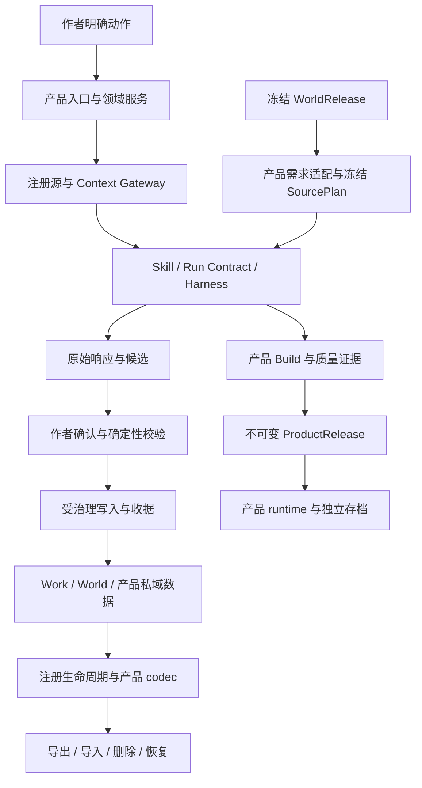

# StoryForge 架构审查

> 版本：1.1.0 · 基线：`c5b51da301abd3875b26732d9657ad485ad39105`
> 状态：固定 A 的 Q2 架构审查结论，2026-10-30；发现问题，未整改，G1 未放行。
> 覆盖、问题编号和命令终态统一见[审查记录](./PROJECT-QUALITY-AUDIT-20261029.md)，方法见[计划](./PROJECT-QUALITY-AUDIT-PLAN-20261029.md)。本文不修改 L0/L1 契约。

## 1. 当前判断

**产品拆分、owner、注册表、冻结来源与 durable 执行的总体方向合理；实现的一致性和恢复成本仍有实质问题。现有证据不能支持“架构已通过、可以作为稳定开发底座”的结论。**

项目已有世界/作品隔离、正式 AI 入口、版本化来源、确定性校验、候选确认、存档和恢复基础设施。主要问题是同一条约束在不同入口、产品、热态与恢复态没有始终由相同机制保证。

该判断基于固定 A 的逐段源码、现行文档、调用/下游及隔离反例；30 个产品/共享范围均有结论。当前大型历史评测录制按明示字段、消费者合同与完整性审查，未冒称全文叙事已读；真实 provider、人工体验、规模与设备证据仍待验证。源码审查完成不等于产品通过。

## 2. 契约与实际实现

下图表达现行约束和已追踪的核心关系，不表示图中所有路径均已验证通过。

| 维度 | 已守住的机制 | 已确认偏差 / 设计成本 |
|---|---|---|
| 产品与 owner | Work/World 与产品私域类型明确；当前聊天多条写入有同事务授权/证据 | 旧导入按当前活动 Work 重解写入范围；状态卡合并使用另一 Work 缓存；公共上下文选中 session 未绑定调用方 Work（022/041/062） |
| 三注册表 | 表与 Dexie 双向清点、正式 AI 入口和字段登记、注册源装配确已存在 | 登记不等于消费闭包完整：非 `id` 主键、更新 FK、嵌套/数组/多态引用和实际删除入口存在缺口（014/035/037/048） |
| 世界与来源 | 冻结版本、需求适配、SourcePlan 和实际读取权限有确定性保护 | 世界包用途/署名证据丢失、增强聊天漏传 SourcePlan；开放世界小说 SourcePin 与上位约束需裁决（005/021/058） |
| 正式 AI 与恢复 | 主正文已有原始响应持久化；插件 AI、当前聊天的部分采纳流程采用原子事务 | 多个产品重复维护状态机；部分原响应未留存，Canon 与运行回执分开提交；主 Agent 恢复还可能绕过 stale（002/036/064） |
| 执行授权 | 部分文本路径传冻结配置，现行 reader 正确拒绝越域媒资 | 部分生产调用先发送后核对配置；节点跨 provider 拼接临时 Key；stale 后的实际策略与冻结合同不一致（050/053/067） |
| 并发与保存 | PendingEditCoordinator 串行同记录写入并等待保存；正文编辑器回读核对；大纲删除在事务内枚举当前树 | 部分服务仍在事务外预取删除键/版本，或由旧 UI 快照全量替换持久数据；小镇脏表单借最新 revision 绕过原编辑基线，并发确认会产生两条当前单值事实（013/024/049/056/059/112/124） |
| 磁盘与正式副本 | 工作区差异检查、history/trash 和公开确认同步确已存在 | size/mtime 缓存误作内容未变证明；异步归档后缺最终正文 CAS，新稿可被删除（092/093） |
| 作者选择与权威 | 当前正式 reader/采纳有真实 owner、来源 hash 与事务保护 | 模型副本被当作原稿、Boolean 弹窗被当作已备份声明；关闭资料/来源主角在下游又丢失选择（087/096/099/100） |
| 分层与演进 | 共享 provider、来源和存储设施被复用，未因审查建议重建第二套体系 | 4 模块服务运行时环；执行器/编辑器承担大量跨域职责；历史版本能力判断多处复制（010/011） |
| 工程交付 | 存在多种静态门、回归、客户端来源校验和完整性检查 | 主干仓库端未强制保护；正式 Mac 包确认含受影响运行时；部署缺独立 SSH 主机身份，静态门还有等价语法漏检（006/033/133/134） |

## 3. 最应先处理的结构问题

### 3.1 用稳定 owner 执行，不能靠活动指针补权限

Project 的活动 Work 指针适合导航。已经开始的生成、确认、导入或恢复必须使用创建时冻结的 scope；后续再读活动指针会改变任务所属作品。UI 缓存也必须按完整 owner/scope 投影，不能成为受治理写入的事实来源。已完成的组件反例包含切 Work 展示旧状态卡、切空地理组后新增把旧组地点写入新组、可见无效编辑却采纳旧模型候选、小镇 dirty 表单借新 revision 覆盖别人的新稿，以及状态卡 live 更新冲掉未保存输入。

最小方向是收敛现有 scope、instance 绑定和 CAS，不新建第二套 workspace。验收需覆盖同项目多 Work、请求中切换、缓存属于另一 Work、来源晚到、删除后写回及跨项目正反例。

### 3.2 生命周期需要覆盖载荷语义

`PROJECT_TABLES` 提供统一入口，但本地引用不全是表顶层的简单外键。已复现的合法备份往返涉及数组、JSON 嵌套、文风 locator、叙事来源和运行媒资 slot。

应由登记的领域 codec/版本适配器说明引用如何导出、重映射、删除或降级。禁止递归改写所有名为 `id` 的数字；不可变原文、hash、版本和来源证据不能被当作本地 locator 重写。真实 reader/重放结果必须进入往返验收。

### 3.3 恢复必须维护同一份作者授权

恢复要区分“补签已经完成的写入”与“执行尚未发生的写入”。前者可以核验精确 post-state 后幂等补收据；后者必须重新检查冻结意图、来源 freshness、owner 和预算。不能因为函数名是 repair，就放宽 stale。

当前插件 AI 的原子采纳是可借鉴的已读正例。共享层适合提供确认/写入/证据的一致规则，各产品继续拥有自己的 payload、来源与业务校验，不建立万能业务服务。

036 的恢复不能只修写库后收据：H56 作者零模型修正的终验中断需要幂等补签；H77/H79 写前 intent 还需要被实际 pending/schedule 和界面找回。同一 runId 的直接 adopt 正例已能恢复，不能一概改成自动重做。064 的 H72 扩展是先写旧伏笔后 paused，应与主 Agent 成功终态分别验证。

### 3.4 减少规则重复，保留产品差异和历史版本

热态/恢复态 parser 分叉、目录与实际采纳能力分叉，以及大量重复版本布尔列表，增加了一处修正、另一处失效的机会。应让现有 action/能力登记、来源适配与版本能力表真正被调用方消费。

拆文件和抽函数应在行为保护后进行。不能为了缩短代码删除仍被历史 Release、存档或候选使用的兼容分支，也不能把产品专属协议统一成固定 payload。

### 3.5 权威证据必须来自实际输入与明确选择

模型返回的“原稿”“已验摘要”和“来源角色”是待核数据，不能自行成为系统基线。系统应冻结真实原文、身份、版本和作者选择，由确定性逻辑校验候选；作者只选一个 diff，不能让模型提供的漏句副本决定整段新稿。

正文状态卡也需要同一来源语义：旧词匹配预览不反映正式必读档案，追加/取消只改变投影（136）。应从实际冻结 manifest 展示包含原因，保持本章与章后整理控件的独立用途。

同样，关闭弹窗不能等同声明已备份，切服务预设不能等同授权重用另一服务 Key。需要保留明确状态与身份的逻辑契约，让实际消费者使用它；仅增加提示词或界面说明不能修复这些接缝。

### 3.6 单值、锁和协议约束必须覆盖并发与失败路径

顺序测试正确并不证明并发正确。事实确认与宪法替换在事务外预取当前条目，并发后可留下两个彼此排斥的当前值，真实注册上下文又同时提升为 Canon（124）。在线服务在串行锁内、最外层 finally 外做备份，单次备份异常就能让当前实例后续操作持续等待（110）。这些约束应在实际原子边界完成，而不是靠调用顺序或提示词。

离线评测的续批也是状态机。当前 judge 只检查父目录与本次输出，没有唯一后继认领，两个子批会重复分派同一输入，甚至重发先前子批已失败的输入（137）。应复用受约束的原子认领与回执身份，保留失败/未知分母及合法未尝试余项。

产品与通道也要共用可消费的协议：内容准入接受执行器拒绝的骰式、社区 UI 拼接协议不接受的 requestId、退款后权益读取旧记录，都说明生产成功或保存成功尚未闭合到下游实际可用（109/117/123）。

同样的身份原则适用于外部备份和发布证据：快照文件名仅用可变名称，会让不同 workspace 静默覆盖（127）；整世界 hash 不能替代逐资源 hash，即使当前内置展示能开局，受保护的公共来源消费者仍会拒绝（132）。应复用稳定身份和真实冻结来源，通过新版本修复，不能重写旧 Release。

### 3.7 从实际执行对象取得工程身份

依赖身份不能只看生产依赖清单或预期常量。Electron 在 devDependencies 中仍被打入正式 Mac 运行时（006）；SAM 前景服务核对的 checkout 与 Python 实际导入目录未绑定，却仍返回冻结 codeRevision（135）。前者需要核发行物，后者需要在导入前验证真实执行来源；二者均不能靠界面显示一个版本号闭合。

异步界面也需要区分发送快照与当前编辑缓冲。文档反馈在旧请求成功后清空新写草稿的反例（138）与正式作品无关，但再次说明“请求成功”不能授权清除所有当前内容；该边界按其实际影响单独整改。

静态架构检查器应说明自身检测边界。当前 DB/AI 守卫存在语义等价写法漏检（134）；源码含有某个函数名和注释，只能作为有限结构约束，不能替代运行时 owner、权限、事务和故障反例。文档部署同样需要独立可信的主机身份（133），发布后可用性与传输端点认证分别验证。

事实文档也需要独立完整性约束：AI 手册生成器遗漏两个常量预算来源却自行检查通过（141），当前架构说明正文又与正确生成指标冲突（012）。优先让文档消费明确的完整来源集合并显式报告无法解析的项，不能把“自动生成”当作完整或永远正确的证明。

### 3.8 可观测性和工程验证也必须落到实际消费者

交叉复核补出HTTP已观察用量中断丢失（142）、后台快照失败只console（143）和测试/关键工具静态验证范围不足（144）；备份正文形状缺口并入129。它们不改变总体owner/注册表方向，说明协议、诊断和质量门仍需覆盖失败时刻与实际对象。

请求期限应按正式入口冻结总run/单跳/流idle及取消语义；本轮不接受刷新必然重付费推断，也不以全局120秒代替合同。未来库阻断启动仍应fail-closed，另行设计兼容版本指引/只读恢复，不把可用性缺口说成数据库已被删除。

允许optional媒体省略或human-review-required是受约束降级，不能看passedGateIds字段就推整产品发布通过；现有商业档拒绝和真实人工回执门保留。最后降级异常的诊断引用可改进，独立于是否伪造人工验收。平台后置、i18n预留和测试专用纯函数也须按明确边界判断，不为迎合旧报告合并不同策略或删除历史消费者。

## 4. 后续整改批次

| 批次 | 先处理的共同机制 | 核心验收 |
|---|---|---|
| A1 数据归属与生命周期 | owner/主键/可空性/引用、真实删除、合法往返；同步保护晚到 writer | 原文和其它 owner 逐字不变；新库/同库恢复真实 reader 成功；损坏零写入 |
| A2 正式 AI 执行与恢复 | 原始响应、冻结配置、失败策略、原子采纳/收据、stale 恢复 | 逐个边界中断；已有输出不靠模型重做；作者新改动受保护；实际用量不丢 |
| A3 产品真实入口 | 节点/批量细纲确认、增强来源读取、媒资审查与交付 | 实际 UI/服务/刷新和下游消费一致，保留合法预览与历史只读 |
| A4 结构清理 | 纯函数重复、单个依赖环、巨型组件、压行、版本能力重复 | 小步可解释改动；已证明的业务正反例和旧版本消费保持 |
| A5 交付规则 | 运行时供应链、主干保护、文档与验证证据 | 维护者可审阅配置；候选安装包/同 SHA 检查和支持矩阵明确 |

批次编号是组织方式，不是把运行时安全 P1 排在结构清理之后。数据/授权/恢复与必要供应链修复优先，独立范围可以并行；共享热点仍串行验证和集成。尚未执行产品修复或远端设置变更。G1 仍须按具体范围满足计划中的条件；本报告不提供全项目笼统放行。
