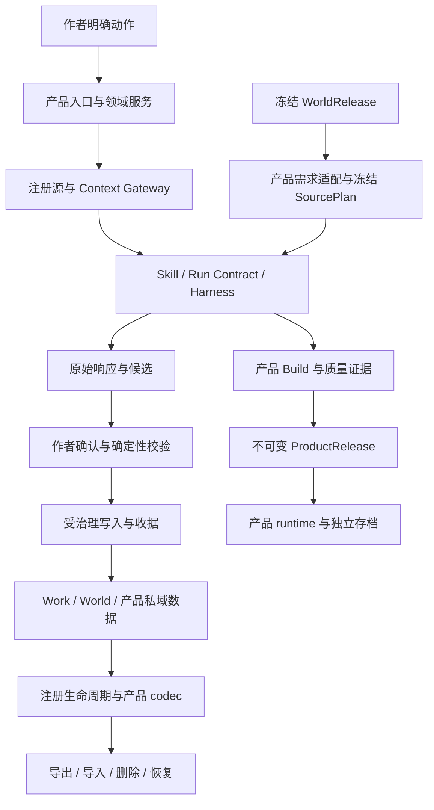

# StoryForge 架构审查

> 版本：0.1.0 · 基线：`c5b51da301abd3875b26732d9657ad485ad39105`
> 状态：Q2 阶段报告，2026-10-30；全项目审查尚未完成，G1 未放行。
> 覆盖、问题编号和命令终态统一见[审查记录](./PROJECT-QUALITY-AUDIT-20261029.md)，方法见[计划](./PROJECT-QUALITY-AUDIT-PLAN-20261029.md)。本文不修改 L0/L1 契约。

## 1. 当前判断

**产品拆分、owner、注册表、冻结来源与 durable 执行的总体方向合理；实现的一致性和恢复成本仍有实质问题。现有证据不能支持“架构已通过、可以作为稳定开发底座”的结论。**

这不是缺少架构概念。已有世界/作品隔离、正式 AI 入口、版本化来源、确定性校验、候选确认、存档和恢复基础设施。主要问题是同一条约束在不同入口、产品、热态与恢复态没有始终由相同机制保证。

该判断基于已读核心闭包；跑团、开放世界、AVG、其余 AI/公共 UI 等未完成范围仍须继续，不能把一个产品的反例扩大到全部产品。

## 2. 契约与实际实现

下图表达现行约束和已追踪的核心关系，不表示图中所有路径均已验证通过。

| 维度 | 已守住的机制 | 已确认偏差 / 设计成本 |
|---|---|---|
| 产品与 owner | Work/World 与产品私域类型明确；当前聊天多条写入有同事务授权/证据 | 旧导入按当前活动 Work 重解写入范围；状态卡合并使用另一 Work 缓存；公共上下文选中 session 未绑定调用方 Work（022/041/062） |
| 三注册表 | 表与 Dexie 双向清点、正式 AI 入口和字段登记、注册源装配确已存在 | 登记不等于消费闭包完整：非 `id` 主键、更新 FK、嵌套/数组/多态引用和实际删除入口存在缺口（014/035/037/048） |
| 世界与来源 | 冻结版本、需求适配、SourcePlan 和实际读取权限有确定性保护 | 世界包用途/署名证据丢失、增强聊天漏传 SourcePlan；开放世界小说 SourcePin 与上位约束需裁决（005/021/058） |
| 正式 AI 与恢复 | 主正文已有原始响应持久化；插件 AI、当前聊天的部分采纳流程采用原子事务 | 多个产品重复维护状态机；部分原响应未留存，Canon 与运行回执分开提交；主 Agent 恢复还可能绕过 stale（002/036/064） |
| 执行授权 | 部分文本路径传冻结配置，现行 reader 正确拒绝越域媒资 | 部分生产调用先发送后核对配置；节点跨 provider 拼接临时 Key；stale 后的实际策略与冻结合同不一致（050/053/067） |
| 并发与保存 | PendingEditCoordinator 串行同记录写入并等待保存；正文编辑器回读核对；大纲删除在事务内枚举当前树 | 部分服务仍在事务外预取删除键/版本，或由旧 UI 快照全量替换持久数据（013/024/049/056/059） |
| 分层与演进 | 共享 provider、来源和存储设施被复用，未因审查建议重建第二套体系 | 4 模块服务运行时环；执行器/编辑器承担大量跨域职责；历史版本能力判断多处复制（010/011） |
| 工程交付 | 存在多种静态门、回归、客户端来源校验和完整性检查 | 主干仓库端未强制保护；依赖审计口径漏掉实际装入客户端的运行时（006/033） |

## 3. 最应先处理的结构问题

### 3.1 用稳定 owner 执行，不能靠活动指针补权限

Project 的活动 Work 指针适合导航。已经开始的生成、确认、导入或恢复必须使用创建时冻结的 scope；后续再读活动指针会改变任务所属作品。UI 缓存也只能服务展示，不能成为受治理写入的事实来源。

最小方向是收敛现有 scope、instance 绑定和 CAS，不新建第二套 workspace。验收需覆盖同项目多 Work、请求中切换、缓存属于另一 Work、来源晚到、删除后写回及跨项目正反例。

### 3.2 生命周期需要覆盖载荷语义

`PROJECT_TABLES` 提供统一入口，但本地引用不全是表顶层的简单外键。已复现的合法备份往返涉及数组、JSON 嵌套、文风 locator、叙事来源和运行媒资 slot。

应由登记的领域 codec/版本适配器说明引用如何导出、重映射、删除或降级。禁止递归改写所有名为 `id` 的数字；不可变原文、hash、版本和来源证据不能被当作本地 locator 重写。真实 reader/重放结果必须进入往返验收。

### 3.3 恢复必须维护同一份作者授权

恢复要区分“补签已经完成的写入”与“执行尚未发生的写入”。前者可以核验精确 post-state 后幂等补收据；后者必须重新检查冻结意图、来源 freshness、owner 和预算。不能因为函数名是 repair，就放宽 stale。

当前插件 AI 的原子采纳是可借鉴的已读正例。共享层适合提供确认/写入/证据的一致规则，各产品继续拥有自己的 payload、来源与业务校验，不建立万能业务服务。

### 3.4 减少规则重复，保留产品差异和历史版本

热态/恢复态 parser 分叉、目录与实际采纳能力分叉，以及大量重复版本布尔列表，增加了一处修正、另一处失效的机会。应让现有 action/能力登记、来源适配与版本能力表真正被调用方消费。

拆文件和抽函数应在行为保护后进行。不能为了缩短代码删除仍被历史 Release、存档或候选使用的兼容分支，也不能把产品专属协议统一成固定 payload。

## 4. 后续整改批次

| 批次 | 先处理的共同机制 | 核心验收 |
|---|---|---|
| A1 数据归属与生命周期 | owner/主键/可空性/引用、真实删除、合法往返；同步保护晚到 writer | 原文和其它 owner 逐字不变；新库/同库恢复真实 reader 成功；损坏零写入 |
| A2 正式 AI 执行与恢复 | 原始响应、冻结配置、失败策略、原子采纳/收据、stale 恢复 | 逐个边界中断；已有输出不靠模型重做；作者新改动受保护；实际用量不丢 |
| A3 产品真实入口 | 节点/批量细纲确认、增强来源读取、媒资审查与交付 | 实际 UI/服务/刷新和下游消费一致，保留合法预览与历史只读 |
| A4 结构清理 | 纯函数重复、单个依赖环、巨型组件、压行、版本能力重复 | 小步可解释改动；已证明的业务正反例和旧版本消费保持 |
| A5 交付规则 | 运行时供应链、主干保护、文档与验证证据 | 维护者可审阅配置；候选安装包/同 SHA 检查和支持矩阵明确 |

这些是整改组织建议，尚未执行产品修复或远端设置变更。G1 仍须按具体范围满足计划中的条件；本报告不提供全项目笼统放行。
