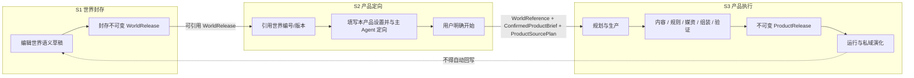

# 世界引擎上层产品跨产品架构契约

> 版本：2.6.0 · 生效：2026-09-28 · 对应总纲：§2.1、§6、§10.1、S1/S2/S3
> 本文只规定跑团、角色互动、AI 小镇、文字冒险、AVG 和文字开放世界共同遵守的架构边界与流转协议，不替代任何一个产品的专项功能设计。

## 1. 契约目的与非范围

上层产品并不是世界引擎里的几个运行按钮，而是引用世界内容后独立生产、发布和运行的产品。本文确保它们在一个共同框架内发展：来源可追溯、阶段不可绕过、所有权不混乱、版本可以演化、未来增加新产品时不复制世界读取和数据生命周期。

本文不决定：

- 跑团怎样车卡、判定、分队或主持；
- 角色聊天怎样调度单人、多角色或小镇居民；
- 文字冒险、AVG、文字开放世界分别怎样设计玩法、分支、结局和界面；
- 一个产品使用几个 Agent、哪些专用表或怎样生成具体媒资；
- 时长、章节、回合、分支或“无限演绎”等产品设置的具体字段。

这些内容必须在对应产品开工时单独研究和设计。总体架构只规定它们放在哪一阶段、由谁拥有、怎样交接和怎样留下版本证据。

### 1.1 产品身份闭集

- 上层产品边界共有：跑团、角色互动、AI 小镇、文字冒险、AVG、文字开放世界。
- 用户可见的文字游戏分类严格只有：文字冒险、AVG、文字开放世界。不得恢复“故事游戏”“独立叙事模拟”或其它历史分类。
- 当前统一生产 Harness 只接受跑团、角色互动、AI 小镇、文字冒险、AVG、文字开放世界六种索引化身份；每种身份都有自己的需求适配器和生产模块。
- AI 小镇拥有自己的 Brief、SourceSelection、生产模块、ProductRelease、runtime 状态与命令；角色回复可复用底层互动事件能力，但必须使用 AI 小镇专属 Skill 和上下文源。
- 叙事模拟是文字开放世界可以调用的内部运行能力，不是产品身份，不拥有独立 Production、ProductRelease、Session 或入口。

### 1.2 产品能力与游戏实例分层

开发某类上层产品与使用该产品生产一个具体游戏/体验是两条生命周期。前者实现作者端、玩家端、数据、编译器、runtime、存档和应用级质量门；后者通过 S1/S2/S3 生产本实例的内容、系统配置、媒资、Build、ProductRelease 和 session。产品基础系统不得由每个游戏实例重新生成，实例配置也不得写回共享产品代码或被误报为产品能力完成。

## 2. 三阶段主链

本文只使用三个规范短名：`S1 世界封存`、`S2 产品定向`、`S3 产品执行`。它们表示所有权、授权和交接边界，不要求三个页面、三张表或一套全产品通用状态机。



三个阶段可以在产品体验中平滑衔接，但不能因共用页面、数据库或 Agent 而合并所有权。

## 3. 阶段职责

### 3.1 S1 世界封存

世界引擎只负责叙事语义内容的编辑、确认、能力描述、封存、比较和版本化读取。它向产品公开可引用的稳定 world code、不可变 WorldRelease ID/hash 和能力画像；用户在 S2 选定准确版本后，产品系统才据此生成并校验 `WorldReference`。

S1 不得创建某个上层产品的设置、production、媒资、build、session、玩家状态或聊天记忆。

### 3.2 S2 产品定向

S2 属于具体上层产品，而不属于世界引擎。用户在该产品入口：

1. 引用并核对世界编号与封存版本；
2. 查看世界能力和与当前产品需求相关的缺口；
3. 填写该产品自己的设置；
4. 与该产品主 Agent 确认目标、限制和方向；
5. 明确下达开始指令。

规模、时长、是否需要结局、参与者或其他体验参数若适用于该产品，应在这里由用户设置；具体字段与单位由产品自己定义。设置保存为产品草稿，不改变来源世界。

角色聊天新建 v3 故事草稿的每次触发行动上限默认两步。玩家新会话按作品冻结上限选择最多两步，陪伴模式默认一步；旧作品的一步上限不扩大。有历史轮次时，页面沿用最近一次实际写入触发事件的行动额度，无 direction 的历史轮次沿用原一步界面默认。新建会话前显示所选角色的开场额度，刷新、选择节奏或切换存档均不触发模型；需要玩家决定、暂停、打断、预算不足及原轮次补齐继续由现有运行合同裁决。连续行动只是允许处理同一次行动的结果并接续，不保证必然推进，也不替代真实质量和用量验收。

用户开始前，系统可以提供只读分析、建议和估算；这些调用也要留下 Context Manifest。不得偷偷启动会产生正式 product production、媒资或 runtime 的工作。开始时冻结 `WorldReference`、`ConfirmedProductBrief`、`ProductSourcePlan` 和用户授权 revision。SourcePlan 锁定世界版本、需求适配器、读取范围、缺失策略与咨询证据，但不假装预先列出生产阶段可能读取的全部资源。

角色聊天实验性 v3 的逐项事实整理归 Chat Work。完整原段先确认为仅作者掌握的事实资料，登记 Agent 生成候选或由作者手工编辑；独立复核同时检查解释、覆盖、初知者及发现条件，作者确认精确候选后才通过 `adopt()` 保存到既有草稿的 `sourceUnitsJson`。旧只读整理/复核 run 不因此取得写权限。新 Brief 携带便携原文证据和确认权限，来源 v6 编译为分别可知的事实；完整原文与限制仅进入协调视角，超出预算必须停止。事实始终保留，包括无人知晓且未允许调查的事实；发现位置不能自动获得经手者或用途。来源、分类或前提过期时拒绝新制作，作者可重新整理或明确移除；已有 Build/Release/Session 不随草稿修改。旧来源 v1—v5 无自动迁移，无新表或世界写入。

事实整理生成 v2 可将原文确立、具有不同核实范围的背景与隐藏内容分别提出候选，例如容器的存在与位置、容器中的物品、人物行为及原因。不得从假设、否定或未来安排中制造实物，不得补出可见性、接触或检查许可；拆分仍保留完整原文和未知限制，不自动设置任何初知或发现权限。独立解释复核、权限复核与作者确认继续沿原路径执行。新旧请求按冻结生成版本处理，不拆分既有发行或存档中的事实，不新增部分知情状态。

事实权限复核 v2 区分未来发现条件是否充分与该条件当前是否成立。原文已明确确立的当事人行为或自身用途，可以由作者设置身份明确、内容具体且与原文一致的亲历说明作为对应事实的发现条件；来源存在欺骗、不可靠、传闻或另需核实的限制时不能套用。一般陈述仍只证明说过，不能据第三人指控、猜测或物品位置确认相邻隐情。此复核不生成在场人物、答复或调查结果；开场和运行仍独立核验创作权限、接触依据、实际行为、听众及完整发现条件。新请求按冻结 Skill 版本选择提示，旧报告及已保存响应按原合同恢复，不因更新而重审、重发或取得新权限。V257 已完成有界真实 Codex 正反例复核与零调用恢复；该证据不代表持续剧情质量或完整产品验收。

角色聊天的作品署名、素材归属与使用说明由作者在实验性 v3 方案中显式填写，属于 Chat Work 的普通作者编辑，不是世界事实或平台核验的许可。字段沿既有 settingsJson、冻结 Brief、Build 与 ProductRelease 保存，旧版本缺省保持“未提供”；模型方案采用不能更改它们。登记的作者/制作上下文剔除发行说明和外部卡片作者元数据，确定性编译器从原授权 Brief 冻结公开说明；安装预览、已安装作品、导出与完整备份保持同一声明。换说明不改写旧发行或存档；兼容升级先显示前后说明并由玩家显式创建副本。无新表、世界回写、AI 自由写字段、身份认证或平台授予许可。 导入 ProductRelease 的版本号必须等于冻结发行谱系中的版本号，不得按本机安装顺序重新编号；同一作品/生产标识/发行版本号出现不同内容时，明确拒绝冲突并保留原记录与存档。

### 3.3 S3 产品执行

角色聊天行动 v71 在原选择步骤增加 `possibilityChecks`：只按本次已交付的自身发展方向逐项说明当前可推进、受阻、已解决或不再有用，不能遗漏或把一个方向的玩家依赖扩大成全部方向的阻碍。该判断是只读草稿，不是事实、许可或必做清单；存在自行判断仍可推进的方向时，不得同时选择空方向或等待，角色有真实理由暂停仍合法。`wait` 明确表示符合原条件的单角色手动 continue 下静默等待玩家决定，表达只能生成 version:1 交还控制候选，不追加收尾台词；提供商输出 Schema 与本地、恢复、采用的原响应校验执行相同限制，不把错误台词自动改成交还控制。独立审查 v42 继续核对等待是否有实际依据及是否遗漏有意义方向，不能以完整表格代替语义通过。沿用 `interactionRuntime`、原角色读取、三调用/原 Token 预算、候选/采用和实例工件生命周期；旧 v70 及此前合同保持原字段、提示和恢复语义，无新表、世界写入、媒资 owner 变化或隐藏重试。工程验证和跨情境真实演绎分别验收。

角色聊天情境生成 v21 仅修正实际问询答复的内容范围：区分过去经过、通常做法与当前状态，不能用当前结果未知来推迟回答过去经历，也不能以已确认一部分掩盖其余无依据回避。普通细节仍受原创作权限、人物亲历/知情与冻结秘密约束；有具体依据的不确定和拒答保持合法，不强迫答全或保证发现。沿用审查 v19、询问证据 v5、原读取与两调用预算、候选/采用/回执及表生命周期，旧 v20 完整请求与原审查字节保持；工程绑定验证不代表真实表达稳定。

角色聊天行动 v70、候选组 v42、后果修订 v25 支持在同一行动登记已实际问出的场景人物问题（`purpose: inquiry-result`）；行动/修订审查配对 v42，候选组审查配对 v30。请求必须绑定提问前已知、可接触的同一非玩家且非可调度角色，以及真实问题原文、人物依据、原目标和事项。情境构建 v20 / 审查 v19 以询问证据 v5、生成读取 v18 / 审查读取 v17 结算这一条问题；同轮已有背景构建或角色用完行动额度后仍可完成该答复，不增加角色行动次数，也不授权新背景、目标、人物、转场或后续动作。答复沿原候选、独立审查、采用和实例事件保存；未通过审查保持待答，玩家打断取消待答并保留原问话，恢复不自动重发。作者选择候选或明确修订后只有实际采用的问题取得结算资格，未选候选不算说过；旧版本请求和存档保持原语义。此能力归角色聊天 S3 产品研发，数据仍由 Chat Work/实例拥有，世界只读、媒资 owner 不变，无新表或旁路写入。工程流程通过与真实剧情质量分别验收。

角色聊天情境构建 v19 / 审查 v18 对 player-request 与 player-followup 补充新背景的可演绎条件：事实应提供角色可知且可实际接触或使用的具体条件，目标与方向应说明这些条件怎样支撑原事项，不以重复种子和询问/检查/等待意向代替背景。允许在原类型及数量权限内补足未写定的普通细节；独立 meaningful-direction 审查须依据实际候选判断，不能为其补写条件或假定后续生成会兜底。直接处理、日常互动、有依据的等待及真实拒绝仍成立，不强求分支数、每轮进展或成功。原 observation-result、inquiryResult 和 discovery 的结果结算不因此获得新增人物、动作或答案的权限。仍使用原 reader v17、询问证据 v4、两调用预算、候选/事件/回执及数据生命周期；旧 v18/v17 请求字节保持。此项工程及真实质量证据分别验收，不升级 M1 成熟度。

角色聊天行动 v68 将行动选择、玩家决定、事实披露、目标/事项、承诺、关系与记忆、局部情境及输出要求整理为分组指令，减少反复解释同一条件；特殊暂停/恢复、转场、新约定、后续目标与三类交还控制的授权规则保持。v67 及更早合同保留原请求字节，新旧版本使用相同的 v4 输出结构（v67 起共享完全相同的定义）、审查 v41、reader v18、三次调用和 56000 输入预算；不删对话/剧情资料、不改字段、状态或独立采用规则。V350 两份保留的失败输入预估分别降至 50385 和 51465，属于原输入预算重建，不能代替真实模型持续演绎、通用成本或长程质量验收。

角色聊天同一轮的后续自动行动须仍有活跃目标或既有授权的待承接事项。当前目标完成后，仅剩旧暂停目标时停止自动接续；玩家明确开始下一轮仍可重新处理暂停事项。该判断与多人自动调度的活跃目标边界一致，不新增或重写完成事件；恢复视图先核对原持久运行，已有失败、取消、结果未知或未采用候选仍须显式处理。不变更模型提示版本、预算、独立审查或数据生命周期。

角色聊天行动 v66 / 审查 v41 新增版本 3 的“维持已有自主暂停”控制候选：仅单角色手动 continue/return 的首次机会，引用当前场景共同可见、与目标暂停事件相符的实际表达，保留原目标、共同事项和责任，静默结束本轮；不新增气泡或剧情进展。活跃目标、玩家暂停、新消息未承接、待改写/情境结果和多人调度由确定性合同拒绝；独立审查另外核对原暂停仍适用、实际义务、可执行新方向、玩家控制和知情边界。空选择草稿不能直接授权，仍沿原三次选择/结果/审查、CreativeArtifact、受治理实例事件和终态回执；新方向可按原恢复合同正常执行，不自动改写或重发失败。S3 产品能力研发的数据由聊天 Work/实例拥有，世界只读、无新表/媒资或跨产品写入；旧 v65/v40 与历史控制版本保持原语义，分支和导入须重映射来源并验证完整证据。V340 的 2129 项相关回归、36 条浏览器路径及类型/治理/构建检查通过；V341 三次真实调用完成该控制并通过独立恢复。静默维持暂停不计剧情推进；当前完整交付门、跨情境质量和后续新情境的累计输入预算问题仍待。

角色聊天行动 v62、双候选 v38、后果修订 v23 使用角色读取 v18 / 检索 v14，保护当前和最近一次实际回应、行动者最近自身回应所在的完整可见轮次，以及明确问答来源。轮次依据真实玩家输入与已有行动的触发记录划分，连续继续不把整场历史变成必读；私聊、排除和已替换消息仍先按原权限过滤。必要依据超预算或明确来源不可用时停止，不能静默删除近期表达或补回不可见资料。选择与表达冻结同一来源，协调审查保留其实际输入，原始消息、候选/采纳、输出规则、三调用预算、世界及媒资 owner 保持；旧读取 v17 和既有存档不自动升级。此项修复 V324 日常情境因漏读上一条提议而重复推进的已复现缺口，工程验证与真实模型复验分别记录，不据此提升 M1 状态。

角色聊天行动 v63、双候选 v39 在原可见来源和候选权限内，区分具体未决条件与泛泛的可能失败。已有条件、权限和角色能力支持的普通自身动作，可以在一条候选中完整演绎并登记实际后果；不要求先有完成历史，也不因动作尚未实施而机械拆成尝试、结果判定和复述。真实未知内容、冻结秘密、实际障碍、他人反应与玩家决定仍保持原观察/发现/询问或选择边界，不保证困难行动成功。选择草稿不能自行确立阻碍或权限，表达仍重新核对，独立审查 v38/v28、三调用预算、确定性检查和原子采用保持。作者保留文字及后果修订 v23 不加入重新规划说明；旧 v62/v38 及更早冻结提示不改。产品能力研发位于 S3 运行，数据仍由 Chat Work/产品实例拥有，交接物仍为已审查候选及运行事件/回执；沿 interactionRuntime、chatSituationRuntime、chatActionCandidate 和原 PROJECT_TABLES 生命周期，无新增字段、表、世界或媒资写回。工程用例仅证明合同与恢复，真实调用减少及剧情质量须另外验收。

角色聊天行动 v64、双候选 v40 保持 v63/v39 的生成说明、输出结构与角色读取，只为新独立审查 v39/v29 建立明确配对。新审查仅对未接受玩家暂停请求的自主暂停候选区分人物的有据取舍与整个目标客观不可行：尚有未尝试办法本身不是否决理由，但实际文字仍须表达有依据的新选择；重复等待、虚构限制、将局部受阻说成全局无路、忽略原责任或玩家边界仍须拒绝。审查不能替候选补写理由，个人暂停不解决共同事项；其余六项判定、候选采用、模型预算和旧合同字节保持。旧 v63/v39 仍绑定审查 v38/v28，未知或混配版本不能取得新权限。当前后果修订沿原 v23 生成合同，不改写作者保留文字；新运行的暂停候选使用其冻结的新审查说明，历史运行不重审或重发。此项仍属角色聊天 S3 产品研发，Chat Work/产品实例拥有数据；世界版本只读，沿既有注册来源、候选/事件/回执和表生命周期，无新字段、表或媒资写入。

角色聊天开场审查 v11 通过登记的 `product-production.chat-opening-review-inputs` 读取同一 Work/Build 已验收的完整来源与候选，并生成只含定位信息的引用目录。模型选择 `refId`，系统从原对象恢复连续原文后执行原五项语义判定及 v3 首步/发展依据校验；错误或跨候选引用、重复首步的 adaptive 依据仍拒绝，目录不提供通过结论或角色新知识。完整资料、目录和内嵌输出结构均进入原输入预算，传输未应用原生 Schema 时也能读到相同格式；单次请求、10000 输出分配及原总预留保持，不追加自动重试。原模型响应保留，正式报告仍为带来源/候选 hash 的 v3 报告；作者选择、发布、导入和恢复继续使用原校验及生命周期。v10 及以前提示、来源和报告不改写，无新表、世界写入或媒资 owner 变化。工程引用正确不等于故事语义通过，真实模型稳定性另验。

开场审查 v12 保留同一登记来源和 v3 报告，只把模型输出改为以当前候选身份及五项检查名为键的对象。各候选 Schema 只列共同来源和自身的引用编号、当前目标及事实身份；相同定义共享引用，提示完整列明输出字段但不再重复内嵌整份 Schema，完整原生结构仍计入预算；本地编译仅还原固定身份和原文，不补判断、删多余引用或更改通过结论。缺项、额外身份、跨候选引用及不成立的行动/发展依据继续拒绝；不增加调用或预算，v11 及更早冻结提示和解析保持。

开场审查 v13 为行动/发展检查增加明确的证明引用：模型可填写 `{"proof":"agency"}` 或 `{"proof":"development"}`，系统先执行原角色、目标、方向、已知事实及发展关系校验，再定位当前候选的方向与依据事实原文，编译为原 v3 证据。引用长文本时使用登记目录首个有内容的有界摘录，完整来源和原文路径保持可追溯。模型仍负责每项判断与原因；证明为 null 时必须用 `{"refs":[...]}` 明确引用拒绝依据，不自动补证据或改判。普通三项引用保持原格式。原生结构仅列确有已知依据的方向及事实，方向不足时不提供不可能成立的 adaptive；跨字段关系仍由原解析器核验。历史 v12 及以前冻结合同不变，无新增调用、预算、表或世界写入。

开场审查 v14 保留 v13 的明确引用格式与原 v3 解析器，将首步和发展证明作为联合结构约束：角色和目标对应、事实属于各自方向、发展角色与首步一致、adaptive 使用不同方向及文本、wait 状态一致。null 与原文拒绝依据仍可输出。共享结构定义控制体积，不删除资料、不增加调用或预算；结构合规不等于剧情有意义；语义审查须对照 participants 核对执行者和对话对象，不能把玩家可做的事算成角色自主行动，也不能把无缘由的自问误判为角色对他人的主动推进。权限、动机、语义差异及原事项的发展仍须独立审查。冻结的 v13 及以前版本保持。

角色聊天新开场审查 v10 将历次追加的重复说明整理为一次完整审查，仍使用同一注册来源的完整资料、全部候选、五项判定及 v3 首步/发展依据。单次输出分配仍为 10000 tokens，原预算预留、模型窗口、发现权限和作者选择保持；历史 v9 及更早提示不改写，已失败运行须显式恢复到新尝试。真实上下文超限样本先验证完整输入可容纳，再进行模型复核；工程适配不等同叙事质量通过。

角色聊天情境构建 v15 / 审查 v14 使用 `inquiryEvidenceVersion=3` 承接同一场景、同一角色跨玩家回合的未答问题。只有原问题、请求及中间对话完整可读，且没有其它角色行动、发现或答复改变历史知情边界时，才列为可审查引用；生成和审查完整保留中间对话，超预算停止而不静默裁剪。玩家简短应声不自动撤销问题，实际撤回、改题、改对象或停止须由独立语义审查拒绝过时答复；引用清单不授予人物、秘密或听众权限。提问时可知前提、原听众、原发现规则与既有候选采纳保持，版本由冻结合同派生并随原事件保存。旧 v14/v13 的同轮规则、旧事件重放和存档不自动升级；无新表、调用或世界/媒资写回。

角色聊天情境构建 v13 / 审查 v12 为实际询问提供协调视角的必要前提清单。系统只列出当前场景、获准角色及冻结发现规则允许的目标，并核对前提在提问时已经可知；提问后发生行动或知识结算时不从当前可见性倒推过去知情。候选仍须显式引用现场人物及所选发现的全部前提，不能引用无关事实、待发现事实或本次新说法；清单不证明语义条件满足，不代替独立审查。系统从原运行合同派生 `inquiryEvidenceVersion=1` 随既有情境事件原子保存，采纳、重放、分支与导入沿原 owner 和生命周期验证；旧合同/无版本事件保持原提问证据子集规则。没有新增 AI 输出字段、表、模型调用、世界写回或自动重试。此项针对 V290 的必要公开前提未随问题引用而阻断发现的缺口，工程与真实模型复验分别留证。

角色聊天行动 v54 衔接纯对话回应与本轮结束：首个 `player-response` 若只承接当前实际可见的玩家消息，不增加事实、披露、承诺、关系、打算或其它后果，可在同一 `turnCompletion` 审查通过后结束本轮，目标仍活跃，且不要求引用无关世界事实。该路径仍核对最新消息、听众、首次行动及所有原约束；明确继续、排除消息、扩展私聊听众、清空打算、缺失或失败的结束审查不能借此通过。旧提示文字保持，新默认说明解决“纯回应强制等待”与“局部完成结束等待”的冲突；不增加调用、表或世界写回。工程与真实体验验收分别记录。

角色聊天行动 v55 在生成候选时核对行动完成后的自身判断和打算：本次已登记的新事实使某个当前判断失效时，在同一候选中修正或撤回受影响的 belief，必要时更新自己的后续方向；不保留与实际后果相反的当前状态。仍须引用角色可知依据，并通过原独立审查和原子采纳；不改写旧事实、他人判断，不把环境变化等同于历史或未知原因已被证伪，也不批量清空猜测。只改变新版本生成说明，v54 及更早冻结提示、六项审查、字段、表和三调用预算保持。此项针对 V287 的真实后果遗漏，实际改善须另行复验。

角色聊天行动 v53 的选择草稿分别保存 `evidenceFactKeys` 和 `evidenceMessageIds`：前者只引用本轮角色视角实际交付的事实键，后者只引用带身份的可见对话。玩家偏好、拒绝或提问可以支持角色选择回应方向；消息内容不因此成为确定事实、未来结果或操作许可。生成、恢复及采用前均从同一冻结 Context Manifest 和角色窗口核对，未交付、其他私聊或已省略消息不得引用；旧选择合同不接受新字段。仍复用原三次调用与候选/回执，实际表达和后果须通过原独立审查，不能把消息编号写入行动的事实键。

角色聊天行动 v52 / 审查 v35 增加同次行动的 `turnCompletion`：角色已完成一个有意义的局部目的时，可以在原选择、表达、独立审查三次调用内结束当前单角色轮次，长期目标仍保持 active。标记须绑定本次实际表达，经额外的局部结束审查与原六项检查全部通过，随原行动及后果原子提交；它不单独生成气泡或增加行动计数，不要求用完动作上限。新玩家消息仍须获得真实回应，等待玩家决定、待处理改写/观察/询问/情境结果、转场和多人调度不能用它跳过；重复旧结果或仅宣布停止不算局部完成。沿既有 `interactionRuntime` / `chatActionCandidate` 注册源、实例候选和事件/回执生命周期保存，无新表、世界写回或媒资变更；旧生成/审查合同不接收新标记。V280 已完成一次真实朗读夜接续与零调用恢复，验证局部结束后长期目标仍保持 active；更广的持续剧情与 M1 验收仍未通过。

角色聊天行动 v60 保持 v59 输出形状及所有语义，只将逐字相同的本次表达证据字段定义共享。玩家原话、历史及来源引文的不同定义不合并；展开引用后格式与 v59 完全一致。完整请求和格式仍进入原上下文预算，不增加模型窗口、删除消息或放宽输出上限。旧 v59 请求字节保持。

角色聊天行动 v59 将既有 `turnCompletion` 的结构前提前移到生成输出格式：普通行动显式填 null，仍可按原合同完成或新建目标；局部结束分支必须保留原有活跃目标，不能同时填写目标状态变化、其它目标更新、新目标、暂停/恢复、情境请求或转场，表达方式只允许已发生的自主行动或无需玩家决定的发言。两种完整对象形状使用共享定义，纳入原请求与输入预算；不增加调用，不替模型删除冲突字段，不放宽原 preview 或独立审查。当前活跃目标、待处理状态、实际进展及所有后果仍由原状态机与审查确认；旧生成格式及存档保持原字节和合同。

角色聊天行动 v57 / 审查 v36 为已保存行动增加 `version:2 / finish-current-turn` 控制结果：本轮最新自身行动已完成有意义的局部目的、且仍有剩余额度时，经独立审查结束当前轮次，保留全部长期目标、事项、事实、关系与消息。优先在生成该行动时使用原 `turnCompletion`；此结果只处理行动已保存后的收束，不新增气泡、行动计数或剧情进展。系统核对当前轮次、真实来源、共同可见性、完整本轮对话、预算及未处理状态；审查另核对本轮进展、局部目的、未完成直接义务、玩家选择与秘密边界。新的玩家消息、排除的依据、待结算/改写、多人调度和失败审查不能跳过；不能用前轮进展或空选择草稿结束新轮次。复用现有交还控制候选、三个调用、实例提交命令和终态回执，仅保存版本化控制标记；分支、导入及刷新沿原生命周期，新轮次可继续原目标。旧等待许可结果及旧生成/审查合同保持原语义，v2 必须绑定新版本。V299 定向工程通过，V300 已在原失败状态真实完成本轮结束并零调用恢复；此控制不计为剧情推进，持续剧情质量和 M1 仍待验收。

角色聊天已接通独立的交还控制结果（V223：生成、独立审查、受治理采用及恢复链完成定向工程验证；V224 已将分支默认生成/审查合同切换至 v46/v33 并通过定向工程验证；全量交付和真实模型效果尚未通过）。它只在单角色手动选择的明确继续轮次中，依据已交付且玩家与角色共同可见的原表达，等待具体未决许可；不新增台词、事实、目标暂停或行动计数。是否仍未回答、是否真正依赖玩家、是否还有可落实的自主方向，必须由独立审查判断，不能由摘录或选择草稿直接授权。审查读取经原运行证据校验的完整选择草稿及来源后的对话，缺失或被裁剪即停止；草稿不成为事实或行动权限。候选及审查全文沿既有实例事件和 Harness 留证，实例触发器仅保存版本化控制标记与来源身份；该标记不进入人物视角，分支重基必须同时移动自身事件和来源序号。旧等待状态仍要求原行动依据，不能去掉旧约束；新消息、待改写、待结算及多人调度不被静默吞掉。读取沿用 interactionRuntime/chatSituationRuntime/chatActionCandidate，正式提交沿实例命令；复用已登记的运行表，不添加世界写回、媒资或通用 AI 写字段。

S3 由具体产品的主 Agent 和内部能力完成。内容、规则、媒资、build、质量证据、ProductRelease、runtime、记忆、存档与私域演化全部归产品实例。Agent 可在 SourcePlan 允许的不可变 WorldRelease 内继续渐进式检索；每个 durable run 保存不可变 Context Manifest。确定性组装器也是正式执行者，不得绕过网关重读世界；它要求的“用户选择 + 语义依赖闭包”必须先在同一 run 中留下可验签原文证据，才能编译 RuntimePackage。

备份导入只重绑可搬运的本地来源引用；冻结 Brief、候选和历史 Context Manifest 不改写。后续世界读取使用经过 scope、release identity、SourcePlan 和 Brief hash 校验的现行本地引用，不使用 Brief 中的历史数据库编号。角色聊天在继续已导入的制作前，先凭原检查点、工件和结算记录本地复验已经完成的步骤；失败或结果未知的步骤不会因此完成。汇总导入前后来源证明时，只有带有导入失效记录且完成本地复验的原 Run，才允许按同一 release UID、资源版本、内容与读取策略核对历史引用。

角色聊天v3的已完成Build也可在导入后零模型调用恢复证明：逐一验证历史原始producer的完成事件前缀、检查点、完整工件与原attempt结算，再复验本轮复用任务和根回执，发布时仍核对完整来源与工件链。无模型调用的作者选开场闸门明确记零费用；旧档仅在证明该闸门未发起模型/工具请求后兼容，原失败记录不改成成功。制作失败及暂停记录中的Run引用由PROJECT_TABLES随备份重映射，缺失映射拒绝；没有便携引用的旧诊断不凭旧数据库编号授权重试。

角色聊天实验性 v3 的开场制作在原授权总预算内预留最多两次调用，只允许首次响应后进行一次定向修复。`chat-situation-production-v7` / `chat.opening-targeted-repair.v1` 的完整候选修复保持原合同；新的 `chat-situation-production-v8` / `chat.opening-targeted-repair.v2` 只接收修复补丁。补丁明确确认已定位的来源类型/原文字段，系统按冻结来源应用已核实值；完整但误置顶层的一个开场可原样移回候选列表，再追加缺少的开场。禁止补丁任意编辑已有身份、顺序、目标、剧情、听众或其它字段；不同内容不能当重复项丢弃。请求第二次调用前先验证全部保留开场，缺少候选不能掩盖其它无法修复的错误；未知来源、用途、知情范围或玩家被当作可调度角色等错误不靠换标记绕过。

修复计划绑定完整原响应 hash 和冻结来源 hash，沿既有 Harness 工件保存，并由登记的 repair-feedback 来源交付同一 Run 第二次 attempt；调用前复验 Build、epoch、Plan、根 Run、第一次失败和已付费用量。新旧提示、验收门及修复计划版本必须对应，旧合同不自动升级。剩余输入/输出/时间预算不足、证据缺失、来源变化或第二次仍失败时停止，保留原始输出、补丁和实际用量。补丁合成的结果仍是待审候选，必须经过完整解析、独立开场审查和作者选择；此合同不代表真实模型开场质量已经达标。

开场制作 v9 增加冻结验收门 `chat.opening-source-references.v1`：确定性制作步骤在原 `design.game` 之外输出 `design.chat-fact-catalog`，只保存与完整来源 hash 绑定的事实别名、原知识标识、知情范围及必保留/发现标记，不复制正文。目录归当前 Work/Build，经既有 `product-production.artifact-inputs` 交付；来源和目录必须与本次实际模型输入逐项一致，缺失或变化在调用前拒绝。模型可输出 `storyforge.chat-situation-reference-draft`：选择目录事实，创作许可内的新背景、动机、事项与发展可能；系统逐字展开原事实及授权发现条件，并保留全部已确认原子事实、发现事实和前提，不让模型重抄或重标知情权限。完整旧候选形状仍须通过原严格解析，不做隐式纠错。

v9 的自动修复计划为版本 3，额外绑定目录 hash 与原响应格式。引用格式只允许原样移回完整错位开场和追加缺少的开场；完整候选格式沿用 v8 定向补丁约束。全部保留开场先通过完整结构与视角校验，才允许预算内第二次调用。原始引用响应、修复计划、补丁、展开后的待审候选和实际用量沿既有 Harness/Build 生命周期保存；独立审查、作者选择、发布和旧档恢复仍不可省略。初始状态和序号由系统初始化，新增背景不能冒用目录标识；世界知识不被改写。该路径仍在工程及真实模型验收中。

开场制作 v10 增加 `chat.opening-option-repair.v1`，使用版本 4 修复计划。在相同来源、目录和原响应下逐个完整校验引用格式的开场，只有明确失败的开场可在已有第二次调用预算内替换；合法开场直接保留原始内容。版本 2 补丁必须准确列出全部失败位置及原 optionKey，不能替换合法项、偷换身份、丢弃故事或增加额外编辑。身份歧义、合法项之间的重复与未知顶层内容不自动决定保留哪一项。修复可调整失败开场的整体构思，但仍须遵守原创作授权、来源与知情边界，不以删去秘密引用或扩大听众自动掩盖错误。应用后完整校验全部开场，再进入独立语义审查及作者选择；再次失败停止，刷新与导入不追加调用。完整旧候选格式保持原定向字段补丁，v9 及更早冻结合同不获得新替换权限；无新表、写字段或世界写入。

开场制作 v11 增加 `chat.opening-source-completeness.v1`：原事实目录升级为版本 2，每条已确认的 identity/knowledge 来源都在每个情境中保留唯一事实身份、原文和知情范围。开场关注的 `worldFactKeys` 不再决定角色已有知识是否能够用于行动；动机、口吻和未确认信念仍按原用途读取，不转成客观事实。完整旧形状候选先通过原严格解析，只确定性补入遗漏的已确认事实，原事实身份及发现条件保持；事实重复、编号占用及来源不符拒绝。来源本身超过初始情境容量时，在模型调用前停止，不静默删减。作者选择、叙事装配和发布装配分别复核完整性，旧合同和旧存档不自动升级。

v11 首轮制作按同一冻结来源生成严格 JSON Schema，仅约束结构、数量、身份与容量，不复制来源秘密正文，也不代替独立语义审查或作者选择。配置解析得到 Codex/Agnes 时使用该格式，其它提供商维持 JSON-object；格式约束开销保守计入原输入预算。提供商拒绝 Schema 不自动切换格式重发。版本 5 修复计划仍沿原最多两次调用及失败停止规则，绑定完整来源目录；第二次修复保持既有补丁格式，只替换明确失败项或修补已登记位置，不借此扩张授权。真实模型的格式稳定性和故事质量仍需单独验收。

开场制作 v13 在既有事实、目标、事项和发展方向内准备有具体内容的当前背景；已写定的隐情、尚未发生的结果及各方知情范围分别保留，不预写完整故事。审查 v7/v8 在原五项检查内核对背景与后续演绎条件。v8 的请求输出分配为 10000 tokens，仍保留原 15000 预算预留，使完整来源和候选获得更多输入空间；来源不足以完整装配时仍拒绝，不提高共享模型窗口或静默裁剪。原生 Codex 协议不提供逐次输出硬上限，该值只参与本地输入预算；支持该参数的传输才实际发送输出限制，用量按真实回执记录。历史冻结合同保持原提示和分配，无新表、世界写回或额外模型步骤；这些工程边界不代表持续故事质量通过。

导入备份时，已完成制作任务的本地验收凭证按既有规则失效；制作进度将这类有完整完成历史、仅等待导入复验的任务显示为“待核对”，不计正在执行，也不安排执行超时检查。进度读取不修改 Run/事件/回执，不把旧凭证计入下游依赖。角色聊天的既有显式修复命令仍先零调用核对可复用的完成步骤；失败步骤、失败 Build 和作者开始权限不因此解除。

角色聊天实验性 v3 可在 S2 明确开启“场景人物回应实际问题”，随 Brief 和新 Release 冻结；旧包缺省无此权限。S3 只承接已提交角色问题和当前待处理情境，答复者须有提问前的在场依据，不能代替玩家或可调度主角色。情境候选保存实际原话、听众和逐项发现，独立检查问题、人物、答复边界、听众及有效后果；每项真相确认还需分别满足冻结来源与发现条件。原话只证明说过，拒答、不确定或普通说法不自动成为真相。一次事件原子提交说法与获知的事实，角色读取实际听到的答复，玩家只看到自己听见的场景人物原话。它复用 chatSituationRuntime/chatSituationCandidate、既有运行候选及 productRuntimeEvents 生命周期，无新表、AI 写入口、世界写入或旧 Release 自动扩权；取消、stale、未知结果不部分提交，分支与导入保留来源关系。

行动 v50 的注册读取 v16 区分公开对话中的主角色名单与场景人物：`conversationBoundary.participantKeys` 限定可调度主角色及结构化听众身份，不是场景中所有人物的名单。角色可见事实已确立人物在场且可交谈时，可以实际发问，无需先将其加入主角色；未知接触条件仍须核实，答复仍需要冻结询问权限、实际问题和独立审查，不能预写答案、泄露私有事实或编造人物身份。私聊及历史读取保留原边界，新说明在资料选择及预算计算前进入原 `interactionRuntime`，选择与表达共享同一冻结读取；不新增表、事实、权限、调度角色或世界写入。未完成运行切换功能版本仍停止，恢复原配置才可沿原合同续验，不自动升级或重发。

行动 v51 在原选择步骤内先考虑角色目标与当前未解决问题，说明所选行动会怎样改变决定、事件或关系；已有观察应支持判断和落实安排，与当前决定无关的局限可保持未知，不自动成为新检查。真实许可、危险、发现与未知后果仍是行动边界，局部进展不能冒充长期目标完成。仅新增这段选择指导；表达与独立审查、角色读取 v16、结构、三调用及重试上限均保持。新 Run 冻结 v51，v50 及更早合同保留原提示与恢复；没有新表、状态字段、权限或模型步骤。工程检查不证明模型已稳定遵循，须另验真实演绎和用量。

角色行动从 v45 起接入选择合同，尚未完成整体交付或上线：选择步骤只复用实际交付的角色视角，生成至多三个有限方向及简短选择说明；草稿不新增事实、权限或后果。字段、数量、长度、重复标识、所选方向和已交付事实引用由确定性合同校验；依赖玩家决定的方向不能标为自主行动。表达接收未确认草稿后仍须重新核对，并沿原审查/采用链处理。新增系统元数据 `actionChoiceVersion:1` 只允许用于已审查角色行动，绑定原Harness冻结的选择、表达、审查三个步骤及一次尝试上限，逻辑场景额度扣三次；历史事件无此字段仍扣两次，不重写旧档。该字段不属于AI行动输出，导入时拒绝错误版本、其他产品或错误事件类型。逻辑场景额度与真实计费用量分别保留，失败/未知请求不能从用量记录中抹掉。选择步骤持久化、剩余表达/审查恢复、采用前证据核验及基础导入/分支回归已接入。恢复入口只显示未完成阶段，不展示私有草稿，也不把草稿当作可采用回复；刷新不自动调用。采用前核对原角色视角、选择完成记录、表达实际收到的建议、原始响应和审查候选，事务再次核对运行未取消且事件头未变。未完成检查点明确绑定原实例，备份导入保留证据并取消；已完成历史保留，不能重复采用。回合服务和界面共用额度判定：新选择行动需三次，先构建背景再演绎预留最多五次，构建后按真实角色及冻结步骤结算；比较候选保持两次（含背景时四次），仅补齐最终情境及普通收束后回应仍为两次。新轮次按确定性触发器预演后检查额度，不能沿用上一轮等待状态低估调用数；额度不足不先写触发器或发起调用。连续调度逐位核对，补齐旧轮次在角色确定后再次核对。已完成背景不重复构建，未知结果不重发。已有定向服务、渲染界面及隔离浏览器回归，并完成原停滞与明确停止的两项Codex定向链路；更广模型效果与当前完整交付仍待验收。作者改写、后果修订、候选比较及普通收束后回应不得被静默升级。

行动生成 v48、审查 v34 复用 v47 的角色读取 v15、候选结构与三调用预算。v48 的选择提示明确 `playerDependency` 只表示本次方向本身依赖的玩家决定，后续操作的未知许可留在 `unconfirmedConditions`；不能清空依赖来伪造授权，也不能把重复说明计为推进。Codex/Agnes 的选择输出 Schema v2 用互斥方向分支约束 `own-action` 的依赖必须为 null，自主行动与局部情境请求至少引用一条已交付事实；原确定性解析、权限、表达与独立后果审查不放宽，不转换矛盾响应，不增加修复重发。Schema 开销进入原输入预算，实际请求与恢复按 Run 冻结的生成版本重建；v45—v47 保持原选择提示和 Schema。其它提供商继续原传输格式并接受相同本地校验。

选择运行的输入预算按每步完整请求累计估算，包含系统提示、目标、建议草稿及结构化输出格式。发送前从原精确请求和调用绑定恢复已耗用额度；仅准备未发送的请求不计调用，结果未知不能重置额度或重发。下一步超额即保留原结果并停止，采用前重核三步证据；估算准入与提供商实际用量分别留证。此检查仅适用于新选择合同，旧两步合同保持原行为。

新的选择运行另冻结输出预算验收项：每步原响应保存后，记录同一请求的输出上限、可见文字估算及提供商实际用量；使用实际输出与可见估算的较大值检查步骤及累计预算，超额时保留响应并停止后续调用和采用。Codex通道未传递单次输出token硬限制，必须取得实际用量回执；回执缺失或损坏不能靠估算继续。其它未返回用量的通道只标为可见输出估算，不当作完整计费证据。界面明确场景额度按调用次数计，Codex单次token消耗不能提前锁定。此处是应用收到结果后的校验，不保证提供商在预算内停止生成。恢复、直接采用和终态凭据重核同一证据；旧合同不追补此项、不改写既有验收。

新建选择运行使用冻结的 `character-chat-action-terminal-v2` 验证器：采用后、终态确认前，将完整验收正文保存在现有精确 `tool-result` 证据中，包括原合同、候选、采用事件、后状态和实际输出用量凭据引用，再记录终验哈希。保存正文后中断只复用同一正文、时间和哈希；缺失、冲突或不同后状态不能补签。已完成运行重复读取须验证原正文，导入保留正文作为原始历史证据；旧验证器合同不追补正文、不重写终态。本项不新增表或模型调用。

角色聊天本轮情境结算（实现中，工程与模型验收未完成）仍属于 S3 实例私域：新玩家轮次可在 `direction.settleSituationVersion:1` 中明确绑定“最后一步后补齐情境”。角色表达与后果先按原候选/审查链提交；仅其最后一步留下的已审查方向或实际观察结果可再进入既有情境构建与独立审查，消耗原场景预算，不增加角色行动额度，也不把打算当作已执行或玩家同意。一次未来方向构建的原限制保持，结果结算不另开自主循环。最终情境采用前本轮保持可恢复状态，采用后关闭；中断、拒绝、暂停、stale、失败和未知调用不能触发隐藏重发，已提交角色行动保留。缺省无此版本的历史轮次、比较候选路径及旧候选继续原行为，刷新不自动调用。读取与候选复用 interactionRuntime/chatSituationRuntime 及现有 Harness，状态、方向、事件与恢复仍由原 productRuntimeSessions/productRuntimeEvents 生命周期管理，无新表、AI 可写字段、世界回写或媒资变更。

角色聊天的记忆管理属于实例私域事件，适用于既有v2及实验性v3存档：玩家可对来源共同可见的已采用记忆明确停用、恢复或撤回，并以真实消息摘录原子更正摘要。修正保留旧条目、替代关系和来源，不改写原作或已发生的情境事实，也不复用过期行动候选；满容量允许等量替换，停用记忆的修正不隐式重新启用。记忆状态及玩家修正来源随既有实例备份、分支重基和删除生命周期管理，无第二套记忆表。玩家修正来源不等于模型忠实性或可见性审查；模型记忆提议的正文安全仍需独立证据，不能只凭引用消息公开就向玩家展示。角色聊天的新模型记忆提议须通过独立正文审查，专用上下文只含精确候选及角色与玩家共同可见的引用消息，证据不可裁剪；通过后仍由玩家决定采用。正文与来源绑定的便携凭据随实例生命周期保存，审查理由及凭据原文不进入角色记忆输入。旧未检查正文暂不展示、不自动复验，既有采用状态及历史保留。管理页仅展示共同可见的真实消息依据；旧摘要不预填编辑框，玩家可据原消息重写并明确采用自己的文本，容量仍受冻结人物设置约束。修正、停用、恢复和撤回均校验当前作品、实例与状态版本；多页面冲突保留表单内容，重新核对来源后才可提交。历史可逐条追踪修正去向；分支继承后可独立管理，撤回历史不再用于后续对话。审查失败保留场景和原响应，未知请求不重发；玩家可明确跳过整理结束场景。

角色聊天实验性v3的新调用采用版本化记忆检索：已采用摘要按当前可见对话、自身目标、未完成剧情线及场景匹配，重要度只作后续排序，不把所有高重要度或承诺摘要自动固定。玩家可明确固定已检查或亲自修正的条目；固定随修正和实例生命周期保留，停用期间不读取，取消固定不删除记忆。预算不足以容纳确定事实、玩家固定记忆或行动者实际依据时停止，不能静默截断。协调审查按候选和局面补选记忆，保留行动者实际读取的依据及全部确定事实，摘要省略不等于否定承诺或事实。新读取版本记录精确输入、选入与省略证据；旧v3/v5角色读取和旧情境候选按原策略核验，不用新策略重算历史。该检索使用确定性词项匹配，跨表达语义召回和长程角色行为仍须真实模型验证。

新角色读取v9保持v8角色输入正文，并将后续协调审查绑定到对话选择v1；新情境读取v11同样启用该策略。当前场景玩家原话、角色实际读取的消息（含前场景）、待结算动作及候选明确引用的消息必须完整保留；缺失、排除或超预算时停止。其余当前场景对话按候选和未完成事项相关性选择，同分优先近期，输出仍按原顺序；输入及Manifest保存策略、必读原因与省略数量。历史改写分支仍保留完整pendingEdit草稿，不要求已经从分支移除的原消息重新出现。旧角色v8及旧情境v10等候选按原策略恢复，不能自动换读法。该变化只减少本轮冗余对话，不归档、删除或截断确定事实、约定、世界秘密或发现条件；事实/目标/承诺存储容量与角色事实预算仍有限，不据此宣称支持100/300/1000轮持续剧情。

角色聊天新角色读取 v14（检索身份 v10）在既有关系状态上召回相关历史原因：当前维度最近原因仍保留，早先由正式已审查行动记录的变化，仅在本人可见且可检索的玩家原话和角色回应完整存在时参与相关性选择。选入原因与两条原话及已有事实依赖成组进入预算，行动审查完整保留角色实际读到的原因；可选历史放不下则省略，当前必要依据放不下则停止，不截取有利片段。排除、替代或其它角色的私聊不经此路径补入，省略不撤销已经成立的态度。它只改变本轮读取，不重新加减关系、恢复旧授权或确认玩家感情；无新表、写字段或世界写入。旧读取策略及原始输入按保存版本恢复；玩家上下文页仅展示双方可见原因的选入情况。词项相关性不保证跨表达召回，也不证明长期关系演绎质量。

玩家的“关系与共同经历”页面沿用实例关系历史，按维度保留当前态度并展开双方当时的完整原话。仅向玩家展示指向自己的关系及有正式行动证据、本人和角色共同可见的原因；其他角色间关系、私聊、被替代或来源不完整的原因不在此页面暴露。历史按最近经历优先、分批展开，排除模型上下文不删除可见聊天原文。它是零模型调用的只读投影，不重新记分、不把旧许可当新许可、不回写世界；旧档缺少可核对原话时不伪造原因。

角色聊天玩家消息从 `playerAudienceVersion:1` 起固定事件发生时的听众：公开消息落为玩家及当时在场角色，私下指定的听众必须仍在场。新提交采用版本2，额外保留发送时明确的公开/私聊选择 `playerConversation`，避免将“其他角色暂时缺席”误判为私聊而阻止公开情境推进。离场后返回或后来加入，仍不会因此读到缺席时的新消息；原话、听众和后果继续随既有事件、分支与备份恢复，不新增消息副本、知情表或模型调用。未带版本及版本1的历史事件保持原语义、原输入和状态，不推测过去谁在场或补写对话选择；旧命令的幂等重试保留原版本。普通v2及其他互动产品的语义保持，新的限制属于主动叙事聊天。

角色聊天可玩作品介绍只读已校验的 ProductRelease：显示作品简介、冻结玩家身份、开场人物及明确对玩家公开的初始事实，不展示角色私有知识、目标、信念和演绎指令。普通互动可选择已发布场景；主动叙事只提供与已冻结初始情境衔接的开场，不把未准备的场景当作可用开局。选择在创建实例前校验，创建沿既有正式 Release 绑定及 scene-start 事件；主动开场仅在玩家明确开始、指定可行动角色且包授权开场触发时调用。介绍、切换选择、刷新或继续旧存档不自动生成，不新增上下文源、正式写字段、表或媒资。

角色聊天的 Character Card V2 转换属于 S2 作者方案编辑，沿既有实验性 v3 的本体验角色入口提供，不创建世界角色或自动开始 S3。依据 [V2 原规范](https://github.com/malfoyslastname/character-card-spec-v2/blob/main/spec_v2.md) 读取本地 JSON 或 PNG 的 `chara` 文本元数据；PNG 校验块长度及 CRC，不解码或导入图片，不请求外部地址。JSON 限 512 KiB、文件限 16 MiB，字段超限明确拒绝，不静默截断。仅将姓名、描述、性格和示例台词转换为可检查的角色草稿，作者须填写身份并明确确认映射，再走原保存/来源分类/冻结世界/制作授权流程。场景、开场台词、系统提示词、历史指令、宏、世界书和扩展不执行、不自动写入，未转换字段逐项展示，原文件保持不变；这是有限字段转换，不是无损角色卡编辑器。

作品库的原创起稿复用上述 S2 方案、私域人物和普通新建 Work 入口，提供单角色、关系发展、多人调查三份可编辑文本草稿。实验性入口默认隐藏，作者先查看完整开场、主动方向、边界与人物背景，再明确创建新作品；每次创建分配独立私域人物 key，不能覆盖已有 Work、套用来源审核或直接生成 Build/Release。普通空白作品入口保持既有版本。起稿不自动选择/冻结世界、不启用制作授权、不调用模型、不宣称人物/素材许可或质量已验收；随后仍须选择适配的冻结世界，逐项检查知情范围、正式制作及发布。起稿方案不是完整可玩体验包，不能据此通过 CHAT-08.05/M3。

外部卡片来源 `cardOrigin` 随原 `privateCharacters` 保存文件名、原字节 hash、卡片声明的署名/版本、作者备注和未转换字段名，复用 Work 草稿、Brief 及备份/删除生命周期。它不是世界原作证据、签名或使用许可；资料投影仍属于 `product-private`，作者备注与署名在构造语义片段前剔除，不成为角色知识、AI 来源或图片请求。修改来源使既有分类失效，旧无该字段的角色不补写。S3 确定性编译把角色 key、已确认私域来源 hash、原卡 hash、署名与版本生成可选 `chatCardCredits`，随 Build/Release/分发包冻结；运行包校验人物、来源和唯一性，其他产品拒收。开场介绍可显示署名，原文件名、作者备注和被忽略的指令不进入发行包。无新表、AI 写字段或模型调用；发布署名不等于已获权利，体验包发行与商业验收仍单独核对。

角色聊天图片基础合同（CHAT-07.02，制作只读检查及玩家展示已接入，集成验证中）：可选 `interaction.chatMedia` 以稳定角色 key 绑定头像/立绘，以场景 key 和冻结地点绑定背景，和共享 `presentation.assets` 目录同时冻结；其 cues 必须为空，不运行预设节拍。绑定只表示经作者确认可向玩家展示的图片，不能从角色隐情、模型预览或待执行打算选择画面。只有实际在场者显示人物图；当前地点无匹配背景时撤下旧图。旧纯文字包不补字段、不改 hash 或实例状态。Build 继续通过既有 Artifact/Blob 绑定，Release 通过自身 ProductMediaAsset 读取；图片读取、失败及降级没有 AI 写回、世界回写或新表，三注册表生命周期不另建路径。明确选择公开描述图片后，制作链路生成候选、等待作者核对原图与用途，再装配；外部任意图片导入尚未接入聊天入口。玩家图片展示正在集成验证。玩家仅从当前存档绑定的冻结来源读取图片，逐次核对 runtimeSourceHash；头像按稳定角色标识显示，背景按当前地点选择，在场立绘通过“查看画面”展开。切换存档、地点或参与者时同步隐藏过期 URL，迟到读取及页面卸载释放 resolver；缺失、超预算或解码失败保留文字与默认图标。不会因图片加载、查看、刷新或导入发起模型调用。

角色聊天浏览器语音（CHAT-07.03，集成验证中）复用共享 VoiceSession，由 `chat.voice.input` 的 `ephemeral-player-input` 和 `chat.voice.output` 的 `read-only-audio` 有限入口登记。玩家主动开启识别，转写先留在当前会话内存，确认后追加至既有草稿，再由玩家发送；没有自动发送、候选采纳或剧情事件。切换存档、听众、地点、参与者、离开聊天或进入后台会取消录音和待确认转写；已确认文字沿原草稿生命周期保存。朗读按消息 ID 重新检查角色身份、玩家可见性及未被替换状态，只读已提交正文；不读隐藏情境、候选或流式预览。玩家可选择分角色设备音色、暂停、继续、停止和调整音量，音色不存在时要求重选；刷新不自动朗读。播放与录音互斥，打断后取消后续分句，迟到回调不进入新会话。当前仅支持浏览器服务，浏览器识别及网络音色可能由浏览器厂商处理；不继承长篇助手密钥、不新增模型生成或收费接口、不保存音频。包内授权音色及付费服务计量尚未交付，不能据此勾选完整视听验收。

设备偏好只保存音量，以及冻结 runtimeSourceHash、角色 key 与浏览器 voiceURI 的对应关系；最多保留 256 项最近设置。它属于浏览器本地应用设置，使用独立版本化 localStorage 记录，不属于作品、运行事件或音色许可，也不随作品备份导出，不新增 PROJECT_TABLES/上下文源/AI 可写字段。新发布版本不继承旧音色绑定，换设备需重选；跨页设置变化停止当前语音并刷新设备偏好，不能自动播放。读取损坏数据或存储失败明确提示，当前页面仍可使用已选设置及文字；不自动清空损坏记录，不保存录音、转写、正文、提供商地址或密钥。

图片确认的前置合同 `chat-media-review-source` 固定当前人物/情境和规范化图片目录，选择记录绑定其 hash、角色/地点用途及作者命令 ID；改图、改说明或许可、换人物/地点后，旧确认失效。合同本身不写库，也不证明用户已经操作；正式接入由当前 Production/Build/epoch 的命令、已采用 Artifact 与真实 Blob 共同验证，不能把来源 hash 当作权限。作者素材检查已使用该合同提示缺少图片说明或许可，仍允许查看以便修订；该只读检查不自动创建确认记录。此来源含作者私有叙事信息，禁止直接作为图片提供商提示词或玩家可读内容。

角色聊天行动 v65 / 审查 v40 在本轮结束（`finish-current-turn`）的独立审查中，明确 `actionChoice` 是未采用方向草稿；最终待审对象由 `handoff` 给出，既成行为由实际消息和事件证明。草稿不发布为台词，也不能被当作已经暂停目标、授予许可或完成后果；同时不能以草稿为空或被放弃跳过真实未决请求、结果和责任。当前五项审查及确定性状态边界保持，本轮结束仍只关闭该轮，不改变目标、事项、消息或世界。旧 v64/v39 及此前合同继续使用原提示；本次普通行动、暂停审查、生成结构、读取和调用预算与前版相同，修订仅改变新合同的本轮结束审查解释。当前为开发分支修复，真实模型复验及最终交付仍待。

角色聊天 v3 的可选 `visuals` 只保存作者明确填写的公开人物外观与开场背景草稿；仍归原 `chatAuthoringDrafts.settingsJson` 和冻结 Brief，不新增表、AI 可写字段或隐式生成授权。旧方案不补该字段，移除人物后保留旧描述供作者处理，但清单编译拒绝不存在或有歧义的角色。图片清单只投影这些描述、稳定角色/场景标识与技术约束，不读取隐情、目标、信念、姓名或地点正文；画面草稿禁止进入情境模型来源。清单编译不调用模型；保存描述本身不授权生成。作者在制作页明确选择图片目标并授权 Build 后，既有图片能力才接收确定性清单；角色秘密和叙事上下文不进入图片传输。原型档只生成标记的程序占位图，不能用作画面质量验收。

图片作者命令基础已接入原 `resolve-blocker`：`confirm-chat-media` 必须对应当前角色聊天的图片确认任务，绑定 Build number/controlEpoch、审查来源 hash 和完整用途选择。命令边界复核当前 Plan、接受的 Artifact、每张图片的目录/许可及实际原始字节；缺图不能借用已有 Release。后续确认工件必须以原命令完整内容重新计算 hash，与同 Work/Production 的成功命令及结果回执核对，不能只信候选自带命令编号；换 Work、Build、用途或回执状态均拒绝。IndexedDB/OPFS 字节校验沿已有 Blob 设施，事务只在外部读取期间保持，避免嵌套等待。制作 DAG 已接入确定性清单、图片生成、审查来源、作者确认门和装配。作者页面读取当前原图并展示人物/场景用途及来源许可；所有图片成功解码后才允许明确确认。刷新不自动批准，普通重试不能替代确认；装配重新验证原始字节与完整命令成功回执，将确认目录绑定到冻结包。复用既有工件、Blob、备份与发布生命周期，不新增表或世界写入。当前工程验证采用注入文本及程序占位图，真实图片提供商画面质量与作者体验仍须另验。

角色聊天的对话范围与在场控制正在接入 CHAT-06.03：玩家在 S3 私域实例内明确选择公开或指定角色对话，并调整冻结包内角色的参与状态。未发送草稿在既有 session 字段内同时保存文字与角色 key，发送原子核对两者；旧文字保存调用不得隐式扩大私聊，离场后保留收件人并阻止发送。草稿不进入模型来源，分支不复制输入草稿，备份导入按冻结人物校验收件人。

新轮次以可选 `direction.audienceParticipantKeys` 和 `conversationMode` 冻结对话范围及公开/私聊选择；回应已提交消息时取与实际听众的交集；版本2原消息的边界同时由后果校验读取，低层调用漏传轮次范围不能绕过，调度、回复、候选比较、新事实、情境、发现和恢复不得扩大范围。公开标记必须覆盖当前可听见该对话的全部在场角色，不能把私聊消息重新声明为公开。公开继续与情境请求同样冻结当前在场范围，情境更新保留范围外角色已有的打算；方式字段只接受明确字符串，不强制转换导入值。私聊不能修改对话外人物的目标、打算或共同场景标题、时地；切换到公开不改变既有消息听众，补齐未完成轮次仍沿用原绑定。旧轮次缺少范围时按原合同重放；已有范围但缺少方式时保留收窄范围的保守场景限制。它复用现有 runtime 事件、候选和三注册表生命周期，无新表、世界写入或媒资 owner 变化；在场控制只改变对话参与，不伪造角色移动的叙事事实。工程与真实模型验收尚未完成。

长期事实读取先具备版本化来源索引：`ChatNarrativeStateV1.factEvidence={version:1,records}` 由已审查候选在同一确定性提交中生成，绑定原 `factKey`、事实类型、依据 `factKey`、适用的行动角色/目标及 action/situation/inquiry 路径；正文及事件序号仍只由原事实保存。正式行动（包括选定候选）、情境构建、询问结果均覆盖，发现既定秘密仍沿用原事实身份。允许同一事件较早事实成为较晚事实的依据，拒绝自引用、未来引用、循环、未知依据及角色不可知的依据。新角色读取 v10 / 情境读取 v12（检索身份 v6）冻结该采纳策略，正式事件携带 `factEvidenceVersion:1`；恢复采用须核验已保存的 producer packet 和原 baseSequence 状态，命令已提交但回执尚未保存也保持幂等。旧事件无标记即不增加字段，旧读取版本不升级；未带索引的旧事实保持来源未知，不能猜测补证或自动视为可省略观察。索引保存在原运行状态/事件体系，无新表、AI自由写字段或世界写入，沿用 PROJECT_TABLES 的会话/事件/检查点生命周期；不复制需再次重基的事件序号。分支保留稳定事实引用，删除父档、嵌套分支、导入后不依赖祖先事件或原始 blob；完整状态解析拒绝损坏引用；注册导入预检在写入前校验初始状态、运行头和检查点中的索引及事件版本，旧无索引载荷不补写。角色/玩家上下文不输出这份完整索引，避免泄露其未知依赖。该增量不归档、不删事实、不调整事实/目标/承诺上限；当前事实与已结束历史的联动检索、保护闭包及100/300/1000负载仍未完成。

长期历史检索的收束依据已接入正式采纳（全量验证待终态）：已结束目标、剧情线须保留从已审查行动确定性导出的 `resolutionEvidence`，绑定目标/剧情线身份、行动者、精确事实引用及原消息的UTF-16半开区间（摘录取首个匹配，主目标使用完整表达）；原消息与目标/剧情线各自继续拥有正文和事件序号，不另造摘要或重复正文。主目标收束引用完整行动表达和行动事实依据，附带目标保留其自身引用与摘录，剧情线保留其收束摘录及行动事实依据。角色读取v11 / 情境读取v13（检索身份v7）绑定新策略，只有正式已审查行动提交 `resolutionEvidenceVersion:1`；旧v10等候选恢复和旧事件重放不自动补写。新读取仍保留原上下文正文，索引不直接进入角色/玩家输入。记录随原运行状态、事件和检查点，分支只重基原目标与消息序号，删除父档后仍可核验，导入前检查目标终态、角色、事实时序及原消息区间。没有此类依据的旧收束事项不得猜测为可省略历史；本增量不改变目标/剧情线状态，不启动历史压缩或扩大容量。历史选择随后须把实际选入事项的依据闭包与角色知识边界一起纳入预算及Manifest。

角色读取v12、情境读取v14（检索身份v8）开始联动选择历史事实、已结束目标/剧情线和已处理约定：仅有来源分类的历次观察及有收束依据的结束事项可作为可选历史，旧无索引事实、对象/地点/人物等持续事实、未完成或暂停事项、当前猜测与打算的事实依据、发现条件和结果、已访问地点、最新后果及待结算行动保持必读。每次选入递归带回已授权的事实依赖、所选目标最近一次约定处置及原收束表达；未处理约定、固定记忆和待核对修正及其来源、角色实际输入和候选明确引用也受保护。共享约定不暴露对方私有目标。当前场景玩家原话优先完整保留；必要闭包超预算时停止，不自动删除旧事实、解除暂停或重置约定。完整运行状态不变，旧读取策略仍按原版本恢复；新选择及省略证据随注册上下文、原Harness packet/Manifest保存，玩家输入查看页只展示共同可见事实与事项的选入情况。该策略使用确定性词项召回而非已验证的语义召回，当前场景大量玩家原话、发现历史和持续事实仍可能达到预算；存储容量、100/300/1000次新增后果负载与真实模型长程效果继续单独验收。

长期存储容量与活跃事项分开约束：冻结初始背景仍保持事实200、目标32、剧情线64的上限；运行历史最多保存4096条事实、1024个目标、1024条剧情线、单目标1024条约定且实例约定总数不超过4096，完整情境序列化另受800万字符保护。这些是工程安全上限，不是已验证对话长度。未完成及暂停目标合计仍最多32，活跃剧情线继续遵守冻结权限，同一目标同时只允许一条未处理约定。结束的历史不挤占活跃目标额度；满容量拒绝整个动作并保留原存档，不删除旧事实、约定或收束依据。仍使用原实例状态、事件与检查点，不新增表、迁移、世界回写或AI自由写字段。

聊天运行命令复用现有运行头缓存接口：事务外由完整事件重放预计算下一状态和哈希，事务内再次重放并逐字比较原状态、作用域及来源绑定，然后把同一事件和派生运行头原子写入。缓存写入失败全部回滚；已有命令保持幂等，损坏缓存仍从原事件恢复。仅角色聊天启用此路径，其它产品原命令语义不变；缓存不取代事件真相或采纳授权。读取投影另有进程内有界缓存，使用完整输入而非身份或弱摘要作为键，返回隔离副本，视角/来源/策略/预算变化均不复用旧结果。

聊天内部重放可复用此前已计算的确定结果，但必须先逐字比较完整初始状态和全部既有事件前缀，包括载荷与作用域字段；序号、session ID和持久化运行头均不能代替该比较。新增后缀仍经同一归约器和校验，旧事件修改、回退到更早历史或输入不一致时完整重放。只保留一个进程内前缀，序列化输入及结果按UTF-16大小估算合计不超过16 MiB，超限不缓存；返回独立副本，失败结果不进入缓存。历史producer验证仍先读取并检查完整事件集合的作用域，包括请求历史点之后的事件；本优化不改变旧候选语义、事件事实源或任何持久化字段。

历史投影的预算试放在单次读取内建立已授权事实的索引，按原集合顺序还原选中条目，保留同身份的全部版本。当前协调读取仅需要分类数量时复用固定总量和必读数量，完整身份审计仍在最终选定后保存；旧版本的身份列表继续原格式。优化不得改相关性排序、预算、依赖闭包、角色知情或原始输入字节，不产生持久化状态或提高缓存上限。

角色读取v13、情境读取v15（检索身份v9）为后续审查预留空间：可选历史的增补预算为18000字符/6000估算token，必需材料仍使用原24000字符/8000估算token硬预算，超过硬预算明确停止。协调视角的模型正文只携带分类选入、省略与必读数量，完整身份及必读原因进入绑定原Manifest和实际输入的持久化context-packet，避免仅选择记录就随全量历史增长挤满模型预算；原文、当前权限、角色实际读取内容、候选引用及其来源闭包仍完整审查。注册源负责同一投影，保存审计证据时重新核对实际装配正文，错配拒绝发送；审查包不进入玩家历史输入面板。旧v12/v14及更早producer按原读取策略恢复，不重新解释旧输入。该增量的工程负载、300/1000持续后果及真实模型效果按开发计划分别记录，不据存储上限宣称长期体验已通过。

角色聊天承诺的状态合同挂在实例内既有角色目标下：声明、履行和撤回各自绑定同一角色的真实消息、逐字摘录、听众及事件序号，摘要不成为承诺或履约证明。一个目标的历史受上述运行容量约束、同时只有一条未处理承诺；改约须先明确处置旧约并保留两版，目标结束前须处理未兑现承诺。尝试、条件意向及等待玩家不能记成履约，履约也不自动完成整个目标或改变玩家同意、关系与世界事实。公开投影仅含听众已知的约定，不带私有目标；分支保留稳定消息身份并重基全部证据序号，容量不足停止而不删历史。旧档缺省不补写，冻结初始背景不可伪造运行承诺。承诺变化候选须逐项绑定独立审查索引与结论，缺项、错配或任一不通过时整条行动不得提交。声明、原文与后果在同一事件生效；两条互斥候选分别审查，只有明确选中的一条生效。旧审查版本禁止处理新增字段，旧无字段事件保持原语义。正式生成、修订和候选组使用新版冻结合同，独立审查逐项核对真实含义、完整条款和实际完成证据，漏记明确约定也须拒绝；仅在等待另一件事的回答时，允许已明确作出的无条件声明或撤回，不允许等待中的履约。自己的约定随既有目标输入，其他角色的共同可见约定只给条款与证据，不给其私有目标；历史输入保持当时状态。玩家可在关系与记忆页查看待履行及已处理约定，并追溯声明和履行/撤回原话；历史输入页展示角色当次实际读到的约定状态，不替换为后来的结果。页面不展示私有目标或审查理由，查看不触发模型。结构及注入审查测试不能证明模型真实判断准确率。

承诺历史读取v7在既有注册上下文内选择：全部未处理约定及每项目标最近一次处置必读，更早已处理历史按当前对话、目标、剧情线和场景相关性选入，原约与处置原文成对保留。旧场景对话不得挤掉能放入预算的相关约定。审查额外保留角色实际读到及候选明确引用的约定；必读证据超预算则停止。省略只改变本次输入，不删除存档或改变履约状态；完整来源、选择记录及读取版本进入原Harness证据，旧v6候选继续沿原策略恢复。词项匹配不保证语义召回；每目标16条历史容量及多角色知情规则仍保持原限制，不据此宣称无限聊天。

记忆纠错核对已接入实验性v3正式行动和审查协议：只针对本角色已采用、仍有效的玩家修正摘要，逐项审查绑定稳定记忆ID及修正事件；通过后与真实行动原子保存核对记录，不把摘要升格为世界事实，不自动回滚目标、承诺或关系。记录只说明该次行动经过核对，不证明摘要永远正确或模型将来不会复发。缺项、错版本、其他角色、失败结论及来源缺失均拒绝；旧审查合同不能写入新字段。旧状态不补写，旧事件原样重放；核对前的分支仍待处理，核对后的分支重基全部事件引用并保留来源。新角色/协调读取版本完整保留尚待核对的修正和共同可见原话，低相关性、早期消息预算及对话排除不丢弃独立记忆依据；停用与撤回仍不读取。角色来源在网关按原子材料处理，预算不足在模型调用前停止。新行动、候选组和后果修订需核对表达及保留后的打算、猜测、目标和关系影响；缺少逐项核对时不得批准或采用，旧读取/审查合同遇到待处理修正须取消后明确重新发起，不静默换约。历史读取按当时版本重建，输入页只展示共同可见的修正和原话；读到修正不等于通过审查。当前为注入模型的工程证据，真实语义审查、长期不复发和关系传播效果仍待验收。

角色聊天实验性v3可由作者单独授权 `allowActorThreadFollowups`，并随既有权限冻结；旧包缺省关闭，须同时允许角色推进情境。角色无未完成或暂停的个人目标时，可在新消息或明确继续/返回的一轮首步，围绕自己参与且知情的原 open/blocked 事项建立下一项自身目标。候选及独立审查绑定原事项、现有事实和实际表达；首步与新目标原子提交，不新增或重开剧情线，不自动改写旧目标、世界、他人意愿或玩家参与。可以自然暂缓而不强建目标；每轮预算、暂停边界、stale、旧合同及实例生命周期约束继续适用。

玩家明确要求暂缓原事项、而角色旧个人目标已结束时，可在同一冻结授权下记录自己尚未完成的责任及暂停：必须引用本轮真实可见的玩家消息，旧完成目标保持不变。暂停只表达接受暂缓，不能夹带已执行事实、新背景或新任务；自己的未完成目标、暂停依据和明确约定与回复原子提交。共同事项是否暂停仍按表达范围及全体知情者判断。暂停依据属于实例目标，绑定请求和角色确认的真实消息，初始背景不能伪造；分支、导入和刷新保留依据。明确继续/返回不解除该暂停，恢复须另一次真实玩家消息及逐字依据，经独立语义审查确认其确实解除当前条件；仅“嗯”、催促重试或无关话题不算恢复。恢复候选只能处理自己的该目标，保留承诺历史和原有结果；缺失、隐藏、过期或无法确认的依据停止写入，不自动重试。

角色聊天的新行动与审查合同在原有目标和情境请求上处理重规划：局部检查无结果或某一办法受阻，不自动代表整个事项结束。角色自己的临时暂停可在有依据的新方向下恢复原目标，并申请有限局部条件；完整原事实、已查范围、承诺及玩家选择保持。玩家明确暂停仍由原 playerPause/resumeGoal 证据约束，继续和返回不解除该限制。独立审查结合近期表达与已发生结果判断重复等待，也允许有实际依据的暂停和自然回应；不保证总能找到线索，不强制引入新人物、冲突或成功。此改进使用新冻结提示版本，旧运行和仅修订后果的任务保持原合同，无新表或新写入字段。

角色聊天的新生成和独立审查区分尚未回答的邀请与当前行动的玩家依赖：只有当前下一步确实需要玩家决定时才等待；旧邀请、可选陪同和欢迎稍后加入不能阻塞角色已经选择的独立办法。审查须说明具体未决事项及其依赖步骤，不能一面认定无需玩家许可、一面放行等待。真正的许可、参与、玩家暂停、未知结果和事实后果仍按原合同校验；计划不自动成为行动或发现，旧生成与审查版本保持原字节。此为语义指导与审查改进，实际推进质量另由真实模型片段验证。

角色聊天的情境合同按实际语义核对人物权限：`observation` 不能掩盖新造人物及其回应，物件用途或呼唤也不授予人物创作权。来源确立身份不等于当前在场、可接触、知情或愿意作答，幕后提及不成为公开依据；已由当前可见事实确立的在场背景人物仍可承接实际互动。结果结算仅确认已完成观察的范围，即使普通情境获准创建临时人物，也不得在 `observation-result` 中引入；一般情境须按原类型权限登记。已问出的具体问题沿既有 `inquiryResult` 合同处理，不能用普通观察绕过。新生成/审查版本保留有依据的有限结果与未知，不为避权编造永久阻碍、不保证成功；旧提示字节、冻结权限、发现条件和存档不改写。无新增表、上下文源或采纳字段，语义判断仍须独立审查及真实模型验证。

角色聊天的观察结果按已提交消息与同事件观察事实结算实际动作范围；待核实 direction 不单独授权未做的查看或翻找。只测试能否打开、接触或响应时，具体结果可以成立，不强制附带内部辨认、性能验证或关键线索；已经明确查阅、辨认内容时则必须给出有限所得或有依据的限制，不能无依据重复未知。获准范围内未写定的普通可见细节仍可补足；新动作、人物、物件与既定隐情不得借此进入。后来的玩家拒绝不撤销过去动作，也不授权继续其反对的行动。新规则随生成 v10 / 审查 v9 的运行合同冻结，旧版本完整提示保持，结构检查、独立否决、候选采纳与恢复机制不变；不新增表、字段、权限或模型步骤。工程注入审查不能代替真实语义判断验收。

新的行动 v58 / 审查 v37、候选组 v36 / 审查 v27、后果修订 v22 与情境 v16 / 审查 v15 区分“已完成一次有限检查尝试”和“检查成功”：正文及同次 observation 明确实际动手正常开启并查看同一获准对象时，可在原 observation-result 中结算开合及本次直接可见内容；失败则只保存有依据的有限结果，不强拆或追加动作。只测试可打开性、未来计划、等许可或仅在 direction 中追加查看仍不包含内容检查。角色不得提前断言成功或未知答案，秘密仍逐项经过冻结发现条件及独立审查，原听众、暂停、预算、采用和恢复边界不变。旧合同提示保持，不新增字段、表、权限、模型步骤或世界/媒资写回。实现先在隔离副本验证；工程与真实完整故事效果分别记证据。

角色聊天情境生成 v11 / 审查 v10 起的协调上下文增加由系统计算的调查证据索引：当前角色、已提交调查事件、已知事实编号、同事件行动依据和仍可判定的目标及冻结前提。索引随注册源及 Context Manifest 保存，仅在已核验的实例与冻结合同中提供；角色/玩家视角不包含该幕后索引。它只描述引用资格，不代表条件满足或必须发现。候选本次新事实不能作为自身发现依据，目标的原条件、摘录、事件、知情与独立语义否决继续生效，不自动删错引用或补结论；旧合同按原输入和提示处理。候选、采纳、分支、导入与失败恢复沿用既有运行生命周期，无新表、AI可写字段、世界写回或权限扩张。

角色聊天行动 v38、候选组 v28 和后果修订 v17 对已验证支持的 Codex、Agnes 传输附加完整候选 JSON Schema，其他提供商和历史合同保持原请求格式。消息与结构约束共同保存并参与请求证据哈希，导入后仍可核验；结构约束不代替领域解析和独立语义审查，不补造缺失字段、不在提供商拒绝时自动换格式重发。接受共同暂停时，角色自己的 `pauseGoal` 与知情范围允许的共同事项 `paused` 后果须分别登记；只暂停自己不暂停他人。新运行的单行动/候选组审查输出上限分别为 8000/16000 tokens，旧运行保留冻结上限；用户更小的上限继续生效，用户值 0 不能解除运行合同上限。复用的互动生成、情境与记忆审查调用遵守同一预算规则，不新增调用次数、表、来源、采纳字段、媒资或世界写回。工程与接口兼容证据不代表真实剧情质量通过。 行动 v39、候选组 v29、修订 v18 在新请求结构的字段说明与最终输出检查中进一步区分当前状态和状态变更：保持原目标状态用 goalStatus=null，未变化的目标/事项不写入更新列表。旧 v38/v28/v17 的结构字节与说明保持；领域预览仍拒绝重复原状态，不悄悄删除后果。玩家暂停继续沿原 playerPause 约束等待真实恢复授权。

行动 v40、候选组 v30、后果修订 v19 允许模型在本次表达的 `evidenceExcerpt` 显式填 null，由确定性编译器绑定该候选完整且未经改写的 `text`。此语法只在冻结的新运行版本中启用；旧运行、缺失字段和非 null 的错误引用不补写。只处理事实、披露、事项、目标、承诺、关系及本次情境/后续目标/暂停/转场的自身表达引用，不处理玩家授权、来源事实、目的地或历史引文。完整正文超过原摘录上限时仍拒绝，模型可提供符合原上限的连续逐字片段；不能截断正文绕过约束。原始响应先保留，绑定后的候选、哈希、独立审查和原子采纳沿既有链保存；恢复使用已保存候选，不重新生成或重新绑定。绑定只证明这句话确实出现在本次表达，不能证明新增事实、承诺或后果成立，不增加调用、写字段、表或世界写回。

行动 v41、候选组 v31、后果修订 v20 的模型输出改用 `expressionMode` 一次选择行为种类和对玩家决定的依赖，确定性映射回既有 `kind`/`waitingForPlayer`，不从正文猜测，也不修改矛盾的旧格式输出。模式覆盖原合同的合法组合，依赖玩家的尝试必须等待；接受或维持玩家暂停仍由原合同要求等待真实恢复授权。`audienceKeys=null` 明确引用发送前捕获的本轮对话听众；私聊沿触发消息和选定收件人边界，修订/待处理改写保留原听众。显式空数组、扩大的私聊范围、混用新旧字段继续拒绝。实际绑定值随发送消息及请求哈希保存；编译后的候选沿原审查、采纳、回放和备份链持久化，恢复不重新推断听众。原版本不获得新语法，不新增世界写回或运行表。

行动 v42、候选组 v32 在选择下一步时对齐角色已经收到的事实、调查回执和剩余目标：已确认内容保留原文限定，不能因旧猜想或目标尚未完成而重新退回未知；已知位置、实际取回、向玩家告知是不同进度。玩家拒绝某种办法后，承接已有成果与拒绝范围，只针对真实未知条件请求新情境，允许合理分享、澄清或暂停，不凭空制造识别困难。复用既有角色可见输入，不新增推断事实、不传入幕后审查理由，不给后果修订或作者待处理改写添加重新规划规则。独立语义否决保持，不自动重写未通过的表达或增加请求；实际效果仍须真实模型验证。

行动 v43、候选组 v33 将局部成果与重规划说明合并为一组新生成规则：实际新观察、答复或发现应支持一个可能改变剩余选择的新问题或行动，重新使用原资料必须有新的问题依据，不能原样重复检查；最终原因未知不等于无路可走。角色仍可基于真实限制或有依据的自主选择暂停，不要求穷尽假想办法，也不能虚构资料耗尽、疲劳或时间限制。人物表达保持自然，不必复述规划过程。旧 v42/v32 保留原说明与附加段，新版本不重复叠加；作者待处理文字和后果修订不获得重新规划授权，独立审查与原有确定性边界保持。此变更仍待真实模型和完整工程验收。

行动 v44、候选组 v34 及审查 v32/v26 收窄情境请求中的等待范围：未回答的邀请只阻塞真正依赖该决定的步骤，同一原目标下有依据、无需该决定的局部方向仍可请求确认。实际玩家停止、目标暂停、当前动作等待或作品未授权仍禁止请求；不把方向当作已执行、玩家同意或新增事实，也不绕过已拒绝的步骤。复用既有 situationRequest、pendingSituation、独立审查和实例事件，无新权限、字段、表或自动重试。改动前的跨轮正反例证明确定性边界已存在，旧 v43/v33 和 v42/v32 的完整生成/审查提示按摘要逐字保持；修订只消除表述歧义，不预先宣称解决真实模型停滞。

情境生成 v12 / 审查 v11 进一步区分观察动作听众与结果知情者：共同看见检查动作不代表共同知道内部结果，普通观察按实际见闻确定听众，不能机械全部设为私有。已冻结秘密只由 discovery 更新原事实的调查角色知识，不用公开或私有 newFacts 建立同义副本；有效发现判定可独立结算观察，无需额外公开答案。后续披露仍由角色实际表达登记。本次仅调整有界生成/独立审查的语义说明，不更改确定性校验、输出结构、候选内容或听众，不增加模型步骤；旧冻结版本提示保持原字节。工程注入审查用来验证提交与恢复边界，不证明真实模型判别准确。

角色聊天实验性v3允许玩家授权访问双方此前已知的地点，当前限单角色场景。`sceneTransition` 是既有角色行动的后果，绑定行动前双方可见的目的地事实、当前场景最新且实际进入角色输入的玩家原话，以及本次完成到达的 observation；不需要新地点创作权，也不扩大该权。邀请、准备、出发、途中和等待不能写成到达；新披露或幕后地点不能用作共同目的地。一条玩家消息最多授权一次到达，后来的消息使旧请求失效；继续按钮可承接尚未消费的真实授权，返回按钮本身不能授权。独立 `sceneTransitionCheck` 核对完整条件、地点语义和实际共同到达，与原六项、承诺及记忆审查共同通过后，正文、到达事实、场景标题地点和来源记录在同一事件生效；不改变时间、其他角色、私有事实或世界版本。完整玩家原话及到达消息随既有实例生命周期保存，分支重基事件序号，导入校验真实来源；结束后重开同一场景沿用实例当前地点，不跳回发行模板。旧状态不补写，旧生成/审查合同不能自动获得转场能力，后果修订不能更换原转场授权。角色单独外出、多人同行及新场所创建不由此合同推定；当前工程注入通过不能代替真实模型及体验验收。

角色行动的类型与等待对象分开理解：`speak` 表示已经说出口的话或问题，向非玩家对象询问不自动成为需要玩家许可的 `attempt`；`attempt` 仍必须等待玩家决定。未知环境结果或他人回答由已授权的情境请求后续补足，不在询问中预写答案。新增事实、目标完成或事项收束仍要求实际 `complete` 且不等待玩家。新生成版本明确该分类，旧冻结输入及仅修订后果的合同保持；无效组合保留原响应并停止，不由系统改类型或隐藏重试。

行动与候选组的新审查合同区分语言询问和物理观察：实际问话随角色消息保存，普通情境请求引用这条消息，纯 `speak` 不另造“问过”的完成事实；六项审查仍核对内容、权限、重复与意义。物理检查及其观察结果仍须真实已完成的观察事实和对应授权，问话不建立在场答复者、不证明已有答案，也不扩大冻结发现条件。旧审查绑定的提示保持原字节，结构检查和否决结果不得由兼容逻辑自动放行。

自然回应的依据不必是世界事实：角色可在本轮首次、面向相同知情范围的玩家原话后作无叙事后果回应，也可依据自己已确认的玩家暂停记录继续等待。前者要求该原话是角色实际可读的最新消息，后者要求暂停请求与角色确认仍完整且对本次听众可见；不从被排除或被替代对话推导新内容。这种无事实引用的回应只允许 speak/pause，不得新增或披露事实、改目标/剧情线/关系/猜测/打算、建立/处置约定、请求新情境或解除暂停；仍有自身目标时交还玩家，不追加自主执行。普通主动推进没有上述依据时仍须事实引用。独立审查必须核对完整正文确为有依据的回应，不能把实质行动、泄密、承诺或完成结果藏在空后果数组里。旧审查合同不能新采用此类候选；旧有效事件保持原语义。

S3 使用四个共同定位点：

1. `S3.1 生产`：按本产品计划以游戏内容、产品系统配置和媒资三条依赖式并行泳道生成受治理产物，并记录真实上下文证据；
2. `S3.2 验收`：由确定性 Build Integrator 组装 build，以可玩切片执行产品专用质量门、问题定位、局部返修、依赖失效、局部重建和受影响路线重放；
3. `S3.3 发布`：冻结 ProductRelease、聚合 ProductSourceManifest，并生成版本谱系、运行时 AI、验收成熟度和兼容证据；
4. `S3.4 运行与演化`：runtime/session 绑定准确 ProductRelease，在机器可校验的 Runtime AI Contract 内推进私域状态、形成后续版本和发布后修复闭环。

怎样生产、何时进入运行、用户进度何时触发下一轮演化、怎样形成结局，都属于该产品的专项功能。跨产品架构只强制：

- 每次工作有有限、可恢复的运行单元和明确 owner；
- 正式运行绑定不可变 ProductRelease，不读取可变世界草稿；
- 增量版本记录父 ProductRelease、来源和兼容结果，不覆盖旧版本；
- 运行时 AI 不得改变 WorldRelease、ProductRelease、确定性状态机或未授权状态；
- 自动可执行、创作者接受、独立玩家验证和公开分发准备分别记录，不相互冒充；
- 运行事件只改变产品私域，不能自动反馈到共享世界。

## 4. 跨阶段交接物

以下是逻辑契约，不强制所有产品共用一张物理表：

| 交接物 | 作用 | 最低要求 |
|---|---|---|
| `WorldReference` | S2 选定来源 → S3 | 从中立目录选择的 world code、release ID、release hash、schema/capability identity；不暴露物理 release 行 |
| `ProductSourcePlan` | S2 → S3 | WorldReference、需求适配器/版本、资源需求、允许范围、初始选择、缺失/补充策略和咨询 Context Manifest refs |
| `ConfirmedProductBrief` | S2 → S3 | product kind、用户目标、产品专用设置、限制、revision、确认时间/主体 |
| `ProductSourceManifest` | S3.3 发布证据 | 聚合 production run manifests 中实际读取/采用/缺失/冲突/遗漏的世界资源；发布时冻结 hash |
| `ProductReleaseLineage` | S3.3/S3.4 版本谱系 | product instance、release/hash、parent release、source plan/manifest、brief/build/quality/runtime AI/maturity references、兼容结论 |

任何物理 schema 都必须能从记录恢复上述语义。不能因为某产品不用其中某个可选设置，就绕过世界版本、用户开始授权或 release 谱系。

它们不是五份都由主 Agent 自由撰写的文本。系统生成并校验 `WorldReference`；主 Agent 可根据对话起草 Brief 和 SourcePlan，用户确认 Brief、系统校验 plan；`ProductSourceManifest` 由真实 run Context Manifests 自动聚合；`ProductReleaseLineage` 由发布系统根据父版本、build、quality、runtime AI、maturity 和兼容证据生成并冻结。Agent 可以解释这些产物，不能伪造读取、hash、成熟度或版本关系。

## 5. 世界数据按协议统一、按产品适配

上层产品共享 `describe/search/read` 世界资源协议，但不共享固定数据 payload：

```text
Product-specific goal/config
→ WorldRequirementAdapter
→ list neutral world/release catalog
→ describe/search/read immutable WorldRelease
→ matched/missing/conflict/omitted resources
→ frozen ProductSourcePlan
→ progressive reads + immutable per-run Context Manifests
→ ProductRelease freezes aggregated ProductSourceManifest
```

每个产品拥有自己的需求适配器，决定当前任务需要哪些能力、资源类型、细节层级和证据，并明确稳定必读、建议/选读、条件读取和禁止读取。现行代码已分别登记跑团、角色互动、AI 小镇、文字冒险、AVG、文字开放世界六个适配器；它们共享目标输入形状和中立协议，不共享固定资源结果。世界网关负责版本化寻址、检索、读取、充分性和来源语义，不负责理解全部产品业务。

产品 UI 和服务只能通过中立目录取得可引用世界/版本候选；用户选定后由系统生成并校验 `WorldReference`，随后再调用需求适配器与网关。物理 `WorldRelease` 行、内部 manifest 和世界表结构都不能穿透到产品层。

需求适配器可以组合类型化代码/配置与产品 Skill：机器契约负责版本、权限、必读、禁止和条件边界，Skill/Prompt 负责将开放式用户目标转成查询。Skill 可以辅助选择，但不能单独充当数据访问控制或必读验证器。

因此：

- 跑团和角色聊天可以从同一世界版本读取完全不同的资源集合；
- 同一产品的不同用户目标也可以产生不同 source plan 和 manifest；
- 新产品通过新增适配器接入，不修改一个全产品万能 payload；
- 任何产品都不得复制世界底层表名、字段名或 release 解析清单；
- 产品编译器的依赖闭包必须由中立语义 relation 推导，与 Gateway 共用同一解析器，不得一边记录一边暗读；
- 资源不足时由产品决定私域补全、限制功能或请求用户调整，补全结果默认仍归产品。

## 6. 产品注册与扩展槽位

每个上层产品开工前必须登记或明确映射以下槽位：

| 槽位 | 架构要回答的问题 |
|---|---|
| Product identity/owner | 该产品实例、草稿、production、release 和 session 如何唯一归属？ |
| World requirement adapter | 怎样把本产品目标转换为世界资源需求，怎样处理缺失/冲突？ |
| Brief schema | 用户在 S2 确认了什么，怎样版本化和判定 stale？ |
| Production contract | 用户开始后，哪些 Agent/Skill/确定性服务被授权生产什么？ |
| Build/integration contract | 三条泳道怎样汇合，怎样校验引用、使下游 stale、局部重建和重放？ |
| Media ownership | 哪些媒资由哪个 production/build/release 拥有，怎样存储和回收？ |
| Release contract | 什么构成可运行版本，hash、质量证据和不可变性怎样保证？ |
| Runtime contract | 哪些状态可以变化，怎样隔离、保存、恢复和授权查看？ |
| Runtime AI contract | 运行时模型能读写什么，预算、工具、降级、审计和存档兼容怎样机器化？ |
| Quality/maturity contract | 工程可玩、创作者接受、独立玩家验证和分发准备分别需要什么证据？ |
| Distribution contract | ProductRelease、游戏包、安装记录和社区条目怎样区分？ |
| Evolution contract | 新 release/checkpoint 怎样继承旧版本和 source plan，怎样处理兼容与回退？ |
| Maintenance contract | 发布问题怎样定位、修复、形成后继 release、迁移旧档和回退？ |

这些是接入框架的槽位，不是要求所有产品复用同一套具体 schema、Agent 图或运行逻辑。只有真实相同且已被至少一个产品验证的设施，才进入共享底座。

## 7. 媒资边界

媒资生产属于 S3。主 Agent 可按产品方案自动拆解和调度图片、声音、UI 或其他资产，但所有候选、选定资产、绑定和成品都必须归明确 owner：生产/发布媒资归 product production/build/ProductRelease，运行时私域生成媒资归 ProductRuntimeSession。禁止一个媒资同时声明 release owner 与 session owner。

共享 media/blob/生成设施只提供传输、存储、溯源和处理能力，不取得内容 owner。世界引擎保存可供媒资创作使用的语义描述，不保存上层产品生成的媒体资产。

## 8. 演化与世界关系

一次产品演化可以基于当前 ProductRelease、当前私域 session 和新的用户目标，形成新 production、新 ProductRelease 或有限 checkpoint。何时触发和产生什么内容由产品设计决定；项目级架构只管理谱系、不可变版本、兼容、回退和作用域隔离。

开放式 runtime 需要继续读取世界时，必须继承 ProductRelease 的 SourcePlan，并把实际读取写入 session/run 自己的 Context Manifest。这些证据可以进入下一次 production，但不得修改旧 ProductRelease 已冻结的 ProductSourceManifest。

产品自己决定何时提出或自动触发下一轮演化。若仍在既有 Brief/SourcePlan 权限内，可以继续该产品自己的有限 run；若用户目标、产品配置、资源需求或读取权限变化，则重新进入该产品的 S2，确认新 Brief/SourcePlan 后创建新 production/ProductRelease。

如果用户主动选择新的 WorldRelease，必须走显式来源升级：重新生成 source plan、做影响分析、形成候选 product version，并在生产中记录新的 source manifest；确认兼容后创建新 release。世界草稿更新不自动推动任何已有产品。

衍生内容若要成为世界新版本，必须离开正常产品运行链，进入由世界作者发起的独立创作/采纳流程。默认、批量或隐式回写一律禁止。

生产时 AI 与运行时 AI 必须分离。Runtime AI Contract 至少冻结可读来源、可变私域状态、禁止边界、工具闭集、调用/费用/时延预算、provider 能力、失败与离线降级、审计、回滚和存档兼容。超出原 Brief/SourcePlan 或改变世界版本、产品目标、权限与重要系统设置时，必须回到 S2，而不是由模型自行扩大授权。

发布后问题必须能通过 release、save、事件序列、Artifact、系统配置、媒资、模型调用和运行环境定位。修复创建直接后继 ProductRelease，并重放受影响路线、验证新存档和旧存档兼容；迁移失败时旧档继续绑定旧 release 或显式回退，不得追写旧 release/旧存档。

ProductRelease、可搬运游戏包、工作区安装记录和社区/市场条目各有独立 owner 与生命周期。首版可以只支持本地发布和隔离导入导出，但不得用本地 release 冒充已经公开分发。

完整本地 `ProductDistributionBundleV2` 另用 `local-bundle` 来源：共享安装器在调用开始冻结输入，核对产品种类、全部清单/媒资/hash 后写入现有 ProductRelease 与媒资生命周期；来源只记录真实 bundle/release hash、安装时间和本地副本，不伪造社区候选、作者认证、许可、订单或权益。原文字冒险 `local-file` 候选合同保持独立。重复同 hash 安装复用原记录；不同内容并列保留，不改既有存档绑定。产品、工作区与媒资仍由 PROJECT_TABLES 管理，无新表或世界内容复制。

图片暂存不等于安装已获得持续有效的引用。共享安装器须在发行和媒资绑定的同一写事务内重新核验对象存在、ready、作用域与冻结元数据；暂存后被并发回收、标记删除或改变时，整体拒绝安装，不留下缺失图片的发行记录。失败清理只处理本次暂存且仍未被引用的对象，保留其他上传及原有发行/存档；用户可以明确重新选择原包，不自动重试。

角色聊天的本地体验包入口位于“游玩 → 作品与存档”：先在当前聊天 Work 检查完整包，再展示玩家可见人物/开场、主动行动权限、图片许可、外部卡片署名与本机同标识版本；预览不创建会话或调用模型，角色秘密和私有目标不显示。明确确认才安装，导出重新核对正式版本和图片字节；模型凭据、设备音色、制作草稿与聊天存档不属于体验包。包内身份与许可只是提供者声明，同标识不证明同作者或兼容。版本比较和并列安装支持选择旧版继续、新版新开；并列安装本身不迁移旧档。

角色聊天的存档升级属于 S3 私域运行，由玩家在具体存档内另行预览、确认。首版只允许同一 Work 内的直接后继发布，且复核完整 manifest/hash 后，世界来源、人物知识、场景、剧情节点、主动权限与运行规则均相同；允许图片、作品名称/介绍及发行说明变化。作者声明“兼容”不能替代确定性检查，语义变更给出具体原因并要求新开故事。未结束或结果未知的 Harness、待处理历史编辑/情境、结束或归档存档禁止复制；普通互动与主动叙事分别校验，暂停状态不被悄悄激活。

升级复用统一正式 Instance 入口与既有聊天分支重定位，创建新 release 绑定的副本，冻结源状态/兼容性/确认计划及首条 `interaction.release.upgraded` 回执；原存档、旧 release、旧模型原文与运行凭证不修改或复制为新版本证据。会话、版本、完整事件与 Harness 账本在提交事务内再次核对，同一次确认幂等；保存失败整体回滚。回执只记录复制，不重复开场或自动推进剧情，草稿留在原存档。父子关联使用 PROJECT_TABLES 已登记字段，回执无本地外键；备份与导入须复算父事件前缀、版本兼容和副本初态，父存档删除后仍校验副本起点与目标版本，不能虚构已删除的原始时间线。返回原档仅切换回原版本进度，不合并副本后续对话；升级前的旧消息改写仍需回原档。无新表、世界写回或 AI 写字段，正式模型继续经原 Gateway/Harness 读取新版本绑定及保留的私域状态。

## 9. 架构级验收

本契约只验收共同框架是否成立：

- 世界入口不能直接创建正式 product runtime；
- 所有正式产品执行都能追溯到不可变 WorldReference、用户确认的 Brief、冻结的 source plan 和实际 source manifest；
- 不同产品可以通过各自适配器读取不同世界资源，且没有手写世界底表清单；
- S2 设置由产品拥有，世界 release 不随产品设置变化；
- 媒资、生产、release、session 和演化均有产品 owner；
- ProductRelease 不可变，升级/演化有父版本、兼容和回退证据；
- Build Integrator 能验证跨泳道引用并支持可玩切片、依赖失效、局部重建和受影响路线重放；
- 运行时 AI 的读取、写入、预算、工具、降级和审计边界可机器校验；
- `engineering-playable`、`creator-accepted`、`player-validated`、`distribution-ready` 的证据分别保存，未完成项可见；
- 来源/媒资权利、安全隐私、生产/运行费用、性能存储、provider 能力/漂移和失败降级进入 Build/Release 门；
- release、游戏包、安装记录和社区条目没有混用身份或生命周期；
- 多个用户引用同一世界时数据互相隔离，运行不回写世界；
- 刷新、中断、失败和版本变化后能恢复到正确阶段，不跨阶段重复写入。

共同验收必须分别报告结构/工程正确、声明路线可执行、玩家可理解和体验质量。自动游玩和已知路线只能证明相应路径可执行；“跑团是否好玩”“角色聊天是否自然”“AVG 是否具备完整演出”等不由本契约宣称完成，必须在对应产品专项方案和真实 E2E、创作者试玩及独立玩家体验中裁决。

## 10. 并行产品分支

跑团、角色互动、AI 小镇、文字冒险、AVG 和文字开放世界可以从同一治理基线分别开工。每个分支新增自己的 requirement adapter、Brief、Agent/Skill、production、媒资、ProductRelease 和产品专用 runtime API；不能修改中立世界出口去迎合单一产品，也不能借通用预览绕过正式 release。文字游戏分支只能选择三种已登记文字游戏身份之一，不能再创造共享工厂里的第四类产品。

若两个产品发现真正相同的能力，先在至少一个真实纵切面中证明它，再以独立共享基础提交进入 Harness、媒资设施或世界协议。共享提交串行集成，产品分支随后同步；最终产品也逐个串行进入主干并在最新基线上重跑阶段闸门、谱系、所有权、生命周期和真实体验测试。

## 11. 雾港内置作品

《雾港：失潮钟声》恢复 `618d388e` 的作者原稿与项目许可美术。它是现有文字冒险与 AVG 的预写作品，不新增产品身份，不恢复退役安装器或世界直达 runtime 入口。

- 入口：主页/文字游戏页的作品卡 → `/play/mist-harbor` → 选择玩法 → 明确开始。首页与介绍页只读；只有开始按钮安装内容。
- S1：`mist-harbor-preset` 在独立工作区通过 `adopt()` 安装 5 名角色、4 组关系、地点、词条、规则、主线和 10 章及细纲，原子提交后冻结 WorldRelease。再次进入复用已有版本，不覆盖作者修改。
- S2/S3：按各产品适配器允许范围冻结 Brief/SourcePlan，确定性生产任务经过现有 scheduler、真实 Gateway Context Manifest、内容与媒资校验、原子发布为 ProductRelease。无模型、外部媒资 provider 或隐藏费用。
- 所有权：世界只保存语义；18 节点/158 节拍的游戏包、17 项 AVG 媒资、会话与检查点属于产品。图片按仓库字节 hash 验证后进入现有 blob/产品媒资生命周期，原许可限定 StoryForge 项目内演示与产品使用，不改为通用 CC0 授权。
- 恢复：同页防重复执行，多标签页通过浏览器安装锁串行；失败构建保留证据，用户重试可重新构建；已安装作品按冻结 productKey 识别，完整备份重映射后仍可继续。从头开始保留原存档。
- 内容边界：文字冒险加入取证与三权接管检查，AVG 使用原美术与声明式 Cue；三结局可达，无运行时模型对话或配音。历史浏览器内三款生成结果未作为现行作品的数据来源。
- 验证：`R-MIST-HARBOR-builtin` 覆盖安装、重复安装、跨产品隔离、三结局、前置条件反例、媒资损坏重试及完整备份恢复；`mist-harbor-builtin.spec` 覆盖真实入口、AVG 舞台与结局、刷新续玩、另建存档及移动端。

## 12. 盐脊文字开放世界展示作品

《盐脊：断流之夜》是 `text-open-world` 产品的内置纵向展示作品，不新增产品身份，也不替代作者从世界观或小说开始的正式 AI 生产链。它复用当前文字开放世界玩家、Action/Effect/Event、ProductRelease 和存档体系，用一段可完整通关的小型内容证明产品主路径，而不冒充 G7 规划中的 3—5 小时完整验收体量。

- 入口：首页与文字开放世界产品页 → `/play/salt-ridge` → 明确“安装并开始”。介绍页只读；只有开始按钮创建本地内容。
- S1：`salt-ridge-preset` 在稳定独立工作区安装 7 名来源角色、10 个地点、世界规则与 3 条故事弧，然后冻结 WorldRelease；重入按稳定工作区身份和已有 Release 复用，不覆盖来源。
- S2/S3：内置 Brief 与 SourcePlan 仍从真实 WorldRelease 选择生成；确定性两任务生产计划把已校验的 Salt Ridge vNext 内容编译为共享 ProductRuntimePackage，经过 scheduler 和质量闸门后原子发布正式 ProductRelease。没有模型调用、外部 provider 或隐藏费用。
- 所有权：世界只保存盐脊语义来源；任务、战斗、物品、制作、经济、关系、导演、双结局、会话和检查点全部属于文字开放世界产品。
- 玩家闭环：双地区旅行、主线和模板任务、固定选择/系统 Action/受限自然语言、回合战斗、装备与物品、制作交易、关系反馈、双结局及正式存档使用现有玩家实现；从头开始另建时间线，旧档不被覆盖。
- 能力口径：当前内置内容目标约 20—30 分钟，证明系统闭环和展示入口；`TEXT-OPEN-WORLD-SALT-RIDGE-BRIEF` 中 90—120 分钟主线、3—5 小时库存仍是后续完整验收世界合同，未因本展示自动完成。
- 验证：`R-SALT-RIDGE-showcase-product` 覆盖来源复用、正式生产发布、重复安装、运行包闭环和真实 Session；`salt-ridge-showcase.spec` 覆盖首页入口、安装、正式 Release 启动、刷新续玩和移动端无横向溢出。

## AI 小镇作者界面（2026-09-15）

AI 小镇入口 `/town/:pageId?` 使用自己的 `Work(kind=ai-town)` 与 `aiTownAuthoringDrafts`。旧 Production/存档按原 scope 继续使用，不迁移作品 owner。S2 草稿可在没有 WorldRelease 时填写、保存和讨论；开始制作前必须选择含结局与 4～8 名居民的冻结世界来源，确认 Brief 后仍需单独授权生产。

- 一级导航为作品库、世界引擎、制作台、发布与版本、游玩、社区与发行；居民、日程、设施、素材属于制作台内的二级页。
- `ai-town.consult.v1` 只读取登记的 `ai-town.authoring` 作者配置与会谈，输出待确认的 S2 候选，保存 contract/manifest/checkpoint/receipt，作者确认后普通领域服务回填配置。此入口不读取居民私密心智，不运行自治导演，不启动生产。
- 运行中的角色回复与自治导演沿用各自现有 Skill、状态机及知识边界。邻里变化、小镇档案与现场游玩共用一套 runtime/session，分支和刷新从同一存档恢复。
- 配置、会谈、冻结世界引用和 Production 指针的导入、导出、删除、引用重映射由 PROJECT_TABLES 派生。v9 仅新增作者草稿表，既有表数据不改写。
- 当前制作产物提供真实检查及修订轮次；居民、日程等已发布内容不能直接覆盖。长期真实模型一致性、真实媒资质量和商业验收仍不宣称完成。

## 13. 潮痕与远日点内置作品

三款预写作品复用 `text-adventure` 的正式生产、发布与运行体系，保留既有 AdventureContentV1 冻结内容和程序化 3D 表现。展示入口仅位于 `/openworld` 玩家页的“内置叙事游戏”区；入口位置不改变产品身份，也不代表文字开放世界通用生产或模拟能力已完成。首页不新增作品卡。

- 生命周期：本轮是产品研发中的作品适配与分发；用户点击开始后，在独立工作区完成 S1 语义预设采纳和世界封存、S2 内置 Brief/SourcePlan 与明确授权、S3 确定性组装、质量核验、ProductRelease 与玩家存档。介绍页只读。
- 内容：《潮痕：最后一盏灯》和《远日点：第七码头》保留十章、至少三万汉字必经主线、五百句以上独立对白及四结局；《潮痕：两声之间》是约四至五分钟的独立短篇，具有调查、取物、有序开闸、救援路线与两种结尾，不套用长篇字数门。
- 交接：`WorldReference`、冻结 Brief/SourcePlan、实际 Context Manifest、Build 与 ProductRelease 复用现行服务。Brief 使用当前有界篇幅合同；正文不截断、不重新生成。世界只保存语义，场景代码、任务、交互、媒资、发布、会话和存档由游戏产品拥有。
- 治理：没有新增模型调用、上下文源、AI 可写字段、数据库表或迁移；语义预设通过已登记字段的 `adopt()` 写入。生产读取现有 product-production 注册源，表生命周期沿用 `PROJECT_TABLES`，不维护旁路导入导出清单。
- 恢复：重复开始复用已有发布；新旅程另建存档，检查点分支保留原时间线。备份导入后按不可变 productKey 识别重映射后的发布；损坏存档报错但不阻止新旅程，删除一个工作区不影响其它作品。
- 运行：主线无 API/外部模型依赖，3D 场景随源码构建，提供文字探索、轻量画面和阅读设置；当前是脚本对白，没有自由输入模型对话或角色配音。Echo 无音频，另两款仅可选程序化环境声。
- 验证：`R-TIDEMARK-builtin`、`R-APHELION-builtin`、`R-TIDEMARK-ECHO-builtin` 验证内容规模、所有结局和备份/删除生命周期；对应 E2E 验证桌面/手机、3D/文字模式、刷新、离线主线、检查点分支；`builtin-games-catalog.spec` 验证功能页入口与只读介绍。

角色聊天行动 v47 / 审查 v34 在现有 interactionRuntime 来源中冻结读取 v15：模型实际收到的已选可见对话包括消息身份与原始事件序号，且这些字段计入预算。角色消息的当前场景范围由场景起始序号确定，不添加虚构的逐消息场景字段。选择、表达、恢复和证据核验使用同一版本；私密、排除和已替换消息不因补充身份进入角色视角。旧 v45/v46 来源与选择附加指令按原字节重建，新格式不改写历史存档；交还控制仍是受审查的运行结果，不计剧情推进。
