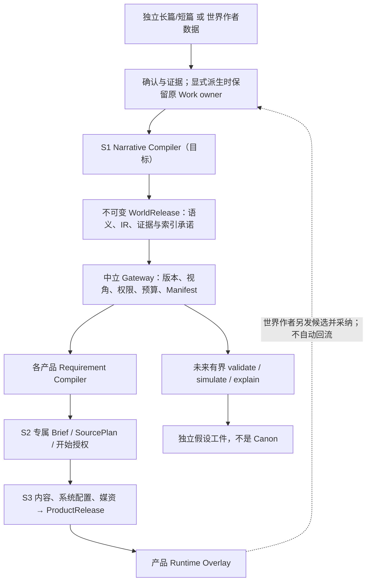
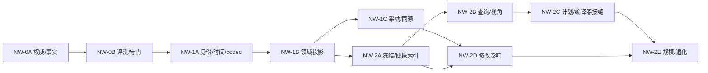

# 叙事世界基座 · 世界引擎专项权威

> 版本：2.2.1 · 生效：2026-10-30 · 权威层级：L2 · 对应总纲：§5、S1 世界封存
> 本文是世界引擎专项唯一最高权威，服从 L0 总纲及 L1 数据/Harness 标准。§1～9 保留产品边界与现有入口；§10 为重新核实的事实；§11～19 是本次确定的目标合同、施工顺序与评测，不代表生产代码已经实现。
> NW-0A 设计、NW-0B 基线和 NW-1A 身份/时间/编码合同已形成，分别见 §20.3、§22、§23。§24～30 记录领域投影、候选、封存、查询、精确来源计划、修改影响和规模评测的进行中实现；完整交付、人工判断及跨产品/规模闸门仍未齐备。推演后置，不启动无关上层产品开发。

> 2026-10-25 本批交付范围：按作者要求将保留的 NW 工程成果整合到当前主干并结束自动接续；增强入口继续默认隐藏。工程交付不提升修改影响语义质量、正式三档性能、固定读者完整性或实际作者改稿/用时的验收状态；原始失败、未知结果和阈值保留。后续研究或扩大开放另立任务。

## 阅读导航

| 任务 | 必须读取 |
|---|---|
| 理解边界、当前能力、研究依据 | §1～10 |
| Narrative IR、角色知识、时间与因果、三注册表 | §11～12 |
| WorldRelease、索引、版本、导入导出 | §12～13 |
| 世界检索、视角与秘密、世界出口 | §13～14 |
| 世界推演、假设、修改影响 | §15～16 |
| 上层产品读取、Requirement Compiler | §14、§17、§20 |
| 实际施工、验收和设计裁决 | §18～21；当前排期以 roadmap 为准 |
| NW-0B 考卷、当前成绩、反例与优先级 | §22；样本与运行入口在 tests/acceptance/narrative-world |
| NW-1A 实际代码、合同限制与基线对照 | §23；不将合同校验当成 provider 查询修复 |
| NW-1B～2E 进行中实现及实际证据 | §24～30；正式放行、产品接缝和规模门分别核验 |

## 1. 定义

世界引擎是可编辑、可确认、可封存、可版本化、可通过稳定编号引用的叙事语义内容包。它不是所有创作产品的父项目，也不是上层产品的运行数据库。

创建者可只提供世界观，也可逐步加入故事、角色、关系、物品、地点、组织、主支线、大纲、细纲、章节和正文。完整度以可声明能力画像表达。

目标是可证据追溯、可版本化、可按人物视角读取、可作时序与因果查询、可验证假设变化，并可编译为不同产品输入的叙事世界模型。空白和部分世界仍合法；不得把拥有整部小说或全部 IR 类型设成创建门槛。

## 2. 数据范围

世界引擎可以拥有：

- 世界结构、自然与人文环境、历史、规则；
- 故事主题、冲突、叙事约束；
- 实体、关系、物品、地点、组织；
- 主支线、事件、时间线和阶段状态；
- 大纲、细纲、章节、原文和确认事实；
- 来源、冲突、置信、revision、目录和检索索引。

世界引擎不得拥有：

- 为跑团、聊天、游戏或漫画生成的图片、音乐、音效、配音、视频、UI、排版；
- product production、build、product release、session、玩家/聊天状态或私域记忆；
- 无明确 owner 的共享素材杂物。

## 3. 草稿、编号与封存

- 草稿可编辑并不断变化；不可直接作为可重复构建来源。
- 可分享世界有稳定 `worldCode`，不因草稿修改改变。
- 封存生成不可变 `WorldRelease`，含 world code、version、content hash、schema version、能力画像、目录与来源 manifest。
- 上层产品锁定 release ID/hash；世界草稿后续修改不影响已有产品。
- 世界新版本从新草稿显式封存，不覆盖旧版本。

## 4. 能力画像

能力画像至少区分：

- 可用域：世界、故事、角色、关系、物品、主支线、大纲、细纲、正文；
- 覆盖范围和最近 revision；
- 已确认、候选、冲突或缺失；
- 是否有原文证据与可查询索引；
- 上层产品的最低输入是否满足。

当前契约还明确区分 `selected`、`partial-selection` 与 `omitted`：资源未被本次封存选择，不等于世界中不存在；候选、冲突和被规则排除的行也不得伪装成已确认 Canon。画像与资源目录均保存确认/候选/冲突/遗漏数量、最近 revision、原文证据和可查询索引能力。

当前 `queryableIndexAvailable` 仅由资源行数推导，不能表示已经具备人物视角、时序或因果查询。增强画像的目标与实际支持判据见 §13.3；当前字段不作这种扩张解释。

“完整度 80%”只能作展示摘要；上层产品必须读取具体能力项，不能用单一百分比代替数据契约。

## 5. 中立世界资源协议

### 5.1 统一什么

上层产品不得直接手写查询 `worldviews`、`characters` 等底层表清单。世界引擎提供三类稳定能力：

1. `describeWorldRelease`：返回版本身份、hash、能力画像和可导航资源目录；
2. `searchWorldRelease`：接收产品需求或查询条件，返回资源描述符和匹配状态；
3. `readWorldResource`：按 release + 稳定 resource ID + detail level 读取详情、结构化事实与原文证据。

现行 V1 实现的精确能力与缺口见 §10；接口存在不代表所有过滤与叙事推理已实现。现行 V1 实现由 `describeWorldReleaseV1`、`searchWorldReleaseV1`、`readWorldResourceV1` 和 `readWorldOriginalEvidenceV1` 提供。它们只读取并校验不可变 `WorldRelease`，返回的 source ref 指向 release/hash 而不是作者草稿；目录投影使用有界缓存，草稿变化不会污染已缓存的旧 release。

统一协议必须携带 source release、resource version/hash、owner、引用、可见性、provenance，并区分 `matched`、`missing`、`conflict`、`omitted` 和 `insufficient`。预算未允许读取某项资源时，不得把它报告为“不存在”。

### 5.2 不统一什么

世界出口不定义一份让所有上层产品照单全收的通用 payload，也不预设某类产品的角色卡、规则、游戏时长、结局或运行字段。不同产品需要的数据广度、细节层级和证据类型可以完全不同。

每个上层产品在自己的 `S2 产品定向`契约中提供 `WorldRequirementAdapter`（名称可按实现调整），把当前用户目标和产品配置转换成稳定必读、建议/选读、条件读取和禁止读取。网关只负责在指定不可变 release 内可靠地解释和满足这些需求。产品侧可对结果继续排序、组合或请求补充读取，但不得绕过协议查询世界底表。

适配器可以由类型化代码/配置与产品 Skill 协作：代码/schema 固定版本、权限、必读和禁止边界，Skill/Prompt 处理开放式目标和语义查询。不能只靠提示词声明“必须读取”，也不能把世界物理表名复制进每个产品。

旧产品 reader 和兼容白名单已全部退役。现行代码中，只有世界引擎基础设施可以解码物理 `WorldRelease` manifest；上层产品、组件、Agent 和产品专用 service 只能通过中立 provider 与冻结 `ProductSourcePlan` 读取。架构检查器同时拒绝恢复旧 reader、旧上下文来源和跑团专用世界目录。

### 5.3 先锁定读取计划，再记录实际来源

用户确认开始后，产品先把 WorldReference、需求适配器版本、需求、允许范围、缺失/补充策略以及咨询阶段 Context Manifest refs 冻结为 `ProductSourcePlan`。生产尚未执行时不能假装已经知道全部会用到的资源。

`S3 产品执行`中的 Agent 可在该 plan 允许的同一不可变 WorldRelease 内继续 `describe/search/read`；每个 durable run 保存自己的不可变 Context Manifest，ProductRelease 聚合生产证据为 `ProductSourceManifest` 快照并冻结 hash。确定性编译不是例外：用户入选资源及从中立 relation 推导的必要依赖，必须由 Gateway 和编译器的同一闭包解析器确定，并先在该 run 中留下原文级证据，才能组装 RuntimePackage。开放式运行若需要继续查询世界，也必须经 ProductRelease 继承的 source plan 执行，读取证据归 session/run manifest，不能改读最新草稿或追写旧 ProductRelease。

同一 WorldRelease 因产品和任务不同，可以产生不同 plan 和 manifest；这正是协议统一而 payload 不统一的设计目的。

上层 Agent 因来源缺失而创作的补充内容默认属于该产品实例。只有世界作者另行发起显式候选/采纳流程，才可能成为新的世界版本；正常生产和运行不回写世界。

## 6. 与独立长篇、短篇的关系

分步骤长篇和短篇可以作为世界引擎内容来源，但不自动等同于共享世界：

- 长篇、短篇可独立存在和完成；
- 作者选择“基于作品创建世界草稿”或“发布为世界引擎”时才建立/更新世界草稿或封存版本；
- 系统自动选取、投影和快照已确认内容，用户不需要复制粘贴；
- 转换保存来源作品、revision、范围和 hash，不改变作品 owner；
- 世界可引用作品中的确认内容，也可只发布选定部分。

文字开放世界的小说入口必须先显式派生世界草稿，由作者确认目标世界语义并经世界引擎封存 WorldRelease，再进入该产品 S2 定向/明确开始及 S3 执行；已有 WorldRelease 可直接进入 S2。小说固定版本/SourcePin 不能替代世界封存。源作品 owner 不变，小说与派生世界后续修改不自动同步；新的作品内容只有再次显式派生、确认和封存才形成新世界版本。

同样，世界引擎可为新作品提供来源，但作品后续写作不自动回写世界。

小说转剧本、小说转漫画、漫剧前期生产当前保持独立，不提供“封装为世界”入口；其改编产物也不因包含完整故事而自动获得世界身份。

## 7. 多世界

多世界不是把多个表简单堆叠。封存版本要表达世界集合、各子世界版本、关系、通道/迁移条件、时间或规则差异，以及角色/事件跨世界引用。上层产品可以选择整个集合或允许的子集，仍锁定版本。

资源目录中的世界组与通道必须互相暴露稳定 relation，产品能够从通道导航到两端世界，而无需读取 `worldGroups` / `worldGroupLinks` 底表。世界草稿的能力投影按显式 `projectId + worldId + workId` scope 统计；同项目的另一 World/Work、另一项目及独立作品内部 scope 均不得串入。

## 8. 验收

- 空白、部分和完整世界均可创建、编辑、封存；
- world code 稳定，release 不可变、hash 可验证；
- 上层产品只通过中立协议和自己的需求适配器读取，不维护世界底层字段清单；
- 两种需求明显不同的产品可以从同一 release 得到不同 source manifest，且来源/遗漏均可追溯；
- 草稿更新不改变已有产品 build/session；
- 导入导出、复制、删除、重映射和多世界引用完整；
- 世界表无上层媒资/运行记录；
- 长篇/短篇与世界之间转换显式、一键、可追溯、可拒绝且无需手工复制；
- 目录→检索→详情/原文在大规模夹具下可用。
- 千级资源冻结、发布、目录、检索和原文核查不得退化为逐行 IndexedDB 游标链；规模回归必须保留。

## 9. 当前作者页面

世界引擎的正式作者入口为 `/world/:pageId?`，通过 `project` 选择本地世界工作区；未选择世界时仍可浏览全部页面，并可直接进入分享包预检/导入。需要实际编辑、生成或封存时才选择或创建世界。旧世界工作区链接重定向到同一作者入口。

一级目录按我的世界、世界设定、版本与封存、数据出口、分享与导入、社区与发行、通用设置组织；规则与起源、自然与地理、人文与社会、人物与关系、历史与事实、故事与叙事、多世界与地图在页内导航承接既有领域编辑器、字段候选与 durable Harness；故事、大纲、细纲和正文是可选语义内容，不成为所有世界的完成门槛。同一世界的叙事 Work 在故事基本信息页管理，世界名称与简介由独立 World 元数据入口修改并校验新鲜度。

版本页可选择冻结修订发布，保留历史不可变版本；目前差异展示为最新两次修订的表级增改删计数，不提供未实现的逐字段恢复按钮。数据出口通过中立客户端分页检索、读取资源及原文证据，分别显示已确认、候选、冲突、未收录和本次封存选择范围；修改返回世界草稿，产品定向设置留在各产品 S2。

分享页可选择历史发布版本，设置作者、许可、用途与内容警告，下载 JSON 包；导入先预检，再由作者确认创建新编号副本。在线社区发布和社区数据尚未接入，页面明确说明此边界。世界交接快捷入口进入已开放产品的制作配置，不直接启动运行。

地图沿用程序化地图引擎和既有候选采纳服务；AI 候选可先展开地图预览和配置，再采纳或拒绝。普通重新生成保存确定种子后更新画面，刷新可重现；比例尺保存失败可见。图层开关为当前查看状态，3D Labs 仍未开放。

世界规则记录缺少一侧文本时，规则导航、统计和编辑页仍可打开，已存文字与原记录保持不变。只有确认两侧均为文本且去除空白后都为空的条目才被判定为空；缺失或无法识别的内容不作为自动删除依据。作者显式补全或修改后沿用原保存入口，不在阅读时迁移或补写记录。

## 10. 基线、缺口与研究裁决

### 10.1 可复核的关联闭包

核查基线：2026-10-13 fetch 后的 `origin/main@45c541e95fb6238d56fe2c6ea0bf3928b80c5518`。附件的 `83ad0231` 已过时。下列“当前”只指该提交，不包含其他 worktree 的未提交内容。

| 环节 | 当前入口与稳定符号 | 本次结论 |
|---|---|---|
| 作者入口 | `src/components/world-engine/WorldNarrativeReleasePanel.tsx`、`WorldResourceBrowser.tsx`、`WorldDerivationActions.tsx` | 复用已有编辑、派生、封存和资源浏览；不另建世界主产品 |
| 读取 | `src/lib/registry/context-sources.ts` 的 `worldRelease`、`canonAssertions`；`src/lib/context-gateway/world-release-provider.ts` | 世界版本经 Gateway；Work 记忆不能假装是冻结 release 记忆 |
| 候选/写回 | `src/lib/registry/field-registry.ts`、`adoption-schema.ts`；`fact-ledger/setting-assertions.ts`、`knowledge-ledger/knowledge-ledger.ts` | 时序事实通过领域 extension，认知账本有字段/schema；新语义必须沿此接入 |
| 生命周期 | `PROJECT_TABLES.worldSemantic/resourceIdentity/domainOwner/exportRemap`、`src/lib/db/schema.ts` | schema v11；`check:required-tables` 复核 128 表；物理 owner 与逻辑 World/Work owner 都须保留 |
| 封存 | `src/lib/world-engine/releases.ts` 的 `buildWorldReleaseManifestInternal`；`release-codec.ts`、`release-hash.ts` | 现行 manifest/semanticContract=3；严格闭集，不可直接塞新增键 |
| 派生与分享 | `world-engine/derivation.ts` 的 `deriveNovelToWorld`；`semantic-snapshot.ts`、`world-package.ts` | 源 Work 不变；新工作区显式复制和重映射，失败清理仅限本次新建目标 |
| 下游 | `product/world-requirement-adapters.ts`、`product/source-contracts.ts`、`product-production/world-source.ts`、`product-production/source-contracts.ts` | 六产品已有 adapter/plan/manifest；编译资源与 Gateway 使用同一关系/分类依赖闭包 |
| 测试 | `R-ARCH05-world-protocol`、`R-WORLD-D-phase-d-closure`、`R-ARCH01-world-derivation`、`R-GATE-P2-world-engine-contract`、`R-ARCH03-stage-gate`、`R-PRODUCTPROD1A1-source-plan-portability` | 本轮重跑 6 文件/24 项；此组选择不同于附件 6 文件/28 项，不能沿用旧计数 |

数据库版本、备份版本、世界内容版本是三个维度：当前 DB v11；`CURRENT_BACKUP_VERSION/CURRENT_EXPORT_VERSION=16`，v14/v15 仅经严格校验和显式转换链可转 v16；WorldRelease manifest v3。新 IR v1 不等于 DB v1，也不授权猜测下一个 DB 版本。

### 10.2 七项旧发现的重新裁决

| ID | 当前实现证据与判定 | 后续落点 |
|---|---|---|
| F1 搜索过滤 | `registry/types.ts:ResourceSearchInputV1` 声明 entityKeys/storyArcKeys/timeRange；provider `requestHash` 收入这些字段，`page` 只按 kind 与 key/title/shortSummary/area/resourceKind 包含匹配。缺口仍在；不是全文、时序或实体事件查询 | NW-2B；先增加反例，不以改 cursor 冒充实现 |
| F2 关系图 | `buildProjections` 仅显式连接词条—分类、人物关系—两端人物、通道—世界组。未见中立事件参与/因果/知识传播图 | NW-1B、NW-2A |
| F3 冻结叙事索引 | **部分实现**：temporalFacts 与 knowledgeLedger 已登记 worldSemantic，confirmed 行可随 release 冻结；retrievalChunks/narrativeSummaryNodes 是 Work 可重建缓存，不导出。不能写成“事实和认知完全没进入 release” | 投影现有冻结数据，补证据、时序与视角查询；不复制 Work 缓存 |
| F4 产品 adapter | 六产品由共享 helper＋allowlist 创建；`Math.max(1, Math.min(selectedResourceCount, 1))` 对合法非负计数恒为 1；没有实际生成 prohibited 规则，框架支持该级别。**但**确定性生产编译路径已将作者所选＋关系/分类闭包设为 mandatory original，并检查 plan permission；不能声称全部生产只读一项 | NW-2C 将精确集合完整性提升为 plan/manifest 合同，保留现有较强路径；产品编译器分别升级 |
| F5 一致性 | 覆盖地图与 fact/knowledge/consistency 实现吻合：四类闭集比较存在；抽取可漏，正文 finding 多为 advisory；动机/OOC、复杂时间/因果、兑现仍无通用硬保证 | NW-0B 评测、NW-1B 类型闭集、§19；保留现有文学质量边界 |
| F6 动态层 | 中立 WorldRelease provider 没有 validate/action/simulate；上层产品已有 action/event/状态机，不是世界中立推演层 | §15 长期设计；不把产品 runtime 搬进世界 |
| F7 文档漂移 | ARCHITECTURE 生成指标已是 v11/128，手写正文仍说 v10；DATA-GOVERNANCE §7 仍说 v4，能力/完成基线仍说 v6/118 | NW-0A 修正现行口径；历史审计只加快照声明，不改历史测试数字 |

附加风险：`isSemanticCanonRow` 对 `authoritative-table` 全行返回 true；结构大纲、planned 伏笔和历史事件的构思字段可能与已发生内容同包。当前 descriptor 普遍标 `author-canon`，不能据此推断每个字段都是“世界内已发生事实”。Phase 1 必须分离“作者接受的设定/计划”和“已发生状态”，并保留 v3 行为兼容证据。

另外，temporalFacts 当前封存只选 confirmed，已 superseded 的历史状态不完整；knowledgeLedger 的 confirmed 只表示作者确认角色持有该认知，不证明该 belief 为真。上述是时态索引必须解决的输入条件，不准由新查询器凭空补历史。

初始审计发现版本兼容接缝：当时 `release-codec.ts` 从最新 PROJECT_TABLES 生成 `WORLD_SEMANTIC_SPECS`，再校验 v3 的 selected/omitted 分区和 capability 数量。将来增加语义域或修改发布策略时，仅保留旧函数名不能保证旧包可读；NW-1B 已固定 v3 的历史规则快照（§24）；NW-2A 仍须为 v4 独立分派。

### 10.3 一手研究及本地化选择

以下来源于 2026-10-13 实际读取的论文摘要、正文相关方法/限制节或官方页面；未复现其模型和得分。右列均为 StoryForge 本次设计判断，外部论文不自动成为产品要求。

| 来源 | 可借鉴的证据 | 本地采用与限制 |
|---|---|---|
| [Narrative World Model](https://arxiv.org/html/2607.05577v1)，§3、§8 | 对接受正文建时态叙事记录，区分事件/揭示、知识、关系与承诺；按问题取混合证据 | 采用叙事分解和固定证据 reader 对照；不把规划当事实。论文将受记忆条件约束的生成效果列为未来工作，不能据 QA 成绩宣称长篇生成质量完成 |
| [NarraWorld](https://arxiv.org/html/2609.32401v1)，§2.1～2.4 | 事实、人物信念、发展、假设四视图；聚合可展开到原子证据，先受限预览再规划检索 | 采用视图/原子闭包/预算装配；模型规划仅建议依赖，权限与必读由代码执行。假设不混入事实回答；不把其记忆更新自动等同作者 Canon 采纳 |
| [E²RAG / ChronoQA](https://aclanthology.org/2026.eacl-long.90/) | 实体单节点易压平演变；实体与事件子图关联，评测时间、因果和人物一致性 | 用 TS 邻接/倒排索引保留事件和有效区间；不引入图数据库，不从“先发生”推断“导致” |
| [ConStory-Bench](https://aclanthology.org/2026.findings-acl.410/) | 一致性错误按类型和文本证据分析，事实/时间及故事中段是重要观测对象 | 自建原创中文样本，按前/中/后段、错误类型分层；检测器只作辅助，不以模型互评代替作者验收 |
| [Editable Shared Worlds](https://research.google/pubs/integrating-level-design-for-editable-shared-worlds-in-diffusion-game-engines/) | 显式持久外部记忆，区分 Memory、Observation、Dynamics | 采用“数据状态独立于模型窗口”的职责分离；视频扩散和多人共享推断不是本地叙事基座的实现方案 |
| [Genie 官方页](https://deepmind.google/models/genie/) | 行动影响未来状态；官方仍列动作空间、多主体交互和持续时长限制 | 仅启发有界行动/后果接口。像素世界预测不能提供 Canon 权限、文本因果正确性或本地低成本保证；不启动训练独立模型 |

Phase 1～2 用 TypeScript、IndexedDB、必要的 Worker 批处理即可承载数据、邻接图、倒排、闭集验证与便携 codec。模型可建议实体归一、事件抽取、因果/动机和摘要，必须先成为候选；哈希、权限、版本、预算、状态转换与引用校验保持确定性。向量/小模型只作可选排序或未来抽取研究，先测本地无向量基线，再凭成本与召回证据决定。

## 11. 目标架构与不变量

三层是逻辑责任，不是三个数据库：

1. **创作权威层**：既有 World/Work 领域数据、CreativeArtifact、作者确认与证据。独立长短篇可以完全不使用共享世界；节点编排同一领域 action。
2. **冻结世界模型层**：S1 确定性 Narrative Compiler → 版本化 IR/证据 → WorldRelease 与绑定索引 → 中立 Gateway。只拥有语义。
3. **产品解释与演化层**：各产品 Requirement Compiler → S2 Brief/SourcePlan/明确开始 → S3 生产、媒资、Build、ProductRelease、私域 runtime。



本轮不改变已有分步骤/节点、短篇、剧本、漫画和漫剧 owner，不降低现有已验收主链；新 IR 是共享语义合同，不能成为长篇创建的前置依赖。世界新版本只供显式升级选择，旧 ProductRelease/session 不因草稿编辑被判不可运行。

关键不变量：

- 单个命题只有一个权威写入位置；IR/索引是有来源的读模型，不能增加第二套 Canon CRUD。
- “记录被作者确认”与“记录里的命题为真”分开。确认角色误信不确认误信内容；确认大纲不确认事件发生。
- 一切可见结果，包括标题、摘要、边、计数、排名、cache、原文和 explain，先过同一视角/权限投影。
- 字面时间、未知时间和不同比例日历不能被悄悄转为 Unix timestamp。
- 未收录、未知、预算不足、权限不足均不等于否定；无证据不能推出不存在。
- 模型可以提出可能性，不能生成有效权限、哈希、用户授权或完成回执。
- index/embedding 失败不能污染已有 release，不能静默调用收费服务或回退到可变 Work。
- 世界封存不带 product production/media/session；假设也不随普通 Canon release 输出。

## 12. Narrative IR v1 技术契约（目标，Phase 1）

### 12.1 权威与存储裁决

IR 是既有表的标准化、证据化投影；**不是新的可写 Canon 主表**。已确认的新语义写回对应领域，抽取结果留 CreativeArtifact。第一版不新增实体、事实、知识、图边各一张平行表；Phase 1 的领域类型增量及 Phase 2 的可丢弃索引缓存分别审查。

| IR 类型 | v1 最小内容 | 持久权威/扩展落点 | 推导或延期 |
|---|---|---|---|
| Entity | typed identity、别名、所属世界、类型、来源 | characters、importantLocations、codexEntries、worldGroups；复用 resourceIdentity | 物品若无独立主表，用 codex 物品身份＋itemLedger 事件映射；不能以显示名自动合并 |
| Event | 参与实体及角色、地点、发生区间、证据、事件种类 | storyTimelineEvents / historicalTimelineEvents 增加受治理 typed 语义字段，保持故事/历史来源区别 | observation/communication 是 event 的子类；物品/认知变化引用事件，不复制事件权威 |
| Assertion | 主体、受控 predicate、typed value、有效区间、模态 | temporalFacts；复用 FACT_PREDICATE_REGISTRY、locked、supersedes 与领域采纳 | current state 是视图；历史 superseded 条目可作曾有效状态，不能一律丢弃 |
| Relation | 两端实体、关系类型/方向/区间、状态来源 | characterRelations 的静态关系或 temporalFacts 中已登记关系命题，各管已声明字段 | RelationDelta 从两时点状态和原因事件确定性计算；未有原因只标 unknown |
| Rule | 规则命题、范围、hard/advisory、可验证条件 | 已确认世界宪法 temporalFacts；worldRulesProfiles 保留叙述规则 | 自然语言规则默认 advisory；不把全部散文编成硬规则，不在本轮设计万能物理 DSL |
| EpistemicEvent | holder、proposition、态度变化、来源/获知时间 | knowledgeLedger 扩展明确 know/believe/doubt/unaware 与修订语义；保留 learn/mislearn/forget/correct 旧投影 | Knowledge/Belief/Misbelief 为按 holder/time 的视图，misbelief 仅作者真相比较时可得 |
| Development | thread/goal/conflict/commitment 的主体、关联事件、open/advancing/blocked/resolved/abandoned 状态 | storyArcs/storylineProgress 扩展类型化目标/冲突/承诺子记录；稳定 subKey；foreshadows 管伏笔/呼应/兑现 | Promise/Payoff 为 development 子类型与显式 fulfills 边；没有正文或作者世界声明证据的“已解决”不自动推断 |
| Disclosure | 命题/事件何时向读者/哪类受众揭示、证据 | chapters 的类型化揭示标注，来源必须到 field/span；角色获知另由认知账本持有 | “第几章出现”可派生；叙事中提到不代表角色知道 |
| Evidence | immutable source、field/pointer、span、hash、支持/反驳角色 | 已有源正文/字段与确认记录；封存时证据表是嵌入内容 | 高层摘要只索引原子闭包，不成为新权威；详见 §12.5 |

Branch 是 scope 身份，Hypothesis 是独立假设工件，不是新的 Canon record kind。模型假设的事件/状态沿相同 IR 形状携带 hypothesis 模态，但不进入普通 WorldRelease。作者选定一个设想也须重新确认目标草稿与证据后封存，不能把 hypothesis flag 改成 canon。

跨领域新增元数据的精确落点：所有有 resourceIdentity 的领域使用其 `ragDocumentId`；有独立子记录的类型增加系统分配的 `semanticSubKey`；各领域按需增加 `narrativeTimeV1`、`narrativeEvidenceV1`、`narrativeAuthorityV1`、`narrativeVisibilityV1`，事件/发展另加自己专属的 typed payload。它们是类型化可选字段，必须在 FIELD_REGISTRY/Adoption 与导入闭集登记，不能成为 arbitrary JSON 扩展口。旧记录无字段时只投影可证实部分并报告 gaps；不在 migration 内用模型填补。

### 12.2 公共信封及身份

以下为目标公共信封；NW-1A 已将信封、八类 variant 与时间实现为 `src/lib/types/narrative-ir.ts` / `narrative-time.ts` 和 exact-key codec，实际 wire 细节及未接入边界见 §23。领域持久化与投影的实现边界见 §24，候选确认及同源消费见 §25；禁止 `Record<string, any>` 作为持久化合同。

```ts
type SemanticKind =
  | 'entity' | 'event' | 'assertion' | 'relation' | 'rule'
  | 'epistemic-event' | 'development' | 'disclosure'

type Modality = 'established' | 'belief' | 'intent' | 'hypothesis'
type ReviewState =
  | 'accepted' | 'candidate' | 'conflict' | 'stale'
  | 'rejected' | 'source-missing' | 'historical'

interface NarrativeEnvelopeV1 {
  irVersion: 1
  semanticId: string
  revisionHash: string
  kind: SemanticKind
  scope: {
    owner: { kind: 'world'; worldCode: string; sourceWorkCode: string | null }
      | { kind: 'work'; workCode: string }
    worldGroupKey: string | null
    branchKey: string
    revisionVectorHash: string
  }
  modality: Modality
  reviewState: ReviewState
  authority: 'author-confirmed' | 'author-declared' | 'derived' | 'model-proposed'
  confidence: number | null
  time: NarrativeTimeV1
  perspectiveKeys: string[]
  visibility: VisibilityV1
  evidenceIds: string[]
  dependencies: Array<{
    semanticId: string
    revisionHash: string
    role: 'supports' | 'contradicts' | 'derived-from' | 'causes' | 'requires'
  }>
  provenance: {
    sourceResourceKey: string
    sourceField: string
    sourceRevision: string
    sourceContentHash: string
    adoptionReceiptRef: string | null
    manualDeclarationRef: string | null
  }
  authorCreatedAt: number
  authorUpdatedAt: number
}
```

冻结记录的 release 身份放在 IR bundle 外层 `{worldCode, semanticRootHash, irVersion, records}`，最终 release ref 由网关响应绑定；记录不嵌最终 contentHash，避免自引用哈希。草稿投影由 revisionVectorHash 锁定，不能被用作产品 WorldReference。独立 Work 使用 work owner 的草稿投影，无需虚构 worldCode 或先建世界；只有显式派生之后才生成目标 world owner 的身份和 lineage。普通 WorldRelease 拒绝混装仍由源 Work 拥有的 IR。

- semanticId = owner 稳定命名空间＋kind＋持久 source uid＋稳定 subKey，禁止数组下标、名称、章节顺序、数据库自增 ID；revisionHash 单独表达内容变化。
- 已有 `ragDocumentId` 可复用但必须先验唯一与来源一致；缺失 ID 的草稿由确定性系统在显式准备/确认事务中一次性分配并持久化，不在每次读取随机生成。
- v3 资源使用 export 坐标和 release hash，保持原 key 与 codec；只在中立层建立有版本的 alias 对照，不重写旧 release 以“升级身份”。无法建立跨版本同一性的旧行标 `release-local`，禁止名称猜测。
- 独立作品派生新世界时生成目标命名空间，保留 source work/revision/hash 的 lineage；导入复制新世界同样换 namespace 并整体重映射，原包的身份和哈希不变。
- 分类型 FK 仍由 PROJECT_TABLES 管理；IR 的语义引用只在编译边界解析成稳定键。不得在数据库偷换成无生命周期定义的多态 `type+id`。
- confidence 只描述抽取/解释不确定性，不改变权限、reviewState 或 Canon 权威。
- 原文与世界声明冲突不得按更新时间、置信分数或“最后写入”自动裁决；保留冲突组、两边证据，作者选择后产生新 revision。

记录 hash 与引用校验分两步：revisionHash 对该记录的 payload、时间/模态/权限、来源、证据 ID 和依赖目标 ID/role 作规范化哈希，排除自身 hash、解析后的依赖 revisionHash、bundle hash 和全局 revisionVectorHash。随后绑定依赖实际 revisionHash，完整 bundle 再统一进入 semanticRootHash。这样双向人物关系或互相反驳的声明不会形成哈希递归；依赖版本不符仍在闭包校验中失败，不能借排除项忽略 stale。

### 12.3 四视图与 Authorial Intent

| 视图 | 可包含 | 不可推断/不可混入 |
|---|---|---|
| Canon World State | accepted＋established 的事件、有效状态、确认规则；历史状态按指定时点投影 | candidate/conflict/belief/hypothesis；author-confirmed 大纲不是已发生事实 |
| Character Knowledge / Belief | holder 在获知时点之前的认知事件折叠；known、believed、doubted、explicitly-unaware、unknown-unrecorded | 缺 ledger 不等于角色确定不知道；误信不能自动订正为全知真相 |
| Narrative Development | 有证据的故事线推进、目标冲突、伏笔、承诺及兑现；计划项保留 intent 标签 | 预期回收时间不等于已兑现；情节“应该如此”不构成事件证据 |
| Hypothetical Branch | 明确 base release/branch、假设、有限行动和未证实后果 | 不进 Canon 检索默认集合，不进入事实摘要聚合；不自动采纳 |

不建立第五个可写“作者意图总库”。Work Brief、叙事计划和产品契约继续拥有 Authorial Intent；封存可携带作者选择的计划语义，但 IR 必须标 `intent`，只能由有相应用途授权的创作查询读取。角色/玩家视角默认排除结局计划、未埋伏笔、未来发展和作者笔记。原始行含混合字段时，字段级分类先于 summary 生成；不能把整行权威当作整行公开。

一个命题可以有“世界真相版本”和多个 holder 的 belief 值；它们共享 proposition identity，但不共享可变值。遗忘不是删除历史获知事件；correct 追加新认知并指向被修正事件；同一获知时点发生冲突且无明确顺序时返回 conflict，不任意取最后一行。

### 12.4 时间与多世界

```ts
type TimePointV1 =
  | { kind: 'tick'; timelineKey: string; value: string }
  | { kind: 'event-anchor'; eventKey: string; side: 'before' | 'at' | 'after' }
  | { kind: 'unknown'; label: string | null }

interface IntervalV1 {
  start: TimePointV1
  end: TimePointV1 | null
  endMeaning: 'known' | 'open' | 'unknown'
}

interface NarrativeTimeV1 {
  occurred: IntervalV1 | null
  valid: IntervalV1 | null
  narratedAt: { sequenceKey: string; unitKey: string; spanStart: number } | null
  disclosedAt: Array<{ audienceKey: string; sequenceKey: string; unitKey: string }>
  acquiredAt: TimePointV1 | null
}
```

约定：

1. tick 是规范化十进制整数字符串，以时间体系定义的最小单位比较；不用 JS 浮点强行表示跨百万年精度。一个 timeline 冻结 calendar/unit/epoch 和序关系；自由文本 `storyTime` 仍可保留，未确认解析只作 label/unknown。
2. 事件区间表示发生时段；状态有效期使用左闭右开 [start,end)，instant event 为独立点；end=null 必须说明 open 或 unknown，二者不可混用。查询未知区间产生 uncertainty，不能当无穷长命中。
3. 叙述顺序用冻结 sequence→unit ordinal 映射，unitKey 稳定。章节拖动只改变新 revision 的 sequence；旧 release 顺序不变。不得使用 authorCreatedAt 排故事。
4. disclosedAt 是读者/授权受众的揭示位置；acquiredAt 是角色实际获知时刻。事件可先发生后揭示，角色也可通过谣言先形成错误信念。
5. 作者创建/修改 timestamp 仅审计；与 world time、有效期、叙述序和获知时间互不替代。
6. 多世界各有 timeline/rule scope；worldGroup/通道引用准确子世界版本。跨时间体系只有作者确认、带证据且版本化的有向映射才可比较；映射可分段、有条件或不可逆。无映射返回 `incomparable-time`。
7. before/after 构成偏序，检测环；合法时间旅行用不同 branch/timeline 的迁移事件表达，不能给同一偏序制造环。因果边需独立证据，不能从 before 自动生成 causes。
8. v3 `throughChapterId` 只在能定位该冻结 release 的章节映射时转换为叙述截止，不解释为世界时间；含糊的 start/end 返回不支持诊断，不猜日历。
9. 旧认知记录若只有章节锚点，保留其 narratedAt 并令 acquiredAt 为 unknown；可支持“读到此章已有的认知证据”，不能声称支持精确世界时点的角色知识。两类能力单独声明，不把章节序换算成获知时间。

### 12.5 证据、可见性与进入 release 的条件

EvidenceSpanV1 至少含 `evidenceId/sourceResourceKey/fieldPointer/sourceRevision/sourceContentHash/normalizationVersion/start/end/spanHash/supportRole`。start/end 采用冻结 UTF-8 字节的 [start,end) 范围，必须落在码点边界；换行/Unicode 规范化规则固定版本并保留原始字段。结构字段以 canonical JSON pointer 取值，空 span 不假装逐字引文。作者直接声明可用手工声明记录与 receipt 作为证据，不要求一切先写成小说。

VisibilityV1 = `{class:public|restricted|author-only|unclassified, audienceKeys, policyVersion}`。未知默认 unclassified；只有作者确认的字段/片段分类可升 public。派生结果取所有依赖可见性的交集；一段摘要含不可见依赖时整段不发，或从已授权原子重新构造独立摘要，不能先把秘密喂模型再要求它保密。角色知识可见性与用户权限分别校验，“知道”不授予读作者后台权。

进入 v4 世界包的判据：scope/identity/引用有效＋被作者选入＋合法权威来源＋状态可发布＋证据 hash 有效。规则如下：

- accepted established 进入 Canon 集；合法 superseded 历史记录以 historical 状态和完整有效区间进入历史集。
- accepted belief 是“人物持有某信念”的确认记录，进入认知集，belief 的内容不进入 Canon 真值集合。
- 作者确认的 intent 只进计划集并默认 author-only；产品必须显式允许该用途。
- candidate/conflict/stale/rejected/source-missing 不进可消费 Canon；作者端保存 issue/排除回执；非作者端不暴露排除内容或数量。
- 任一必需证据/引用缺失时拒绝声称完整。作者可取消相关资源并重新确认 partial 选择，系统不得自动删一部分后继续发布。
- hypothesis、runtime state 和产品补全数据禁止混入；世界作者另发采纳可产生新世界声明，保留原假设/产品来源且重新审核。

### 12.6 Variant payload 与投影判据

每个 kind 的 payload 是独立 exact-key union，和公共信封一起校验。`SemanticRefV1` 是同包的 typed semanticId 引用，解析后绑定目标 revisionHash；外世界引用必须带精确 WorldReference 和已登记通道，不允许裸跨 scope ID。`TypedValueV1` 只含 boolean、规范化 decimal＋unit、text、enum、entity-ref 和有序集合六类；predicate 注册项声明可接受的值类型、比较器、基数、否定和冲突规则，未知 predicate 不能自行升级为可执行条件。

| kind | 必要 payload 字段 | v1 约束与推导 |
|---|---|---|
| entity | entityType、canonicalLabel、aliases、sourceIdentity | label/alias 只检索，不决定同一性；entityType 限当前已登记领域 |
| event | eventType、participants[{entityRef, role}]、locationRefs、propositionRefs、effectRefs | observe/communicate 另有 observer 或 sender/recipient、渠道与被传播命题；通信发生不自动表示对方理解/相信，获知须独立认知证据 |
| assertion | subjectRef、predicateKey、value、polarity、supersedesRefs | 明确否定与没有记录不同；排他 predicate 在同 branch/有效区间出现互斥值时返回 conflict，supersedes 不擦除历史 |
| relation | fromRef、toRef、relationType、direction、value、causeEventRef或null | direction 取 directed/symmetric；有向关系不自动反转；变更 delta 只在两个可比较时点都有充分状态时确定 |
| rule | scopeRefs、statement、strength、validatorRef或null、preconditionRefs | hard 必有版本化已登记确定性 validator；原文声明与 validator 不等价时只作 advisory 并请求作者复核 |
| epistemic-event | holderRef、propositionRef、assertedValue、transition、attitude、sourceEventRef或null、revisesRef或null | transition 取 acquire/revise/forget/deny-awareness，attitude 取 know/believe/doubt/unaware；legacy mislearn 保留原值，不因 Canon 相反自动纠正角色 |
| development | developmentType、ownerRefs、memberRefs、state、transitionEventRefs、resolutionEvidenceIds | 类型限 thread/goal/conflict/commitment/foreshadow；resolved/fulfilled 必须有已发生事件或显式作者世界声明，未来计划仍为 intent |
| disclosure | subjectRefs、audienceKeys、sequenceKey、unitKey、spanRef | 揭示位置必须可在冻结 sequence 和证据中定位；对读者揭示不等于对场内所有人物传播 |

实体当前状态由 accepted established 声明按 predicate 与有效区间折叠；认知状态由 holder 的获知/修正/遗忘流折叠；发展状态由显式转移和证据折叠。无顺序的冲突保持 conflict，缺来源保持 unknown，不以更新时间或最高 confidence 选赢家。硬因果/前置边要求已登记语义与证据；模型提出的解释边停在候选或 hypothesis。模型因果建议也不得被 deterministic projector 洗成 derived Canon。

## 13. WorldRelease Narrative Index v1（目标，Phase 2）

### 13.1 封存流水与版本

沿 `createWorldRevision → publishWorldRevision → release-codec` 扩展，不增加绕过 codec 的 reader。编译输入是作者选定 scope 的一致快照、revision vector、资源选择、审核与可见性策略，不是查询时读取的“最新 Work”。

1. 校验 Workspace/World/Work owner、开始封存意图和选择范围；从 PROJECT_TABLES.worldSemantic 派生领域集合。
2. 捕获已确认行及所需的合法历史、证据和稳定 ID；完成异步准备后再次验证 revision vector。
3. 每个 registered projector 输出 IR records、证据引用和 exclusions；散文抽取不在确定性封存中偷偷调用模型。需抽取的先退出到候选审核。
4. 解析 typed 引用、时间/认知/揭示、原子证据闭包；校验 locked、权限和 branch；生成 coverage receipt。
5. 计算 semanticRootHash，按确定性 recipe 构建 indexes 和 indexHash，再计算最终 manifest contentHash。
6. 只在末端最小事务中写入不可变 revision/release 及绑定记录；并发 revision 变化则 stale 拒绝。耗时编译不在长事务里等待外部请求。
7. 回读 codec/hash/coverage 后才显示发布完成。失败保留旧 release 和编译诊断；重试按输入 root＋compilerVersion 幂等复用，取消/刷新可恢复任务 checkpoint。

新内容格式按当前基线设计为 `WorldReleaseManifestV4/semanticContract=4`，数据库版本在实际开工时单独分配。它包含 v3 的纯语义内容合同及新 IR/证据、时间体系、可见性政策、coverage 和 index descriptor。v3 decoder 与哈希算法保持不变；新 codec 仅按明确版本分派，拒绝未知未来版本/额外键，不恢复旧产品身份或宽松兼容层。

注册表依赖也必须按版本封存：v3 decoder 使用由已发布 v3 合同生成、留存并校验的 semantic registry snapshot；v4 使用自己的 projector/publishPolicy 版本。快照是历史 wire contract，不是第二份可编辑现行表清单。新增 worldSemantic 域、调整状态筛选或 area 划分时，禁止让旧 decoder 改用新集合；回归必须在扩展当前注册表后仍成功读取同一份 v3 golden 包，且原字节/hash、遗漏分区与能力校验不变。

v3 release 继续可读原能力，可在内存生成保守 legacy projection，但不能伪造完整角色视角、历史区间或新 index 验收。要得到 v4，作者从可编辑草稿明确确认并发布新版本；没有源草稿时显式导入成新草稿，审查后发布，不重写原 v3 字节/hash。

### 13.2 内容、索引和缓存的裁决

| 对象 | 是否纳入 release 内容承诺 | 导出/重建 |
|---|---|---|
| 原始已选语义、被采纳 IR、原子原文/声明证据、sequence/timeline、可见性、coverage | 是，进入 semanticRootHash 和最终 contentHash | 必带；不能依赖另一浏览器或在线正文 |
| 实体/事件倒排、typed adjacency、时间区间、知识/揭示投影、发展/伏笔状态、原子闭包表 | 独立确定性 NarrativeIndexV1，inputRootHash/recipe/version/output hash 被最终 manifest 绑定 | v4 完整包携带；缺失时仅可按相同 recipe 离线重建并比对 expected hash |
| LLM 摘要/因果抽取结果 | 不能声称可确定性重建；若作者采纳，原始文本、成员/证据、版本/hash 成为冻结输入 | 未采纳候选不进 release；已冻结摘要必须随包携带 |
| embedding、ANN、查询结果、加载缓存 | 不进入可移植 release contentHash，不作证据权威 | 不随普通世界包导出；可删除/重建；无 provider 仍能查询 |
| 产品投影/Persona/规则脚本/媒资、runtime overlay、simulation ledger | 不属于世界内容 | 各产品/假设 owner 自行导出；普通世界包禁止夹带 |

缓存落点设计为一张 `worldNarrativeIndexCaches`（Phase 2 才新增），owner=world、显式 release FK、exportable=false、worldSemantic=false、可全量丢弃，注册 PROJECT_TABLES 的删除和引用生命周期；不得借用 Work 的 retrievalChunks 放 release 数据。便携包内的 index 是由封存内容承诺的派生文件，与这张本机缓存表不是同一持久化权威。

Hash 顺序消除循环：

```text
S = canonical-v4(semantic payload + IR + evidence + policies + coverage inputs)
semanticRootHash = SHA256(S)
I = canonical-v1({inputRootHash: semanticRootHash, recipeVersion, indexes})
indexHash = SHA256(I)
M = canonical-v4({semantic payload, IR, evidence, policies, coverage,
                  semanticRootHash, indexDescriptor: {inputRootHash, recipeVersion, indexHash}})
contentHash = SHA256(M)
外层包绑定 = {releaseUid, contentHash, indexHash}，不放进 S 或 I
```

v4 canonical 明确按 Unicode 码点排序对象键/语义集合键，引用按 stable key 排序，禁止 locale、运行时间、provider 或随机数影响结果；原文数组/叙述序按内容合同保序。不得改 v3 的 `canonicalWorldReleaseJsonV1` 排序来追求统一；两个 codec 用各自 golden vectors。计算顺序、输入集合与 normalizationVersion 都纳入 recipe，版本改变必须生成新 index descriptor，不能悄悄替换冻结承诺。

embedding cache key 至少包含 semanticRootHash、chunker/normalizationVersion、embedding provider/model/revision/dimension、向量度量、可见性投影 fingerprint。换模型只重建向量缓存；未提供可靠模型 revision 时以本次配置 fingerprint 隔离并标不可跨环境复现。默认不上传作者正文；调用外部 embedding 必须已有明确 provider/数据授权与预算，失败不隐藏切换。

### 13.3 索引内容及漏收录检测

NarrativeIndexV1 至少提供：

- entity → event 与 event → participant/location/object 的双向映射；边包含角色、适用 branch/time、evidence IDs。
- temporal before/after/overlap，causes/enables/prevents，state transition、relation delta；因果边有支持证据或明确 inference 标签，推测不能当硬因果。
- holder＋proposition＋acquired time 的认知流；reader/character disclosure 分开索引。
- thread/goal/conflict/promise/foreshadow → open/advance/payoff 事件；intent 集单独标识。
- 原文 keyword postings、稳定 chunk span、章节/场景/故事线聚合成员，全部可展开到原子证据。
- 每种 operation/filter 的真实能力、适用范围、unknown 时间/引用数量和 coverage 证明。

CoverageReceipt 的集合不变量：

```text
eligibleSelected = 从 registry + scope + 作者选择 + authority policy 得到的合格来源集合
eligibleSelected = projectedSourceKeys ∪ explicitlyUnsupportedSourceKeys
projectedSourceKeys ∩ explicitlyUnsupportedSourceKeys = ∅
所有 semanticId 唯一，所有 evidenceId 可校验
所有硬依赖闭包均可在同包解析，或有明确未选入的 gap
```

这是“没有漏掉已选可表示 Canon”的集合验证，不是声明自动抽取识别了正文全部事实。必须同时报告 row/field projection coverage、作者标注原子集合召回和尚未抽取的原文区间。某领域有行不代表支持时间/角色/因果查询。

能力描述分为三项：冻结包中的 operation/filter/view、scope/branch/time 适用范围与 coverage 证据；当前 reader 的 codec/recipe 实现版本；本机 ready/rebuildable/unavailable 状态。只有实现通过正反例，且本包在请求范围内具有相应数据与闭包，才能声明该范围的支持；不能用全库单个 supports=true 掩盖 partial。缓存被清除只改变就绪状态，不修改冻结能力。不可见范围的数量/缺口不向当前角色返回。产品开始门同时检查最低 coverage 与可用执行能力，不能只看测试通过或 rowCount。

### 13.4 导入、删除、恢复与增量

导入顺序：读取包版本与大小边界 → 校验原始 contentHash/每块 hash → codec/owner/权限/引用/coverage → 验证或重建 index → 规划目标 ID 与 namespace → 一次原子提交本地引用。未知版本、篡改、缺原文、跨 scope FK 拒绝且零写入。缺 index 但 recipe 可用时离线重建；不一致拒绝。recipe 不可用时仅允许明确的 source-only 导入模式，不声称 index ready，也不能满足需要该能力的产品开始门。

导入创建新编号副本与本机“安装同一不可变包”要区分：前者按现有 world-package 路线生成新 draft/lineage/release；后者只重绑本地 locator，原始包 UID/hash 不变。任何 FK remap 都不得改写已验证的原始包字节。Project 备份沿现有 registry 派生，若新增必备字段需显式升级备份版本并定义支持窗口；不能把 v14→v15 例外无限外推。

删除草稿不默删已发布版本；删除本机 index cache 不删语义内容。删除 release 必须先检查 ProductRelease/SourcePlan/派生与假设引用，存在强引用时阻断或由明确的完整删除流程处理，不制造悬空档案。新 release 的增量编译以 source/record hashes 找变更闭包，结果必须与同版本全量编译逐字/hash 相等；旧 release/index 保留。

## 14. 中立查询与访问协议（目标，Phase 2）

### 14.1 沿现有 Gateway 扩展

继续使用 source key `worldRelease`、registered provider、Context Gateway 和 per-run Manifest。检索不是新的旁路 AI reader。计划中的 `WorldQueryV1` 是 typed query AST，经 Gateway 执行；`traverse` 是 query 的有界 mode，不另开可绕权限的裸图接口；`explain` 读取已有 query/validation/simulation receipt，不执行任意模型工具。

```ts
interface WorldQueryV1 {
  worldReference: FrozenWorldReference
  sourcePlanHash: string | null // 仅世界作者审查可空；产品路径必填
  view: 'canon' | 'character' | 'development' | 'author-plan' | 'hypothesis'
  perspective: { kind: 'author' | 'reader' | 'character'; characterKey?: string }
  branch: { kind: 'canon'; key: string } | { kind: 'hypothesis'; artifactRef: string }
  mode: 'search' | 'state-at' | 'events' | 'traverse'
  text: string | null
  entityKeys: string[]
  storyArcKeys: string[]
  time: null
    | { axis: 'occurred' | 'valid' | 'acquired'; mode: 'overlaps'; interval: IntervalV1 }
    | { axis: 'occurred' | 'valid' | 'acquired'; mode: 'at'; point: TimePointV1 }
    | { axis: 'narrated' | 'disclosed'; sequenceKey: string;
        throughUnitKey: string; audienceKey: string | null }
  evidenceDepth: 'metadata' | 'atomic' | 'original'
  relationExpansion: { kinds: string[]; maxHops: number; maxNodes: number }
  causalDepth: number
  budget: { maxTokens: number; maxRecords: number; maxEvidenceBytes: number }
  cursor: string | null
}
```

FrozenWorldReference 复用现行身份语义；请求中的 perspective 只是请求，必须与冻结 plan 的 allowed audience/view/purpose 求交，不能让客户端自报 author 获得全知。作者路径验证真实 owner/grant，不能只看 sourcePlanHash 为空。所有值走 enum/range codec；state-at 必须使用有效状态轴上的 at 时点，disclosed 必有合法受众，序列锚点必须属于指定 sequence。预设上限 v1：maxHops≤3、causalDepth≤3、maxNodes≤500；更大探索拆成多次有账本的 query，不能递归无限展开。实际 token/记录上限继续受 Skill/plan budget 更小值约束。

### 14.2 精确过滤语义

| 维度 | 语义 |
|---|---|
| entityKeys | 先解析到指定 release 的稳定资源/实体；同一列表 OR；命中自身或显式允许的一跳实体事件/参与关系。更深关系仅由 expansion 指定，不能通过字符串“同名”命中 |
| storyArcKeys | 独立 OR 集，只匹配冻结 thread membership；与 entity facet、kind、time 和文本检索结果取 AND |
| timeRange | 新接口强制 axis 与 timeline/sequence；默认区间相交，state-at 取包含时点的区间；未知/不可比较进 diagnostic，不假装 matched；v1 旧字段按 §12.4 显式兼容 |
| text | 授权集合内 lexical/结构化条件；新 query 可 null 仅筛选，旧 search 保留非空 query 约束；可选向量只排序已授权候选 |
| perspective | author/reader/character 与 plan purpose/授予的 audience 求交；character 必有稳定 holder；缺 holder 拒绝而非全知 fallback |
| visibility | 在 metadata/summary/原文生成、计数和 ranking 之前执行，按字段/证据 closure 传播；不是客户端传一个 public flag |
| branch | 仅选一个冻结 Canon branch 或一个独立假设 overlay；其他分支默认不可见；不能合并多个版本的“最新值” |
| evidence depth | metadata 不能声称验证原文；atomic 必须闭合所依赖原子；original 精确完整 span，预算不足明确拒绝或分批取，不把截断内容标 original |
| expansion | 类型白名单＋深度＋节点＋预算的共同上限，去重/visited 防环；越界边不返回端点标题、隐藏数量或遗漏实体 ID |
| cursor | 绑定 release/contentHash/indexHash/codec、全部条件、view/授权/策略 fingerprint、budget、排序版本；变化则拒绝旧 cursor |

同一输入在无向量模式下结果、顺序、cursor 和 hash 必须确定；排序依 relevance 后以 semanticId 断平局。模型提出的新 entity/filter 要再经 schema 和 plan 检查；不能修改冻结 allowlist。

作者目录补充：验证后的同一 v4 manifest 可按冻结 registry 的资源身份，将显式 `name/title/label` 与已投影记录的直接来源相连，仅在 `author-review` 且真实授予 author 视角时参与文本匹配和标题优先排序。未投影来源不产生查询记录；不推断缺失标题，不搜索摘要作为标题。标题不加入原子或原文证据，不改语义资源名称和 descriptor hash；reader、character、产品定向/生产/运行均不增加这项目录权限。当前查询排序解释版本为 `authorized-lexical-source-evidence-v5`，作者策略为 `local-author-world-query-v6`，旧游标拒绝；v4 编译规则、release/index 字节及已存来源计划保持原契约。

作者证据读取补充：`author-review` 的 author 视角查询 `author-plan` 或 `development` 时，视图只筛选返回的语义条目，不将已获授权的 Canon 章节变为禁读。明确引用的证据跨度可使用同一 grant 下通过 Canon 权限与依赖闭包的来源；不新增搜索命中或支撑原子。精确 allowlist、分支、字段/分块权限与原文预算继续校验；其他视角、产品用途和默认 Canon 的计划排除规则保持。

认知投影的编译器版本边界：`narrative-domain-v1` 保留原有的全引用权限交集。新增 `narrative-domain-v2` 使用相同 v4 容器、IR 字段和冻结 registry，但明确区分认知记录的 `propositionRef` 完整性引用与角色实际读取的材料；旧包不得按 v2 重解释。v2 只在角色视角重建独立的 `holderKey/assertedValue/attitude/transition` 投影，并声明 `projectionVersion=2`，不借用私有 Canon 的主体、属性、真值或身份。角色自己的分类、持有者、获知截止、显式依赖、引用值中的实体和所有证据来源权限继续取交集；未分类或未注明获知时间仍不开放。公开 Canon 只有在授权、角色确知且值一致时才可独立返回，错误信念不能因此获知其相反真值。

v2 的认知原文只取作者明确选择的证据跨度，不以整条 provenance 字段回退，以免附带叙述者的“误以为”标签或相邻人物真相。目录、搜索、原子、原文、关系与缓存必须使用同一投影闭包。新封存及新编译任务使用 v2；既有 v1 包、已捕获检查点、导入和增量基线按各自显式版本处理，最终来源比较也包含该版本。编译器版本进入输入、manifest/reference/hash 和验证回执；未知版本拒绝，不静默退回。此版本不新增 Canon 表、模型写入或自动采纳，获知时间和证据必须来自明确的作者确认。

### 14.3 返回状态和证据

WorldQueryResultV1 返回 `{queryHash, releaseRef, indexRef, viewFingerprint, items, diagnostics, budgetUsed, nextCursor, receiptRef}`。每个 item 包含 descriptor、实际读取 depth、source/evidence hashes、time/membership 匹配依据、authority/modality 和 closure 完整性。结果不直接变 Canon。

| 状态 | 精确含义与行为 |
|---|---|
| matched | 在当前授权/时间/分支与索引能力内命中；不等于无遗漏 |
| missing | 在声明完整的可读范围内没有符合项；不能推广为全世界不存在 |
| omitted | 本次 release/plan/run 没选入或查询预算裁掉；必须区分 selection、policy 和 budget reason |
| forbidden | 请求不被 plan/角色/用途允许。仅在调用者已获知该资源身份时返回资源级状态；其余返回统一 access-unavailable，防存在性探测 |
| conflict | 当前时点多项已接受声明矛盾或先后不明；不按置信任选其一 |
| insufficient | 证据闭包、必须读取集合或最低预算不足；阻断依赖该条件的生产步骤 |
| unsupported | 当前 release/index 不支持该 axis/filter/view；不得悄悄忽略条件 |
| unknown / incomparable-time | 模型未记录或不同比例时间不可比较；不转成 false |

哈希损坏、scope/版本不符、stale 授权、未知 codec 是 typed error，立即终止；不自动试最新 release。搜索结果要产生可机器比较的计划/匹配 receipt，实际 read 才成为 Context Manifest 的读取证据。发布聚合真实 production manifests；metadata 预览与运行时新增 reads 不可伪装成生产已采用证据。

### 14.4 秘密不经侧路泄露

共享世界包是作者可完整查看的创作资料；本地数据库持有者能够读磁盘，因此不承诺在其自己的机器上做敌对保密。正式多人秘密须由产品的可信服务保管，只向客户端/模型发其视角投影。本地首期的验收目标是 AI 上下文、UI 与输出遵守边界。

必须同时测试：标题、缩略摘要、关系端点、倒排关键词、命中总数、ranking、token estimate、缓存命中、错误、原文证据、explain、导出和日志。未授权秘密不得进入任何相关可见中间结果；author 查询 cache 不能供 character 查询复用。Plan 枚举的是读取上限；实际运行还要按角色知识/揭示时点收窄，AI KP 可见真相不等于 NPC 可见真相。

## 15. 世界动态与假设推演（设计已定，实现在 Phase 2 之后）

不另立“状态推演产品”，不接管任何产品 action/event/规则引擎。这里定义未来中立语义校验器与受限假设工具；具体数值、骰子、经济和存档仍属于产品。

### 15.1 输入输出

```ts
interface ProposedActionV1 {
  actionKey: string
  actorKey: string
  intent: string
  targetKeys: string[]
  capabilityRefs: string[]
  proposedEffects: SemanticDeltaV1[]
  evidenceIds: string[]
}
interface SemanticDeltaV1 {
  targetKey: string
  expectedRevisionHash: string
  fieldOrPredicate: string
  before: JsonValue
  after: JsonValue
  causeEventKey: string
}
interface WorldDynamicsRequestV1 {
  releaseRef: FrozenWorldReference
  access: { kind: 'author'; ownerScopeHash: string; grantHash: string }
    | { kind: 'product'; sourcePlanHash: string; runtimeContractHash: string }
  overlayRef: string | null
  expectedStateHash: string
  perspectiveFingerprint: string
  action: ProposedActionV1
  horizon: { maxSteps: number; maxBranches: number }
  budget: { maxModelCalls: number; maxTokens: number; maxCostUsd: number | null }
}
```

`validate(currentState, proposedAction)` 输出 `valid|invalid|undetermined`、前置条件逐项 true/false/unknown、规则/能力/知识约束、violations、冲突/缺证据和有效 state hash。valid 只证明已登记闭集约束；未知前置必须 undetermined，不能当允许。自然语言规则无法确定化时输出 advisory review，不伪装确定性批准。

`simulate(currentState, proposedAction, horizon)` 输出有界分支树；每个分支含 assumptions、mandatory/possible/speculative/illegal 分类、状态/关系 delta、新事件、获知/传播事件、未解决后果、原子证据与规则版本。mandatory 只能由完备前置和确定性已登记规则推出；模型生成结果最多 possible/speculative，概率未校准时为 null。illegal 仅作解释，不成为可应用 delta。

`explain(result)` 提供 premise→rule→delta→后果路径、证据和不足。自然语言解释可作为独立受限候选，不能修改结果、隐藏违规、恢复被过滤秘密或新增事实。无模型也能生成确定性验证/解释骨架。

### 15.2 状态、权限与恢复

- Canon input 只读；simulation 永远不调 adopt 或写 WorldRelease。未指定 overlay 也不能把动作应用到原世界。
- 假设标识包含 owner Work 或产品实例、base release、branch UID、parent hypothesis/event、rule/model versions、seed（如适用）、assumptionsHash。复用 CreativeArtifact/durable ledger 保存，worldSemantic=false。
- 非确定性模拟保留原始结果和模型配置，replay 重放已保存 delta/receipt，不宣称同一 seed 可重现模型输出。
- 模拟前后比较 source release/hash；应用到产品私域必须经产品自己的授权、expected state/sequence CAS、闭集 validator 和原子事件提交。世界层只返回建议，不负责写产品状态。
- 不得通过动作文本扩大 actor 权限或知识；只能看到自己获准的条件/结果。全知规则检查可在可信确定性层执行，返回无泄密的可行动诊断。
- 超 budget/horizon、循环、provider 缺失或未知调用结果停止，保留已完成分支和 incomplete receipt；不隐藏重发。无模型时仅允许 deterministic 规则步骤，不补写“可能情节”。
- 假设过期由 base/overlay state 或规则变化判 stale；原假设保留可查。Canon 新发布不会自动重算全部产品假设。
- 将推演内容用于新世界的唯一途径：世界作者显式选择→新候选→冲突/证据审查→adopt 到新草稿→新 release。玩家接受 runtime 后果不是世界作者授权。

## 16. 修改影响与增量更新（Phase 1 建依赖，Phase 2 验证）

复用 `src/lib/consistency/impact-analysis.ts:buildEditImpactGraphV1`、已有 impact durable run、摘要/retrieval 失效和 locked 约束。当前图以章为根，包含全部后续章等保守范围；它不是已具备精确世界语义依赖的证明。

世界级 ImpactPlanV1 输入为 `baseRevisionVector, changedSemanticIds, old/newHashes, operation, scope`；输出每项 `rebuild|stale|review|unaffected`、直接/传递依赖路径、字段级差异、证据、未知边和影响可信度：

1. 证据 span/source hash 改变 → 直接引用它的 IR、摘要与索引分片失效；同主体无依赖的外观字段不应误伤关系/任务。
2. 硬规则/时间映射/身份改变 → 沿 uses/derived-from/constraint 边传递；封存前必须重验相关闭包。
3. 只存在语义关联、因果推测或章序后继 → review，不把整部书删掉或全部判已失效。
4. 依赖覆盖不足时标 unknown-impact 并要求复核，不能报 unaffected。缺边由评测测漏召回，不用“全部 stale”掩盖。
5. 作者锁定约束不可自动 supersede；发生矛盾保留双方并停止相应采纳。重算的派生视图不修改作者已确认正文。
6. 对新 draft 的 impacted source 做最小重建；冻结 release/index/product/session 不动。只有作者选择升级或产品新生产才比较新旧 source plan 并生成新 lineage。
7. 恢复校验原 revisionVector 和 dependencyGraphHash，发现漂移重做 impact plan；重试复用 operation key，不重复删除/重建。
8. 场景聚合/模型摘要的成员必须有原子 closure；失效只沿成员与实际证据传播。模型提议的依赖不得自动成为“已确认因果”。

度量以作者标注的真实修改集 T 与系统影响集 P 定义 precision=|P∩T|/|P|、recall=|P∩T|/|T|；T 为空单列“无关修改”集合，不能用除零归满分。分别报告 hard dependency 与 review 候选的 precision/recall、误伤条目、漏更新、作者追加编辑次数/字符、端到端时间、tokens/已知费用。初期确定性 hard 依赖夹具要求 recall=100%、无跨 owner 误伤；语义影响门见 §19，不对任意小说宣称完备。

## 17. 产品 Requirement Compiler 与共享语义需求矩阵

### 17.1 六个产品拥有不同编译器

Compiler 是产品侧“把目标转成类型化读取要求、接收证据并产出本产品输入”的职责；不能放进世界 provider，也不要求六产品同一个 class/payload。各产品保留专用配置、排序、补全和 RuntimePackage。

| 产品 | 共享 IR/查询需求 | 产品必须自己拥有的解释/补全 | 默认禁止读取或传播 |
|---|---|---|---|
| 跑团 | 规则、人物/阵营/地点、冲突、秘密、信念、行动前提与传播 | 模组/局势、规则包、席位、Oracle/骰子、压力、团局钩子、会话事实 | PC/NPC 未获知真相、其他分队私聊、作者未来情节；GM 权限不传给全部角色 |
| 角色聊天 | Persona 原作证据、生平/价值观/目标/恐惧/话语证据、关系、当前知识 | 玩家 Persona、开场情境、私人记忆、信任、导演节奏、私域新增人物 | 未分类角色字段、别人秘密/内心、未来结局、真实用户私密资料跨角色复用 |
| AI 小镇 | 居民、地点、关系、制度、资源、事件、知识传播 | 时段/日程、经营、住户记忆、离线推进、社会模拟策略 | 未知传闻当真、所有居民共享私有记忆、未授权跨世界数据 |
| 文字冒险 | 场景依据、目标/任务语义、状态/规则、行动性及后果 | 节点/选择、确定性判定、资源数值、任务结算、结局及玩法平衡 | 隐藏选择后果/未来揭示进玩家上下文；来源目标不等于可玩任务 |
| AVG | 人物弧、路线关联、场景、对话原文、揭示/伏笔 | 路线编排、旗标、演出、脚本、立绘/声音/UI 媒资需求 | 其他路线 spoiler、未到达揭示、作者备注进角色对白 |
| 文字开放世界 | 区域、世界规则、实体事件、目标、社会经济设定、因果与长期状态 | NPC 运行规则、经济/战斗数值、动态任务、地图、成长、私域长程演化 | 玩家不可见区域真相、运行经济自动回写世界、模型绕过 action registry |

共享的是 identity/time/evidence/visibility/modality/owner，不共享一次性“全世界大 JSON”。原作中有“集市以盐换粮”可入语义世界；实际库存、价格刷新率与玩家余额属于具体产品。外貌描述可入世界；立绘/配音制作与素材版本在产品。

### 17.2 SourcePlan 与完整选择门

基于现行 WorldRequirementRule/SourcePlan 的新版本必须声明：

- compilerId/version、产品种类与配置 hash、准确 world reference；
- stable-required、recommended/optional、conditional、prohibited 四类 typed selector；
- 条件绑定冻结 Brief 的字段值/表达式版本及求值结果；不可由运行中的模型切换；
- requiredExactResourceKeys（作者确认的精确集合）、required capability/filter/depth、每步目的与证据要求；
- allowed views/audiences/branches/time bounds、prohibited selectors、缺失处理、预算以及咨询 manifest refs。

设 A 为作者精确选入集合，D 为同一中立 resolver 算出的依赖闭包，P 为 plan permission。必须满足 A∪D⊆P；不满足时 S2 展示冲突并让作者修改选择/授权，禁止静默丢项。required = 去重(A∪D)，每项的 required depth/证据 hash 必须在真实 run manifests 中满足；数量相等不能替代 key 集合相等。分批读取可聚合，但任何 mandatory 原文未读取都阻止相应 build/release，不允许用 recommended 命中凑数。

无谓把所有生产步骤都喂满 required：各步骤冻结其 task slice；确定性集成/发布验证所有 slices 的实际 evidence union 与 required 集合、版本和 closure 完整相符。复用当前 `resolveProductProductionWorldCompilationDescriptorsV2` 与 `executeProductProductionWorldGatewayV1` 的强门，不在后续重构中退化。条件要求激活后同样进入 required；prohibited 优先于 required，冲突是 S2 配置错误，不以“为了充分性”越权。

产品可只选一个世界的部分资源；允许补全的缺失进入 product-owned candidate，保留 generated/source-adapted 标记，不能伪造 source evidence。身份缺失、权限不足、hash 损坏不能由补全策略补救。Compiler 可建议更大预算或追加读取，扩大 plan 权限须回 S2 冻结新版本并重新授权。

## 18. Phase 0～2 可执行施工包

### 18.1 开工卡公共合同

NW 是世界引擎专项工作包前缀，不替代总纲 A～F 阶段或已完成 D-WORLD-01～04。下列卡片保留设计合同；NW-0A、NW-0B、NW-1A 的实现状态分别见 §20.3、§22、§23；NW-1B～2E 的分支实现和未完成验收见 §24～30，不能仅凭阶段测试标记交付完成。进入实际施工前重新 fetch、核对最新 schema/接口和本表目标；不得把后续卡“建议新增测试文件名”写成已存在或已通过。

所有卡片继承以下约束，逐卡的“验证/失败”行为是额外要求：

| 编号 | 每卡必需的公共内容 |
|---|---|
| C1 生命周期/边界 | 生命周期=产品能力研发；世界语义部分在 S1，产品读取跨 S2/S3；只改卡片模块，不实现具体产品玩法、媒资或线上部署 |
| C2 owner/写入 | 保留 Project/World/Work；IR/索引不持有另一份可写 Canon。模型→CreativeArtifact→作者确认→adopt/extension→post-state receipt；系统字段由代码生成 |
| C3 三注册表 | Context 复用 worldRelease，作者草稿投影先扩现有 scoped source，无法表达时才新增登记，禁止平行 reader；Field/Adoption 逐字段、类型/FK和目标 owner；Table 元数据含 domainOwner、worldSemantic、resourceIdentity、refs/exportRemap、删除与支持窗口 |
| C4 迁移/导入导出 | 先 golden fixture 后版本化加字段/索引；未知旧值不能猜。有新持久化字段则补当前版本备份 codec 与 remap；v3 release 原字节不变。无新持久化项的卡明确“无迁移” |
| C5 stale/恢复 | 输入 revisionVector/hash＋目标 revision 校验；外部工作在事务外，提交 CAS；未知调用结果不隐藏重发，失败保留旧值/候选/receipt，可从 checkpoint 重放 |
| C6 验证 | unit 验 typed 条件，integration 验跨 Gateway/codec/adopt/lifecycle；涉及 UI/API/恢复/跨产品纵切面用隔离 E2E，不用作者数据；真实模型与真人质量单独记录 |
| C7 工程交付 | 实施代码后跑下列 V-ENG，清洁工作树、文档/路由同步、串行审查，必要隔离 E2E；未来合并遵守 COLLAB-WORKFLOW。本轮禁止 push/PR/merge main |
| C8 完成证据 | 卡片正反例和当前/未来状态同时更新；性能/文学/产品体验不能由单元测试替代；失败项留可复现根因，不为通过检查删除反例 |

V-DOC（NW-0A 文档交付）：

```bash
npm run check:docs
npm run check:agent-context
npm run check:roadmap
npm run check:architecture
npm run check:required-tables
git diff --check
```

NW-0A 定向基线为 §10.1 所列六文件的 `npx vitest run`；§20.3 记录真实结果。V-ENG（后续代码实施每个交付单元）：

```bash
npm run check:architecture
npm run check:required-tables
npm run check:ai-manual
npx tsc --noEmit
npm run build
npm run ci
```

每卡先跑其定向测试，再运行 V-ENG；需要 E2E 的卡另跑 `npm run ci:e2e`，仅用隔离数据。定向测试统一 `tests/regression/R-NW-<卡号>-*.test.ts`；下表中的命令对应已建立的测试文件。文件存在不代表验收通过，实际执行结果、反例与外部验收分别记录在各卡证据中。

### 18.2 工作包卡片

#### NW-0A · 基线与专项权威（已交付的设计依赖）

| 项 | 内容 |
|---|---|
| 用户/架构价值 | 接手者知道已有能力、目标与边界，不从过时 schema/论文快照施工 |
| 当前证据/目标 | §10 的代码闭包和七项重验 → 本文、文档权威/路由、roadmap 与事实漂移修正 |
| 入口/范围/非范围 | docs/products/WORLD-ENGINE、DOCUMENT-AUTHORITY、CONTEXT-ROUTING、总纲短引用、数据/架构/能力/完成基线；不改 src/tests/schema 或其他 worktree |
| 输入→输出/类型 | 最新 remote SHA、实际符号、六篇研究、只读分支快照 → L2 合同、工作包/验收矩阵；无生产类型修改 |
| owner/生命周期 | 文档归仓库；C1；不触碰浏览器作者数据 |
| 三注册表 | 只核对并设计未来登记，无当前登记变更 |
| Release/Plan/Manifest/Harness | 只界定版本边界和证据要求，无运行数据变化 |
| 迁移/导出/失效 | 无迁移/导出；手写文档替换错误现行数字，历史审计加快照说明；提交号变化重核证据 |
| 错误/恢复 | 无法验证的论文/分支/代码声明标未验证，不编造；文档可按 Git diff 回退 |
| 正/反例 | 正：confirmed 知识已可封存；反：把所有知识都说成缺失、把 IR 设计当已实现 |
| 测试/完成/依赖 | V-DOC＋六个现有定向文件＋人工正反向审计；无 E2E/模型需求。输出可审查提交；后续所有 NW 卡依赖 |

#### NW-0B · 评测集合与架构守门

| 项 | 内容 |
|---|---|
| 用户/架构价值 | 先保留真实缺口的反例，避免生产分支各自宣称语义已完整 |
| 当前证据/目标 | §10 F1～F6＋CONSISTENCY-COVERAGE-MAP → 版本化原创小世界、gold queries、edit sets、leak probes 和边界静态门 |
| 入口/文件/非范围 | tests/acceptance 的 NW corpus manifest、tests/regression 的 R-NW-0B-evidence、现有 check-architecture/authority 定向增量；不修产品功能 |
| 输入→输出/类型 | corpus IDs、许可、答案原子/证据跨度、角色/时间/branch → DatasetManifestV1、QueryGoldV1、ImpactGoldV1；开发/留出分割 |
| owner/生命周期 | 测试夹具归仓库；真实作者材料本地 opt-in，脱敏后才可独立导出；C1/C2 |
| 三注册表 | 不增生产源/字段/表；静态门约束后续 worldSemantic/projector、产品禁读物理表、hypothesis 禁入 release |
| Release/Plan/Manifest/Harness | fixtures 锁定 input hash；不把测试结果写生产账本；模型测量走 evaluation 入口 |
| 迁移/导出/stale | 无生产迁移；数据集版本/hash 改变使旧成绩不可比较，保留旧结果 |
| 失败/恢复 | 预期失败用明确 gap 状态，不伪装通过；标注冲突人工仲裁，恢复按数据版本重跑 |
| 正/反例 | 正：倒叙获知＋错误信念＋局部修改；反：表数量代替 query coverage、只用生成器自评 |
| 单元/集成/外部 | 校验 gold span/hash 与划分；现有 provider 重现 F1/F4、候选隔离；无产品 E2E。真实模型基线另经授权运行 |
| 命令/完成/依赖 | `npx vitest run tests/regression/R-NW-0B-evidence.test.ts`＋V-ENG；样本/量表全部冻结，已知失败有证据，不要求缺口已修；依赖 0A，放行 1A |

#### NW-1A · IR 身份、时间和 codec

| 项 | 内容 |
|---|---|
| 用户/架构价值 | 同一角色不随排序/导入改身份，倒叙不被当作时空矛盾 |
| 当前证据/目标 | resourceIdentity/ragDocumentId、ContextTimeRangeV1 和章节序 → §12 typed union、稳定 uid、timeline/sequence 与 exact codec |
| 入口/文件/非范围 | src/lib/types 的 narrative-ir/time 类型、world-engine 编译 codec、registry 元数据；不建第二套实体库，不提供游戏规则 |
| 输入→输出 | 既有 source uid/typed FK/章节顺序 → NarrativeEnvelopeV1、时间词汇、实体映射、未知/冲突诊断 |
| owner/类型/schema | 既有领域 owner；先加可选系统元数据类型。缺 uid 仅经显式事务赋值；DB 版本按开工时基线分配，不覆盖当前11 |
| 三注册表 | PROJECT_TABLES.resourceIdentity 驱动寻址；Field/Adoption 标系统字段禁模型写；AI 尚不读取新投影则不增 Context source |
| Release/Plan/Manifest/Harness | 保持 v3；记录投影版本/hash供后续绑定；无新增正式 AI run |
| 迁移/导出 | 缺新字段仍能读旧数据并标 partial；UID/FK 经过当前导出导入重映射；不批量解析自由文本日历 |
| stale/失败/恢复 | 名称变不换 uid；实体合并必须保留 explicit alias；重复 uid、跨 world ref、时间环拒绝；旧记录保持可用 |
| 正/反例 | 正：重排后同一人物/原文身份稳定；反：两个同名角色合并、跨世界直接比较 tick、日期字符串当 timestamp |
| 单元/集成/外部 | 时间区间/偏序/codec golden vectors；备份重映射与节点同源；仅后台类型无模型，UID准备入口上线需隔离恢复 E2E |
| 命令/完成/依赖 | `npx vitest run tests/regression/R-NW-1A-ir-codec.test.ts`＋V-ENG；所有 §12 字段可解析且正反例通过；依赖0B，放行1B |

#### NW-1B · 领域语义、证据和依赖投影

| 项 | 内容 |
|---|---|
| 用户/架构价值 | 事实、认知、计划、因果和未兑现承诺能可靠区分并回到原文 |
| 当前证据/目标 | temporalFacts/knowledgeLedger 已冻结，关系图有限 → registered source→IR 投影、原子闭包、知识/发展视图 |
| 入口/文件/非范围 | world-engine projector；types 的 temporal-fact/knowledge-ledger/story-timeline/history/story-arc/foreshadow 等；不重写长篇 pipeline，不自动从原文抽 Canon |
| 输入→输出/类型 | 既有确认记录＋新增作者确认注释 → §12 各 kind、 typed dependency edge、CoverageReceipt；未知/intent 留标签 |
| owner/schema/生命周期 | 各现有领域为唯一权威；对子记录/元数据做增量闭集字段，不新增平行 Canon 表；删除/合并保留失效证据与必要墓碑 |
| 三注册表 | 在 PROJECT_TABLES.worldSemantic 增加 projector/publishPolicy 元数据；保留历史版本 semantic registry snapshot；新 nested FK 先有 refs/remap；Field/Adoption 注册具体字段，确定性投影不成为 AI 写目标 |
| Release/Plan/Manifest/Harness | v3 不变，准备 v4 IR；提供 plan 可需要的能力定义；领域采纳复用 durable 流程 |
| 迁移/导出 | 旧字段缺语义元数据→partial，不臆断 confirmed occurred；历史 superseded 有效区间专项往返；新增字段改变备份闭集则明确版本转换 |
| stale/失败/恢复 | span/hash不符、源删除、证据冲突阻断相应投影；保留草稿/旧索引；从相同 input vector 重建 |
| 正/反例 | 正：A 误信但 Canon 相反、旧状态在历史时点可读；反：planned伏笔入事实、摘要继承秘密、候选伪装作者确认 |
| 单元/集成/外部 | 每种 projector 正反例；认知/事实采纳到IR与导入导出；作者编辑/刷新入口需隔离 E2E，确定性投影不需真实模型 |
| 命令/完成/依赖 | `npx vitest run tests/regression/R-NW-1B-projection.test.ts`＋V-ENG；字段/证据/owner闭合；依赖1A，放行1C/2A |

#### NW-1C · 候选、作者确认与同源消费

| 项 | 内容 |
|---|---|
| 用户/架构价值 | 作者可确认抽取、拒绝错误因果和修改误认，节点与分步骤得到同一结果 |
| 当前证据/目标 | 已有 constitution/impact/知识采纳与节点 action → 新领域语义沿同一 Harness/Adoption 接入 |
| 入口/文件/非范围 | agent/skill-registry、run、已有领域 store/UI、node-authoring binding；不另建聊天/跑团生产流程 |
| 输入→输出/类型 | 源字段/原文 hash＋作者意图 → 带原始响应、edit draft、evidence/span、revision 的 CreativeArtifact → 显式 adopt receipt |
| owner/schema/生命周期 | 候选归源 Work/World 的运行；确认后只写1B指定领域。复用候选/账本表，不建新待确认总库 |
| 三注册表 | 先扩现有 `canonAssertions`/Canon provider 的领域投影；只有现有源不能表达的世界草稿读取才另登记限定 owner/revision 的 source，禁止平行 reader；worldRelease仍冻结；登记新Skill reads/writes与具体field/extension |
| Release/Plan/Manifest/Harness | Candidate不进入release；新Context Manifest完整留输入/权限；有界repair、unknown-call恢复、post-state回读必需 |
| 迁移/导出/stale | 账本按现有便携链导出；目标/来源变则stale；字段新增按1B备份版本，不私加兼容别名 |
| 失败/恢复 | 权限/余额/4xx/结果未知停止；刷新恢复候选，拒绝不改Canon；采纳事务幂等 |
| 正/反例 | 正：同一注释分别经分步骤/节点读到；反：模型自报确认、删源后仍可采纳、节点复制知识表 |
| 单元/集成/外部 | Run contract、FK、stale、一次repair；采纳→IR→下游＋刷新恢复E2E；新增模型抽取需真实provider证据和作者抽检 |
| 命令/完成/依赖 | `npx vitest run tests/regression/R-NW-1C-adoption.test.ts`＋V-ENG＋隔离E2E；只证明范围内抽取/确认路径可用，文学质量另验；依赖1B，Phase1退出门之一 |

#### NW-2A · 冻结索引、哈希与便携包

| 项 | 内容 |
|---|---|
| 用户/架构价值 | 分享后的世界离线可查，草稿/向量模型变化不改变旧版本 |
| 当前证据/目标 | v3 codec/hash与纯语义包 → §13 v4内容、NarrativeIndexV1、recipe与coverage、版本化分享包 |
| 入口/文件/非范围 | world-engine releases/release-codec/release-hash/world-package、types、db/registry/export、Worker编译；不改产品runtime |
| 输入→输出/类型 | 一致已审查快照＋IR＋evidence → semanticRoot/index/content hashes、不可变release、完整包、编译receipt |
| owner/schema/生命周期 | 原语义owner不变；新增可丢弃 worldNarrativeIndexCaches，仅按world/release归属，容量/回收/强引用删除策略明确 |
| 三注册表 | 缓存表 PROJECT_TABLES exportable=false/worldSemantic=false、release FK；Context仍worldRelease；index没有AI可写field |
| Release/Plan/Manifest/Harness | 新v4＋保留v3只读codec；description带索引能力/指纹；plan可绑定index身份；确定性编译保留任务恢复证据，无隐式模型 |
| 迁移/导出 | DB新增cache版本独立；包升级严格分派；v3不原位升级；世界包必带原文/IR/索引，Project备份不带cache |
| stale/失败/恢复 | 编译后revision变化拒绝提交；配额、Worker中断、索引损坏只丢cache；旧release可读，按inputRoot/recipe恢复 |
| 正/反例 | 正：无provider导入重建同hash、当前注册表增域后旧v3仍通过原合同校验；反：缺一条Canon/原文、未知版本、UID冲突、跨scope引用、包篡改、v3哈希被重算 |
| 单元/集成/外部 | codec/hash黄金向量、全量/增量一致；新库/支持版本迁移、删除/复制/往返；封存→导出→隔离导入E2E，不需模型 |
| 命令/完成/依赖 | `npx vitest run tests/regression/R-NW-2A-*.test.ts`＋V-ENG＋隔离E2E；覆盖实际拆分的索引、内容、缓存、版本分派、生命周期与便携包测试，无cache仍可验证恢复，全部hash/owner不变量通过；依赖1B，正式UI依赖1C |

#### NW-2B · 查询、视角与能力画像

| 项 | 内容 |
|---|---|
| 用户/架构价值 | 按人物、故事线、时点查询真正生效，角色不会从摘要看到秘密 |
| 当前证据/目标 | F1过滤未执行、F2图有限、rowCount画像 → §14typed query、权限先行和真实supports/coverage |
| 入口/文件/非范围 | registry/types、context-gateway world-release provider/client/contract、Gateway policy/manifest、WorldResourceBrowser；不新增旁路reader |
| 输入→输出/类型 | QueryV1/旧search＋SourcePlan/视角 → Result/receipt/status；provider版本递增，scopeFingerprint包含policy与index |
| owner/schema/生命周期 | 无新权威表；查询缓存仅本地可丢弃、按授权fingerprint隔离；复用2A cache或内存，不能跨owner |
| 三注册表 | Context worldRelease能力声明/Skill工具闭集；Field无写入；Table不增表，有持久cache键修改则由2A统一 |
| Release/Plan/Manifest/Harness | 只读release；read证据记录actual depth/hash/omitted；plan强制必需能力，未知filter不得忽略 |
| 迁移/导出/stale | 无语义迁移；旧release返回unsupported/partial；策略或条件改变cursor失效，日志/导出应用同投影 |
| 失败/恢复 | 无向量走lexical/图；预算不足保留diagnostic；hash/scope失败终止，无“最新草稿”fallback |
| 正/反例 | 正：指定实体＋线程＋时点交集；反：无效time被忽略、作者cache给角色、关系边/计数/原文/explain泄密 |
| 单元/集成/外部 | 过滤集合相等与所有泄漏通道；provider→Gateway→manifest→两种产品切片；WorldResourceBrowser隔离E2E；可选模型planner需另测 |
| 命令/完成/依赖 | `npx vitest run tests/regression/R-NW-2B-query.test.ts`＋V-ENG＋隔离E2E；F1/F2/F3明确退出证据，v3消费者回归；依赖2A |

#### NW-2C · 精确来源计划与产品编译器接缝

| 项 | 内容 |
|---|---|
| 用户/架构价值 | 作者选择的内容不会被“至少读一项”掩盖，各产品只读真正需要的世界部分 |
| 当前证据/目标 | F4 helper/constant＋现有mandatory original闭包 → §17精确集合/depth/禁止规则/能力门 |
| 入口/文件/非范围 | product/world-requirement-adapters、source-contracts、types/product-world-source、product-production source-contracts/world-source；只做共同合同与两调用方接缝，不做六产品完整功能 |
| 输入→输出/类型 | 产品专属settings/Brief hash＋selection＋resolver → 版本化Requirement/SourcePlan/实际SourceManifest，canonical exact keys |
| owner/schema/生命周期 | S2/production仍属各产品；沿现有plan/manifest容器版本化，不新增万能S2表；旧plan冻结不变 |
| 三注册表 | Context权限约束和实际reads；Field只涉及已有产品草稿接缝，禁止写世界；PROJECT_TABLES嵌套WorldReference/remap规则复用并扩展版本验证 |
| Release/Plan/Manifest/Harness | 新计划绑定compiler/IR/index版本，conditional/prohibited必验；每run切片，发布验evidence union；runtime只继承旧plan并记session manifest |
| 迁移/导出 | 新旧plan显式版本分派；旧ProductRelease可继续读；开始新的增强生产须重新确认新plan；portable locator/hash往返 |
| stale/失败/恢复 | A∪D超权限或budget不足阻断开始/集成；不自动缩选择或换世界；原Brief可改后显式再开始 |
| 正/反例 | 正：同release聊天与AVG得不同manifest；反：同数量错key、漏一资源/原文、prohibited＋required冲突、条件变却复用旧plan |
| 单元/集成/外部 | Rule/permission/完整性；两个真实产品adapter的freeze→run→release链，其他四现有调用方兼容回归；隔离E2E，模型生成质量不作为该卡验收 |
| 命令/完成/依赖 | `npx vitest run tests/regression/R-NW-2C-source-plan.test.ts`＋V-ENG＋隔离E2E；至少两不同产品接缝通过才共享，不能报六编译器完成；依赖2B |

#### NW-2D · 修改影响与增量编译

| 项 | 内容 |
|---|---|
| 用户/架构价值 | 只修受影响处，保留作者锁定与无关内容，旧作品继续运行 |
| 当前证据/目标 | 章级impact图与stale基础 → §16字段/证据依赖、四类处置、增量等价证明 |
| 入口/文件/非范围 | consistency/impact-analysis、agent/run/impact-*、world-engine index compiler；不替作者自动改稿/升级产品 |
| 输入→输出/类型 | change set＋两个revisionVectors＋dependencyGraphHash → ImpactPlan、最小rebuild set、stale/review receipts |
| owner/schema/生命周期 | 影响计划归源owner/run；复用CreativeArtifact/ledger；临时图无新权威表、旧release仍强引用 |
| 三注册表 | Context受限impact读源；Field写回走已有采纳且保locked；Table无新表，证据refs删除重映射联合检查 |
| Release/Plan/Manifest/Harness | 新版本重编译；旧SourcePlan/ProductRelease不变；影响run有checkpoint/幂等，发布新manifest |
| 迁移/导出 | 无新增Canon迁移；计划/receipt随所属run现有备份；旧图版本只读，不能拿旧算法证据证明新图 |
| stale/失败/恢复 | dependency不全→unknown-impact/review；CAS失败重新规划；不全量删除派生物，不更新旧世界包 |
| 正/反例 | 正：改地点只使实际依赖受影响；反：漏掉远距承诺、只因在后章全书stale、删除locked Canon、连带另一Work |
| 单元/集成/外部 | 增量=全量hash、impact gold精确率/召回；改稿→采纳→新封存→旧档保留；恢复E2E；语义依赖需模型与作者修改集独立验收 |
| 命令/完成/依赖 | `npx vitest run tests/regression/R-NW-2D-impact.test.ts`＋V-ENG＋隔离E2E；通过§19指标且不误伤owner；依赖1C/2A，可与2B并行只改自身范围 |

#### NW-2E · 规模、退化与跨产品验收

| 项 | 内容 |
|---|---|
| 用户/架构价值 | 十万到百万字符可在本地预算内检索，没向量/断网也可用 |
| 当前证据/目标 | 已有千级目录与长篇规模门不是冻结叙事查询证明 → §19所有新索引/查询分层验收和真实限制 |
| 入口/文件/非范围 | tests/acceptance、regression/R-NW-2E-scale、隔离E2E、评测runner；不顺手调优其他产品或启动独立模型训练 |
| 输入→输出/类型 | 0B固定corpus、三规模/多世界/两产品/故障矩阵 → ResultManifest（环境、版本、预算、质量、时间、内存、成本、raw refs） |
| owner/schema/生命周期 | 测量证据独立evaluation owner；默认本地，匿名聚合另导出；无新生产表 |
| 三注册表 | 不改业务注册；评测模型入口明确evaluation；检查所有生产source/field/table登记，无fixture身份渗入产品验收 |
| Release/Plan/Manifest/Harness | 真正从导出包读冻结索引；记录每步manifest、覆盖与恢复；真实provider记录失败/unknown cost，不伪造费用 |
| 迁移/导出/stale | 不执行作者库迁移；隔离新库及支持版本往返；输入/codec/模型变成绩另版本，不覆盖 |
| 失败/恢复 | 任一硬门失败不开放增强能力；性能退化先定位卡片，不重跑无关全部产品；失败运行可复现且保留原始证据 |
| 正/反例 | 正：晚出低频事实预算内召回；反：百万字符只查标题、截断original、没provider却自动联网、导入后读取原机草稿 |
| 单元/集成/外部 | 确定性gold＋fixture scale；两产品end-to-end和隔离E2E；真实模型和真人作者另收回执，未做时能力只标工程partial |
| 命令/完成/依赖 | `npx vitest run tests/regression/R-NW-2E-scale.test.ts`＋V-ENG＋隔离E2E；§19工程门通过、语义质量状态诚实，Phase2工程退出；依赖2B/2C/2D |

### 18.3 依赖、并行与退出门



必须串行：共享类型与注册表 → schema/备份 codec → release codec/hash → provider/Gateway → SourcePlan → 产品正式接入。NW-1C 的产品UI与 NW-2A 的确定性索引算法可在稳定1B合同上并行；NW-2B 与2D可分目录并行研究/夹具，但共用type/schema/registry/lock变更仍归一个foundation写入者。禁止用此计划自动授权并行Agent或同时改共享热点。

| 阶段 | 退出条件 | 对产品分支的允许范围 |
|---|---|---|
| Phase 0 | 0A文档/事实完成＋0B样本/守门/缺口基线冻结 | 继续当前v3产品私域工作；不得宣称新query/IR已可用。0A/0B 实测见 §20.3/§22，不提升 IR/查询生产状态 |
| Phase 1 | 1A/1B/1C合同、字段采纳、owner、生命周期与同源回归全部通过；复杂语义仍诚实标partial | 只可依赖已验证IR draft投影做产品内准备；正式来源仍需已发布WorldRelease |
| Phase 2 工程 | 2A～2E通过哈希/往返/秘密/查询/完整性/规模与退化硬门；至少两产品真实接缝 | 产品逐个更新foundation基线，声明compiler兼容版本后接入增强世界能力 |
| Phase 2 质量 | 独立真实模型/作者评审、各产品体验回执达到§19条件 | 只提升已验收范围；未验收产品不随共享工程门自动成熟 |
| 后续研究 | validate/simulate/explain完整实施另立任务与授权，规则/预算/私域隔离先验 | 不等待通用推演才做产品已有确定性runtime；不承诺训练模型 |

## 19. 评测与验收矩阵（目标门；NW-0B 实测见 §22）

### 19.1 数据、对照和证据层级

NW-0B 至少冻结 12 个原创场景族、120 个带原子答案的查询、40 组作者修改/影响 gold，其中至少 30% 按场景族留出；不得把同一故事的改名版分到训练/留出两侧。覆盖中文指代、别名、倒叙、隐含但未确认关系和时间未知。为规模测试确定性扩展到 10万/30万/100万 Unicode 字符，保留晚出与低频针事实的固定答案；报告真实去重内容量，不能只把同一段重复千次当文学规模。

对照至少含当前 v3 provider、lexical原文检索、IR＋lexical、IR＋可选vector/依赖planner；同一读者模型、问题、token预算、输出合同与评分方式固定。分别做无时间、无知识、无证据闭包的消融，确认提升来自可验证表示和召回，不是扩大上下文或更贵模型。

| 证据层级 | 能证明 | 不能代替 |
|---|---|---|
| 确定性测试 | 版本、FK、时间区间、权限、hash、集合、状态机 | 任意语言抽取正确、文学质量 |
| fixture 测试 | 已声明反例、规模、故障、恢复和预算退化 | 真正作者使用、真实provider成本 |
| 真实模型测试 | 指定provider＋model＋版本＋预算下的抽取/查询/生成表现 | 其他模型兼容、独立作者和玩家验收 |
| 真人作者验收 | 原文证据、误认/动机/伏笔合理性、改稿负担与接受度 | 工程无遗漏/权限完备 |
| 产品体验验收 | 该产品该Build上角色、选择、节奏、运行与恢复的体验 | 共享世界能力对全部产品通用完成 |
| 研究评测 | 对照、消融、分层结果与置信区间 | 自动形成论文结论或商业效果 |

所有模型原始响应、tokens、耗时、provider/model、Prompt/Skill/codec/index版本、已知费用和失败都可追溯；未知费用为 null。独立评审以 provider＋model 的独立性判断，另一个 key 不构成独立模型。作者手稿默认只作本地验收材料，训练/共享另需明确授权、权利来源与用途，允许撤回未发布集合；去标识化不自动等于获得训练许可。先积累可追溯失败样本，不在本次决定训练小模型。

### 19.2 必测场景与通过标准

| 类别 | 正例/反例 | 验收与阶段 |
|---|---|---|
| 规模/长尾 | 10万/30万/100万字符；90%位置出现的关键事实、很早但一直有效的低频物品位置 | 2E：结构化gold召回100%；复杂自然语言证据召回单列，不把“有返回”计正确 |
| 时间 | 事件第2日发生、第8章揭示、角色第5日获知；未知/不同比例历法 | 1A/2B：各axis独立正确，incomparable不假命中；冻结重排不漂移 |
| 实体/因果 | 同名两人；A enables B，B causes C；只有先后无因果 | 1B/2B：无错误合并、typed edge可解释；未确认因果不得当硬证明 |
| 秘密/错误信念 | A被误导、B知真相、读者尚未揭晓 | 1B/2B/2C：所有§14.4通道零已知泄漏；合法获知证据才能改变知识，通信不自动等于相信；测试零泄漏不是任意自然语言绝对保密 |
| 揭示/意图 | 大纲已计划凶手身份，正文未发生/未揭示 | 1B/2B：intent不可进入默认Canon/角色；author-plan显式用途可读 |
| 伏笔/承诺 | planned→planted→echoed→resolved；有证据/只有预期章节 | 1B/2B：expected不等于payoff，未解决仍可检索；作者判断软提示质量 |
| 动机/OOC | 冲突价值观、多义台词、刻意伪装 | 真人作者＋模型：至少两位独立评阅者按1～5量表及证据评判，分歧保留；不得升级为通用硬检测 |
| 修改影响 | 改承诺证据/仅改景物形容；晚章依赖、locked、另一Work | 2D：硬依赖gold recall=100%、跨owner误伤=0；语义gold目标 recall≥0.95、precision≥0.80，逐类公开分母和失败样本 |
| 假设隔离 | “若城门已开”产生合法/非法delta，另一个branch仍关闭 | §15后续实现：Canon哈希不变、overlay不能越权、unknown前置不判valid；Phase2只能验禁止混入，不能声称simulate可用 |
| 多世界 | 两套时制/规则、显式通道与无通道 | 1A/2A/2B：映射须有证据，跨world引用可往返；无mapping不比较/不扩展 |
| 两产品投影 | 同release供聊天人物视角与AVG作者路线编排 | 2C：不同合法manifest；同selected集合漏一项或同数量错key均失败 |
| Runtime不回写 | 产品获得物品、关系改变、发现秘密 | 2C/产品回归：原WorldRelease/SourcePlan哈希不变，新私域状态/证据有owner |
| 包与hash | 导出→全新库导入、删原库后仍读、重建cache | 2A/2E：原包字节身份保持，引用映射/全部证据可校验；篡改一字节零写入拒绝 |
| provider/预算 | 没embedding、断网、低token、原文过大、索引损坏 | 2B/2E：明确degraded/insufficient/unsupported；必要原文不截断冒充；不自动外部调用 |
| 恢复 | 封存前中断、配额不足、CAS变化、刷新、重复点击 | 1C/2A：旧release/草稿保留，幂等恢复，无幽灵“完成” |
| 人工创作 | 修订同一场景再继续两章，冻结前后对照 | 作者盲评＋修改记录：一致性不下降、无无法解释的硬矛盾、接受度中位数≥4/5；人工耗时/新增改动/成本分别报告，未达标不提升质量状态 |

上述阈值是本次设计采用的初始退出门，尚未测得；0B 可根据公开基线提出修订，但必须版本化、保留旧结果和理由，不能在看到失败后悄悄放宽。假设、OOC、人物动机不要求 Phase 2 假装已经确定性解决。

性能工程门：在0B记录并冻结参考设备（CPU/内存/OS/浏览器版本）、100万字符且至少1万语义记录/3万边夹具上，离线确定性完整编译目标≤30s；预热查询p95≤500ms，首开索引p95≤3s，构建附加峰值内存≤256MiB。每项至少5次冷/30次热运行，排除模型和网络时间另报。较弱设备允许显示分批进度/暂停恢复，不把超时当“空世界”；若设备/算法达不到，阻断性能完成声明并优化/重新审定目标，不修改Canon或任意丢资源。

## 20. 分支接入、反向审计与交付证据

### 20.1 当前分支只读快照与影响

2026-10-13 枚举全部 local/remote refs 和52个worktree（含本任务新树；33个位于历史归档目录）。位置、ahead/behind和dirty仅是核查瞬间的证据，不自动证明该任务仍在运行。已在主干祖先上的 provider/node/修复分支不重新认领开发；本轮没有合并、stash、清理或暂存其他worktree。

| 开发线 | 相对45c541e9的事实快照 | 共享语义影响/接入要求 |
|---|---|---|
| feat/ttrpg-plan-20261012 | head27d753a7，ahead2/behind12；PR124 open、MERGEABLE；只读契约 | 计划中的秘密、信念、会话事实/Oracle保留产品owner；中立知识/时间/来源用本合同，不把session事实变Canon |
| feat/ttrpg-handoff-20261013 | heade7242bd3，ahead2/behind0；83项未提交变更，已触及product-production/runtime共享模块 | 已不只是文档计划；shared契约/生成与runtime分界需独立foundation审查。本任务不判定这些未提交实现已验收 |
| feat/character-chat-optimization-20261006 | head45c541e9，ahead0/behind0；11项未提交变更含专用source-projection、tests与共享world-source | CHAT-01的字段片段、稳定角色身份、可见性可留产品；共通EvidenceSpan/知识投影未来复用IR；禁止自行扩世界底表/另一Canon |
| feat/text-adventure-delivery-20261010 | head38c5e1c8，ahead20/behind18；Draft PR119 CONFLICTING；与merge-base差异42文件 | revision/scheduler/commands/ledger等共享热点须串行整合；任务结算、transcript/存档是产品私域，不进入IR |
| feat/avg-production-research-20261013 | head44695f31，ahead2/behind2，干净；当前主工作区主题 | 研究不等于主干L2实现；AVG路线/演出/媒资留产品。本分支不夹带其未合入文档 |
| feat/builtin-games-release | headcf273d50，behind762，72项未提交，含staged内容 | 用户保留演示分支，只读；体验可参考，旧媒资/运行归属不得回灌成世界合同 |
| 早期3D/开放世界/公开展示 | builtin-3d ahead9/behind763；其他多为已归档detached或落后原型 | 仅体验/需求证据；不恢复旧架构或旧入口权威 |

PR状态来自本轮 `gh pr list --state open`。这些PR仅作背景，未在本任务更新、创建或发送评论。活跃聊天/跑团未提交内容持续变化，实施前应重核，而不是按本表数字做清理。

### 20.2 Foundation 与产品分支职责

- foundation唯一写入者：IR/time/evidence codec、PROJECT_TABLES与Field/Context元数据、schema/backup、release codec/hash、world provider、公共SourcePlan/Manifest、文档权威/路由、锁文件。
- 产品分支：本产品Requirement Compiler、专属S2设置/Agent、内容/系统配置/媒资、ProductRelease、runtime overlay/私域知识。需要新的中立语义时提交最小需求/两调用方证据，不能复制世界记录表。
- foundation合入前，产品可用明确版本的测试夹具/接口合同作本地实验；正式入口仍依赖当前可用provider。不得以设计包提交代替“IR已经交付”的编译基线。
- 每个产品接入需冻结 `foundationCommit/irVersion/indexVersion/providerVersion/compilerVersion/sourcePlanVersion`，同步最新集成树并验v3旧作品、新v4读取、所选资源完整性、秘密和runtime不回写。
- schema/registry/codec/lock等共享变更单独小提交串行集成；后合并产品重新fetch并验证真实最终树。Git无冲突仍须检查知识真假、时间轴、身份映射、权限、数据owner、旧存档和实际manifest语义。
- 本设计不要求暂停全部产品。聊天Persona、跑团Oracle、冒险结算和AVG演出可继续在产品内迭代；依赖未来中立IR/query的部分必须等Phase2对应门。

### 20.3 NW-0A 设计交付的反向审计（历史回执）

| 方向 | 发现的潜在失败 | 本设计的收口 |
|---|---|---|
| 上层产品→世界 | 六产品把自己的角色/任务/知识再建成世界权威；只验资源数量 | §17专属compiler＋精确A∪D证据集合；§20共享热点串行；保留已有mandatory original门 |
| 世界语义→产品 | accepted计划/误信被标author-canon；summary/关系泄密 | §12模态与审核双轴；§14先权限投影，再摘要/排序/原文/explain |
| 作者修改→运行 | 改草稿触发全部旧游戏stale或删派生物；丢superseded历史 | §13新release增量与全量等价；§16只影响新草稿，旧release/session继续绑定 |
| 导出→新库 | index hash循环、重映射改原包、没向量不可查、证据仍指向原机、最新注册表使旧v3失效 | §12～13分层hash；原包与安装locator分离，原文必带/离线重建；按封存版本固定语义注册规则 |
| 设计→施工 | 只加类型名称、没有可写权威/测试门；把任务模板当完成 | §12按既有领域分配；§18逐卡模块/登记/生命周期/正反例；§19独立工程/模型/真人质量 |
| 历史→当前 | 旧schema/表数、旧审计“当前”覆盖新事实 | 现行文档修正，L4审计保留带日期快照，§10限定实际commit |

这是文档逻辑审查，不是未来实现验收。本轮只修改13份既有文档，未修改src、schema、注册表、测试、脚本、依赖锁或生成文件。已取得的验证如下，最终提交前复核文档检查和diff：

| 检查 | 本轮证据 |
|---|---|
| `npm run check:docs` | 通过；68份现行治理文档，包含关联文档门 |
| `npm run check:agent-context` | 通过；开发入口与上下文路由一致 |
| `npm run check:roadmap` | 通过；现有路线/完成索引检查。NW卡片还经逐项人工审查，不声称旧检查器理解新语义 |
| `npm run check:architecture` | 通过；现有架构/静态治理门 |
| `npm run check:required-tables` | 通过；schema与PROJECT_TABLES共128表 |
| §10.1六个WorldRelease/provider/adapter定向测试文件 | 24项通过；证明当前工程基线，不证明本设计的IR、索引、查询增强已实现 |
| `git diff --check` | 通过；最终提交前再次执行 |

未运行全量CI、build、产品E2E或真实模型评测：本轮按用户指定的文档交付范围验证，未引入生产代码或数据迁移。Phase 1/2、规模指标和真人质量均未验收；未来实施按§18的V-ENG和各卡专属门提升验证。

## 21. 二十项设计问题的裁决索引

| 问题 | 本次裁决 | 施工位置 |
|---|---|---|
| 1 IR是不是新权威库 | 既有领域的标准化投影；不建平行Canon CRUD | §12.1 / 1A～1C |
| 2 必存与推导 | 原子声明/获知/证据/稳定身份/作者分类必存；当前状态、delta、邻接、closure可重建；模型摘要采纳后冻结输入 | §12～13 |
| 3 Index归属 | 独立确定性派生包，recipe/input/output hash被release承诺；IR和原文是release内容 | §13.2 |
| 4 embedding是否进便携release | 否；本地可丢缓存，不影响内容hash | §13.2 |
| 5 没向量如何工作 | lexical＋typed filters＋邻接＋证据索引为必备基线 | §13～14 / 2E |
| 6 多种时间 | occurred/valid/narrated/disclosed/acquired和作者timestamp分离，时制偏序 | §12.4 |
| 7 不知道/误解/怀疑 | unknown-unrecorded与explicitly-unaware分离；hold belief/doubt，误信由作者真相视图比较 | §12.3 |
| 8 Canon等区分 | modality×reviewState×authority，不用confidence晋升；runtime不在IR持久权威中 | §12.2～12.5 |
| 9 多世界规则/时制 | 分scope；版本化通道与显式时间映射，无映射incomparable | §12.4 / 2A～2B |
| 10 不同时间实体状态 | 同identity、多有效区间，合法historical保留，冲突显式返回 | §12～14 |
| 11 防秘密旁路 | 元数据/聚合/原文/边/计数/cache/explain均先授权；本地保密威胁模型明确 | §14.4 |
| 12 不漏且不误伤影响 | 类型化依赖＋unknown-impact，hard stale与review分级，precision/recall和作者修订量测量 | §16 / 2D |
| 13 真能力画像 | operation/filter/view支持矩阵＋coverage证明；行数不等于可查询 | §13.3 / 2B |
| 14 Compiler四类读取 | 产品专属typed规则，条件冻结，prohibited优先、冲突阻断 | §17 |
| 15 验全部选择 | 精确A∪D集合＋depth/hash/closure比对，按run切片与真实manifest聚合 | §17.2 / 2C |
| 16 节点同源 | 同领域action/Skill/IR，不设第二存储或Adoption | §11 / 1C |
| 17 长短篇派生 | 显式快照、目标namespace＋source lineage；原Work owner不变，无自动同步 | §6、§12.2 |
| 18 可解释推演不污染 | 只读validate/simulate、独立假设工件、有界delta；产品自己批准写私域 | §15，Phase2之后 |
| 19 未来研究数据 | 原创/明确授权、来源/许可/版本、用途隔离与留出，默认本地；不预先决定训练 | §19.1 |
| 20 128表增量整合 | Phase1扩既有领域不建第二Canon；Phase2只计划一张可丢索引cache，registry完整生命周期；表数开工时重核 | §12.1、§13.2、§18 |

没有必须先由用户另选产品方向才能完成本设计的阻塞项。完整动作DSL、概率校准、独立小模型、托管秘密服务、六产品各自最终体验属于后续研究/产品任务，不由本设计预授权。它们不是Phase1/2的隐性依赖；若将来扩大边界，需给出候选、代价、推荐、阻塞证据和专项授权。

## 22. NW-0B 评测基线与处理优先级（2026-10-13）

### 22.1 交付边界与冻结材料

本卡为产品能力研发：评测 S1 封存、S2/S3 读取接缝及独立 Work 修改影响。测试数据 owner 是仓库，运行在隔离 fake-indexeddb；交接物是考卷、gold、回执和反例优先级。无生产源/字段/表、schema、作者数据、产品媒资或正式模型入口变更。本轮没有修复下列生产缺口。

开工时 fetch 的生产基线为 `646beba1`，NW-0A 设计依赖在新分支上为 `4861441b`；评测输入逐文件 SHA-256 另随回执保存，不用提交标题代替实际代码身份。

材料入口为 [NW-0B 评测说明](../../tests/acceptance/narrative-world/README.md)，包含：

- 原创 `corpus-v1.json`：12 个场景族、120 条查询/答案原子、48 组修改及正反向影响集合；全部带原文 UTF-8 字节跨度、source/span hash。
- `manifest-v1.json`：8 族开发/4 族留出（33.3%）、MIT 来源、评分口径、输入指纹、参考设备；留出未对语料作者盲化，标注未经独立真人评审。
- `baseline-20261013-v1.json`：真实当前接口的逐项 expected/observed；`findings-v1.json`：10 项发现、证据 ID、优先级和后续卡片。
- `R-NW-0B-evidence.test.ts` 和三个评测脚本：确定性执行、考卷损坏拒绝、输入变化检测；架构门扩展到未来 WorldRelease 版本、AI 小镇物理读取边界及评测答案禁止进入生产。

### 22.2 当前测得什么

| 对象 | 结果 | 解释 |
|---|---|---|
| 120 条查询 | 24 pass / 60 gap / 36 unsupported | 资源集合/证据评分，不是模型答题准确率 |
| 24 条 literal 全文对照 | 24 pass | 仅标题/正文检索子集，不与完整查询分母混算 |
| 168 条边界控制 | 96 pass / 72 gap | 候选/历史、视角、原文、cursor、预算、owner 等 |
| 六产品 24 条适配器控制 | 12 pass / 12 gap | 精确 keys 的通用计划与生产编译通过；仅数量和禁止策略尚不足 |
| 48 组修改 | TP 55 / FP 77 / FN 0；precision 41.67%、recall 100% | 当前按后续章扩散，48 组均未达到精确集合；FP 是额外复核建议 |
| 锁定断言、另一 Work、冻结 release | 各 48/48 保持 | 没有观察到跨作品误改或自动改写旧版本 |

开发集查询为 16/40/24，留出集为 8/20/12（依次 pass/gap/unsupported）。测试通过只证明上述行为可复现，不能把 `gap` 或 `unsupported` 宣称为已实现。正文短语在当前 `searchMetadata` 未命中属于新目标缺口；原有目录 flag 非空控制通过，不把它误读成语义查询承诺。

### 22.3 排序与下一步

| 优先级 | 发现 | 后续合同 |
|---|---|---|
| P1 | NW-G02：角色知识范围在目录/original 未执行；NW-G01：实体/故事线/章节截止条件不筛选 | 1A/1B → 2B/2C；先身份/时间/知识合同，再把限制落实到所有读取通道 |
| P1 | NW-G04：合法历史状态被 confirmed-only 排除；NW-G05：计划/信念/事实缺标准视图分类 | 1A/1B → 2A/2B；不能简单放开候选或改写已有 v3 包 |
| P2 | NW-G10：1 token 预算返回 33；NW-G03：无正文检索；NW-G06：仅数量选择不足、禁止策略为空 | 2A/2B/2C；保留已验证的 original 拒绝与精确 keys 正例 |
| P2 | NW-G07：章级影响范围过宽；NW-G08：typed 因果/发展 query 缺失 | 1B/2D/2B；精确依赖、证据及可验证查询子集 |
| P3 | NW-G09：simulate 未实现 | Phase 2 后另立任务；假设隔离检查不等于推演可用 |

优先级的含义和逐项根因在 findings 中冻结；没有证据支持本轮宣称已发现线上 P0 数据丢失/对外泄漏。显式两 key 的计划与编译均完整，不能把 count-only 反例推广为所有产品生产路径漏读。`author-canon` 记录仍保留 belief/action/status，不宣称所有调用方已经混淆真相。

0B 交付时下一卡为 **NW-1A**（后续实测见 §23）；0B 放行的是身份/时间/codec 施工前置，不是 IR、增强查询、产品体验或研究结论。Phase 1/2 及具体修复没有在 0B 卡启动。

### 22.4 验证与未测范围

本卡工程验证已完成；生产缺口保留为基线，不用工程测试通过替代能力验收。

| 检查 | 最终回执 |
|---|---|
| 原创考卷/回执复现 | `check:narrative-world` 与 25 项 `R-NW-0B-evidence` 通过；独立重跑及完整 CI 中的观测一致 |
| 架构/数据/AI 治理 | architecture、required-tables（128 表）、ai-manual、ai-entry-registry、source-reachability 等通过；无 src/schema/依赖锁变化 |
| 文档/路线/入口 | docs、roadmap、agent-context、agent-freshness、project-metrics 等通过 |
| 完整 CI | 通过共享串行队列运行 `CI=1 npm run ci`，退出码 0；此前并发轮次因资源协调中断，未计作通过 |
| 全量测试/覆盖率 | 789 个文件、4,303 项测试通过；配置内 statements/lines 88.16%、branches 74.50%、functions 86.80%，覆盖率闸门通过 |
| lint / 类型 / 构建 | 全量 lint、`tsc --noEmit`、正式 build（含 UI preview 类型检查）和 bundle-size 均通过 |
| 依赖审计 | 生产依赖 0 vulnerabilities；未修改依赖或放宽任何断言/阈值 |
| 差异检查 | `git diff --check` 与暂存区检查通过；最终提交前复核文档与冻结输入 |

串行队列仅协调本机验证资源，不是项目运行依赖；复现通常直接运行 `CI=1 npm run ci`。完整 CI 不包含本卡未授权的真实模型评测或产品 E2E。

没有运行产品 E2E、真实模型、独立真人或 10万/30万/100万字符测量。原文答案原子已保存但未做自然语言回答评分；当前短场景不代表长篇文学质量。参考设备已冻结为 Apple M1 Pro / 32 GiB / macOS 26.6.2 / Chrome for Testing 151.0.7922.34，浏览器只读取版本；实际执行环境为 Node v24.16.0 / happy-dom / fake-indexeddb。2E 仍需既定冷/热次数、去重规模、性能和降级验收，不得从单元测试时长推断性能门通过。

## 23. NW-1A 身份、时间和编码合同（2026-10-13）

### 23.1 实际边界与入口

产品=世界引擎/共享叙事语义基座；生命周期=产品能力研发；位置=S1 编译前的后台合同，不提供 S2/S3 新入口。交接物为 typed IR compiler artifact、时间/身份诊断、编码 golden vectors 与同语料对照。现有 World/Work 仍持有源数据，媒资仍归产品。本卡基于 `0656c584`，开工 fetch 后 origin/main 仍为 `646beba1`，独立分支 `feat/narrative-ir-contracts-20261013`。

入口闭包：既有 `PROJECT_TABLES.resourceIdentity` / `ragDocumentId` → `inspectNarrativeIdentitiesV1` 的只读 owner/唯一性校验 → 稳定 semanticId 与注册 FK 映射；既有分步骤/节点的 `resolveCanonicalChapterSequence` → 冻结 sequence；明确提供的 typed records/原文证据 → `compileNarrativeIRBundleV1` → exact codec/引用/证据/hash 校验。调用方进入 1B 时还须捕获一致来源快照和 revision vector，不能把本卡只读身份检查当成原子封存事务。

| 已实施 | 代码与不变量 |
|---|---|
| 身份/来源 | `world-engine/narrative-identity.ts`；semanticId 由 owner namespace、kind、持久 resource UID、`root` 或持久 sub UID 编码；不含显示名、自增 ID、章节排序。重复 UID（包括未选中同表行）、非法 kind/owner、跨 Work/World 读取拒绝 |
| 同名/子记录/alias | 四类实体来源由 PROJECT_TABLES.resourceIdentity.narrativeEntityType 登记。两个同名角色保持两份身份；merge alias 必须同 namespace、有确认引用且无环；derivation 必须换 namespace、保留来源 revision；v3 仅按 worldCode/releaseHash/resourceKey 显式映射，无证据返回 release-local |
| 时间 | `types/narrative-time.ts` / `world-engine/narrative-time.ts`；BigInt 比较规范 tick，发生/有效/叙述/揭示/获知与审计时间分离；状态为 [start,end)，open/unknown 不混用；before 偏序检查环和传递冲突，不生成 causes |
| 多时制 | timeline 冻结 world/branch/calendar/unit/epoch；无有向映射返回 incomparable-time。v1 实现有证据/确认、版本化、有界分段仿射映射，不隐式求逆/串联；非整数目标不强行四舍五入。条件映射与更复杂转换仍不支持 |
| 编码/值/证据 | `narrative-ir-codec.ts` 的八类 union、六类 TypedValue、信封/证据/alias exact keys；未知版本/字段/非 JSON 数值拒绝。原文使用 raw-utf8-v1，不替换换行或 Unicode；跨度须非空并位于码点边界 |
| 哈希/闭包 | `narrative-json.ts` 按 Unicode 码点排序；语义集合按稳定键排序，有序值保序。先计算 record hash（排除自身、解析后的引用 hash 与全局 revision vector），再绑定依赖，最后 bundle root；循环语义引用可验证，旧依赖 hash 不可静默重绑 |
| 保守旧数据 | 缺 UID 返回 partial，读取零回填；UID 创建仍复用已有显式 `stampNewRecord` 写入事务。旧自由文本日期保留 unknown；章节只能给 narratedAt，不能补 acquiredAt。throughChapterId 仅接受同一冻结 release 的显式坐标图 |

没有新增表、索引、DB/schema 或备份版本；schema v11/备份 v15 不变。`NarrativeSystemMetadataV1` 仅声明未来子记录的可选系统字段类型，未给现有领域增设任意 JSON 存储口。`FIELD_REGISTRY`/Adoption 的现有闭集拒绝模型写入 UID、subKey、semanticId、hash 或新 time 字段；测试覆盖零写入。AI 尚不读取新 IR，因此不增加 Context source/Skill/run。新的后台编译边界在 source-reachability 中单独登记，不接作者 UI，不修改旧 v3 codec/hash。

### 23.2 Wire 裁决与后续接缝

- `NarrativeIRBundleV1` 是 `{schema,irVersion,scope,records,evidence,timeContext,aliases,semanticRootHash}` 的编译中间物，允许 Work owner，无需虚构公共世界；不是 WorldRelease v4、WorldReference 或另一份可写 Canon。§12 的最终 release 外层绑定留待 2A。
- `SemanticRefV1` 当前只表达同 bundle 的 typed id/hash；裸跨 owner/branch 引用失败。精确外部 WorldReference＋通道的装配留待 1B/2A，不借一个无效字符串伪装支持。
- `provenance.sourceField` 在此 wire 为 JSON pointer，与调用方冻结的 `{sourceResourceKey,sourceRevision,fieldPointer,text}` 一一对应。字段提取、语义抽取、确认凭据真实性和 publishPolicy 属于后续 projector/采纳边界；codec 校验不授予权限或作者确认。
- 支持 historical、belief、intent 的无损表示；不据此把旧 v3 的 superseded 历史重新发布，也不修改 `ContextResourceAuthorityV1`。hard rule 名称虽可解析，但当前无已登记叙事执行器，完整验证返回 validator-unavailable；不能把散文规则升级为机器证明。
- 正常备份恢复保持 World/Work code 和资源 UID、重映射物理 FK；显式世界包 remix 创建新 worldCode/namespace 并保留原 release hash/lineage。两类操作的身份语义分别验收，不修改原包字节。
- 待 1B 接入领域元数据、publishPolicy、证据与依赖 projector；1C 接入作者候选采纳；2A/2B 接入冻结索引和读取过滤。这里完成的是后续修复需要的合同，而不是提前宣称这些路径生效。

### 23.3 同一考卷的结果与验证

[NW-1A 逐场景回执](../../tests/acceptance/narrative-world/ir-contract-20261013-v1.json)记录 12 个 NW-0B 场景族，120 查询和 48 修改所引用的 249 个原文跨度通过新证据校验；12/12 同名实体身份独立、改名/输入重排后身份不变、冻结章序不漂移、旧 release hash 保持。这里的 249 包含不同问题重复引用的跨度，不当作 249 条独立内容。

[再次运行的 v3 回执](../../tests/acceptance/narrative-world/baseline-20261013-nw1a-v1.json)与原 0B 的全部 expected/observed 相同：查询 24 pass / 60 gap / 36 unsupported，修改影响 precision 41.67% / recall 100%，保护不变量 48/48。原考卷、旧回执、findings 均保留；10 类原缺口没有因此改判通过。G01/G04/G05 所需的身份、时间、历史/模态表示前置已实现，真正的读取和投影改善仍要按 1B/2A/2B 复测。

定向回归为 72 项 NW-1A、25 项 NW-0B，并验证现有资源 UID/备份、世界包和节点同源路径。2026-10-14 完成完整 V-ENG，未修改依赖、放宽断言或降低验证阈值：

| 检查 | 最终回执 |
|---|---|
| 完整 CI | `CI=1 npm run ci` 退出码 0；本地以低 CPU 优先级执行，保留两进程隔离覆盖率配置 |
| 全量测试/覆盖率 | 790 个文件、4,375 项测试通过；配置内 statements/lines 88.16%、branches 74.53%、functions 86.80%，覆盖率闸门通过 |
| 治理与文档 | architecture、required-tables（128 表）、AI 手册/入口、source-reachability、docs、roadmap、agent-context/freshness、project-metrics 等通过 |
| lint / 类型 / 构建 | 全量 lint、`tsc --noEmit`、正式 build（含 UI preview 类型检查）、bundle-size 全部通过 |
| 依赖与输入 | 生产依赖 0 vulnerabilities；15 个合同输入指纹与最终代码匹配；原 0B 语料、旧基线与 findings 字节保持不变 |

无新增 UID 准备 UI、生产存储/恢复流程或产品 API，故未启动产品 E2E；既有恢复与世界包路径在隔离 fake-indexeddb 中回归。真实模型、独立人工、规模性能和上层产品体验均未验收。

## 24. NW-1B 领域投影实施记录（2026-10-14，工程验证中）

本卡是产品能力研发，服务独立长篇与 S1 世界封存的共同语义基础。已有 World/Work 领域记录继续拥有内容；投影交接物是 `NarrativeDomainProjectionV1`，无媒资、产品 runtime 或第二份 Canon 表。当前无新增 AI 调用或作者操作面板，候选审阅和 durable 采纳由 NW-1C 接入。

### 24.1 注册字段与确认边界

`PROJECT_TABLES.worldSemantic.projector/publishPolicy` 在 13 个既有领域登记来源字段、原文入口和有限注释：人物、地点、词条、子世界、故事事件、历史事件、事实、关系、认知、故事线、进度、伏笔及章节。元数据包括独立时间轴、原始证据、可见范围、模态、依赖，以及系统确认回执；发展和揭示子记录使用持久 sub UID。新增 typed FK 由同一声明派生 refs/exportRefRemap；FIELD_REGISTRY 和 Adoption 扩展由注册声明收口，投影结果不是模型写目标。

`confirmNarrativeDomainAnnotationsV1` 接受显式作者注释和预期来源 hash，事务内验证 owner、实际 UID/FK、原文字节和 CAS，才签发确认凭据。通用 `adopt()` 拒绝整份含注释的写入，模型不能注入顶层或嵌套确认凭据。旧记录没有注释时保留 `review-required`，不从标题、年份、录入时间或 planned 状态猜测已发生事实。World 不带 sourceWorkCode 时只读取 World-owned 内容；来源作品必须显式指定。

### 24.2 确定性闭包与真实覆盖

八类 projector 区分事实、角色误信、历史 superseded 状态、作者计划、关系原因、交流/观察和读者揭示。规则仅为 advisory；未登记谓词、任意 JSON 值、无证据兑现、计划事件充当已发生原因、失效原文和缺失依赖均留下诊断。显式因果/支持边须绑定 supports 证据；时制、子世界和事件锚点属于结构性 requires，不被冒充为因果证据。

原文保留 raw UTF-8 字节。发展 statement 的逻辑字段路径为 `/narrativeDevelopmentsV1/<persistent-subKey>/statement`：由注册字段的 keyed resolver 提取原始字符串，不以数组序号寻址；数组重排不改变身份或 hash。它与冻结的 `NarrativeEvidenceSourceV1.fieldPointer` 一一对应，不把整理后的摘要当原文。

投影范围为一个明确 owner/branch 的合集，所有 IR record 使用相同的 `scope.worldGroupKey=null`；每条来源的子世界 UID 单独放在 `sourceGroups`，所属子世界和时制同时形成稳定依赖。不同世界时制仍需显式有界映射，未授权反向/链式转换保持不支持；不以合集范围抹平时制差异。可见范围取父来源、原文子记录、typed 引用及依赖的保守交集，循环引用也不能把私有内容变成公开。

Coverage 显式满足 eligibleSelected = projectedSourceKeys ∪ explicitlyUnsupportedSourceKeys，二者不重叠；同时列出排除项、缺口、注册字段及原文字节已覆盖/未覆盖区间。字段计数表示参与版本绑定的字段，不能当作语义召回率。未确认章节也保留在正文覆盖分母中；精确选择缺少依赖时不自动扩选。读者权限过滤及计数、explain、原文出口的完整隔离仍属 NW-2B。

### 24.3 生命周期与兼容

DB 保持 v11/128 表；备份独立升级 v16。严格校验的 v14 先转换插件表到 v15，v15 再转换到 v16；不会补造注释或作者确认。多目标 FK 先导出为来源表内便携坐标，再在全部表导入后重映射；UID 不符、跨 World/Work 或缺失非空目标会回滚整个导入。正常同身份恢复重验内容 hash；另建 owner namespace 后旧确认需要复核。

完整八类已确认闭包的备份往返反例发现并修复了空 FK 的规范化问题：导入把缺省 FK 恢复为 `null`，两者现在按同一“无引用”语义参与来源 hash 和字段覆盖，避免合法恢复使事实及其依赖误失效。新增回归验证原子、证据、依赖、IR root、coverage 保持一致；实际事实内容修改仍触发 stale，原作品和旧 release 保持。

角色、章节、事件、关系、伏笔、故事线、地点、词条、力量系统与子世界的注册删除路径将注释 FK 变成保留原 UID/证据的空引用。确认回执保留用于审计，失效来源不再投影。自动合并若涉及已确认身份或已确认注释引用会整笔拒绝，保留旧来源；当前没有声称提供已审阅身份合并 UI，后续必须携带 explicit alias 和作者回执才可开放该路径。

v3 使用 `semantic-registry-v3.ts` 固定 31 域/10 区域的历史合同；旧包按原始字段、策略和 hash 验证，新注册表扩域不能重写旧字节。注释来源需要 v4，当前 v3 封存明确拒绝包含这些新字段的选择，避免悄悄丢弃证据或暴露私有注释。旧无注释 v3 生产和消费仍走原路径。

### 24.4 证据与剩余闸门

- [NW-1B 原考卷投影回执](../../tests/acceptance/narrative-world/domain-projection-20261014-v1.json)：12 场景采用固定规则显式设置测试作者注释，验证八类输出及事实/误信/历史/计划分离。它不是真实模型抽取、独立人工标注或自然语言问答验收。
- [NW-1A 再验证回执](../../tests/acceptance/narrative-world/ir-contract-20261014-nw1b-v1.json)：原 72 项合同与 249 个证据跨度复验，IR golden 不变；新共享 JSON 实现加入实际输入指纹。
- [v3 对照回执](../../tests/acceptance/narrative-world/baseline-20261014-nw1b-v1.json)：原查询仍为 24/120 通过、60 缺口、36 不支持；影响分析 precision 41.67%、recall 100%。旧语料、findings 和全部历史回执保留，不把领域投影当作旧 provider 改善。

NW-1B 独立冻结边界的完整串行 CI r7 已通过：800 文件/4490 项、构建及包体门、生产依赖零漏洞；93 个提交文件与冻结清单逐个同 hash，本地提交为 `16b006fd`。原生刷新/隔离恢复/墓碑路径另有 1 项定向 ci:e2e 通过，未声称全部浏览器套件。第六轮失败及第七轮通过分别保存于 [CI 回执](../../tests/acceptance/narrative-world/nw1b-ci-checkpoint-20261015-v2.json)。这不覆盖后续 NW-1C/2A～2E 工作树，也不包含真实模型、独立人工或规模性能验收；后续卡继续按 §18 实施。

## 25. NW-1C 候选审核与同源消费（工程进行中）

本卡服务独立长篇的作品生产和 S1 世界语义准备；领域内容仍由既有 World/Work 记录拥有。运行、候选、调用与确认证据复用 `agentRuns/agentRunEvents/agentRunCheckpoints`，不新增候选总库，不接管产品媒资或 runtime。交接物是原有领域字段的作者确认注释及其可验证 IR 投影。

已扩展现有 `canonAssertions` 源：保留已确认设定断言，并加入同一显式 Work/World 作用域内、经 NW-1B 验证的领域投影。旧断言读取也接受显式 scope，避免活动作品切换后回退到另一 Work。节点现有 `source.world-rules` 与分步骤的 `assembleContext` 共用该入口，没有新建节点知识表或平行 reader。已确立内容、角色信念、作者意图和历史状态分别表达；原文或注释变化使旧确认及其依赖退出有效投影。作者草稿源拒绝产品 runtime session；产品权限查询仍须走冻结 WorldRelease。

新 Skill `world-origin.narrative-annotation-extract` 通过现有 `ragSelection` 的原文模式读取作者逐项选择的完整字符串字段。Canon provider 负责稳定 UID、scope、版本和原文回读；预算不足、字段禁用或原文不完整时，模型不执行。目标须登记领域 projector；没有 projector 的登记世界观等来源可作为原文证据。目录变化最多从第一页重读一次，旧页全部丢弃；次数进入实际上下文及运行证据，持续变化仍停止。这是模型调用之前的只读恢复，不是模型重试。

候选协议只接受已登记的叙事字段、稳定引用和逐字引文。UTF-8 字节跨度、hash、确认凭据及新子记录身份由系统生成；既有子记录身份不得按文字重新分配。候选先经过领域 codec、证据闭包和实际 projector 校验；错误只允许一次定向 repair，保留初始响应。结果未知时停止并保存检查点；刷新、备份恢复和作者编辑不发起隐藏模型调用。

作者确认通过 `adopt()` 载入持久候选并再次检查来源、权限和候选版本。确认意图、领域写入、post-state 回读、完成回执与 memory settlement 处于同一事务；重复采纳不重写。原生 Chromium 暴露了共享账本 helper 的异步返回丢失事务作用域问题，现已在 helper 边界显式恢复 Dexie Promise 作用域，并保留事务检查。浏览器故障注入同时覆盖 `adoption.committed` 和最后的 `memory.settlement.recorded`，两处失败都撤回正式行和作者确认。已采纳备份导入后必须重新核验当前内容并签发新作用域回执，不重复正式写入。

事实与认知页新增结构化审核面板：选择记录及原文、生成、修改并保存候选版本、确认、拒绝、查看原始响应、恢复未完成运行及核验导入记录。验证失败时保留当前编辑；生成失败时仍展示已保存的未知调用。面板目前仅在开发预览显式使用 `narrative-preview=1` 时出现，默认与生产构建均隐藏。作者抽检和交付门完成前不改成正式入口。

`canonAssertions` 的软预算为 8,000 tokens，最终预算保护仍由现有 assembly 执行，并在 sourceEvidence 中记录交付状态。这不是 NW-2C 的精确必读门，也不代表已实现 v4 封存、角色权限查询或长篇规模验收。

已验证候选/协议/同源读取、共享 Harness 与导入生命周期定向回归，以及隔离冻结浏览器中的修订、刷新、两种事务故障、重试、待审核备份导入和已采纳备份复核。测试入口为 `R-NW-1C-{adoption,candidate-protocol,context}` 与 `narrative-annotation-review.spec.ts`；实际数量及模型证据见 [评测目录](../../tests/acceptance/narrative-world/README.md)。本轮模型评测使用作者选定的本机 Codex 订阅通道，失败尝试与后续结果分文件保留，不覆盖 NW-0B 原考卷及查询成绩。首轮供人工抽检的四条合成说明句带有答案提示，作者指出不能据此阅读故事并判断，本次抽检请求已撤回。旧真实调用只作协议/流程证据；完整故事评测另存新版本。作者已在 2026-10-16 明确认可铜铃五项和晒谷台候选的忠实度，实际回执及下游复核见 §30.4；此前撤回的说明句仍不计人工通过。这只完成这些候选的含义抽检，不代替创作质量盲评。最终组合 CI、隔离 E2E 和正式入口放行仍须单独完成；NW-1C 不据局部证据标记整体交付。

## 26. NW-2A 确定性索引 recipe（工程进行中）

`narrative-index.ts` 已形成纯编译组件：输入已验证的领域投影和由调用方绑定的 inputRootHash，构建八类原子的种类/来源/实体映射、显式关系边、直接依赖表、分轴时间、认知流、揭示、发展状态、独立意图集合，以及原文与原子内容的关键词索引。依赖闭包通过有界解析器求精确并集，预算不足直接阻断，不静默删去必需项；索引内部数字只定位同一文件的排序数组，不是数据库 ID。

recipe 使用原始 UTF-8、码点顺序、最多 1,024 字节且不拆字符的分块、ASCII 单词折小写和非 ASCII 相邻码点词项。它不依赖模型、在线向量或系统分词器。证据边界参与分块；没有证据覆盖的原文保持未分类，关键词跨越多个权限区间时取完整词语跨度的权限交集，不因其中一段公开就产生公开命中。原始事件/发展文本不会借公开原子元数据进入另一份宽松关键词索引。

`R-NW-2A-index-recipe` 的 7 项定向回归已通过，并新建独立 `index-recipe-golden-v1.json` 固定可复算样本；原 NW-0B 数据集、旧回执及 IR/v3 黄金样本没有改写。这些结果只证明确定性组件的约束，尚无规模性能证据。

v4 内容组件现已加入独立版本合同：`semantic-registry-v4.json` 固定领域解释、证据字段和谓词；已捕获投影不再回读现行规则。`narrative-release-v4.ts` 从已有注册导出坐标恢复只读编译快照，重新验证原文、确认、投影、可见性与覆盖，先计算 semanticRootHash，再构建 indexHash，最后绑定 manifest contentHash。字符串包必须是 v4 规范字节；异步前复制输入，避免调用方在编译期间改写原件。缺索引可离线按同一 recipe 重建并核对承诺；未知 recipe 仅显式 source-only，不能标为 ready。

限定语义导出复用 `registry-export` 的行编码，不读取整个项目或产品媒资。所选原始行按稳定 UID 排序；必填、可选和嵌套引用缺目标都拒绝，不用丢行/清引用使封存成功。场景中的本地角色编号由便携 shadow 承接，通道和数组引用经过完整性检查。v4 默认只选 World-owned 来源；世界引擎工作区可显式包含当前 Work 的语义，以 sourceWorkCode 冻结来源，IR 仍归目标 World。候选、其他 Work 和未选择的来源不会混入，原行 owner 不变。独立小说派生复用既有 `deriveNovelToWorld` 的显式 v4 分支，原作品与目标世界保持独立。

`R-NW-2A-index-recipe`（7）、`registry-version`（2）、`release-content`（6）、`semantic-export`（4）合计 19 项组件检查通过，包含 v4 完整内容 golden、清空原库后验读、索引重建、原文/权限/coverage 篡改、来源坐标变更、嵌套闭包和并发输入改写反例。它们仍是确定性夹具；不等于作者发布、真实产品导入、Worker 性能或模型质量验收。

`createWorldRevision → publishWorldRevision` 已接入显式 v4 分派和末端来源 CAS；默认仍使用 v3，未知版本拒绝。封存期间源行或审核变化不创建修订，相同来源/父修订/标签幂等复用；发布前校验冻结内容与目标身份。新增版本分派 3 项和发布生命周期 4 项回归通过；另一次覆盖发布内容、已有生命周期、确认与 NW-1C 的 7 文件共 49 项通过，隔离浏览器的 NW-1C 事务回滚再验通过。

世界包按 v3/v4 明确分派，v4 必带承诺的索引，旧包仍使用旧摘要规则；复制输入后校验，未知版本、混装格式、缺索引、重复 UID、owner/原文/索引篡改均拒绝。v4 导入生成新草稿编号并保留原来源，安装的原封存字节与 hash 不变，缺本机缓存时离线重建相同索引。新草稿的旧确认仍须按新 namespace 复核，不能宣称自动完成派生审批。包与旧入口定向检查 27 项通过。

DB 独立增加 v12，只新增 `worldNarrativeIndexCaches`，已登记 world owner、release 级联 FK、exportable=false 且不属于 worldSemantic/AI 写目标；项目备份仍为 v16。缓存限制为全局 8 项/64 MiB、单项 16 MiB，并按原字节计量；回收只删缓存，不沿引用删除原件。损坏重建、配额失败退化、隔离副本、跨 owner 拒绝及注册生命周期已验证，旧 v1～v11 的 11 个升级例保留原行。持久缓存每次进程加载须完整核验，进程内仅使用有界已验证副本；尚无规模性能通过声明。

封存编译已调用独立 Worker；60 秒/32 MiB 输入预算、显式取消、错误与未知消息停止、返回 hash/来源核对和末端 CAS 均不改旧发布。无 Worker 的平台明确走 inline-fallback，已派发失败不隐藏重试。隔离 Chromium 的 `narrative-release-package.spec.ts` 已验证实际 Worker 启动后取消、原生写入故障回滚、幂等、导出、空白浏览器导入与刷新（`/tmp/nw2a-worker-native-r1.log`，1 项通过）；它验证内部 API，正式作者 UI 尚未开放。

编译任务复用零模型 durable Harness：捕获的完整输入、输入 hash、最多三次显式尝试、编译结果和回执进入检查点；刷新恢复不会假定旧 Worker 已完成，中断不自动重发。来源改变、跨工作区历史导入、取消及终态阻断后续执行；编译完成不等于冻结或发布。显式冻结重新核验整个结果并在写入事务内比较来源，重复界面操作不会重复冻结同一结果。开发预览的版本页已接入捕获、继续、取消、刷新、冻结；默认与生产入口仍隐藏。

派生身份回执采用独立的 `NarrativeLineageV1`：原 Work/World owner、来源内容与修订 hash、目标 World code、按稳定 UID/子 UID 产生的一对一 alias 和回执 hash。它落在既有 `worldDerivations.narrativeLineageJson`，无新增表、无 AI 写字段；可选的 v1 lineage 进入 v4 `sourceManifest`，活跃目标 alias 进入 IR，原 v4 无此扩展的 golden 字节继续通过。来源工作区、World/Work、原始确认不变；只有原确认有效且复制后原文/注释/FK 在原 namespace 下逐项同 hash，才通过已有确认服务绑定新目标。未确认或 stale 的来源不被自动升级。同名角色不靠名字合并，World 包复制不自动确认新草稿。

世界包的原文、草稿、复制回执和原封存现在在同一注册表导入事务提交；预检/hash/身份规划在事务外完成，最后一步写入失败整笔回滚。源库不存在时仍可验证、复制和离线重建原包；安装的原封存始终保留原字节与身份。派生回执的本地目标 locator 随注册删除清空，便携来源身份保留；备份导入前校验回执 hash 与目标 World，导出不包含本机 index cache。

最新阶段证据：编译/封存任务 9 项、派生与原包兼容组合 24 项、原子导入/派生/缓存组合 13 项通过。隔离 Chromium 三项通过（`/tmp/nw2a-atomic-native-r1.log`）：真实长篇界面派生及来源保留；检查点最终写入故障、刷新和显式恢复/冻结/发布；实际 Worker 取消、封存回滚、包最后一步写入整笔回滚、全新浏览器导入与刷新。它们不包含用户手稿、不调用模型。原生测试还发现并修复了空白世界的可选开关序列化和 Work→World 便携引用缺少根坐标的校验缺口。

本节的阶段检查不替代最终组合 CI、隔离 E2E 或正式入口放行；查询、跨产品接入、规模与退化的后续证据见 §27～30。NW-1C 完整故事候选含义抽检已取得作者认可，创作质量另验。内部根 Work 替换已发现并修复新修订错误套用旧 Work 活动 alias 的问题：历史 lineage 保留，只对同源的当前 Work 装配活动 alias；原来源、旧发布及备份往返已有回归。单独删除被下游引用的 release 没有新增入口；完整生命周期矩阵继续受交付门约束。NW-2A 尚未标记交付。

2026-10-15 原子派生补验：v4 长短篇派生先在内存准备身份、按原命名空间核对已确认内容、通过共享确认校验器准备目标凭据，并在 Worker 编译后完整校验来源和索引。目标工作区、重映射来源、lineage、修订及可选发布仅在既有注册导入事务内一起保存；事务内重新比较源内容与作品修订，并要求实际目标身份和导入内容等于预编译输入。身份冲突、源改名、最后写入失败均整笔拒绝。World 版本推进已登记到现有 world-root-lifecycle，不新增模型写权限；v3 行为不变。

证据见 `derivation-atomic-checkpoint-20261015-v1.json`：51 文件/456 项通过、1 项规模跳过；四项原生恢复测试覆盖编译结果返回前关闭页面、修订写入事务中关闭页面、同一事务中强制 Chromium 渲染进程崩溃，以及提交后丢失页面回执。前两类中断及崩溃均只留下源作品，作者显式重试后只产生一个完整目标；已提交结果可通过既有“已派生的世界”列表重新打开。另四项相关原生采纳/封存/世界包测试通过。v7 基线保留原评测题目并记录新增崩溃测试；这些工程证据不替代完整 CI、性能门或作者语义抽检。

## 27. NW-2B 查询、权限与读取证据（2026-10-14，工程进行中）

本卡是 S1 世界引擎能力研发；内容仍由冻结 WorldRelease 拥有，无新增权威表、AI 写字段、媒资或产品 runtime。作者浏览、受控查询及实际读取都通过 `CONTEXT_SOURCES.worldRelease`；新 `WorldReferenceV2` 显式绑定 v4 内容与 index recipe/hash。纯查询器只接收已验证输入，不回读草稿，也不调用模型、向量或网络。

`WorldQueryV1` 的严格 codec 校验字段、独立时间轴、模式和有界扩展。实体与故事线分别 OR、跨条件 AND；有效期为左闭右开，发生点与获知时点独立，读者揭示连接已授权的 disclosure subjects。未知/不可比时间保留诊断；没有可比较结果时为 insufficient。因果只沿带支持证据的声明边；展开项标注 expansion 和自身时间匹配结果。单值冲突不按顺序任选，多值事实可并存，同值正反声明仍冲突。完整回执、游标和证据计入预算，原子/原文不足时明确拒绝，不截取后声称完整。

本机作者授权检查真实 World owner 和冻结字节，以不可复制的内存 capability 绑定视角；模型参数不能自报作者权限。角色仅获得截止时点的自身认知，错误信念不会被引用命题的真实值替换；计划不进入该视角。授权先于标题、摘要、关键词、关系端点、排序、原文及诊断。Gateway 的 kind/精确资源 allow-list 在 provider 内再次收窄，不能通过一个获准资源夹带未准依赖。策略与索引进入 cursor/cache fingerprint；撤销或删除后的缓存读取也重新检查授权。

登记的 `query_world_release` 只返回目录与匹配回执；模型只能请求过滤条件，宿主填入引用、视角、分支和读取深度。实际原子/原文仍由既有 `read_context_resource/read_original_evidence` 产生证据。工具 schema 在 2026-10-25 主干集成时升至独立 `agent-read-tools-v8-narrative-query-v1`，绑定当前注册来源与叙事查询的实际 schema hash；未自动扩大发布中 Skill 的工具权限。通过现有 Gateway 选择器、ContextPacket、durable Manifest V3 验证完整原文读取、刷新回放、旧草稿修改不影响旧封存，以及撤销授权变 stale；确定性回执测试没有真实模型调用。

开发预览的 WorldResourceBrowser 支持实体/故事线/时间、作者计划、因果展开和角色认知预览。摘要明确标为非原文，原文从完整冻结证据另读；切换视角先清空上一视角结果。默认及生产构建继续隐藏。v3 目录的 entity/storyArc 过滤已经执行；没有独立轴的旧 timeRange 和没有授权合同的 characterId 请求显式 unsupported。V1 产品目录只列经校验的 v3，合法 v4 不再让旧目录整体失败；旧消费者不能隐式获得新版能力。旧 golden/包字节未改写。

阶段证据：NW-2B kernel/provider/Gateway 与 CTXG6/7/8 共 46 项通过；旧考卷/IR/领域复验共 109 项通过。隔离 Chromium 的新版查询、原文、计划、角色切换及刷新和旧版空搜索目录两项通过（`/tmp/nw2b-native-r2.log`）。测试使用明确注释的隔离夹具，不是模型发现事实或用户故事质量验收。新增完整封存测试曾被未来夹具创建时间触发 audit-time 拒绝；对齐测试时钟后通过，没有放松业务校验。

[新 v3 对照](../../tests/acceptance/narrative-world/baseline-20261014-nw2b-v1.json)在同一 120 查询上为 48 pass / 12 gap / 60 unsupported；实体/故事线各新增 12 项通过，时间/角色的拒绝不计功能通过。[阶段发现](../../tests/acceptance/narrative-world/findings-20261014-nw2b-v1.json)与旧 findings 分开保存。影响分析仍为 precision 41.67%、recall 100%；精确 SourcePlan、两个真实产品接缝、修改影响、规模和全部秘密侧路综合验收仍由 2C～2E 完成，不能据此宣称全部 F1/F2/F3 已退出。

该阶段累计回归为 32 文件/296 项通过（`/tmp/nw2b-combined-r1.log`），最终查询浏览器两项复验通过（`/tmp/nw2b-native-r3.log`）；TypeScript、构建、架构/表/生成手册/路由与文档检查均通过。上述成绩保留为该阶段证据，最终组合验收以 §30 为准；两产品接缝见 §28，NW-1C 候选忠实度认可见 §30.4。旧编译器 v1 的信念仍采用保守引用交集，私有真实命题可能使信念整体省略；该旧解释没有被原位放宽。编译器 v2 的独立角色认知与证据条件见 §30.2，不能据此宣称任意自然语言知识都已覆盖。正式入口放行仍受完整工程和质量门约束。


## 28. NW-2C 精确来源计划与两产品接缝（2026-10-15，交付闸门未齐备）

本增量属于 S2/S3 产品能力研发，沿用 productProductionBriefs、durable Manifest V3、ProductRelease 和会话 canonSnapshotJson 的既有容器。世界内容仍属于 World，生产和运行仍属于各产品，没有新增表、AI 写入世界或媒资 owner 变化。角色聊天与 AVG 已接通 v3/v4 来源的增强计划；v4 选择入口仍限定 DEV＋narrative-preview，并标明实验性。其余四产品保留 V1 入口，不因新版存在而自动扩大权限。

`ProductSourcePlanV2` 保存产品专属 compiler/version、Brief/configuration hash、作者精确集合 A、同一中立 resolver 产生的依赖 D、逐项能力/深度/内容和便携证据 hash、条件表达式版本与冻结结果。required=去重(A∪D)，必须在语义 permission 内，禁止规则优先；不允许删掉越权或超预算资源后继续。起始、内容和集成三个切片分别限制实际可读集合。旧 V1 入口继续严格只接受 V1；通用入口显式分派，新保存的聊天/AVG Brief 创建 V2，旧计划与旧 release 不自动改写，其他四产品继续使用原适配器。

读取 policy 的身份由完整冻结计划输入确定，排除本地 locator 和派生 hash，避免自引用。因而换 Brief/选择/配置后，即使读的是同一批资源，也不能拿旧 run 的 policy/manifest 顶替。ConfirmedBrief 同时校验新的 Brief hash。发布沿既有真实 durable Manifest 读取器聚合，不接受一个“已读取”布尔值：V2 SourceManifest 逐项核对 key、原文深度、能力、内容 hash、SourceRefs hash 及实际 manifest 指针；同数量错 key、漏原文、篡改 hash、条件改变和跨计划复用均失败。独立分批 run 的真实证据 union 可闭合 required。

嵌套 WorldReference 继续通过 PROJECT_TABLES 重映射，本地 WorldRelease 主键不进入计划/原文证据身份。新版本在导出、导入前额外校验计划、Brief 与来源行的身份；损坏或未知增强版本在导入事务之前拒绝。旧 V1 兼容及全部历史冻结字节保持，不新增万能 S2 配置表。

Gateway 的 mandatory original 现支持多个确定性 SourceRef：逐段核验完整文本/hash，全部成功后形成带独立片段的原文证据包，不伪装成连续引文；每个原文读取及证据包预算均受限。单段内容格式保留，Gateway 执行合同改用 `context-gateway-execution-v2-original-bundles`，WorldRelease provider 升为 v4。v4 描述符的内容身份依据实际授权视角的内容，策略身份另外保存，避免 SourcePlan 绑定导致内容 hash 自引用。

v4 中立描述符声明版本化依赖与关系端点，并包含原文证据块的完整闭包；产品不读取物理业务表。S2 preparation grant 只有元数据权限，不能读原文，也不暴露全局 coverage/时间目录。生产 grant 重新绑定已冻结 V2 计划，只允许精确 P；所有 opaque grant 由注册 provider 管理，模型工具不能自行签发。公共实体的隐式 provenance 不等于公开原文授权，缺少明确证据注释仍阻断，不能借产品接入放宽 v4 可见性合同。

正式执行器接收并校验冻结 SourcePlan；导入后用其重绑 locator 读取，原 Brief 的历史字节和 hash 不变。普通作品演化为新 Brief 重新冻结同一来源权限及条件绑定，生成新 policy/plan hash；它不扩大选择或改旧版本。该修复来自两条连续演化回归的实际失败，修复后两项复验通过（`/tmp/nw2c-evolution-r1.log`），未绕过新 Brief 身份检查。

两个产品当前运行期只消费冻结 RuntimePackage，不直接查询世界。新增强会话使用来源快照 v2，记录 ProductRuntimeSourceManifestV1：冻结 plan/reference/package hash、release 身份或 preview 身份、继承的生产 SourceManifest hash，以及真实 directWorldReads=[]。预览没有发布清单时继承值为 null，不冒充已有发布证据。底层会话创建、后续来源校验、分支、导出与导入共同核验这份系统回执；它不增加 runtime 世界读取权。旧 V1 会话保持原合同。

历史定向证据（仅对应所列原回执）：两个 NW-2C 文件 16 项通过（`/tmp/nw2c-import-executor-r1.log`），含两产品 v4 正式保存/开始、实际 Gateway/durable 读取、正式确定性执行器装配、发布合同、会话、预览与便携恢复；另 9 文件/39 项兼容检查通过。隔离冻结浏览器 3 项通过（`/tmp/nw2c-native-v4-r1.log`）：聊天/AVG 的 v4 选择、原文权限对应的来源确认、保存/刷新及默认隐藏，加上 v3 AVG 路径。18 文件/142 项基础证据及 NW-2B JSON 保留为历史检查点，不代表新改动后的全量成绩。所有叙事/质量值为明确的确定性夹具，不证明模型质量、真人体验或商业发布。

2026-10-22 的[独立契约复核](../../tests/acceptance/narrative-world/independent-quality-contract-review-20261022-v1.md)把精确选择、Brief 身份、真实读取证据、便携生命周期、发布归属、运行继承、产品分派与作者路径逐项对应到当前实现和现有反例。当前聊天/AVG 用例已覆盖 durable 调度、发布与恢复运行，输出明确为 fixture；测试正文的覆盖不等于本轮执行通过。历史接缝回执的 63 个来源文件已有 23 个变更，最终组合 CI/E2E 仍须使用现有队列的实际新回执。

尚未齐备：最终组合工程交付、NW-2D/2E 的未通过项及独立创作质量门。NW-1C 候选含义抽检已获作者认可，范围见 §30.4。增强产品当前只冻结 Canon/product-author/canon、timeBound=null；同标题历史状态和未消歧冲突仍拒绝，不任意选最新状态，不宣称完整时间定向体验。其他视角/时间产品需求、旧编译器 v1 的信念可见性限制和未分类原文继续列入综合反例。


## 29. NW-2D 当前实现与未完成门（2026-10-15，工程 partial）

本卡属于世界引擎的产品能力研发，作用于 S1 新草稿比较和编译。领域 owner 仍为 World/明确选择的 Work；交接物是只读 WorldImpactPlanV1、版本向量、依赖图 hash 和编译回执。无新表、无模型写入口、无媒资 owner。原文捕获复用已登记领域，计划留在现有零模型 durable 编译 run/checkpoint，导入后仅作历史证据；旧章级 impact 仍用于长篇自身，不用其保守后继范围证明世界级硬依赖。

确定性图保留证据/字段来源、身份引用、显式依赖、时间体系及先后顺序。身份未变的外观字段不会沿实体引用把关系全部标 stale；原文证据变更可以沿真实依赖到远处承诺。先后和未确认的语义关联只进入 review。冻结原始业务字段也参加差异比较，未投影字段变更会显式补 unknown-impact；缺覆盖不能报语义安全。锁定内容要求作者决策，计划没有任何自动 supersede/delete/adopt 操作。

增量编译复用输入完全一致的原文块/倒排和原子词项，保留原 recipe；全局序号、依赖/时间装配和 IR 完整性仍完整核验。冷 Worker 先重建并验证旧冻结配方以取得可信分片，然后只重建新版本变化的词项/原文分片。回执分别记录复用集合、重建集合、完整核验和全局装配；不把这实现表述成全链路最小成本。增量结果与全量逐字及 hash 等价，旧 index/release 不改写。

实验编译界面可明确选择比较基准；来源变更、版本向量/图 hash 不一致或父修订不符时拒绝继续冻结。相同输入的 operation key 稳定，恢复重用现有 run，最多三次显式尝试；最终冻结再核对图与输入并复用原有 CAS/幂等提交。来源/权限未通过时保留旧修订，没有隐藏重新发起。

定向 5 文件/28 项和隔离实际 Worker 浏览器 1 项通过，原始记录见 tests/acceptance/narrative-world/README.md。完整 CI、NW-2E 性能/退化和语义 gold 的独立模型＋作者真实编辑验收尚未完成，不能宣布 §19 语义 precision/recall 已达到目标。增强入口仍 DEV＋narrative-preview 默认隐藏。

后续检查点 `impact-checkpoint-20261015-v1.json` 区分较早的 44 文件/386 项综合回归与最终两文件/12 项路径边界回归，不能把不同源码状态相加。路径只存最多 64 条边的连续尾段、保留根与截断提示，完整直接依赖图仍保留；缺少覆盖时未变化的来源也标为 review，不伪装成 unaffected。

原 NW-0B 48 组修改经当前真实投影/影响计划诊断，见 `impact-semantic-20261015-v1.json`：TP=55、FP=77、FN=0，precision=41.67%、recall=100%，语义精度目标未通过。gold 仅在计划输出后评分，没有把 mustReview 或 dependencyEvidence 注入算法；沿用原有不完整夹具注释，原文修改后也没有伪造重新确认。cosmetic 的 36 个误报均保留，另一 Work、锁定原事实及旧发布逐例保持。此结果说明未知依赖的保守复核代价，不是独立模型/作者语义验收，也不否定单独的声明硬依赖 gold。

2026-10-22 的[真实领域注释回归](../../tests/acceptance/narrative-world/impact-sequence-reproduction-v2-20261022.json)复现两个映射错误：`A.before=[B]` 为引用闭包保存的 `requires B` 被反转成 B→A 硬依赖；同一顺序对上另有有效支持证据的显式 requires 又被降为顺序复核。[修复回执](../../tests/acceptance/narrative-world/impact-sequence-repair-v1-20261022.json)将新比较算法版本更新为 `world-impact-evidence-v2`，operation key 同时绑定算法版本。纯先后闭包只保留真实方向的 sequence/review，独立证据支持的 requires 和精确事件锚点仍保留硬依赖。历史 v1 计划可作为历史证据读取；冻结提交按当前算法重算，不一致时要求明确新建编译任务。旧 release、索引配方和 gold 均不改写。

本次 6 文件/45 项定向回归、类型、lint、三项治理检查及构建通过；最初夹具时钟不一致的失败另存，未计作产品缺陷复现。原 48 组语料再次得到 TP=55、FP=77、FN=0，precision=41.67%，质量门仍未通过。缺覆盖的 unknown/review、锁定事实的作者决策及另一 Work 的隔离保持；本次工程修复没有新增模型或人工验收。

2026-10-22 的[质量重算](../../tests/acceptance/narrative-world/quality-analysis-current-20261022-v1.json)确认本次 132 条计分建议只有 `incomplete-dependency-coverage` 兜底，没有具体依赖路径；在 TP=55 不变的算术前提下，precision≥0.80 最多允许 13 个 FP，需至少消除 64 个。仅消除 cosmetic 的 36 个误报仍仅为 57.29%，不能靠隐藏 unknown/review 达标。历史模型留出召回 18/19=94.74% 仍低于 0.95；本轮同题读者分析保留失败/未知，不新增模型或人工判断。另有[归档补证](../../tests/acceptance/narrative-world/impact-sequence-archive-supplement-20261022-v1.json)：原修复归档将实现与类型同名文件写到同一路径，现保留原始冲突，按完整路径补存两份与原 pin 相符的源码；不将原归档称为无缺陷，也不改变原测试结论。

2026-10-22 的[接续修复证据](../../tests/acceptance/narrative-world/continuation-recovery-evidence-20261022-v1.json)保留 v77 和原断言失败；[v78 实际回执](../../tests/acceptance/narrative-world/impact-sequence-baseline-v78-20261022.json)的 4 项晋升反例与 25 项基线检查通过，保持原观察和清单自身指纹。新版归档 helper 经 3 项回归后采用，保留完整路径并拒绝覆盖，原冲突另行补证。完整 CI 随后在原 45 天 Skill 复核门失败；[12 组/132 项回归与治理检查](../../tests/acceptance/narrative-world/impact-sequence-freshness-v1-20261022.json)通过后，仅[刷新 36 个已复核条目的日期](../../tests/acceptance/narrative-world/skill-freshness-review-20261022-v1.json)，权限、提示词与期限保持。[delivery-v2](../../tests/acceptance/narrative-world/impact-sequence-delivery-v2-20261022.json)因制作台初始读取的 1 次未处理异步异常失败（867 文件、4949 断言通过，3 项跳过），E2E 未启动。[确定性复现](../../tests/acceptance/narrative-world/impact-sequence-workspace-load-red-v1-20261022.json)保留同一错误；[最小修复及定向复验](../../tests/acceptance/narrative-world/workspace-load-repair-20261022-v1.json)已补齐当前作用域加载失败提示、过期/卸载拒绝收尾及导航测试的异步读取等待，保留原 WorldRelease 校验且不新增重试。4 文件/33 项 UI 回归、4 项基线保护和 25 项基线检查通过；[v79](../../tests/acceptance/narrative-world/baseline-20261022-nw2d-v79.json)由实际运行生成，289 个指纹保留清单自身，原观察与 v78 一致。修复后的 [delivery-v3](../../tests/acceptance/narrative-world/impact-sequence-delivery-v3-20261022.json)已通过并归档：完整 CI 为 868 文件、4952 项通过、3 项跳过；隔离 E2E 为 274 项通过、5 项跳过、0 项失败且无重试。原冻结输入未变，验证进程已退出。跳过项需要独立规模性能或打包/PWA 环境，未计入相应专项通过。语义质量、性能和人工门分别待完成。

## 30. NW-2E 当前实现与验收边界

本节属于世界引擎的产品研发、S1 封存与读取基础设施。原 Work/World 保持各自 owner；候选须由作者确认后采纳，作品派生世界仍须显式执行。交接物是版本化 WorldRelease、来源计划和可核验回执，不含产品媒资或运行状态。增强入口在 §19 的完整门槛通过前保持实验性隐藏。

本节只维护现行约束和证据索引。此前逐次施工记录已保存为[历史原文快照](../../tests/acceptance/narrative-world/raw/world-engine-section30-20261017-v1.md.txt)，其中旧队列、旧指纹与中间成绩不是当前状态；各次原始失败、回执、模型回答和固定 gold 均保留。

### 30.1 封存、传输与运行期验证

- v3/v4 旧格式及其 32 MiB 导入上限保持。正常大小的旧包继续使用旧传输；v4 大包可显式使用 v5 的字典与 gzip/base64 传输，完整解码后仍按原 v4 codec、IR、证据、索引 recipe 和 contentHash 验证。原文和语义记录不能省略。
- v5 同时限制外层传输 32 MiB、解压后的字典 JSON 64 MiB、展开规范 JSON 128 MiB、深度 128、值节点 800 万、字典字符串 100 万和对象形状 65536。字典展开前验证预算及引用；流式解压超限即取消。未知字段、访问器、循环、非法 Unicode、重复或未用字典项、非规范顺序均拒绝。gzip 字节不是 Canon 身份。
- 缓存单项 16 MiB 和现有 Worker 预算保持。持久缓存、导入、克隆及 Worker 传输不能携带内存验证权威；损坏、跨 owner、改写返回对象均须拒绝或按完整来源重建。
- 只有本次完整校验产生的私有、不可变 IR 与同一原文对象，且谓词和身份注册合同匹配，才可复用内存验证回执。外部输入仍完整解码、核对原文重投影、权限、证据、引用、摘要和索引。私有引用绑定只修改精确解码器拥有的对象；显式旧 revision 必须拒绝，不能静默重绑。
- 分段严格 JSON、SHA-256 流式摘要、规范原字节与语义根合并核对、UTF-8 缓冲区复用，以及普通索引直接写入全局坐标，只减少中间分配。领域注释的精确解码与便携归一化也直接传递私有值，避免无用途的编码再解析。旧黄金字节、Unicode、数组顺序与哈希规则不变；增量私有分片仍保留，全量/增量等价仍须验证。
- [摘要与版本分流优化](../../tests/acceptance/narrative-world/hash-dispatch-validation-result-20261018-v1.json)已取得确定性与完整浏览器证据：v4 直接进入完整核验以消除额外的版本探测解析；对象输入先严格捕获。不可变来源使用身份查找索引，可变来源保留实时碰撞检查。SHA-256 加速在实际编译或打开操作内初始化，独立有界状态与 JavaScript 回退保持相同摘要；运行后端单列诊断，不进入内容身份。冷开与内存仍未达标。
- [投影读取与临时分配修补](../../tests/acceptance/narrative-world/deferred-projection-validation-result-20261019-v1.json)已通过定向与治理复验、性能仍未达标：先核对完整规范字节及原文重投影，再解码并返回调用者独立可变的投影；非规范、超出识别预算的输入保留原严格路径。字符串 token 复用采用相同预算的 FIFO，资源键保持相同 UTF-8/SHA-256 公式。此轮不改变原文、hash、recipe、权限、测量范围和验收阈值。
- 极小读取预算不足以容纳截断说明时明确返回 `budget` 拒绝；任何成功响应均不得超出调用方预算。原文读取仍按自身的完整证据预算规则处理，不用截断原文掩盖预算不足。资源描述、候选过期和发布来源检查使用带作用域与授权核对的元数据协议，不依赖正文截断额度。

### 30.2 来源、角色知识与候选边界

编译器 v2 将角色自己获准的信念材料与私有事实的完整性引用分开：可以返回有确切证据的错误信念，不泄露私有 Canon 的身份、主体、属性或真值。显式依赖与证据来源仍取权限交集；未知获知时间保持未知，不补造日期、通信或因果。新封存默认 v2，旧 v1 包和恢复检查点按原解释验证，跨版本增量须与全量一致。

作者目录标题与 `authorSource` 元数据来自同一已验证封存，仅在 author-review 授权、可见集合及原过滤条件下使用，并计入预算。角色、读者和产品用途不因此获得作者权限。查询排序 v5 / 作者策略 v6 区分结果视图与同 grant 下的原文授权；注册资源目录同样使用证据授权集合，不把另一视图的共用原文条目列为可读取依赖：共享原文不因计划或认知条目未命中当前视图而误拒绝；返回内容仍只属于命中条目的证据。明确禁读、分支、允许列表、审核状态和依赖闭包继续约束读取。

候选准备、恢复与采纳重新核对所有已选原文字段的精确字节和 hash，不只检查旧实体投影字段。原文与既有发展/揭示注释身份分开交接；模型不能推进父记录业务状态，业务准入不满足时拒绝，作者显式改状态后须重新准备。旧候选备份按原 hash 恢复，不能回填旧失败为成功。

Gateway 的模型额外读取额度与确定性必读原文调用分别计数，但共用总 token 预算；每资源最多 64 个不重复引用。旧 v3 部分封存的未选行数只作历史观察统计，不能证明资源存在或读取权限。正式存档迁移的父会话 owner/序列检查、准备指纹与事务内 CAS 保持。

### 30.3 评测与恢复规则

三档规模固定为 10 万、30 万、100 万 Unicode 原文字符。编译器 v2 百万档有 10,845 条语义记录、40,680 条引用边和 500 条角色信念；测试作者声明与合成记录不能当作实际模型抽取或长篇文学质量。实际导出、新库导入、清缓存、刷新、断网后的精确原文读取均须覆盖。

正式性能仍按 §19 在同一参考设备和同一最终源码测量各档 **5 次冷开、30 次热查询**；百万档完整编译 ≤30s、冷开 p95 ≤3s、热查询 p95 ≤500ms、附加峰值内存 ≤256MiB。CPU/堆分配采样、单次诊断、不同版本或不同负载的结果不得累计为正式样本。堆采样包含已回收对象，仅用于定位分配来源；正式性能模式拒绝打开采样。进程树 RSS 的共享页重复计数与基线方法随回执说明，前后堆差不能代替峰值。诊断运行成功的 `accepted` 仍为 false。

固定读者对照保留原 12 族、120 题、8/4 开发/留出与六条件。时间、知识和证据消融必须在开发及留出两侧各有真实模型可见材料差异；编号、排序和诊断字段不计。模型看不到 gold。共享响应不计独立样本，拒答、未知和失败保留完整分母；历史输入的评审不代表当前生产代码的表现。

模型评审按回答正文判定作答/拒答，自报状态另列；逐字引文须匹配指定来源。独立作者盲评不能被模型评分或自动测试替代。人工缺失、分歧、未计时、未知费用与不同输入成本必须保留，不能据单个故事或不等成本的对照宣布整体质量提升。

本机订阅评测使用冻结协议、固定模型与预算。已启动的失败或结果未知输入不得自动重发；显式独立续批只处理经过历史清单核验的从未尝试输入。调用前检查磁盘，持久保存开始、提交意图、原始回答、用量和终态；提交意图不代表服务端确认。存储错误停止派发，未知结果保持未知，完整矩阵与不完整诊断使用不同入口及 schema。

### 30.4 当前证据与未通过项

当前工程状态以 2026-10-22 的 [delivery-v3 完整验证](../../tests/acceptance/narrative-world/impact-sequence-delivery-v3-20261022.json)为准：完整 CI 868 文件、4952 项通过、3 项跳过；隔离 E2E 274 项通过、5 项跳过，无失败、无重试，输入未变且进程已退出。跳过项不算专项通过，正式性能、语义质量、固定读者完整证据及实际改稿/用时仍未完成。本节保留各次历史测量与失败，后文“当前”“下一候选”“仍待完整验证”均指相应回执记录时的源码状态；判断本轮状态应使用上述回执及本节末的汇总表。

[此前工程检查点](../../tests/acceptance/narrative-world/baseline-reference-validation-result-20261021-v1.json)已完成完整 CI：866 文件、4,941 项通过、3 项跳过，构建、依赖审计与包体门通过；另保留[完整隔离 E2E](../../tests/acceptance/narrative-world/avg-navigation-validation-result-20261020-v3.json)的 274 项通过、5 项跳过及其各自源码指纹。这些回执是对应源码的工程证据，性能和质量仍未通过。

[当前源码 CPU/堆采样](../../tests/acceptance/narrative-world/current-source-profile-result-20261021-v1.json)与[归因](../../tests/acceptance/narrative-world/current-source-hotspots-20261021-v1.json)用于定位重复遍历及分配；包含已回收对象的累计分配不等于峰值 RSS。[领域引用映射候选验证](../../tests/acceptance/narrative-world/domain-map-reuse-validation-result-20261021-v1.json)已归档并[独立复核](../../tests/acceptance/narrative-world/domain-map-reuse-archive-verification-20261021-v1.json)：13,855 份输入保持，13 个已记录进程退出，38 份原始材料一致；16 文件的 137 项回归、lint、类型和三项治理通过。百万档未采样诊断为编译 9.6503s、冷开 9.6518s、两次热查最大 458.4ms、附加 RSS 341.328125MiB；固定原文、内容、索引及包身份保持，冷开、内存和正式次数仍未过。单样本未显示明确整体收益，已[撤回该候选](../../tests/acceptance/narrative-world/domain-map-reuse-disposition-20261021-v1.json)，生产 helper 恢复为此前相同字节，保留新输入隔离/异常回归。[撤回复验](../../tests/acceptance/narrative-world/domain-map-rollback-validation-result-20261021-v1.json)已完成：137 项回归、25 项基线回读及治理、类型、构建通过，基线 v75 原观察不变；13,897 份输入保持，15 个已记录进程退出，30 份材料已归档复核。不把这些检查或旧完整 CI/E2E 计为最终交付通过。

[短文本批处理候选](../../tests/acceptance/narrative-world/buffered-text-repair-20261021-v1.json)的独立 Node/Chromium 操作对照及[314 项定向回归](../../tests/acceptance/narrative-world/buffered-text-validation-result-20261021-v2.json)保留，但[五对交替完整链路测量](../../tests/acceptance/narrative-world/buffered-text-paired-validation-result-20261021-v1.json)不满足预先约定的保留条件：冷开中位数从 9.4489s 降至 8.1045s，五对附加 RSS 均升高，中位数从 343.015625MiB 升至 348.75MiB；一组候选热查询为 599.4ms，失败样本未剔除。固定原文、内容、索引及导出包身份全部保持；14,012 份工作区文件、4,152 份隔离副本文件及 500 份运行依赖未变，234 个已记录进程退出，59 份原始材料已[归档复核](../../tests/acceptance/narrative-world/buffered-text-paired-archive-verification-20261021-v1.json)。已[撤回这次生产实现](../../tests/acceptance/narrative-world/buffered-text-disposition-20261021-v1.json)，保留两项分段/重入边界回归；[撤回复验](../../tests/acceptance/narrative-world/buffered-text-rollback-validation-result-20261021-v1.json)已通过共享串行入口完成：31 个文件共 314 项定向测试通过、1 项跳过，25 项基线生成及默认回读分别通过，lint、类型、五项治理检查与构建通过；默认 IR v64 保持，基线 v76 与 v75 的语义观察一致。14,075 份工作区输入及 500 份运行依赖保持、49 个已记录进程退出、32 份原始材料已[归档复核](../../tests/acceptance/narrative-world/buffered-text-rollback-archive-verification-20261021-v1.json)。冷开、内存、完整三档正式次数、最终源码完整 CI/E2E 和质量门仍未通过；旧回执、gold、阈值及作者数据不变。

[索引私有键候选](../../tests/acceptance/narrative-world/index-keys-paired-plan-20261021-v1.json)只存在于隔离副本，生产索引未变。独立操作对照通过后，[完整链路五对实测](../../tests/acceptance/narrative-world/index-keys-paired-validation-result-20261021-v1.json)取得 32 文件、315 项定向测试通过/1 项跳过，lint 与类型检查通过，原文、内容、索引及包身份保持；冷开仅两对改善，未满足预先约定的保留条件。基线/候选冷开中位数为 9.8024s/9.8724s，附加 RSS 中位数为 340.328125MiB/339.78125MiB，所有原始样本及失败门均保留。另已确认其他工作区的 CI 在 NW 获得共享槽位后从串行入口之外启动，与测量重叠；并保留本会话完整哈希核验的观察开销，不能据此轮判定孤立的性能收益或退化，也不能采用候选。14,140 份工作区输入、5,418 份副本文件及 632 份运行依赖未变，267 个已记录进程退出，59 份材料已[归档复核](../../tests/acceptance/narrative-world/index-keys-paired-archive-verification-20261021-v1.json)。候选和新增集成用例继续保存在独立材料中；不自动重跑，不改 gold、阈值或正式验收次数，后续若重测须另立隔离方案。

2026-10-22 的[冻结标量独立候选](../../tests/acceptance/narrative-world/frozen-scalar-conformance-result-20261022-v1.json)仅在已有完整 JSON 校验与深冻结回执下省去重复标量检查，生产源码尚未采用。基线与候选各 4 文件、25 项行为测试及类型/lint 检查通过；[Node/Chromium 七对操作探测](../../tests/acceptance/narrative-world/frozen-scalar-operations-result-20261022-v1.json)的全部输出与独立规范字节/SHA 对照一致，三项冻结操作在两个环境中均为 7/7 对更快，中位耗时约下降 9%～12%，可变对象和首次冻结对照保持在预先声明范围内。但 326 次边界观察均见其他高 CPU 进程，包括系统存储扫描及共享入口的工作区清理观察；本轮未满足环境条件，不能据此进入完整链路或采用候选。47 份原始材料已[复核归档](../../tests/acceptance/narrative-world/frozen-scalar-operations-archive-verification-20261022-v1.json)，14,266 份工作区输入、398 份运行依赖及 24 份草稿/计划保持，337 个已记录进程退出。后续须另立低负载准入方案，保持共享串行入口及原判定条件；此操作级诊断不代替冷开、RSS、三档正式次数或文学质量验收。

2026-10-22 的[低负载等待排查](../../tests/acceptance/narrative-world/low-load-diagnosis-20261022-v1.json)确认：原等待器从未派发测试，系统存储扫描与其他实际测试持续触发环境条件；仅 NW 自有等待器在保全终态与全部输入校验后结束。文档及检测器回归改为独立进入共享串行队列，性能操作使用单独冻结副本和有期限的准入，不再冻结整个工作区等待。性能环境条件、数值门槛、gold 和候选未采用状态保持。

最近完成的[投影读取整组验证](../../tests/acceptance/narrative-world/deferred-projection-validation-result-20261019-v1.json)绑定 12,882 份未变输入：57 个 NW 回归文件、504 项通过、3 项显式诊断跳过；类型及五项治理检查通过。lint 为 0 错误/1 条无用转义警告，警告在归档后清理。基线 v55、IR v47、领域 v47 的原有场景观察保持。当前版本尚未运行完整 CI/E2E；[上一冻结版本](../../tests/acceptance/narrative-world/hash-dispatch-validation-result-20261018-v1.json)的完整隔离浏览器套件为 **274 项通过、5 项跳过、无失败**。

上一轮完整 CI 被 11 条 Agent Skill 验证记录超出 45 天窗口拦住。上述新验证实际完成其登记的两文件/8 项回归，随后才按实际 UTC 通过日期更新 11 条记录；[核验回执](../../tests/acceptance/narrative-world/skill-regression-reverification-20261019-v1.json)保留来源、测试日志和修改前后 hash。阈值不变，该日期只证明登记回归已运行，不代表新模型或人工验收。

此后[完整 CI 与 CPU/堆诊断](../../tests/acceptance/narrative-world/profile-ci-validation-result-20261019-v1.json)已完成：12,915 份冻结输入未变，855 个测试文件、4,882 项通过、3 项跳过；lint、类型、治理、依赖审计和构建通过，基线 v56 / IR v48 / 领域 v48 的原有观察保持。诊断浏览器一项通过只表示采样顺利结束，冷开、内存及正式样本数继续未过。[热点分析](../../tests/acceptance/narrative-world/profile-hotspots-20261019-v1.json)保留实际 CPU 栈和含已回收对象的分配采样，后者不是峰值 RSS。依据规范 JSON 重复遍历的开销，下一候选采用[有界冻结形状缓存](../../tests/acceptance/narrative-world/frozen-shape-repair-20261019-v1.json)：只复用已严格校验并冻结对象的键序和键 token，弱凭据只存数字句柄，淘汰时释放结构元数据，正文值仍完整遍历；容量超限回退，不改变合法输入、gold 或阈值。另补充影响计划逐项原因，不改评分逻辑。随后[冻结形状验证](../../tests/acceptance/narrative-world/frozen-shape-validation-result-20261019-v1.json)已完成并归档：12,945 份输入未变，58 个 NW 文件、510 项通过、3 项显式诊断跳过；lint 无警告，类型和五项治理检查通过。基线 v57 / IR v49 / 领域 v49 的原有观察、完整原文及包身份保持。未采样百万档编译 9.57s、冷开 10.40s、两次热查最大 385.3ms、附加 RSS 469.94MiB，冷开与内存仍超标，单样本不证明稳定改善。

[编译遍历与倒排分配验证](../../tests/acceptance/narrative-world/compiler-traversal-validation-result-20261019-v1.json)已结束并归档 25 份原始材料：12,980 份冻结输入未变，16 文件编解码检查 128 项通过、1 项跳过；61 个 NW 回归文件 519 项通过、3 项显式诊断跳过，包含九项新增反例。lint、类型与五项治理检查通过；基线 v58 / IR v50 / 领域 v50 的原有观察及固定原文、内容、索引、包身份保持。未采样百万档编译 8.08s、冷开 8.48s、两次热查最大 368.6ms、附加 RSS 459.98MiB；单次观察不证明稳定收益，冷开、内存和正式样本数仍未过。

下一候选[私有冻结记录引用绑定](../../tests/acceptance/narrative-world/frozen-reference-repair-20261019-v1.json)在记录摘要时完成严格冻结，只复制需要绑定 revision 的引用路径，减少后续对同一字段的描述符检查；普通公开编译仍返回可变副本。摘要排除字段仍完整校验和冻结，显式旧 revision 继续拒绝，语义/证据/作用域核验完成后才发验证回执。首轮[绑定验证](../../tests/acceptance/narrative-world/frozen-reference-validation-result-20261019-v1.json)在 13,012 份输入未变的情况下结束并归档 14 份材料：编解码 135 项通过、1 项失败、1 项跳过，类型通过，lint 0 错误/2 条无用转义警告；基线、整组 NW 及浏览器尚未运行。失败来自新正例误用 V1 禁止的嵌套有序集合，普通编译器正确拒绝该输入。[测试修正](../../tests/acceptance/narrative-world/frozen-reference-test-repair-20261019-v2.json)使用合法的单层有序值，按 semanticId 查找规范排序后的记录，并保留原嵌套输入作为两种编译路径的拒绝反例；两条转义警告同步清理，生产实现和 V1 深度契约不变。后续[绑定验证 v2](../../tests/acceptance/narrative-world/frozen-reference-validation-result-20261019-v2.json)已归档 32 份原始材料：13,028 份冻结输入未变，17 文件编解码 137 项通过/1 项跳过（九项绑定反例均通过），62 个 NW 文件 528 项通过/3 项跳过；lint 无警告，类型及五项治理检查通过。基线 v59 / IR v51 / 领域 v51 的原有观察保持。未采样百万档编译 8.56s、冷开 8.93s、两次热查最大 396.5ms、附加 RSS 468.84MiB；冷开、内存及正式样本数仍未过。[同源采样](../../tests/acceptance/narrative-world/frozen-reference-hotspots-20261019-v2.json)单列 CPU 与含已回收对象的分配，不能视为正式性能或保留内存。[字符串与摘要分配修补](../../tests/acceptance/narrative-world/token-digest-repair-20261019-v1.json)保留所有严格属性检查，对无需转义的已校验字符串避免复制，使用同预算的环形淘汰顺序，并直接取得 SHA 十六进制摘要。[实测](../../tests/acceptance/narrative-world/token-digest-validation-result-20261019-v1.json)归档 25 份材料、13,068 份输入保持：18 文件编解码 141 项通过/1 项跳过，63 个 NW 文件 532 项通过/3 项跳过，类型及五项治理检查通过；lint 只有一条无用禁用注释。基线 v60 / IR v52 / 领域 v52 原观察不变；百万档编译 7.67s、冷开 8.44s、两次热查最大 380.2ms、附加 RSS 463.58MiB，仍不满足冷开/内存/正式样本数，不能用单样本声称稳定收益。下一候选[有界 UTF-8 摘要缓冲](../../tests/acceptance/narrative-world/byte-sink-repair-20261019-v1.json)把规范小片段写入各摘要独占的 32KiB 缓冲，减少摘要阶段的片段数组和拼接，最多保留四个清零的空闲缓冲；完整属性/Unicode/省略校验和 SHA 字节保持，无用禁用注释一并清理。后续[摘要缓冲验证](../../tests/acceptance/narrative-world/byte-sink-validation-result-20261019-v1.json)已归档 25 份材料，13,100 份输入未变：19 文件编解码 146 项通过/1 项跳过，64 个 NW 文件 537 项通过/3 项跳过，五项新反例均通过；lint 无警告，类型及五项治理检查通过。基线 v61 / IR v53 / 领域 v53 原观察保持。未采样百万档编译 11.05s、冷开 10.59s、两次热查最大 349.6ms、附加 RSS 346.23MiB，原文、索引、完整包身份保持。相较上一单样本，内存降低但耗时增加；冷开、内存及正式样本数仍失败，须用当前源码的 CPU/堆诊断定位增量，不能把采样结果算作正式性能。三注册表、owner、正文、权限、索引 recipe、gold 与阈值不变；最终源码完整 CI/E2E、正式性能及质量门仍须完成。

[摘要缓冲采样](../../tests/acceptance/narrative-world/byte-sink-profile-result-20261019-v1.json)已结束，18 份材料和 13,130 份输入核对一致；[实际调用栈](../../tests/acceptance/narrative-world/byte-sink-hotspots-20261019-v1.json)显示 `updateText` 自耗时为冷开 1.35s、编译 1.88s。采样仅用于定位，不能算正式性能或峰值内存。下一候选[短 UTF-8 写入修补](../../tests/acceptance/narrative-world/short-utf8-repair-20261019-v1.json)对已经严格校验的短片段一次预留三倍 UTF-16 单元的空间上界，循环内使用局部游标，避免逐字节反复检查和更新闭包状态；补充容量边界与短长路径反例，保留异常拒绝、重入隔离及全部规范字节。后续[短片段验证](../../tests/acceptance/narrative-world/short-utf8-validation-result-20261019-v1.json)归档 25 份材料，13,151 份输入未变：19 文件编解码 146 项通过/1 项跳过，64 个 NW 文件 537 项通过/3 项跳过；lint 无警告、类型及五项治理通过。基线 v62 / IR v54 / 领域 v54 原观察保持，未采样百万档编译 9.99s、冷开 9.53s、两次热查最大 347.3ms、附加 RSS 351.36MiB；冷开、内存及正式样本数仍未过，不能据单次观察宣称稳定收益。下一候选[有界数字段写入](../../tests/acceptance/narrative-world/numeric-runs-repair-20261019-v1.json)保留全部属性/数值校验，把已检查的长数组数字按最多 256 项合并写入摘要；原数组不直接交给原生拼接，不改变可变返回、权限、索引配方、正文、gold 或阈值。后续[数字段验证](../../tests/acceptance/narrative-world/numeric-runs-validation-result-20261019-v1.json)已归档 25 份材料、13,183 份输入保持：20 文件编解码 152 项通过/1 项跳过，65 个 NW 文件 543 项通过/3 项跳过，lint 无警告、类型及五项治理通过；基线 v63 / IR v55 / 领域 v55 的原观察与完整包身份保持。未采样百万档编译 9.49s、冷开 9.45s、两次热查最大 383.3ms、附加 RSS 352.16MiB，冷开、内存及正式样本数仍未过。针对前述实际短片段编码热点，下一候选[短 token 字节复用](../../tests/acceptance/narrative-world/utf8-token-bytes-repair-20261019-v1.json)在现有摘要器内保留最多 1,024 项、256KiB 的精确 UTF-8 token 键与字节；键由私有字节重新解码以避免短切片滞留大段原文，BOM 保持。完整 JSON/属性/Unicode/省略校验仍先执行，不缓存对象有效性、摘要结果或语义权限，活动摘要独占缓冲；四项新增反例覆盖 Unicode/淘汰/重入/输入改写。后续[短 token 验证](../../tests/acceptance/narrative-world/utf8-token-bytes-validation-result-20261019-v1.json)已归档：21 文件编解码 156 项通过/1 项跳过、66 个 NW 文件 547 项通过/3 项跳过，lint、类型及五项治理通过，13,215 份输入不变。基线 v64 / IR v56 / 领域 v56 原观察保持；无采样百万档编译 9.84s、冷开 9.58s、热查最大 497.1ms、附加 RSS 633.88MiB，冷开、内存与正式次数未过。单次诊断未证明收益，[已撤回短 token 缓存](../../tests/acceptance/narrative-world/token-memo-withdrawal-20261020-v1.json)，保留数字段优化和四项严格回归；后续[撤回验证](../../tests/acceptance/narrative-world/token-rollback-validation-result-20261020-v1.json)已归档 33 份材料，13,246 份输入不变，21 文件编解码 156 项通过/1 项跳过、66 个 NW 文件 547 项通过/3 项跳过，lint、类型及五项治理通过；基线 v65 / IR v57 / 领域 v57 原观察与规范身份保持。无采样百万档编译 9.28s、冷开 9.272s、热查最大 452ms、附加 RSS 343.89MiB，冷开、内存及正式次数仍失败。[同源 CPU/分配采样](../../tests/acceptance/narrative-world/token-rollback-hotspots-20261020-v1.json)指出索引末次哈希的重复描述符分配；累计分配含已回收对象，不是峰值内存或验收成绩。

下一候选[内部索引分段编码](../../tests/acceptance/narrative-world/compiled-index-wire-repair-20261020-v1.json)只处理编译器新建或私有分片复制的行和数组，以完整类型映射约束字段覆盖；逐项检查字符串和安全非负整数，嵌套时间与权限继续严格编码。原始字符串流摘要不提供 JSON、语义或权限回执。外部对象仍完整校验与重编译比较，公开结果保持可变，不改变规范字节、recipe、gold 或阈值。[本轮验证](../../tests/acceptance/narrative-world/compiled-index-wire-validation-result-20261020-v1.json)已结束并归档 26 份原始材料、4 份生成报告；13,286 份输入和 Git 引用保持，原进程已退出。21 文件编解码 159 项通过/1 项跳过，66 个 NW 文件 550 项通过/3 项跳过，lint、类型及五项治理通过；基线 v66 / IR v58 / 领域 v58 原观察和规范身份不变。无采样百万档编译 9.0504s、冷开 9.1829s、热查最大 352.7ms、附加 RSS 340.5625MiB，冷开、内存及正式次数仍失败。这一个样本与上一轮差异很小，不能宣布稳定收益；[同源剖析](../../tests/acceptance/narrative-world/compiled-index-wire-profile-result-20261020-v1.json)已归档 19 份材料、13,317 份输入保持，12 个已观测进程退出。末次索引摘要约 0.906s，原始 token 循环及对象/列表生成器约 0.420s 自耗时；完整冷开仍有多轮规范遍历。采样不作为验收。[同步写入实测](../../tests/acceptance/narrative-world/direct-index-stream-validation-result-20261020-v1.json)归档 27 份材料、13,339 份冻结输入保持、12 个已观测进程退出；551 项 NW 回归及类型/治理检查通过，基线 v67 / IR v59 / 领域 v59 观察不变。百万档单次编译 9.7979s、冷开 9.9041s、热查询 p95 459.6ms、新增 RSS 340.390625MiB，仍未通过冷开/内存/正式次数门；内容/索引/包摘要保持。该候选未显示收益，已[仅撤回同步传递改动](../../tests/acceptance/narrative-world/direct-index-stream-disposition-20261020-v1.json)，保留原始代码与结果；单次差异不作为稳定退化结论。[字宽正则复用](../../tests/acceptance/narrative-world/json-width-regexp-repair-20261020-v1.json)已[完成验证](../../tests/acceptance/narrative-world/json-width-regexp-validation-result-20261020-v1.json)：27 份原始材料及 4 份生成报告归档后逐项复核，13,376 份输入保持，13 个已观测进程退出。550 项 NW 回归、类型及五项治理检查通过；基线 v68 / IR v60 / 领域 v60 原观察不变。百万档单次编译 10.2244s、冷开 9.6394s、热查询 p95 372ms、新增 RSS 338.265625MiB，冷开、内存及正式次数仍失败；内容、索引和包身份保持。该小幅结构修改消除了每个片段重新创建无状态正则，但实测未证明稳定的整体性能收益；采样回调的累计分配不能全部归因于该正则。旧 gold、阈值和 release 不变。[私有来源冻结候选](../../tests/acceptance/narrative-world/private-source-freeze-repair-20261020-v1.json)在内部原文副本和重映射行上先做完整 JSON 校验与深冻结，复用结构回执减少后续重复遍历；所有语义、owner、权限、证据、投影比较与索引重建校验保留。公开 manifest 重新解析或克隆，原文嵌套数据及 IR 均保持可修改且彼此隔离；公开捕获工具和调用者输入不冻结。新增字符串/对象、完整/仅原文、嵌套修改、访问器拒绝及异步输入隔离回归。[首轮定向验证](../../tests/acceptance/narrative-world/private-source-freeze-validation-result-20261020-v1.json)163 项通过、1 项失败、1 项跳过，lint/类型通过；失败定位到对外副本重新解析整包，违反既有零次整包解析约束。16 份原始材料已归档，13,409 份输入保持，4 个已观测进程退出；未执行合同/基线生成及浏览器实测。[修正](../../tests/acceptance/narrative-world/private-source-freeze-repair-20261020-v2.json)仅克隆已解析原文并单独解析延后的叙事值，保留原测试及 5 项新隔离用例。[修正版实测](../../tests/acceptance/narrative-world/private-source-freeze-validation-result-20261020-v2.json)已归档并复核 27 份原始材料、4 份生成报告；13,427 份冻结输入保持，17 个已观测进程退出。555 项 NW 回归、类型和五项治理通过；基线 v69 / IR v61 / 领域 v61 原观察不变。百万档编译 9.2708s、冷开 9.2828s、热查询 p95 386.1ms、附加 RSS 336.640625MiB，冷开、内存和正式次数仍失败。单次差异未证明稳定收益，已[撤回提前冻结来源及额外公开副本](../../tests/acceptance/narrative-world/private-source-freeze-disposition-20261020-v1.json)，保留 5 项公开可变性与隔离回归。下一候选[固定字段解码器复用](../../tests/acceptance/narrative-world/decoder-shape-repair-20261020-v1.json)仅复用引用和八类记录的字段解码函数；每次仍完整解析成新对象，保留原校验，不缓存输入或授予新信任。[本轮结果](../../tests/acceptance/narrative-world/decoder-shape-validation-result-20261020-v1.json)已归档并复核 26 份原始材料及 4 份生成报告；13,465 份输入保持，3 个有记录的自有进程已退出，未发现剩余工作区进程。555 项 NW 回归、类型及五项治理通过，基线 v70 / IR v62 / 领域 v62 原观察不变。百万档单次编译 9.1799s、冷开 9.6375s、热查询 p95 450.7ms、附加 RSS 340.09375MiB，冷开、内存及正式次数仍失败。该独立候选未显示整体收益，已[撤回并保全原代码](../../tests/acceptance/narrative-world/decoder-shape-disposition-20261020-v1.json)，不将单次差异当成稳定退化。

下一候选[不可变记录复用](../../tests/acceptance/narrative-world/immutable-record-reuse-repair-20261020-v1.json)只让内部不可变编译复用本轮精确解码、深冻结且当前身份注册合同匹配的记录，避免第二份整批记录副本。权限变化重新创建并校验记录；外部输入、克隆和普通可编辑返回值没有该回执，整包摘要、原文、引用、证据和谓词仍完整核验。[本轮验证](../../tests/acceptance/narrative-world/immutable-record-reuse-validation-result-20261020-v1.json)已完成并归档 26 份原始材料及 4 份生成报告；13,501 份输入保持，17 个有记录的自有进程已退出，未发现剩余工作区进程。新增 6 项边界用例在内的 561 项 NW 回归通过，类型及五项治理检查通过；基线 v71 / IR v63 / 领域 v63 观察保持。百万档单次编译 9.8902s、冷开 9.6427s、热查询 p95 414.9ms、附加 RSS 342.640625MiB，仍未通过冷开、内存和正式次数门。该候选未显示整体收益，已[撤回记录复用及其注册表回执机制](../../tests/acceptance/narrative-world/immutable-record-reuse-disposition-20261020-v1.json)，六项边界检查改为覆盖既有解析器与不可变编译器，保留原候选和证据；单次差异不作为稳定退化结论。

[整树复验计划](../../tests/acceptance/narrative-world/integration-checkpoint-plan-20261020-v1.json)将对撤回后的当前源码依次运行定向编解码、基线 v72 / IR v64 / 领域 v64、完整 CI 和隔离 E2E。此轮不重复已知失败的单次规模诊断；性能和质量保持未通过，正式验收仍须最终同源材料。最终完整 CI/E2E 和验收仍待完成。

[影响原因实测](../../tests/acceptance/narrative-world/impact-reason-analysis-20261019-v1.json)确认 55 个正确复核与 77 个误报均仅由 `incomplete-dependency-coverage` 触发，没有实际依赖路径。全局 unknown/review 保留不确定性，但不能证明语义相关；应继续补充有证据的依赖覆盖与语义判断，不能靠删除未知提示或改 gold 达标。

同源百万档单次无采样诊断为编译 **10.47s**、冷开 **9.83s**、两次热查最大 **426.7ms**、附加进程树 RSS **372.58MiB**；完整往返、内容/索引/包身份及精确证据保持。上一轮观察为 9.32s/8.80s/331.2ms/495.89MiB，单次结果不证明稳定收益；冷开、内存和正式样本数仍未达标。下一步独立 CPU/堆采样只用于定位实际瓶颈，不能充作正式性能结果。

[此前完整 CI](../../tests/acceptance/narrative-world/bounded-token-validation-result-20261017-v1.json)的 851 文件、4,852 项和构建通过属于历史冻结版本；当前 CI 与性能未过，完整目标仍未完成。

[较早的两产品复验](../../tests/acceptance/narrative-world/native-runtime-validation-result-20261017-v1.json)中 AVG 通过，聊天因测试漏掉场景选择而失败。补上真实场景选择和刷新后消息断言后，[本轮两条原生路径均通过](../../tests/acceptance/narrative-world/segmented-encoding-validation-result-20261017-v2.json)：保留四次模拟生产调用、发布包 hash、精确 SourceManifest、版本快照与原世界不回写检查，覆盖聊天和 AVG 的生产、发布、运行及刷新恢复。这是隔离工程验证，不是真实模型或产品体验验收，也不替代最终完整 E2E。

[分段编码阶段无采样百万档诊断](../../tests/acceptance/narrative-world/segmented-encoding-validation-result-20261017-v2.json)为编译 10.58s、冷开 11.25s、两次热查最大 357.5ms、附加进程树 RSS 493.75MiB；原文、索引和包身份、导入后清缓存离线读取通过。相较[前一轮](../../tests/acceptance/narrative-world/bounded-token-validation-result-20261017-v1.json)的 594.47MiB，本次观察到的附加峰值较低，但仍高于 256MiB；单次结果不能证明稳定收益。冷开、内存和正式样本数继续未过。[独立 CPU/堆诊断](../../tests/acceptance/narrative-world/retained-heap-result-20261017-v1.json)定位到规范编码/摘要和完整清单字符串的开销；强制回收与采样会改变性能，不能代替正式成绩。

当前分段编码修补在编译计时内完成所有字节与 SHA，避免强制物化同样大的扁平 UTF-16 副本；只冻结编译器私有的已解码内容，外部输入仍完整核验。另有[目录查询修补](../../tests/acceptance/narrative-world/no-expansion-query-repair-20261017-v1.json)：未请求普通或因果扩展时不建立遍历前沿，避免每个直接命中再扫描全部关系边；权限过滤、边输出、预算和排序保持。源数据、Canon、hash、计时范围和阈值不变。本轮定向回读 32 文件/362 项通过、2 项显式诊断跳过，lint、类型与五项治理检查通过；基线 v52、IR v44、领域 v44 的原有观察逐项不变，三个新回执与 12,657 份输入均绑定 hash。最终完整 CI、构建和完整 E2E 尚待最终源码，旧回执保持。

[规范原文核验修补](../../tests/acceptance/narrative-world/canonical-wire-repair-20261017-v1.json)已完成[独立验证](../../tests/acceptance/narrative-world/canonical-wire-validation-result-20261017-v1.json)：内部完成 JSON.parse 后识别精确规范字节，直接对完整根字段片段计算摘要；非规范字节及超出快速路径预算的形状仍交给原有严格检查，重复键覆盖非法旧值时保留原解析值的判定与摘要。32 文件/368 项回归、两条原生产品路径、lint、类型及五项治理检查通过，另有 2 项显式诊断跳过。基线 v53、IR v45、领域 v45 的观察保持，12,701 份输入未变。无采样百万档编译 10.89s、冷开 11.31s、两次热查最大 354.7ms、附加 RSS 496.89MiB；本次单样本未显示冷开改善，冷开、内存与正式样本数继续未过。最终完整 CI、构建和完整 E2E 仍待最终源码。

[相同块范围的重复词项合并](../../tests/acceptance/narrative-world/posting-batch-validation-result-20261018-v1.json)通过 9 文件/87 项回归、lint 与类型检查，保持公共/未分类权限、跨块词项、UTF-8 原文跨度以及全量/增量等价。当时单次百万档编译 10.25s、冷开 10.53s、两次热查最大 349.4ms、附加 RSS 497.02MiB；输入、内容、索引及导出包哈希与固定向量完全一致。冷开、内存、正式样本数和最终整树检查仍未过，单样本不证明稳定收益。

[作者创作盲评](../../tests/acceptance/narrative-world/author-quality-human-review-20261017-v1.json)现已取得：甲、乙一致性均 5/5，人物动机均 4/5，接受度均 4/5；作者明确两稿相较原文未下降，均未发现硬矛盾。[原始回答](../../tests/acceptance/narrative-world/author-quality-human-followup-20261017-v1.json)指出“文章整体还是偏白描，介于自然和流水账中间，故事性有，但较弱”，作为文笔与风格问题保留。两稿同分不证明 IR 条件改善了写作；实际改稿记录和用时未提供，继续为 null，不推断无需修改或零耗时。这是一位作者对一个故事及两稿的判断，不扩大为全部长篇质量验收。[既有模型与作者判断对照](../../tests/acceptance/narrative-world/author-quality-reconciliation-20261019-v1.json)绑定同一材料及输出 hash，保留模型 5/5/5 与作者 5/4/4 的差异；未增加模型调用或人工判断，也未改写历史回执。

| 事项 | 已取得证据 | 仍需完成 |
|---|---|---|
| 身份、时间、编码、领域投影及预算反例 | [v79 实际基线](../../tests/acceptance/narrative-world/baseline-20261022-nw2d-v79.json)保留 289 个输入指纹和原有观察；[delivery-v3](../../tests/acceptance/narrative-world/impact-sequence-delivery-v3-20261022.json)的完整 CI、构建及隔离 E2E 通过 | 工程证据已取得；不替代下列质量、性能与人工门。后续源码变化须按范围复验 |
| 完整故事候选含义 | 作者明确认可铜铃五项及晒谷台忠实度；[作者回执](../../tests/acceptance/narrative-world/author-review-status-20261016-v2.json)、[铜铃贯穿复核](../../tests/acceptance/narrative-world/approved-bell-flow-20261016-v1.json)保留实际候选与隔离采纳/派生证据 | 不因此自动采纳或替代创作质量验收 |
| 修改影响 | 生产 48 例 TP55/FP77/FN0，精确率 41.67%；[独立模型诊断](../../tests/acceptance/narrative-world/impact-model-20261015-v2.json)的留出/锁定规则召回率 94.74% | [五处分歧人工问答已关闭](../../tests/acceptance/narrative-world/impact-review-source-limit-20261018-v1.json)：材料没有可独立核验的完整故事，未取得标签；质量门仍未过，保留 gold 与 unknown/review |
| 历史固定读者 | [结算](../../tests/acceptance/narrative-world/reader-incomplete-review-results-20261016-v1.md)有 459 次评审调用、458 份有效评语、717/720 条观察；完整 IR 为 70 正确/6 部分/44 合理拒答，原文字面检索为 90 正确/29 合理拒答 | 失败/未知保留；不能据此宣布 IR 整体优于原文检索，亦非当前实现重测 |
| 创作修订与续写 | [真实模型回执](../../tests/acceptance/narrative-world/author-quality-model-run-20261017-v1.json)保存两次写作及一次独立评审；作者两稿均评 5/4/4、明确一致性未下降且无硬矛盾，文风和故事性仍有不足 | 实际改稿记录与用时未提供；不推断零修改或零耗时，不据单篇双稿同分证明质量提升 |
| 百万字符性能 | 完整往返与精确原文证据已取得 | 冷开、内存和三档各 5 冷/30 热正式次数未过 |

[修补前问题清单](../../tests/acceptance/narrative-world/findings-20261017-nw2e-v8.json)及原始失败保留；规范原文修补的实测结果和后续人工判断见本节的新回执，不原位改写旧待验记录。全部必需闸门通过前，不宣称 NW-2E 或整条路线完成，增强入口继续实验性隐藏。
