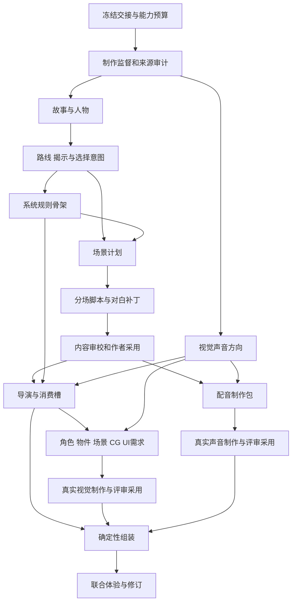

# AVG 专业岗位、工件与生产图

> L2 · 版本：1.2.0 · 生效：2026-10-14 · 受 [AVG 产品契约](../AVG.md)约束。
> 22 岗位/Skill 是目标合同；BASE-00B 已登记首批八种 schema、输出 key、关闭的专业 AI 写口和作者输入采用接缝，实际验证状态见实施计划。未登记的专业 Skill 尚不可调用，schema 或作者输入采用不等于岗位实现。

## 1 主助手、岗位与确定性职责

用户面对一个 AVG 制作助手，内部按实际任务调度独立岗位；岗位不要求常驻。每个生产岗位有一个核心 Skill、唯一候选写域与明确上游，不能将所有岗位挂在 `outline` 下再称专业团队。

现有 `avg.consult.v1` 继续只承担 S2 会谈。升级为 `avg-authoring-consultant / avg.consult.v2` 时保留旧草稿读取、切换新入口并下线旧生成路由；该岗位只产生方向草稿，作者命令更新 S2 revision，不在未开始时创建正式 Build 工件。

正式 S3 岗位表中的 key 模板由计划编译器实例化为闭集；模型不能任意选择另一个 Work、scene 或输出 key。所有内容/系统/制作 Brief 写 `payloadJson`，媒资需求候选按登记 schema 写 `metadataJson`；review 只写问题工件，不写生产对象。

| Agent ID / 核心 Skill ID | 输入工件与读取重点 | 独占输出 key | 方法和禁止项 |
|---|---|---|---|
| avg-production-director / avg.production-supervision.v1 | 已确认 Brief/SourcePlan、能力和问题 | avg.governance.production-plan | 制作范围/岗位/质量基准/预算建议；不扩大授权或自报通过 |
| avg-source-editor / avg.source-adaptation.v1 | 冻结来源、需求目录和证据 | avg.governance.source-audit | 必需事实、缺口、改编/私域补充与禁止披露；不替系统生成 SourceManifest |
| avg-story-architect / avg.story-design.v1 | 来源审计、体验与约束 | avg.content.story-bible | 欲望/冲突/代价、主题、因果与回收；不代写全部分场 |
| avg-cast-director / avg.cast-bible.v1 | 故事、来源人物及允许补充 | avg.content.cast-bible | 人物行为、关系弧、声音/知识、稳定主体；不回写世界 |
| avg-route-designer / avg.route-reveal-plan.v1 | 故事/人物、线性或分支范围 | avg.content.route-plan | 结局回推、分叉/汇流、信息和选择回响；不执行变量效果 |
| avg-scene-designer / avg.scene-plan.v1 | 路线、人物、系统骨架 | avg.content.scene-plan | 逐场目标/阻碍/策略/变化、资源需求；不扩大已冻预算 |
| avg-scene-writer / avg.scene-script.v1 | 指定场景、角色声音、相邻状态 | avg.content.scene-script.<sceneKey> | 具体动作与可读对白/选择；不改规则和人物所知 |
| avg-dialogue-editor / avg.dialogue-pass.v1 | 准确剧本、声音锚点、场景目的 | avg.content.dialogue-patch.<sceneKey> | 潜台词、回应/自然度、删重复；只改批准的表达字段 |
| avg-continuity-editor / avg.content-review.v1 | 剧本、来源、路线/知识和执行投影 | avg.review.content.<sceneKey> | 事实/动机/因果/知识/回收问题；不写剧本或自审同一 Run |
| avg-system-designer / avg.system-plan.v1 | 选用模块、路线意图、主体目录 | avg.system.plan | 类型/条件/效果/物品/知识/消费需求；只产候选，不生成任意代码 |
| avg-performance-director / avg.scene-direction.v1 | 被接受剧本、规则/槽、画面声音方向 | avg.system.direction.<sceneKey> | 注意目标、空间、焦点、时序和打断；不改剧情状态 |
| avg-art-director / avg.visual-bible.v1 | Brief、人物/场景和导演需求 | avg.media.visual-bible | 视觉基准/画布/空间/风格/复用和允许变化 |
| avg-character-designer / avg.character-assets.v1 | 视觉基准、主体与外观槽 | avg.media.character-brief.<subjectKey> | 身份、服装/姿态/表情、锚点；提交真实参考任务，不以 Prompt 代替图片 |
| avg-environment-designer / avg.environment-assets.v1 | 地点/镜头/光照与站位 | avg.media.environment-brief.<subjectKey> | 同地点/视角/天气变体，避免任意换场 |
| avg-prop-designer / avg.prop-assets.v1 | 正式物件状态、公开细节与消费者 | avg.media.prop-brief.<subjectKey> | 同物件 icon/detail/特写、可读细节；不从图像创建案件真相 |
| avg-ui-art-designer / avg.ui-assets.v1 | 正式 UI 槽、主题/设备/安全区 | avg.media.ui-brief.<consumerKey> | 控件皮肤/装饰/状态和缩放；文字由 UI，不能发任意网页代码 |
| avg-key-art-designer / avg.key-art-plan.v1 | 剧本、人物/物件参考与导演 | avg.media.key-art-brief.<requirementKey> | CG/封面的动作关系与构图，区分舞台/宣传消费者 |
| avg-sound-director / avg.sound-plan.v1 | 情绪拍、环境/事件、声音预算 | avg.media.sound-plan | BGM/变奏、环境/SFX 进出、循环/静默与混音用途 |
| avg-voice-director / avg.voice-performance.v1 | 定稿句/说话人/语言、潜台词 | avg.media.voice-plan.<sceneKey> | 读音、言语行动、上下句、音色/片段制作包；不改台词 |
| avg-visual-reviewer / avg.visual-review.v1 | 真实图、基准、连续合成及用途 | avg.review.visual.<requirementKey> | 身份/比例/动作/空间/信息/文字区；未收到图不得判达标 |
| avg-audio-reviewer / avg.audio-review.v1 | 真实音频、制作包及场景混音 | avg.review.audio.<requirementKey> | 读音、演法/衔接、噪音/截断/循环；不能观察音频时记未知 |
| avg-experience-reviewer / avg.experience-review.v1 | 准确 Build、实际路径/状态/媒体、问题 | avg.review.experience.<buildKey> | 跨线意图、可理解性和操作问题；不代替真实玩家回执 |

哈希/稳定 ID、角色来源映射、SourcePlan 权限、模型路由、预算/重试、parser/规则编译、Blob/绑定、事务、事件/检查点、stale、发布/导出均由确定性服务负责，不建立生成这些事实的 Agent。

### 1.1 岗位启用与最小专业路径

22 岗位是长期能力目录，不是每个作品都调用 22 个 Agent 的默认套餐。01A 先来源/制作与故事/人物/路线；02A1 再系统骨架；01B 才场景/写作/表达/连续性；02A2 才导演/最终编译。按任务多批使用，保持唯一核心 Skill/写域；作者直接提供合法工件时仍通过同一验证/采用，不为凑岗位数再生成一次。

角色/环境/道具/UI/关键画面、声音/配音等岗位只在存在对应需求时启用，review 只覆盖真实存在且可观察的输入。线性作品的 route Skill 管理揭示/结束而非强添分支；无声范围不开 voice 岗位；未选物件不启用 prop 工厂。所需评审不能因省调用被静默跳过。

CAL-00 冻结启用清单/预算，CAL-01 提前测试最小专业路径的收益。若分离编辑提高措辞却损坏人物/事实，或相同预算下采用/人工/质量没有收益，先修方法/任务粒度，不能机械增加 Agent。专业方向、Prompt、模型、实际样本和人工采用共同决定效果；岗位名称不证明专业水平。

## 2 工件最小 schema 与 ownership

所有工件复用现行候选容器和 `product-production-artifacts` adoption extension，增加 AVG 类型化 payload/metadata validator。公共 envelope 由系统添加：Work/production/build、artifact key/revision、schema/version、producer/Skill/Prompt、输入引用/hash、实际 Context Manifest、候选/采用/拒绝/stale、Run/attempt 和预算证据。模型只返回本 schema 的语义 payload，不自报真实 hash、授权、模型版本、质量通过或发布 lineage。

BASE-00B 的确定性作者输入先绑定已冻结 human-import 任务，只写 pending；作者通过 `adopt-avg-artifact` 命令确认后，才保存正式 revision 和事务回执。此路径无 provider/模型 Run，标为 author-import；不伪造 Context Manifest、专业岗位或人工艺术质量通过。来源引用暂限 SourcePlan 的初始资源，进一步读取与专业 AI producer 的真实 manifest/receipt 由 01A/01B 登记。刷新和备份后仍检查同一 hash/版本/上游，不能用 schema 正例或自报 authorAccepted 绕过命令确认。

| payload schema（统一前缀 storyforge.avg，version 1） | 必需内容 | 确定性检查 |
|---|---|---|
| production-plan | 作品目标、岗位/工件需求、依赖建议、基准/预算及停止点 | 工件/岗位闭集、需求在 Brief 内、计划无环；正式 DAG 由代码冻结 |
| source-audit | 事实/证据引用、必需缺口、产品补充与待确认项、知识/披露边界 | 引用来自实际 manifest，补充有作者授权，不能伪装源世界事实 |
| story-bible | 承诺/主题、核心因果、角色欲望/代价、不变量、回收与结局意图 | 主体/来源/约束引用、规模和上游版本 |
| cast-bible | characterKey、sourceRef 或产品新增依据、行动/声音、关系弧、knowledge refs、显示身份 | 稳定主体、唯一来源映射、公开/私密字段投影 |
| route-plan | route/scene/choice/ending keys、信息获得、分叉/汇流、即时/延迟回响 | 引用闭合、结局条件需求及可达性；线性不虚构分支 |
| scene-plan | sceneKey/location/cast、进入/离开状态、目标/阻碍/策略/变化、拍/选择意图及消费需求 | 来源/人物知识、前后交接、主体/需求在范围内 |
| scene-script | sceneKey、稳定 beat/line keys、speaker/显示名、文本、choice 文案及动作/信息引用 | ID/说话人/版本、规则写入隔离；知识硬约束和可读长度警告 |
| dialogue-patch | base script hash、line/field、旧值 hash、新文本、理由及不可改项 | 只准表达字段，稳定身份/事实/规则不改；通过作者采用生成新脚本 revision |
| system-plan | 模块/版本、变量、有限行动/条件/效果、目录、知识/解锁及消费槽 | 类型/范围、合法转换、scope、回放、目标引用、模块依赖无环 |
| scene-direction | scene/beat、焦点/布局、声明式动作、真实事件依赖、等待/打断/恢复、需求 refs | renderer 能力、Cue/事件闭集、时长边界、有限等待，不含规则副作用 |
| visual-bible / media-brief | 主体/用途/消费者、基准与参考、允许变化、画布/锚点、必要/降级、制作方式 | 有正式主体/槽、参考 owner/version、能力/预算和公开信息 |
| sound-plan / voice-plan | 消费拍/事件、文本/演法版本、人物/音色/语言、读音/上下句、循环/混音/片段用途 | 精确文本、合法 speaker、支持的参数、片段/事件覆盖 |
| review-issues | 输入版本、位置/证据、severity/owner、允许修改、影响与重验条件、未观察项 | 位置有效、review Run 分离、blocking 不能平均掉，不能伪造观察/人类身份 |

实际图片/音频是 provider/import 的不可变候选，拥有字节、技术元数据、权利、成本/传输与处理 lineage；它们不是上述 LLM payload 的替代品。物理 schema、Artifact kind 和 key pattern 由 AVG-BASE-00 登记，不能因此表出现名称便绕过 L3。

脚本是 scene-writer 拥有的规范语义工件；dialogue-editor 拥有补丁而非第二套脚本。确定性采用服务验证 base/权限并应用作者接受的补丁，生成脚本新 revision 与 derived lineage，writer 后续只能读取该正式 revision。

## 3 三线依赖 DAG

视觉/声音方向可早期并行；最终生成等待稳定主体和消费者。配音等待正式文本；content review 先检查候选与规则模拟投影，Build 形成后再检查实际展示/知识/消息状态。来源缺口涉及关键事实时停在缺口，返回作者裁决/S2 重新冻结，不能让后续图像或导演填事实。

## 4 Run、上下文和有界执行

每任务冻结具体 key/scene/主体、输入 Artifact revision/hash、WorldReference/SourcePlan、purpose/允许来源、能力、provider/model、输出 schema/大小、调用/token/时间/现金或可验证费用上界、尝试数及终止策略。每批调用/token/时长/attempt 必须有具体值，不能以“自动优化”开启无界重试；总现金/人工上限允许作者显式不设，本次首轮已取得该授权。未知费用不是零；若作者设置现金硬上限而系统无法验证，停止收费调用。无总上限也须记录真实费用/unknown 和全部失败、废弃及人工投入。

模型先看目录/相关摘要，再渐进读取当前工件、相邻进入/退出状态、角色/路线或必要原文；必读/禁止由 Gateway 校验。固定前 N 条不作为来源策略；最终 token 裁剪不能删除必读约束后继续运行。

目标 Context Sources（待登记）：`avg.content-inputs`、`avg.system-inputs`、`avg.media-inputs`、`avg.review-inputs`。它们对既有 brief/artifact-inputs 做按用途/版本/权限的产品投影，不形成第二套上下文装配器。媒资 provider 只取得已确认视觉/声音资料及用途需要的信息；不默认发送完整人物秘密或源作品。

任务粒度为指定场景、主体家族、需求或评审包；一个 Skill 可以多批使用，但每批有独立 input closure/Run。并发只允许没有冲突的写域和已满足前置，最终 fan-in 对准同一 Build 输入集。

原始响应、候选、事件、checkpoint、repair 和终态 receipt 持久化；刷新继续已知 Run，不暗重发。结果未知、余额/授权问题、非重试型 4xx、stale 或预算不足必须停在可见状态。结构 repair 和创作重写分别记账；同 Skill 的有界新 attempt 不变成无限“审稿循环”。

## 5 方法卡、审校与采用

核心方法采用[专业方法研究 M01～M07](../../audits/AVG-PROFESSIONAL-METHODS-20261013.md)：当下有效的日常行为及后场回响、行动代价与路线价值、言语行动/潜台词、叙事视角与镜头语法、连续资产家族、表演/混音，以及按实际 Build 反查问题。

每个 Skill 发布时必须携带输入/输出 schema、具体方法步骤、至少一个原创正例和一个会被拒绝/返修的反例、rubric、上下文空/缺失策略、预算、stale/修复和真实评测入口。方法、Prompt、schema 和 compiler 分别版本化；修改方法不追写旧 Run 结果。

producer 与 reviewer 分离 Run/职责。若宣称独立模型评审，须使用不同 `provider + model` 并保存真实路由；同模型的独立 Run 只能叫辅助审校。文学/艺术意见仍需作者及目标玩家，schema 通过不证明表达成熟。

review 输出问题单，作者可以接受、退回或说明不采纳；blocking 不能用平均分抵消。高影响事实/关系/路线变更返回相应 owner，表达补丁不能偷改上游；模型给出“通过”不创建正式质量或人类 receipt。

注册与采用顺序：Agent/Skill → Context Source/输入政策 → FIELD_REGISTRY/schema/写域 → adoption extension/parser → 任务/Artifact key 与生命周期 → 正反例/恢复 → 真实任务校准。不要先在组件中自由调用模型，再补一张岗位表。
