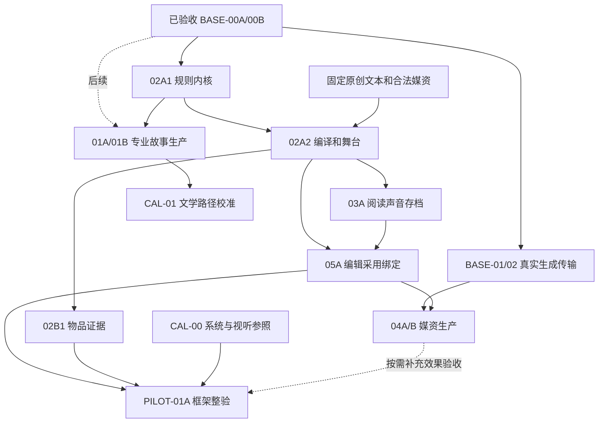

# AVG 实施计划与依赖顺序

> L2 · 版本：1.9.0 · 生效：2026-10-15 · 上位条目：E-AVG-01。
> 唯一产品施工入口：[AVG.md](../products/AVG.md)；逐包开工与验收：[工作包卡](AVG-WORK-PACKAGE-CARDS.md)。
> 正式设计已交付并经内容复审；公共/私有版本接缝已通过分支工程验收；真实生成、质量校准与首戏尚未通过。产品仍为 partial。

## 1 当前边界与下一步

2026-10-15 作者重新确定优先级：**先交付 AVG 系统与表现框架，专业剧情/故事设计与文学对照后置**。已进入目标模式；不以故事 Agent、故事圣经、分场生成或文学 CAL-01 为系统施工前置。固定原创测试文本和授权/测试媒资只用于框架验证，不据此评价剧情创作能力。

AVG-BASE-00A/00B 已通过分支工程验收；本轮从 **AVG-02A1 确定性规则内核**开工。先前 BASE-01 仅做过基线准备，尚无媒体代码；真实参考生成/配音接入继续保留，按框架需要推进，不阻塞合法导入、舞台或播放器。所有分支验收与主干上线、真实模型、人类试玩和商业质量分别记账。

### 1.1 当前目标的四个交付阶段

| 阶段 | 对应工作包 | 可检查的结果 |
|---|---|---|
| 1 规则与统一编译 | 02A1 → 02A2 | 变量/玩家与角色知识/关系/选择、有限条件效果、图校验和状态模拟；固定文本可编译成同一版本化包，不复制运行引擎 |
| 2 播放与表现 | 02A2 + 03A | 对话推进/历史/选择、背景/立绘/CG/Cue、真实音频等待与打断、资源加载、偏好和存档恢复实际联动 |
| 3 物件、媒资和编辑 | 02B1 + 05A；BASE-01/02、04A/B 按实际需要 | 物品/证据可获得、检查、使用/出示；需求→导入或生成→候选/采用→绑定；改字、换图与联合预览、失效/局部返修贯通 |
| 4 框架整体验收 | PILOT-01A 的工程路径；所选 03B/02B2 | 两套可替换测试配置验证复用，隔离浏览器完成选择/物件/画面/声音/刷新/存档/备份与旧 V1 回归；可选模块有明示合同和能力开关，未实现者不冒充可用 |

02A1 的确定性编译/预览先独立交付，专业 system-designer 接入后置；02A2 的有限导演合同/renderer 先行，专业 performance-director 不阻塞工程。开始具体作者作品时仍需 AVG Work、明确开始、Brief、SourcePlan、合法候选和采用，不为测试框架开一个绕过正式治理的作品入口。

本目标不承诺一次实现所有可选系统、Live2D/3D/视频或独立小游戏；先冻结扩展合同、依赖及缺能力时拒绝的边界。故事岗位 01A/01B、文学 CAL-01、自动生成首戏/独立读者文学评分、分发及大规模题材扩展进入后续队列，不作为本轮框架完成门。美术与声音的连续性、实际播放和系统交互仍须用真实效果取证，不能以 schema/测试通过代替。

## 2 实际施工队列

| 单元 ID | 状态 | 直接前置 | 可独立验收的交付 |
|---|---|---|---|
| AVG-00 | 设计交付 | 无 | 三线/系统/媒资/质量方案与权威路由；不等于产品 DONE |
| AVG-CAL-00 | 准备中 | AVG-00 | 指定版本/语言/连续场景参照、rubric 锚点、首批功能/设备/投入矩阵与专业岗位启用条件 |
| AVG-BASE-00A | 分支验收 | AVG-00 | 公共 Package/Preview/Release Manifest V2 分派、hash、嵌套导入/运行来源兼容；不实现新玩法 |
| AVG-BASE-00B | 分支验收 | AVG-BASE-00A | AVG Settings/Module/Presentation/Binding、专业工件/消费者 typed schema 与作者输入采用接缝；未登记专业 AI 和新运行能力继续关闭 |
| AVG-BASE-01 | 按需排队 | AVG-BASE-00B | 媒体请求 V2、真实参考/能力/费用/async receipt；V1 文本路径不变 |
| AVG-BASE-02 | QUEUED | AVG-BASE-01 | voice 传输/真实 clip/对齐/权利；不阻塞授权音频导入和播放器研发 |
| AVG-01A | LATER | AVG-BASE-00B, AVG-CAL-00 | S2 会谈、制作/来源、故事/人物/路线意图；不要求最终系统或剧本 |
| AVG-02A1 | 施工中 | AVG-BASE-00B | 先交付确定性 system-plan/规则编译和只读模拟；专业设计 Agent 后置，不依赖故事 |
| AVG-01B | LATER | AVG-01A, AVG-02A1 | 受规则骨架约束的场景卡/剧本/表达补丁/内容问题及作者采用 |
| AVG-CAL-01 | LATER | AVG-CAL-00, AVG-01B | 提前比较通用/专业/分离编辑路径，记录文学质量/人工/费用；本轮图/音按 CAL-00、BASE-01/02 与 04A/B 分项先行 |
| AVG-02A2 | 施工中 | AVG-02A1 | 先接固定/已采用脚本、有限导演合同和编译/舞台/消费槽；专业导演和故事生成不阻塞框架 |
| AVG-02B1 | 施工中 | AVG-02A2 | 物件/证据、查看/出示、知识投影与 inventory/detail 消费者；首戏所需完整小模块 |
| AVG-03A | QUEUED | AVG-02A2 | 阅读/声音/历史、存档槽/偏好、资源加载与失败恢复；使用真实授权导入音频即可验收 |
| AVG-05A | QUEUED | AVG-02A2, AVG-03A | 最小场景编辑/采用/联合预览与问题定位；支持合法媒体导入，不等待完整三线 UI |
| AVG-PILOT-01A | QUEUED | AVG-05A, AVG-02B1, AVG-CAL-00 | 先以固定工程场景验消费者/规则/播放/恢复/编辑和第二配置；作品质量与自动生成另验 |
| AVG-04A | QUEUED | AVG-BASE-01, AVG-02A2, CAL-00 视觉分项 | 视觉岗位/真实参考/必要家族/加工/采用/绑定；涉及物件还需 AVG-02B1 |
| AVG-04B | QUEUED | AVG-BASE-02, AVG-02A2, CAL-00 声音分项 | 固定/已采用准确台词的真实音频/演法/审听/采用与绑定；专业剧情岗位不阻塞 |
| AVG-PILOT-01B | LATER | AVG-PILOT-01A, AVG-04A, AVG-04B | 正式生成并绑定的同一完整戏、可用/淘汰率/人工/费用；不得借导入模式通过自动生产门 |
| AVG-05B | LATER | AVG-PILOT-01B | 依实际问题补全三线工作台、批次/锁定、跨线最小返修、真实声音/参考管理与回执失效 |
| AVG-03B | QUEUED | AVG-03A | 跨周目 progress 的注册表/迁移/导出/导入/remap/delete/去重；不挡单会话首戏 |
| AVG-02B2 | QUEUED | AVG-02A2 | 后续 optional 队列：热点/地点、话题/消息、档案/辅助按实际选用分别细化/交付；不强依赖库存，未选者不阻塞首戏 |
| AVG-06 | LATER | AVG-PILOT-01B, AVG-05B | 15～30 分钟切片、扩大内容对照/专业评审/独立玩家、修复版→旧档；所选模块另加真实依赖 |
| AVG-07 | LATER | AVG-06 | 指定渠道播放器/离线包、语言/设备/权利、隔离安装与维护；所需鉴赏/进度加 02B2/03B |
| AVG-08 | LATER | AVG-06 | 第二题材/配置、长作品投入与高级表现；小型换来源/关闭模块探针已在前包执行 |

AVG-BASE-00、AVG-01、AVG-02A、AVG-02B、AVG-03、AVG-05、AVG-PILOT-01 是聚合组；AVG-02/AVG-04 仅指规则/导演与视觉/声音两个领域，均不是另一个可重复领取的施工单元。CAL 单元是质量/可行性验证，不新建产品或生产泳道。

### 2.1 当前增量与验收边界

AVG-BASE-00A 使用独立工作树/分支 `feat/avg-base00a-20261014`，基线为远程主干 `e40fadce` 和同步后的设计 `8df94be1`；代码提交 `7738a7e0`，交付 [PR #137](https://github.com/yuanbw2025/storyforge/pull/137)，依赖设计 [PR #133](https://github.com/yuanbw2025/storyforge/pull/133)。Package/Preview/Release 的严格 V1/V2 分派、哈希和 Build/Release 来源检查已实现，备份派生引擎在写入前验证嵌套版本和指针。旧备份的空对象或单独 `version:1` 占位记录保持原字节/指针，只作不透明备份数据，不能作为正式运行来源；完整协议和所有新版本继续严格校验。未新增表、AI 写域、模型调用或正式生产入口。

00A 验收时 V2 仅允许 AVG 公共叙事载体，`modules` 与 `mediaBindings` 必须为空、能力仅为 `narrative`；未知版本/模块和混合嵌套版本拒绝。版本可解析、可备份不表示可运行：V2 会话启动/会话备份继续拒绝，00B 扩展产品 schema（当前增量见 §2.2），02A2/03A 才验收新玩家。

V1 固定协议/字节/哈希值由原 `e40fadce` 解析器取证并进入回归；旧哈希域不变。V2 Preview 哈希覆盖整个正文（含版本、productionKey、buildNumber），嵌套包、来源合同、lineage 和 owner 另有独立校验；不静默降级 V2、改写旧记录或升级旧档。

00A 已通过分支工程验收（2026-10-14）：

| 检查 | 实际结果 |
|---|---|
| 定向协议/来源/生命周期与旧调用方 | 9 文件 / 54 测试通过，其中新包 18 正反例；V1 固定字节/hash、跨 Work、备份往返/原子拒绝、旧占位和 V2 会话关闭均覆盖 |
| `npm run ci` | 792 文件 / 4,353 测试通过；覆盖率、治理/文档、lint、TypeScript、build、依赖审计与包体门通过 |
| `PLAYWRIGHT_PORT=4198 npm run ci:e2e` | 隔离 Chromium：254 通过 / 2 项既有条件测试跳过；新增 carrier 刷新/往返与既有 AVG 作者/试玩路径通过 |
| 自查与交付 | code `7738a7e0`、PR #137；工作树干净，diff 检查通过，未合并 main |
| 性能/质量边界 | smoke 正确产出 `long-run-incomplete`，测试通过不代表长时商业性能；V2 首戏、真实模型/媒资、人工及商业质量均未验收 |

首次全量回归暴露旧 `version:1` 占位备份兼容问题，已在同包修复并通过旧长篇备份验收；未改写原记录。测试源码不变的验收记录更新只运行文档/diff 直接检查，工程结果绑定上述代码提交。main 集成和设计依赖仍待处理，产品整体继续 partial。

CAL-00 已进入准备。作者于 2026-10-14 明确答复“没有上限”，首轮模型/媒资总费用及修稿、修图、审听工时不设作者上限，并授权使用 Agnes 现有调用路线；这项授权不再等待或重复确认。每个真实试验仍冻结有限样本、调用/token/时长/attempt 和真实路由，全部失败/废弃/修改及费用留账；未知费用记 unknown，不能记零。该授权不等于无界自动重试、作品开始或外部发布授权。连续参照、实际路由/能力和专业观察仍需取得真实证据。

### 2.2 AVG-BASE-00B 分支验收

使用独立工作树 `avg-base00b-20261014` / 分支 `feat/avg-base00b-20261014`，协议代码 `274ccf84`、采用代码 `29371705`，完整 CI 对应包含文档的 `aa44eae6`，[PR #140](https://github.com/yuanbw2025/storyforge/pull/140)。基线为 `origin/main cfc5ed3f`，显式依赖已验收的 00A `18218f73`。本包是 AVG 产品能力研发的私有协议接缝：S2 的作者期望与显式 V1→V2 提案、S3 的专业候选验证和冻结载体，owner 留在 AVG Work / production / 产品媒资，世界仅按原冻结来源只读引用。不创建具体作品或调用模型/媒资。

实际首批 schema 为 production-plan、source-audit、story-bible、cast-bible、route-plan、scene-script、dialogue-patch、review-issues；其余规则/导演/视觉/声音 DTO 和 22 岗位目录中未实现的 Skill 保留为后续包，不能通过任意 JSON 或旧通用采用口启用。严格 key/schema/kind/场景写域校验已接入；旧通用写口仍拒绝专业 AI 工件，V1 作者媒体编号继续兼容并有实际媒资写入回归。

本轮补充登记的作者输入接缝：`stageAvgAuthorArtifactV1` 只接收已冻结 human-import 任务的输出/输入闭集，写 pending 候选；`adopt-avg-artifact` 复用生产命令 claim/CAS/幂等回执，确认后正式采用。事务校验 AVG Work/Production、开始命令、Brief/ConfirmedBrief/SourcePlan/Plan、epoch、候选真实 hash、上游与当前正式 revision。来源引用暂限冻结初始资源；新增读取等待 01A 的真实 manifest。作者输入无模型 Run，不冒充专业 AI 或观察证据。

表达补丁采用会原子保存补丁和脚本新 revision、实际 base/patch/receipt/hash，并失效被替换版本及受影响的正式消费者；历史文本保留。纯 patch 函数仍只返回候选。表达字段限制不证明句意/事实正确，01B 的内容审校仍必需。已覆盖 pending 和 accepted 两类备份 remap、恢复后实际采用/读取、跨 Work、篡改、过期来源/基线、重复确认及删除隔离。

V2 可承载至多一个已登记 AVG 基础模块，逐句身份/文本与公共 narrative 对齐；Presentation V2、Binding V1 和九域消费槽有独立严格 codec。可执行状态/行动/Cue、实际绑定、progress/assist 均仍关闭，V2 的正式生产和运行继续拒绝。Settings V2 是有界作者期望，不接收作者/模型自报的 capability ready、质量通过、调用或发布回执；旧 V1 设置/声音/字节/hash 不改写。提案的 null 总上限表示未设作者上限，不能代替开始授权；派生默认零调用。

复用已有 FIELD_REGISTRY / adoption extension / PROJECT_TABLES，未增加 AI 写字段、Context Source、表/索引或迁移；新增确定性作者采用命令。旧 S2/V1 生产、采用、发布与玩家路径继续回归；新专业上下文/Skill/producer 验证与实际计划编译由 01A/01B 各自包登记。当前作者采用仅验证私有承载接缝，尚不提供新的工作台 UI，不是已完成专业生成、自动绑定或新播放器。

当前工程结果（2026-10-14）：定向 9 文件 / 61 测试通过；隔离 Chromium 全量 255 通过 / 2 项既有条件跳过。全量 CI 首轮 4,359 通过 / 13 超时失败（5 文件），5 文件 / 189 测试隔离复测通过后，完整 CI 按共享资源串行执行，793 文件 / 4,372 测试、构建及包体检查全部通过（exit 0）；未修改测试时限或断言。此证据对应协议子增量 `274ccf84`，不覆盖后续采用代码。性能 smoke 仍给出 long-run-incomplete，不是长时性能验收。

最终采用增量于 2026-10-15 核对通过：定向 10 文件 / 72 测试通过；隔离 Chromium 的 AVG 草稿/修订/版本/采用/恢复 6 条 E2E 通过；完整串行 `CI=1 npm run ci` 为 794 文件 / 4,383 测试、全部治理检查、类型/代码检查、生产构建及包体检查通过，exit 0。此结果覆盖采用代码 `29371705` 和文档 `aa44eae6`，不借用前一协议子增量结果；本轮没有重新运行全仓浏览器套件，不能把旧 255/2 计作新代码全量 E2E。00B 限定的采用/序列化接缝通过分支工程验收，允许下一基础包施工；专业生产、艺术/人工/玩家质量与 V2 可玩能力仍按后续包验收。

### 2.3 系统优先开工：内核增量

复用独立工作树 `avg-base01-20261015`，从准备分支另建 `feat/avg-system-presentation-framework-20261015`；基线为最新已取证主干 `5147924e` + 00B `13ce6792` + 准备文档 `8440ddbd`。主检出与已验收 00A/00B 工作树不承担新包修改。

本增量是 AVG-02A1 的**确定性内核**：`system-contract.ts` 严格解析变量/知识/关系、场景/行动、有限条件效果与安全路径；`system-state.ts` 约束逐效果状态，`system-compiler.ts` 将其编译为现有 Frozen Narrative，复用 `enterFrozenNarrativeNode/advanceFrozenNarrativeChoice` 作有界只读模拟。没有故事正文或媒体字节，空 Beat 明确表示规则预览；不能启动 V2 玩家、冻结正式作品或签发运行/质量 receipt。此内核提交未启用专业 `avg.system-plan.v1` Skill、AI 写域或作者正式采用；后继作者接缝见 §2.4。

输入/输出均在内存中；不读 WorldRelease、不调用模型、不写表/候选/会话、不新增 CONTEXT_SOURCES / FIELD_REGISTRY / PROJECT_TABLES 或迁移。对下游交付规范 system-plan、编译图、准确 hash 和逐步状态；之后必须经受治理的作者输入/采用、V2 模块版本升级及玩家准入才能运行。V1 字节和现有关闭门保持原义。

验证范围包括两套原创规则配置、玩家/角色知识隔离、已选行动/访问条件、可见与可用分离、关系/变量范围、原子失败与输入不变、未知字段/安全路径、死路/循环/孤立/悬空引用。结构可达不表示所有状态路径均可通关；只读模拟仅验证实际执行的路径，未覆盖路径不得自报通过。当前定向 5 文件 / 52 测试通过（内核 10 项）；治理/必需表/AI Manual、源码可达、文档、定向 lint、TypeScript、build 和 diff 检查通过。内核代码提交 `d99d56c5` / [PR #143](https://github.com/yuanbw2025/storyforge/pull/143) 保持 Draft，完整 CI 待共享槽位运行；当前仅完成内核实现及定向验收，02A1 全包与本轮框架均未完成。

### 2.4 当前作者规则接缝增量

独立工作树 `avg-rules-adoption-20261015` / 分支 `feat/avg-rules-adoption-20261015` 从内核 `d99d56c5` 建立；前一工作树保持不变，供已排队 CI 验证。当前生命周期为 AVG 产品研发，完善 S3 作者输入/采用/编译读取；规则与工件归 AVG Work，世界只读来源不回写，媒资/玩家未改变。

`avg.system.plan` 以 `product-module` 通过既有严格工件 codec 和作者暂存/确认命令。图与入口检查由代码实际执行并生成 candidate@2 校验证据；确认时重新验证，拒绝伪造校验或 stale，正式 revision 才能交给 `readAvgSystemPlanForCompilationV1`。继续复用 FIELD_REGISTRY/Adoption extension 和 PROJECT_TABLES 的 production/build/artifact/command 生命周期，未新增 Context Source、AI 字段、表/迁移或模型调用。旧非规则作者 candidate@1 保留原义。

02A1 本轮工程完成门是规范规则、确定性编译/模拟、受治理作者采用与编译读取；专业设计 Agent 后置，02A2 的联合编译和播放器不是 02A1 的循环前置。

闭包：规范规则 → 冻结 human-import 任务写域 → pending → 实际作者命令 claim/CAS/幂等 → 校验与正式 revision → 受校验的编译读取；规则修订使旧依赖失效且保留字节；备份重映射/恢复/删除沿注册表。受控测试任务不冒充已经实现的生产 planner/工作台；该作者接缝提交未启用专业 AI、联合编译或 V2 玩家；后继原生增量见 §2.5。

当前包含旧调用方的定向回归 6 文件 / 57 测试通过；隔离 Chromium 的规则候选/确认/刷新/备份/篡改与旧 AVG 路径 7 条通过。纯规则校验以单个事务等待保活，内部计算不进入 DB 事务，避免嵌套哈希等待自依赖；测试时限未放宽。architecture、required-tables、ai-manual、源码可达、文档、统计、定向 lint、TypeScript、生产 build 和 diff 检查通过；完整 CI 待串行执行，尚不标记工程包验收完成。

### 2.5 原生编译与玩家接缝

独立 `avg-runtime-framework-20261015` / 分支 `feat/avg-runtime-framework-20261015` 从作者规则 `00222d28` / [PR #145](https://github.com/yuanbw2025/storyforge/pull/145) 建立。产品研发，完善 S3 包候选和冻结来源运行；规则/脚本/演出和媒资仍归 AVG Work/产品，运行状态归 AVG 会话，世界只读固定引用。前两树供各自 CI 使用，不覆盖共享主检出。

新增同步规则 lowering、`AvgRuntimeModuleV2` 严格 codec 与联合编译；确定性编译读取实际确认的规则/脚本，验证当前依赖并保留文字与选择身份/后果的分工。原生 Package V2 通过公共版本化源验证进入同一会话/事件/checkpoint/玩家，阶段复用现有 Cue renderer 和 Blob resolver。演出草稿到正式采用/生产 planner/durable 集成仍待施工，不把受控冻结夹具当成正式制作 UI。

持久化只增加现有 JSON 状态中的原生可选字段，无新表/索引/迁移、AI Source/Field 或模型调用；CONTEXT_SOURCES/AI 写域不扩。三注册表的现有 runtime/export/import/delete 生命周期继续派生。原生规则重放逐效果验范围，原生缓存由事件重放复核；导入/导出校验 source/owner/初始规则/hash，旧 V1 省略新字段，旧 inert V2 会话仍拒绝。TTRPG 三处兼容调用明确收窄自己的产品类型，没有新增跑团功能。

当前定向 17 文件 / 109 测试通过（新原生模块 9 项），覆盖 Build/Release 来源运行、重复访问、状态隔离、存档分支/备份恢复、原子拒绝和旧 AVG/TTRPG 调用。隔离 Chromium 8 条 E2E 通过，实际渲染台词/说话人/night Cue/知识选择并验证刷新、快速存档；已查看截图。architecture、required-tables、ai-manual、源码可达、文档/统计、lint、TypeScript、生产 build、bundle-size 和 diff 检查通过；完整 CI 待共享串行槽位。此原生接缝不含物件/证据（后继增量见 §2.6）、完整语音屏障与历史、作者工作台、真实媒资自动配置/效果校准，不能关闭总目标。

### 2.6 物件/证据与实际玩家投影

独立 `avg-inventory-20261015` / 分支 `feat/avg-inventory-20261015` 从原生 `d5fba87f` / [PR #146](https://github.com/yuanbw2025/storyforge/pull/146) 建立，保留前树给 CI。最新远端主干 `a27ea30e` 只比准备基线增加流量归档；本分支明确依赖前述 AVG 栈，未合并上线。生命周期是 AVG 产品研发，完善 S3 规则采用和冻结来源运行；规则/媒资归 AVG Work，物件状态归 AVG 会话，世界引用只读。

本轮接 `AvgSystemPlanV2` 的有限物件定义/实例/状态转换/公开变体/操作、原生能力与图标/详情引用，并复用作者确认/联合编译、类型槽和现有事件/存档；无新表/索引/迁移、Context Source/AI 写域或模型调用。新增受治理 CAS 命令与专用 replay adapter，界面通过 store/API 发出准确动作和目标，不能发送任意效果。代码实际检查唯一/堆叠/获得/查看/出示/转移/使用/状态变化/移除、知识与可见性、重复奖励/错误目标/过期基线和原子失败。背包与实际 Blob resolver、checkpoint/分支/备份恢复/删除闭合；不触发剧情重新入场。

当前定向 18 文件 / 122 测试通过；资源释放加固后对应 2 文件 / 22 项再次通过。隔离 Chromium 9 条 E2E 通过，实际确认图标/详情图 Blob 解码、未知细节隐藏、面板自动播放暂停、操作反馈、等待存档成功回执再刷新、分支读档后再次解码与移动布局；已复核桌面和移动截图。修复了切换分支时旧 resolver URL 被释放后仍显示的时序问题，并阻止释放中的预加载创建新 URL。治理/三注册表/源码可达、类型/lint、生产 build/包体、文档/统计与 diff 均验证，完整 CI 继续按共享槽位串行验证，尚无全包完成结论。原始固定 SVG 只验证真实字节消费，不代表商业美术、自动生图或媒资工厂。正式作者工作台/生产 planner 与整体框架验收继续按 05A/03A 等包推进。

## 3 调整后的依赖

故事生产未来消费稳定规则框架；其失败不会阻塞本轮系统研发。真实参考/生成/声音能力按分项校准，未知项不扩大生产；导入回执不能冒充生成回执。可选系统、跨周目和高级表现按独立合同接入，不改变知识、媒资和世界的 owner。

## 4 基础接缝与能力启用

00A 仅提供公共版本/hash/来源承载，两个实际调用方为 Build Preview 和 ProductRelease 冻结/运行；兼容测试不依赖未来 02/03 的新玩法已经实现。00B 承担 AVG 私有 schema/Settings/工件/消费类型，未支持能力失败关闭。V2 的首次可运行验收在 02A2 + 03A，不能把结构 fixture 当成软件或作品验收。

参考与 voice 复用版本化媒体请求/证据外壳；公共扩展需要 AVG 与另一实际需求调用方证据，否则采用 AVG adapter。voice provider 尚未就绪不阻塞授权导入 clip 的播放和恢复。所有输入必须走合法 candidate/adopt、实际 Blob/版本和 typed consumer。

新功能按 CAL-00 的能力矩阵启用，记录 compiler、renderer、Skill、provider、数据生命周期和质量门是否都就绪。首批默认中文、一个冻结画幅、静态立绘/背景/关键画面、有限分支和物件；其他语言、消息/热点、鉴赏及高级表现按选择增加依赖，不强迫首戏实现全部目标。

旧 V1 内容/字节/hash 不改写；原有新游戏、继续、保存和恢复仍受回归保护，“只读旧包”不等于禁止旧会话正常操作。V1→V2 草稿显式派生，旧档没有批准 migration 不跨包加载。新专业入口就绪后收口同范围旧通用生成入口；未达到正式门按实验性隐藏，回滚入口不删数据。

## 5 商业质量与投入门

功能覆盖完整不等于全部功能都立即开发。角色/风格/声音基准和实际连续参照在 CAL-00 冻结；图/音工程与质量锚点在 CAL-00 对应分项取证；专业内容样本 CAL-01 后置；首戏、切片、独立交付和长作品分别证明其范围。判“接近某商业作品”必须绑定作品版本/场景类型/语言/观察者及逐项实际比较，不能由自评 4/5 或通关率推出。

27 个候选样本的内容对照分两阶段：CAL-01 先一个匹配 Brief × 三条路径 × 三个样本（9 个）；06 在方法/投入未失败后补另外两类（18 个）。全部输出/拒绝/人工修改与调用成本留存，同预算比较；多岗位路径不是每样本一次调用。样本/单批资源和停止条件在调用前冻结；有作者总上限时不得超额，本次首轮已明确无总上限，仍须逐批记录实际投入和是否值得扩大。

专业编辑/美术/声音意见、作者实际采用、独立玩家与渠道安装证据分别取得。读者喜欢一部短戏可支持继续制作，不能证明完整长篇、所有题材、全自动生产或盈利。若质量提升不够、修稿/修图/审听投入超出作者上限，停扩大并回到方法/选型/制作路径；允许已授权的人工作为正式编辑/美术/声音生产输入，仍走同一采用与版本合同。

## 6 验证与交接

设计复审只做内容覆盖、语义依赖、文档路由/链接和 Git 检查。未来代码按 AGENTS 的定向测试、架构/表/AI Manual、TypeScript、build/ci；UI/API、数据恢复和跨线在隔离浏览器项目跑 E2E，保护作者数据。真实模型/图/音/人类/渠道门不能被 fixture 或《雾港》旧素材填补。

共享 schema/三注册表/包/transport 用独立基础 commit 串行集成，再更新产品分支；不同任务采用独立 worktree，不使用共享主检出目录。代码与验证按本计划的工作包实施；设计文档和研发校准本身不代表具体作品开始、main 合并/部署或外部分发。最终状态由准确 commit/PR/证据确认。
