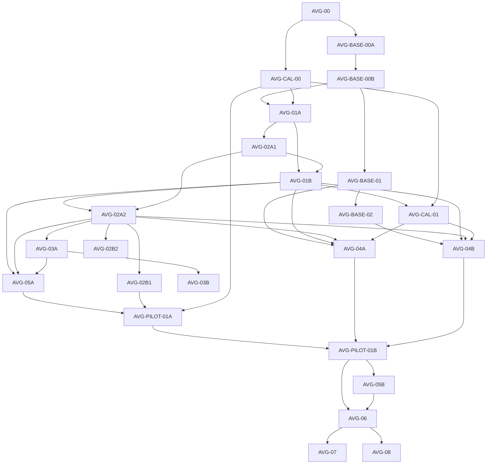

# AVG 实施计划与依赖顺序

> L2 · 版本：1.4.0 · 生效：2026-10-15 · 上位条目：E-AVG-01。
> 唯一产品施工入口：[AVG.md](../products/AVG.md)；逐包开工与验收：[工作包卡](AVG-WORK-PACKAGE-CARDS.md)。
> 正式设计已交付并经内容复审；公共版本接缝已通过分支工程验收；真实生成、质量校准与首戏尚未通过。产品仍为 partial。

## 1 当前边界与下一步

已授权按本计划实施，每个增量完成后更新进度和验收证据。**AVG-BASE-00A：公共版本承载与兼容分派**和 **AVG-BASE-00B：AVG 私有 schema 与采用接缝**已通过分支工程验收，下一代码单元是 **AVG-BASE-01：实际参考与媒体传输**；**AVG-CAL-00：商业参照、质量/能力和投入边界冻结**继续准备。分支验收不表示已合并上线；未有真实质量锚点不能宣称商业质量或放大生产。

原分组保留稳定名称，拆为下列 24 个施工/验证节点。近期增量按明确前置独立交付；后置 optional 模块、渠道和规模节点还需按真实选择展开具体开工卡，不能把目标目录称为全量可直接施工。聚合包不会因为一个子单元通过而完成；各增量使用独立 commit/PR/最终 head 和证据，共享热点串行集成。

## 2 实际施工队列

| 单元 ID | 状态 | 直接前置 | 可独立验收的交付 |
|---|---|---|---|
| AVG-00 | 设计交付 | 无 | 三线/系统/媒资/质量方案与权威路由；不等于产品 DONE |
| AVG-CAL-00 | 准备中 | AVG-00 | 指定版本/语言/连续场景参照、rubric 锚点、首批功能/设备/投入矩阵与专业岗位启用条件 |
| AVG-BASE-00A | 分支验收 | AVG-00 | 公共 Package/Preview/Release Manifest V2 分派、hash、嵌套导入/运行来源兼容；不实现新玩法 |
| AVG-BASE-00B | 分支验收 | AVG-BASE-00A | AVG Settings/Module/Presentation/Binding、专业工件/消费者 typed schema 与作者输入采用接缝；未登记专业 AI 和新运行能力继续关闭 |
| AVG-BASE-01 | QUEUED | AVG-BASE-00B | 媒体请求 V2、真实参考/能力/费用/async receipt；V1 文本路径不变 |
| AVG-BASE-02 | QUEUED | AVG-BASE-01 | voice 传输/真实 clip/对齐/权利；不阻塞授权音频导入和播放器研发 |
| AVG-01A | QUEUED | AVG-BASE-00B, AVG-CAL-00 | S2 会谈、制作/来源、故事/人物/路线意图；不要求最终系统或剧本 |
| AVG-02A1 | QUEUED | AVG-01A | system-plan、类型化规则/知识/选择骨架及状态模拟；不依赖最终剧本/导演 |
| AVG-01B | QUEUED | AVG-01A, AVG-02A1 | 受规则骨架约束的场景卡/剧本/表达补丁/内容问题及作者采用 |
| AVG-CAL-01 | QUEUED | AVG-CAL-00, AVG-01B | 提前比较通用/专业/分离编辑路径，记录质量/人工/费用；图/音分项消费 BASE-01/02 的真实试验回执 |
| AVG-02A2 | QUEUED | AVG-01B, AVG-02A1 | 导演、确定性编译/基础舞台/消费槽和 V2 可运行规则；不依赖完整媒资工厂 |
| AVG-02B1 | QUEUED | AVG-02A2 | 物件/证据、查看/出示、知识投影与 inventory/detail 消费者；首戏所需完整小模块 |
| AVG-03A | QUEUED | AVG-02A2 | 阅读/声音/历史、存档槽/偏好、资源加载与失败恢复；使用真实授权导入音频即可验收 |
| AVG-05A | QUEUED | AVG-01B, AVG-02A2, AVG-03A | 最小场景编辑/采用/联合预览与问题定位；支持合法媒体导入，不等待完整三线 UI |
| AVG-PILOT-01A | QUEUED | AVG-05A, AVG-02B1, AVG-CAL-00 | 导入组装的 3～5 分钟连续戏，实查消费者/规则/播放/恢复/人工修改；不证明自动生成 |
| AVG-04A | QUEUED | AVG-BASE-01, AVG-01B, AVG-02A2, AVG-CAL-01 | 视觉岗位/真实参考/必要家族/加工/采用/绑定；涉及物件还需 AVG-02B1 |
| AVG-04B | QUEUED | AVG-BASE-02, AVG-01B, AVG-02A2, AVG-CAL-01 | 声音/配音岗位、真实音频/演法/审听/采用与绑定 |
| AVG-PILOT-01B | QUEUED | AVG-PILOT-01A, AVG-04A, AVG-04B | 正式生成并绑定的同一完整戏、可用/淘汰率/人工/费用；不得借导入模式通过自动生产门 |
| AVG-05B | QUEUED | AVG-PILOT-01B | 依实际问题补全三线工作台、批次/锁定、跨线最小返修、真实声音/参考管理与回执失效 |
| AVG-03B | QUEUED | AVG-03A | 跨周目 progress 的注册表/迁移/导出/导入/remap/delete/去重；不挡单会话首戏 |
| AVG-02B2 | QUEUED | AVG-02A2 | 后续 optional 队列：热点/地点、话题/消息、档案/辅助按实际选用分别细化/交付；不强依赖库存，未选者不阻塞首戏 |
| AVG-06 | QUEUED | AVG-PILOT-01B, AVG-05B | 15～30 分钟切片、扩大内容对照/专业评审/独立玩家、修复版→旧档；所选模块另加真实依赖 |
| AVG-07 | QUEUED | AVG-06 | 指定渠道播放器/离线包、语言/设备/权利、隔离安装与维护；所需鉴赏/进度加 02B2/03B |
| AVG-08 | LATER | AVG-06 | 第二题材/配置、长作品投入与高级表现；小型换来源/关闭模块探针已在前包执行 |

AVG-BASE-00、AVG-01、AVG-02A、AVG-02B、AVG-03、AVG-05、AVG-PILOT-01 是聚合组；AVG-02/AVG-04 仅指规则/导演与视觉/声音两个领域，均不是另一个可重复领取的施工单元。CAL 单元是质量/可行性验证，不新建产品或生产泳道。

### 2.1 当前增量与验收边界

AVG-BASE-00A 使用独立工作树/分支 `feat/avg-base00a-20261014`，基线为远程主干 `e40fadce` 和同步后的设计 `8df94be1`；代码提交 `7738a7e0`，交付 [PR #137](https://github.com/yuanbw2025/storyforge/pull/137)，依赖设计 [PR #133](https://github.com/yuanbw2025/storyforge/pull/133)。Package/Preview/Release 的严格 V1/V2 分派、哈希和 Build/Release 来源检查已实现，备份派生引擎在写入前验证嵌套版本和指针。旧备份的空对象或单独 `version:1` 占位记录保持原字节/指针，只作不透明备份数据，不能作为正式运行来源；完整协议和所有新版本继续严格校验。未新增表、AI 写域、模型调用或正式生产入口。

00A 验收时 V2 仅允许 AVG 公共叙事载体，`modules` 与 `mediaBindings` 必须为空、能力仅为 `narrative`；未知版本/模块和混合嵌套版本拒绝。版本可解析、可备份不表示可运行：V2 会话启动/会话备份继续拒绝，00B 扩展产品 schema（当前增量见 §2.2），02A2/03A 才验收新玩家。

V1 固定协议/字节/哈希值由原 `e40fadce` 解析器取证并进入回归；旧哈希域不变。V2 Preview 哈希覆盖整个正文（含版本、productionKey、buildNumber），嵌套包、来源合同、lineage 和 owner 另有独立校验；不静默降级 V2、改写旧记录或升级旧档。

00A 已通过分支工程验收（2026-10-14）：

| 检查 | 实际结果 |
|---|---|
| 定向协议/来源/生命周期与旧调用方 | 9 文件 / 54 测试通过，其中新包 18 正反例；V1 固定字节/hash、跨 Work、备份往返/原子拒绝、旧占位和 V2 会话关闭均覆盖 |
| `npm run ci` | 792 文件 / 4,353 测试通过；覆盖率、治理/文档、lint、TypeScript、build、依赖审计与包体门通过 |
| `PLAYWRIGHT_PORT=4198 npm run ci:e2e` | 隔离 Chromium：254 通过 / 2 项既有条件测试跳过；新增 carrier 刷新/往返与既有 AVG 作者/试玩路径通过 |
| 自查与交付 | code `7738a7e0`、PR #137；工作树干净，diff 检查通过，未合并 main |
| 性能/质量边界 | smoke 正确产出 `long-run-incomplete`，测试通过不代表长时商业性能；V2 首戏、真实模型/媒资、人工及商业质量均未验收 |

首次全量回归暴露旧 `version:1` 占位备份兼容问题，已在同包修复并通过旧长篇备份验收；未改写原记录。测试源码不变的验收记录更新只运行文档/diff 直接检查，工程结果绑定上述代码提交。main 集成和设计依赖仍待处理，产品整体继续 partial。

CAL-00 已进入准备。作者于 2026-10-14 明确答复“没有上限”，首轮模型/媒资总费用及修稿、修图、审听工时不设作者上限，并授权使用 Agnes 现有调用路线；这项授权不再等待或重复确认。每个真实试验仍冻结有限样本、调用/token/时长/attempt 和真实路由，全部失败/废弃/修改及费用留账；未知费用记 unknown，不能记零。该授权不等于无界自动重试、作品开始或外部发布授权。连续参照、实际路由/能力和专业观察仍需取得真实证据。

### 2.2 AVG-BASE-00B 分支验收

使用独立工作树 `avg-base00b-20261014` / 分支 `feat/avg-base00b-20261014`，协议代码 `274ccf84`、采用代码 `29371705`，完整 CI 对应包含文档的 `aa44eae6`，[PR #140](https://github.com/yuanbw2025/storyforge/pull/140)。基线为 `origin/main cfc5ed3f`，显式依赖已验收的 00A `18218f73`。本包是 AVG 产品能力研发的私有协议接缝：S2 的作者期望与显式 V1→V2 提案、S3 的专业候选验证和冻结载体，owner 留在 AVG Work / production / 产品媒资，世界仅按原冻结来源只读引用。不创建具体作品或调用模型/媒资。

实际首批 schema 为 production-plan、source-audit、story-bible、cast-bible、route-plan、scene-script、dialogue-patch、review-issues；其余规则/导演/视觉/声音 DTO 和 22 岗位目录中未实现的 Skill 保留为后续包，不能通过任意 JSON 或旧通用采用口启用。严格 key/schema/kind/场景写域校验已接入；旧通用写口仍拒绝专业 AI 工件，V1 作者媒体编号继续兼容并有实际媒资写入回归。

本轮补充登记的作者输入接缝：`stageAvgAuthorArtifactV1` 只接收已冻结 human-import 任务的输出/输入闭集，写 pending 候选；`adopt-avg-artifact` 复用生产命令 claim/CAS/幂等回执，确认后正式采用。事务校验 AVG Work/Production、开始命令、Brief/ConfirmedBrief/SourcePlan/Plan、epoch、候选真实 hash、上游与当前正式 revision。来源引用暂限冻结初始资源；新增读取等待 01A 的真实 manifest。作者输入无模型 Run，不冒充专业 AI 或观察证据。

表达补丁采用会原子保存补丁和脚本新 revision、实际 base/patch/receipt/hash，并失效被替换版本及受影响的正式消费者；历史文本保留。纯 patch 函数仍只返回候选。表达字段限制不证明句意/事实正确，01B 的内容审校仍必需。已覆盖 pending 和 accepted 两类备份 remap、恢复后实际采用/读取、跨 Work、篡改、过期来源/基线、重复确认及删除隔离。

V2 可承载至多一个已登记 AVG 基础模块，逐句身份/文本与公共 narrative 对齐；Presentation V2、Binding V1 和九域消费槽有独立严格 codec。可执行状态/行动/Cue、实际绑定、progress/assist 均仍关闭，V2 的正式生产和运行继续拒绝。Settings V2 是有界作者期望，不接收作者/模型自报的 capability ready、质量通过、调用或发布回执；旧 V1 设置/声音/字节/hash 不改写。提案的 null 总上限表示未设作者上限，不能代替开始授权；派生默认零调用。

复用已有 FIELD_REGISTRY / adoption extension / PROJECT_TABLES，未增加 AI 写字段、Context Source、表/索引或迁移；新增确定性作者采用命令。旧 S2/V1 生产、采用、发布与玩家路径继续回归；新专业上下文/Skill/producer 验证与实际计划编译由 01A/01B 各自包登记。当前作者采用仅验证私有承载接缝，尚不提供新的工作台 UI，不是已完成专业生成、自动绑定或新播放器。

当前工程结果（2026-10-14）：定向 9 文件 / 61 测试通过；隔离 Chromium 全量 255 通过 / 2 项既有条件跳过。全量 CI 首轮 4,359 通过 / 13 超时失败（5 文件），5 文件 / 189 测试隔离复测通过后，完整 CI 按共享资源串行执行，793 文件 / 4,372 测试、构建及包体检查全部通过（exit 0）；未修改测试时限或断言。此证据对应协议子增量 `274ccf84`，不覆盖后续采用代码。性能 smoke 仍给出 long-run-incomplete，不是长时性能验收。

最终采用增量于 2026-10-15 核对通过：定向 10 文件 / 72 测试通过；隔离 Chromium 的 AVG 草稿/修订/版本/采用/恢复 6 条 E2E 通过；完整串行 `CI=1 npm run ci` 为 794 文件 / 4,383 测试、全部治理检查、类型/代码检查、生产构建及包体检查通过，exit 0。此结果覆盖采用代码 `29371705` 和文档 `aa44eae6`，不借用前一协议子增量结果；本轮没有重新运行全仓浏览器套件，不能把旧 255/2 计作新代码全量 E2E。00B 限定的采用/序列化接缝通过分支工程验收，允许下一基础包施工；专业生产、艺术/人工/玩家质量与 V2 可玩能力仍按后续包验收。

## 3 内容与系统没有循环前置

故事/人物/路线意图先于系统骨架，正式分场才消费骨架，导演/最终编译消费采用剧本。创作返修可以回到上游，必须显式新 revision/失效再编译；这不是开工前置的循环。

CAL-01 文本试验只等最小专业内容路径。图/音校准在对应基础就绪后分别进行；文本通过不能放行未知图/音的批量制作。每项失败先修方法/路由/粒度，不将 22 个岗位全部接完再判断是否有收益。首场景的导入和生成模式单独验收，完整工作台与跨周目进度后置到实际问题出现后。

## 4 基础接缝与能力启用

00A 仅提供公共版本/hash/来源承载，两个实际调用方为 Build Preview 和 ProductRelease 冻结/运行；兼容测试不依赖未来 02/03 的新玩法已经实现。00B 承担 AVG 私有 schema/Settings/工件/消费类型，未支持能力失败关闭。V2 的首次可运行验收在 02A2 + 03A，不能把结构 fixture 当成软件或作品验收。

参考与 voice 复用版本化媒体请求/证据外壳；公共扩展需要 AVG 与另一实际需求调用方证据，否则采用 AVG adapter。voice provider 尚未就绪不阻塞授权导入 clip 的播放和恢复。所有输入必须走合法 candidate/adopt、实际 Blob/版本和 typed consumer。

新功能按 CAL-00 的能力矩阵启用，记录 compiler、renderer、Skill、provider、数据生命周期和质量门是否都就绪。首批默认中文、一个冻结画幅、静态立绘/背景/关键画面、有限分支和物件；其他语言、消息/热点、鉴赏及高级表现按选择增加依赖，不强迫首戏实现全部目标。

旧 V1 内容/字节/hash 不改写；原有新游戏、继续、保存和恢复仍受回归保护，“只读旧包”不等于禁止旧会话正常操作。V1→V2 草稿显式派生，旧档没有批准 migration 不跨包加载。新专业入口就绪后收口同范围旧通用生成入口；未达到正式门按实验性隐藏，回滚入口不删数据。

## 5 商业质量与投入门

功能覆盖完整不等于全部功能都立即开发。角色/风格/声音基准和实际连续参照在 CAL-00 冻结；早期内容/图/音样本在 CAL-01 取证；首戏、切片、独立交付和长作品分别证明其范围。判“接近某商业作品”必须绑定作品版本/场景类型/语言/观察者及逐项实际比较，不能由自评 4/5 或通关率推出。

27 个候选样本的内容对照分两阶段：CAL-01 先一个匹配 Brief × 三条路径 × 三个样本（9 个）；06 在方法/投入未失败后补另外两类（18 个）。全部输出/拒绝/人工修改与调用成本留存，同预算比较；多岗位路径不是每样本一次调用。样本/单批资源和停止条件在调用前冻结；有作者总上限时不得超额，本次首轮已明确无总上限，仍须逐批记录实际投入和是否值得扩大。

专业编辑/美术/声音意见、作者实际采用、独立玩家与渠道安装证据分别取得。读者喜欢一部短戏可支持继续制作，不能证明完整长篇、所有题材、全自动生产或盈利。若质量提升不够、修稿/修图/审听投入超出作者上限，停扩大并回到方法/选型/制作路径；允许已授权的人工作为正式编辑/美术/声音生产输入，仍走同一采用与版本合同。

## 6 验证与交接

设计复审只做内容覆盖、语义依赖、文档路由/链接和 Git 检查。未来代码按 AGENTS 的定向测试、架构/表/AI Manual、TypeScript、build/ci；UI/API、数据恢复和跨线在隔离浏览器项目跑 E2E，保护作者数据。真实模型/图/音/人类/渠道门不能被 fixture 或《雾港》旧素材填补。

共享 schema/三注册表/包/transport 用独立基础 commit 串行集成，再更新产品分支；不同任务采用独立 worktree，不使用共享主检出目录。代码与验证按本计划的工作包实施；设计文档和研发校准本身不代表具体作品开始、main 合并/部署或外部分发。最终状态由准确 commit/PR/证据确认。
