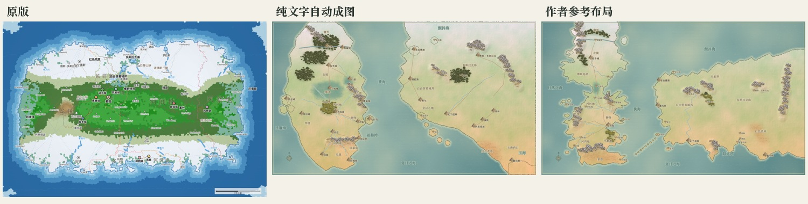

# StoryForge 世界地图升级调研与产品设计

2026-11-18，本机实验分支 `feat/world-map-atlas`，远程 main 基线 `ae9194cde78804b0ac9eb03be076e8cec12aab05`。

**建议保留现有世界资料、候选采纳和地形引擎，增加能直接表达大陆、河口、山口与通道的制图草图。** 模型负责把文字组织成地理构图，程序负责校验和绘制，美术资产负责局部质感。首期最值得投入的是海岸与河网的连接约束。实测中，模型已经能把君临与黑水河终点放到同一坐标，却让这个“河口”停在陆地内部。加再多城堡贴图，读者仍看不到河港为何建在那里。

## 先看同题结果

左图使用原版正式生成流程。中图使用分支上的实验协议，真实模型读取同一套项目资料后生成几何草图，程序绘制山林、海岸、城堡、道路和中文。右图让同一个渲染器读取人工编写的地理参考文件。右图的海岸、地标、河道、路网及长城均有人工坐标，包含 104 个要素，代表有明确地理底稿时的表现；中图的 105 个要素来自模型，模型未看到这份参考文件。底图没有使用官方位图。另做了将原版同一批单元、聚落和路网直接换用插画渲染器的对照，以区分几何和画风的贡献。原版和新协议成功运行使用了不同模型，本次不能把全部差异归因于协议。

局部均以同一地名为中心，裁取宽 245、高 160 个各自画布单位。原版的临冬城、卡林湾、君临未必在读者预期的位置，所以三个窗口分别寻找实际生成的地点。该比较体现相同绘图尺度，并不表示相同的现实公里数。[长城方向与临冬城](comparison/对照-临冬城.jpg) · [颈泽与卡林湾](comparison/对照-卡林湾.jpg) · [君临与黑水湾](comparison/对照-君临.jpg)

## 现有系统的来历与实测

早期作者在世界观和地理栏目中输入资料，模型输出地图 JSON，画布承担展示与标记编辑。5 月的提交 `fc15317e8` 把多世界树与程序地理结合起来，用种子、模板和邻接网格计算陆海、温湿度、河流、国家和道路。6 月提交 `5c79e89c2` 明确记录了作者对漏读城池重镇、自然资源和词条的反馈。7 月提交 `2c0c0ac27` 引入具名实体空间约束。记录能够证明这条路线服务于“把已写世界落实到图上”，没有记录足以证明当时对所有商业制图工具的取舍。

当前入口为「长篇工作台 → 地点与地图 → 世界地图」。世界树定位当前节点；注册源 worldview、geography、codex、locations 提供资料；模型生成候选配置。正式配置由作者确认后写入该世界节点。地理旁边的概念图、游戏产品内的运行地图拥有各自的入口和用途。长篇可以直接使用本作设定。游戏复用涉及世界封存、具体产品定向和版本化读取；此次验证到地图阅读与 PNG 导出，游戏产品的发布、媒资和运行数据继续由各产品负责。

实际示例覆盖 18 个地理分区、30 条重要地点、6 条城池词条和 8 条家族词条。世界观写入大陆分布、气候、资源、山川、领地、经济、文化及冲突；地理树保存分区与下属地点。选取第一卷开篇、五王之战前。图幅集中在维斯特洛及厄索斯的主要已知区域，东方、塞外深处和南方大陆并非完整测绘。地区和中文译名由资料综合整理。出版地图集区分世界图、大陆图和分区图；制图者还专门说明了自由贸易城邦与七国隔海相连的空间意义。[出版地图集](https://georgerrmartin.com/grrm_book/the-lands-of-ice-and-fire-map-set/) · [制图师说明](https://www.fantasticmaps.com/2013/03/the-free-cities/) · [维斯特洛地理](https://awoiaf.westeros.org/index.php/Westeros) · [厄索斯地理](https://awoiaf.westeros.org/index.php/Essos)

| 检查对象 | 在实测中发生了什么 |
|---|---|
| 原版配置 | 模型提交 60 个空间实体、20 条关系。原版引擎生成 9 国、74 城、51 河、82 路。这些数量含程序补全。 |
| 河流与命名 | 旧管线先独立生成河网，再根据名字或最近位置匹配河流。给某条河冠以黑水河之名，不会反向切开海岸或把君临移到入海口。 |
| 比例尺 | 原版把一段只描述大陆分布的引文和“6000 公里”一起接收，界面显示为用户疆域尺寸。分支增加引文中必须有距离值和单位的检查；它仍无法证明数值换算、横纵方向和地理范围全面正确。 |
| 正式调用 | 原预设的本地上下文预算曾拒绝完整输入。其他尝试出现逐字引文不匹配、重复实体、关系端点未登记，以及未完成的模型调用。失败没有写入正式地图。最终正常采纳了原版候选和实验候选。 |
| 纯文字实验 | 模型在一张 1200 × 700 的草图中给出了两大陆、长城、湿地和 30 个具名地点点位；目视可分辨南北和狭海。模型把长城既画作屏障又列为地点。示例地理树的录入把若干建筑与要塞统归城镇，输入分类本身也应改善。 |
| 几何核查 | 自动图中君临与黑水河尾点重合，距原始海岸线约 25.2 图幅单位；长城两端距岸约 22.1、8.7。风息堡落在陆地外。工具栏提供离岸提醒。参考布局调整后，检查中的城镇落点均在陆地范围内。 |
| 美术效果 | 分层浅海、冷暖地表、方向光、山林印章和城堡使地貌较易辨认。大陆边缘仍有均匀抖动，自动图的狭颈偏宽，树林密度和重复山群还显程序痕迹。与 Inkarnate 范例的手工构图及素材丰富度仍有明显距离。 |

## 竞品与制图方法

| 作品或工具 | 具体可观察的做法 | 对 StoryForge 的取舍 |
|---|---|---|
| Inkarnate | 编辑器把陆地遮罩、纹理笔刷、对象层、印章和文字分开。教程先做陆地，再铺纹理与山林城市。作品中完整的山脉走势还依赖作者选材和摆放。 | 用同一语义草图驱动这些层，并把关键的构图选择交给模型和作者核对。没有公开证据支持对其私有渲染实现作进一步断言。[官方制图教程](https://help.inkarnate.com/articles/5374358-create-your-first-map) · [图层](https://help.inkarnate.com/articles/4641701-layer-panel) · [陆地工具](https://help.inkarnate.com/articles/3883631-land-tool) |
| Wonderdraft | 自动美化画出的海岸、成组绘制山与树、少数点击形成河路，并用整套风格控制字体。 | 自动化的基本单位应是一条山脊、一片树林、一段海岸。一个城市点换一张图标对世界级构图帮助有限。[官方功能与演示](https://www.wonderdraft.net/) |
| Red Blob Games · Mapgen4 | 作者把俯视河岸与侧视山体作为单独的设计问题，交互样例能直接比较地形与山体褶皱。 | 同一张高度场既可提供地理条件，也可提供光照与符号方向。下一版应让山群随脊线旋转、分叉并遮挡，而不只是更换材质。[作者演示与制作说明](https://www.redblobgames.com/maps/mapgen4/) |
| Hatchlas | 将高度图转成有山体明暗面、排线、林地和河岸线的浏览器地图。画面证明一部分手绘感可以由地形分析驱动。 | 这是本轮找到的、比通用关卡编辑器更接近目标的参考，尤其值得用同一高度场对照山地局部。此次未移植项目代码。[源码与作品示例](https://github.com/timvandingenen1993/Hatchlas) |
| Azgaar Fantasy Map Generator | 以可改造、可交互的程序化世界为起点，开放代码可以检查地理与政治要素如何组织。 | StoryForge 已拥有类似的网格、气候和聚落基础。优先利用其结构数据做表现层试验，再决定何处替换算法。[官方源码与演示](https://github.com/Azgaar/Fantasy-Map-Generator) |
| Jonathan Roberts 的《冰与火之歌》出版地图 | 自由贸易城邦虽小，作者仍分别绘制其城市轮廓，同时按照实际印刷尺度取舍细节。 | 首屏看大形，局部才有必要辨认城堡特色。素材使用原型自制资源，出版图只用于地理校对。[制图师图文](https://www.fantasticmaps.com/2013/03/the-free-cities/) |
| Quartermaester | 公开说明底图来自手绘地图的切片，地点信息、角色行程和章节控制叠加其上。 | 游戏式世界大地图可以保有绘画品质与独立信息层；附加剧情信息时可以按读者进度披露。这属于后续产品选择。[交互地图与作者说明](https://quartermaester.info/) |
| 高德 LabelsLayer 与 MapLibre | 标注可设置优先级、显示缩放范围与碰撞策略。中文城市密集区需要对文字实际宽度排布。 | 原型在缩放时重新测量文字，试放多个候选位置，对次要标注设显示门槛。下一步需测低分辨率、竖排和沿河文字。[高德中文示例](https://developer.amap.com/demo/javascript-api-v2/example/mass-markers/labelmarker) · [MapLibre 图层规范](https://maplibre.org/maplibre-style-spec/layers/) |
| ControlNet | 公开实现支持以边缘、深度、涂鸦或语义分割条件引导图像生成。 | 可实验把已确认的河岸和山体分区送入图像模型生成纹理。条件图并不证明地名、港口或河道交会能精确保持，需以实际重叠误差验收。[作者项目与示例](https://github.com/lllyasviel/ControlNet) |

用户提供的《荒野大镖客》局部另给出一个直接的判断标准：在颜色克制的情况下，读者仍能用线宽、线型、地形线与聚落轮廓找到路。用户提供的两张维斯特洛图分别展现了小说旅程和政治势力；中文玄幻图通过疏密与留白让宗门、城市和关隘同时出现。它们分别适合行旅图、势力图、设定图。把所有标记都挤进同一个默认视图，会削弱第一眼的阅读效果。

## 推荐产品流程

1. 作者打开本作的地图，直接使用已有世界资料。空白处允许合理推测。候选画面应让作者知道哪些地名有来源、哪些位置来自推测，首次生成不要求作者先学绘图。
2. 先看整图的轮廓、区域和水系，再定位作者最关心的城市。当前原型可以展开、缩放、拖动、切换地名、导出 PNG。建议在候选旁增加“河口、峡湾、关隘、相邻国”等逐条核对入口，点一条就定位到对应画面。名称在原文出现仅证明名称有依据。
3. 对原创世界，作者可直接选择满意的推测布局；对熟知轮廓的世界，可以导入原创轮廓与地理锚点。在原型中可随时切换两种成图。整套作者参考几何由显式导入确认，保存在当前世界节点上，程序美术由界面生成。当前导入会替换完整参考布局；下阶段需要支持锁定某段河岸和局部重新排布。
4. 作者确认后，世界节点保存地图配置和推测几何。重开与导出复用该配置。小说可使用 PNG。游戏若要显示同一地图，应从冻结世界版本读取地点和几何，经具体产品生成底图、标签与交互，产品拥有其发行文件、探索状态与运行数据。此次没有打通游戏发行包。

## 三条路线与投入顺序

| 路线 | 画质上限与设定忠实度 | 投入与适用条件 |
|---|---|---|
| 沿用生成好的地形，只升级渲染 | 能立即去掉逐格色块感，为旧作品增加山体、林地与分级地图文字。地理错误仍会随旧配置重现。 | 开发和浏览器成本最低，对旧地图回报直接。已用实际基线配置验证。 |
| **模型提出可检查的草图，程序约束布局，用统一素材绘制** | 能同时表达大陆、城墙、河道和城市，并独立刷新文字。纯文本实测形成了可读的大地图；入海口、岛屿轮廓和颈泽宽度需要进一步校正。 | 推荐主线。在现有候选确认层扩展制图语义；逐步建立山脊、海岸、森林、港城的变体。前端缓存地表后重绘注记。本次没有增加独立数据库或依赖渲染服务。 |
| 地理条件图驱动整图/分块图像生成 | 有机会获得最强的材质与绘画变化，局部重绘可能改变邻区、比例和地貌，中文需要保留独立排版。 | 适合做同题离线质量试验与素材生产。模型推理费、分块接缝与重复生成的一致性需要另测。本轮真正采用的是一次生成符号表并本地复用。 |

**实施顺序**：先把城镇落陆、河口入海、岛屿分离和跨山关口做成可测几何约束。为候选同时给出原句、推测位置和残差，在三种不同原创世界上复测；存在城市落水或明确河口悬空时应能定位并修正。随后用同一批合格构图对比山脊、森林和地标素材，提高地域辨识度；作者应能只改一片森林或一次标注。最后验证移动端尺寸、较大地图的瓦片缓存以及游戏侧冻结版本读取。首期决策依据是同题实图和读者能否从图上找到地点与通道，只测导出尺寸或生成耗时不足以判断成图品质。

## 原型范围与复现

本地打开开发工作树后进入 `/storyforge/examples/world-map-atlas/demo/index.html`。该开发示例用项目正式备份恢复入口新建隔离作品；再次打开时复用该浏览器对此示例的项目。默认展开纯文字模型地图。点击「查看参考布局」观察人工布局对照，「返回工作台」可查阅作品资料与候选入口。旧配置仍可通过开发参数 `?module=world-map&atlas=1` 试用图集。示例不要求重新调用模型。

原型公开读入四个现有注册源，复用 map-config 的 Run Contract、候选 hash、作者确认、CAS 和终态回执。模型只能提交有限的几何与名称协议，作者参考文件走手工导入，包含版本、尺寸、坐标与绘制预算校验。地表、印章和动态文字在产品端渲染，运行时无需图片服务。现有设定回读、原版与新协议真实请求、正式采纳、刷新、参考布局切换、平移缩放、地名开关和 PNG 导出已在本机 Chrome 侧验证。一次桌面测量中，生成地表并绘制导出整图及三幅局部共约 0.3～0.5 秒；这不是帧率或移动端性能保证。

原型仍有单次生成波动、岛屿形状失真、政治边界缺少明确多边形、方向性山脊和生态变化不足、部分道路接近直线等问题。没有对真实读者开展盲测，也没有验证连续编辑时的局部锁定。已知世界局部的原始事实与人工推测可分别查询[测试语料](world.json)和[原创参考坐标](known-world.anchors.json)。图集使用内建 imagegen 生成的一张透明水彩符号表，按地形与种子放置；本次没有取用商业产品的印章、底图或字体。生成提示与素材位置见[美术记录](ART.md)。

### 本机验收记录

- 针对地图的 4 个回归文件共 35 项通过，覆盖旧协议、资料读取、空间布局、新草图解析、拒绝错误输入、生成候选、确认写回与回执。
- 在独立 Chrome 配置中先保存再刷新，切换自动布局与作者参考，检查离岸提示、视图展开、缩放、地名显隐以及浏览器下载的 PNG。展开后的画布实测 1728 × 952 CSS 像素。
- 通过正式备份导出再导入新作品，连续两次从示例入口进入同一个恢复出的作品，并停在自动地图整图视野。示例入口仅在本机开发服务中提供。

### 历史缺陷与升级回归边界

根据作者补充的 2026-11-18 核对记录，SFQA 是审查缺陷编号。当前地图分支的 Git 包含关系已核实，包含国家领土扩张修复 `14e1be9999fab53457f970775e3250fc2707de0b` 和 PR #332 的合并提交 `fbed5668b9070058d89b8a7f2c6def70e7533275`。升级前后这些修复涉及的国家扩张实现、地理概念图隔离预览和编辑草稿作用域保护实现没有差异。

| 已修复缺陷 | 地图升级需要保留的行为 | 本轮定向检查 |
|---|---|---|
| SFQA-119 国家领土扩张异常 | 队列成本与已知成本使用一致精度；水域、高山、文化差异、宜居度和预算仍制约扩张；跳过真正过期项；固定种子可回放。 | `R-SFQA119-nation-expansion-precision` 覆盖扩张规模、各项限制、过期队列和固定种子。 |
| SFQA-122 地点与草稿跨世界串入 | 切换空世界组时清空旧视图；未失焦输入、保存队列、失败稿和迟到结果绑定原始 World/Work/世界组；其他世界保存成功不能消除原失败。 | `R-SFQA122-world-authoring-scope`、`R-SFQA122-singleton-readback` 与 `R-HARNESS66-world-map-durable` 检查编辑归属、保存失败、迟到概念图和正式候选作用域。 |
| SFQA-131 概念图 SVG 全局样式泄漏 | 通过隔离图片预览保留合法局部样式、渐变和原图；解码失败重试本地显示；替换与卸载时回收 URL。 | `R-SFQA131-svg-preview-isolation` 检查样式隔离、原图保留、解码错误与 URL 生命周期。 |

在实现提交 `0a0b05794` 上，以上五个回归文件加 `R-worldmap-spatial-layout`、`R-world-map-atlas`，共 7 个文件、70 项测试通过。这是本机确定性检查，历史编辑器用例和新图集的协议用例各自覆盖对应入口。新图集的连续跨世界浏览器操作、所有平台安装包仍需各自的实际验收证据。

后续交互继续遵守当前契约。换种子时先保存确定种子，成功后更新画面，刷新读取同一配置；比例尺保存错误必须显示；AI 整图先形成候选，作者确认后采纳。新图集的作者参考文件显式导入并通过 CAS 保存，模型生成的草图由既有候选流程保存。图集的 PNG 导出使用独立画布，地名由程序绘制。

3D Labs 仍为未开放能力。作者提供的核对记录将 Issue #92 归为空白世界创建与填充需求，将 Issue #192 归为世界规则面板异常；两者不能据此当作本轮地图缺陷。本轮未重新核对这些 Issue 的远程状态、后台全量报告或平台安装包，v4.0.7 的发行包含关系沿用作者提供的核对记录。
