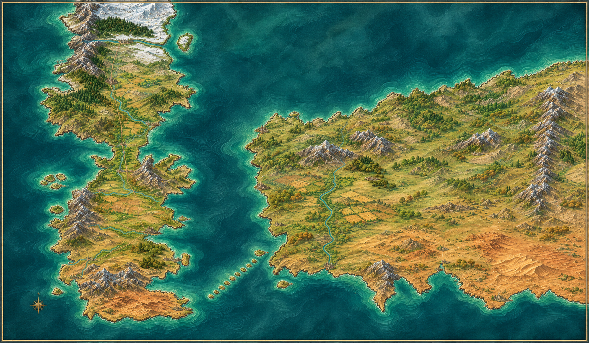

# 连续绘画视觉试验

2026-11-18，内建 imagegen 编辑模式。输入为上一轮权游作者参考布局的程序成图，输出保存在 [continuous-paint.png](continuous-paint.png)。采用原图纵横比，以相同轮廓和地形分布约束构图。模型仍改变了部分海岸、河流和地形细节，且道路和河流已进入图像像素。这张图用于检验美术方向，其视觉品质不能计作当前可筛选地图程序的成图品质。

## 生成提示

Transform the provided working world map into an exquisitely detailed professional fantasy world atlas illustration. This is a visual R&D experiment for a layered 2D map program. Keep the EXACT top down map layout, framing and coastline geography, including the long narrow western continent, its constricted neck, the specific southern peninsula and bays, offshore islands, the wide central sea, and the large eastern continent cut off at the right edge. Preserve the positions and trajectories of the mountain ranges, forests and rivers already visible, and the tiny settlement locations. Entire image is flat orthographic illustrated cartography. Render coherent, flowing terrain with dramatic yet tasteful mountain relief, individually drawn asymmetric peaks along branching ridges, soft directional north-west lighting, foothills and valleys joined organically into the land. Very rich clustered pine forests fading to scattered trees, warm central rolling farmland, green riparian valleys, finely painted ochre southern scrub/desert with dunes, and snow fields in the far north. Deep petrol blue ocean, broad jade and turquoise shallow coastal water, subtle engraved contour ripples and natural irregular coves. Elegant antiquarian gouache and watercolor on softly textured ivory parchment. Zoomed in details are beautiful; zoomed out continents and landforms remain instantly readable. Highly varied scale-appropriate details, refined muted colors with distinct regional palettes and excellent tonal hierarchy, cohesive artisan-finished fantasy cartography quality. NO enlarged foreground objects, no tilted perspective, no realistic satellite photo, no repeated obvious stickers, no UI, no 3D scene. REMOVE ALL TEXT, city labels and region names from the reference, replace with underlying terrain. Only tiny settlement silhouettes without banners or wording. Retain delicate fine roads and exact river alignments for this visual comparison. Do not add a title or new labels. Maximal crisp paint detail, panoramic 12:7 composition.
