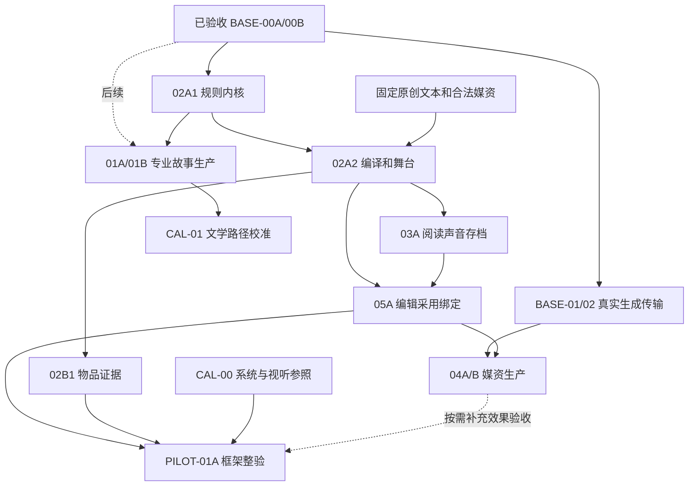

# AVG 实施计划与依赖顺序

> L2 · 版本：1.132.0 · 生效：2026-10-22 · 上位条目：E-AVG-01。
> 唯一产品施工入口：[AVG.md](../products/AVG.md)；逐包开工与验收：[工作包卡](AVG-WORK-PACKAGE-CARDS.md)。
> 系统与表现框架已分支工程验收，最终源码 cf8415e9 的完整 CI/全仓浏览器均成功；真实生成、商业质量校准和作品首戏另验。产品仍为 partial，未合并上线。

2026-10-22当前共同版本分支定向验收：准确b1797a5e源码在共同基础0bf022dd上接入最新远端主干fdfe4817，再串行接入共享图像读取5275645e和音频冻结声明3a925ef1。362项整合回归、类型/构建/原包体门及9条原生路径通过，无flaky/跳过；各阶段源码稳定，独立113项登记回归也已实际通过。两项已知检查结果单独保留：36项旧Skill日期已超过45天，须依据真实复验另作元数据基础提交；三份流量CSV与远端原字节完全一致，原父比较的换行提示退出2，而对最新main父的全部AVG差异检查通过。未放宽时限、包体预算或检查器。后续完整前景/边缘算法、正式音频producer/独立试听采用及已另行本地提交的R5尚未接入；最终准确源码完整CI、真实美术/审听仍未完成。Work/Blob/采用owner、只读世界及旧V1保持，无新真实供应商/模型调用、原作者项目改写、主干合并或部署。

## 1 当前边界与下一步

2026-10-15 作者重新确定优先级：**先交付 AVG 系统与表现框架，专业剧情/故事设计与文学对照后置**。已进入目标模式；不以故事 Agent、故事圣经、分场生成或文学 CAL-01 为系统施工前置。固定原创测试文本和授权/测试媒资只用于框架验证，不据此评价剧情创作能力。

AVG-BASE-00A/00B 已通过分支工程验收；本轮自 **AVG-02A1 确定性规则内核**开始，现已完成 §1.1 的四阶段工程目标。自动图像、逐句配音与声音的后续工程/有限真实校准以[媒资规格](../products/avg-production/03-MEDIA-PRODUCTION-AND-BINDING.md)和工作包卡§9/§10为准。声音原型及沿用/后继发布/关闭工厂恢复已有分支工程证据；原专业视觉V5的原型发布、五槽原图/加工、Source5/6后继修订和双门关闭后的准确完整备份恢复也已分支工程验收（工作包§9.25、媒资§5.12）。18文件106项关联、最终16项工程检查及5条原生路径通过，浏览器无flaky、源码稳定；106项按相同后端文件hash沿用，不重复执行或计数。旧声音历史测试的缺省解码条件与确定性并发顺序反例已补齐，原断言/90秒界不变；新增发布准备反馈与等待明确成功状态，原完整五槽420秒界和其余断言保持。准确新提交完整CI仍待独立验收；68b6全量成功、355托管旧失败分别保留。局部重新生产/重审、图声/配音联合沿用、真实连续质量与专业审听继续后续，所有分支结果均不等于主干上线或商业作品验收。

准确`534b3812`托管verify成功，AVG完整五槽两次420秒超时及缺少成功导出的关闭恢复失败仍保留；本机完整CI也有12项失败，不能记全量成功。共享基础§9.26已取得准确旧实现的唯一预期计数红例及7项语义通过；候选32文件201项、16项工程检查和5条原生路径通过，原完整五槽420秒界、同一成功导出及关闭恢复、字节和最终CAS保持。两次本机单样本不证明托管超时已解决；准确新提交完整CI另验，组合继续接回既有AVG-05 §11.2，真实图声质量仍待验。

新增声音来源按工作包§10.17施工：在原licensed-library路径内增加明确的网页许可source/result@2，保留旧Kenney目录与协议，补真实环境声原件的准入与生命周期；不以来源页CC0或技术解码代替审听。原件准入/失败/完整恢复已在同一固定源码通过41项Python、15文件88项关联、16项工程检查及四声音模式10项原生首遍验证，无flaky；新增6项已包含于88项。原雨声真实Vorbis解码/播放仍保留未知听感，不能选用；新来源的独立选择/Stage/Release及其关闭恢复、准确新提交完整CI仍待验，§10.17整包不标完成。

环境声下游增量以已提交`6d1b79ef`为产品基线，接回三项原型发布/许可损坏/写门合同回归及新原生Stage发布、同一成功导出的关闭工厂恢复；代码沿用原公开作者命令、路线/目录验收和发布器，没有新生产写域。增量已完成16文件94项不同回归（新3项、关联91项）、16项工程检查、原CI配方核对及四模式12条原生路径（1/3/6/2），均首遍通过、无flaky；准确新来源与同一成功导出进入Stage/Release及关闭恢复。原来源41项Python仅在1814项生产/后端文件hash一致时沿用其真实已完成证据。共享基础/组合整合后的完整CI仍待验，§10.17整包保持施工中，专业剧情和真实听感不由工程声明签发。

同Work九媒资组合按既有AVG-05 §11.2推进：配音质量/原型发布门已修复，V3/明确沿用的生成配音保留Media/Voice双门及最终写事务复查，旧手工导入/冻结播放及Sound/V5门不改。13项快例、两条原180秒组合和19文件127项关联共22文件142项，最终16项工程门通过，源码稳定；原失败和夹具基线更正分别保留。共享只读基础与发布页Stage已分别本地提交，后继组合树串行接入；真实PNG/Vorbis/PCM、同屏四通道/配音等待和同一成功备份关闭恢复、准确整合源码完整CI仍另验，不借合同或旧单线完成全目标。

### 1.1 当前目标的四个交付阶段

| 阶段 | 对应工作包 | 可检查的结果 |
|---|---|---|
| 1 规则与统一编译 | 02A1 → 02A2 | 变量/玩家与角色知识/关系/选择、有限条件效果、图校验和状态模拟；固定文本可编译成同一版本化包，不复制运行引擎 |
| 2 播放与表现 | 02A2 + 03A | 对话推进/历史/选择、背景/立绘/CG/Cue、真实音频等待与打断、资源加载、偏好和存档恢复实际联动 |
| 3 物件、媒资和编辑 | 02B1 + 05A；BASE-01/02、04A/B 按实际需要 | 物品/证据可获得、检查、使用/出示；需求→导入或生成→候选/采用→绑定；改字、换图与联合预览、失效/局部返修贯通 |
| 4 框架整体验收 | PILOT-01A 的工程路径；所选 03B/02B2 | 两套可替换测试配置验证复用，隔离浏览器完成选择/物件/画面/声音/刷新/存档/备份与旧 V1 回归；可选模块有明示合同和能力开关，未实现者不冒充可用 |

02A1 的确定性编译/预览先独立交付，专业 system-designer 接入后置；02A2 的有限导演合同/renderer 先行，专业 performance-director 不阻塞工程。开始具体作者作品时仍需 AVG Work、明确开始、Brief、SourcePlan、合法候选和采用，不为测试框架开一个绕过正式治理的作品入口。

本目标不承诺一次实现所有可选系统、Live2D/3D/视频或独立小游戏；先冻结扩展合同、依赖及缺能力时拒绝的边界。故事岗位 01A/01B、文学 CAL-01、自动生成首戏/独立读者文学评分、分发及大规模题材扩展进入后续队列，不作为本轮框架完成门。美术与声音的连续性、实际播放和系统交互仍须用真实效果取证，不能以 schema/测试通过代替。

### 1.2 当前目标的验收矩阵（2026-10-16）

| 阶段 | 当前已取得的实际证据 | 本轮工程结论 |
|---|---|---|
| 1 规则与统一编译 | 两套配置、类型/范围/知识隔离/图校验/原子失败，作者候选采用后同一 V2 编译与运行；旧协议字节保持 | 分支工程验收通过；最终完整 CI 通过 |
| 2 播放与表现 | 对话/选择/有序历史、背景/立绘/Cue/镜头、真实 PCM ended/失败/打断、独立音效与 voice Cue、静音/菜单/设置/偏好联动；含 CSS 插值暂停的浏览器全套 35 条通过 | 分支工程验收通过；工程图/非人声 PCM 不签成商业艺术或专业审听 |
| 3 物件、媒资和编辑 | 实际 PNG/WAV 导入/解码、待确认/采用/失效、规范脚本/演出绑定、库存/证据/详情、正式零调用组装与 Preview/本地原型版本、修订留旧档 | 分支工程验收通过；自动媒资生产按后续包验收 |
| 4 框架整验 | 两套配置、七项禁用扩展的合同/能力开关、来源隔离、准确 URL/刷新、父档删除后子档读取/再分支/备份 remap、旧 V1；152 项 AVG 定向/35 条 AVG 浏览器；全仓 809 文件/4491 测试及 287 条浏览器通过，2 项既有生产环境条件跳过 | 本轮框架工程目标完成；终态证据见 §2.16，不提升整个 AVG 或作品的成熟度 |

系统/表现优先不改变 Work/会话/媒资 owner、三注册表或作者采用门。专业故事/文学、生成质量与完整三线工厂、长作品/全设备/外部分发按各自后续包验收；不混作本次固定工程场景的完成证据。

### 1.3 当前媒资自动生产目标（2026-10-16）

作者已明确继续媒资自动生产和配置，剧情继续后置。沿用前轮框架，在独立工作树 `avg-media-production-20261016` / `feat/avg-media-production-20261016` 施工；`73d0a249` 合入已抓取的 `origin/main ce49309b`，保留 `36b3e55f` 的完整框架。主共享检出与旧验收分支不修改。预算及 Agnes 授权沿用 CAL-00，有限批次/次数和未知费用处理继续执行。

| 阶段/单元 | 本轮输出与验收门 | 当前状态 |
|---|---|---|
| A1 / BASE-01A | AVG 专用冻结参考输入、真实 Data URI 传输、能力/hash/授权、Work-owned Blob、错误/未知结果边界；不升级其他产品 V1 请求 | `eab861ce` 已推送；定向 4 文件/40 测试、35 条 AVG 浏览器及提交前工程门通过；完整 CI 首跑 805/811 文件、4501/4516 项通过，15 项失败；原 timeout 隔离复查 4 项生产失败例及 5 文件/42 项开放世界通过，首跑仍记失败。全仓浏览器 287 通过/2 条件跳过/1 失败，旧科幻标题超时在单文件复跑重现；真实调用 0 |
| A2 / BASE-01B | 正式明确开始、预算/Context/Run/候选检查点、准确回执、失败与刷新恢复；真实账号的参考输入 smoke | 施工中。默认关闭的实验性图片工作台已接需求/参考授权 → 明确开始共享 Harness → 解析前回执与严格原图接收 → 作者选图 → 配置演出草稿 → 独立采用并生成原生 Preview；含实际 Data URI、IndexedDB/OPFS、pending 刷新及备份 remap。前包 32 文件 / 269 项回归、41/41 条 AVG 浏览器通过；新增相同冻结批次的明确原图保留、子版本零调用复验与局部重做，连续返修/导入后返修、无密钥全部复用和未知结果拒绝已有定向证据，工作台路径已通过（工作包 §3.1～§3.7）。新增树最终 35 文件 / 340 项回归、完整 42/42 条 AVG Chromium 与提交前工程门通过，验证期间源码/测试 hash 不变；受控 HTTP + 原创 PNG，实际 provider 调用 0，不代表艺术验收。跨需求变更的舞台沿用见 A3 /04A.2；真实账号校准未完成，当前集成树的完整 CI 与浏览器结论见 A3，旧轮失败保留 |
| A3 / AVG-04A | 需求和合法参考、人物基准→立绘/差分、场景、同物件 icon/detail、质量与作者采用、typed 绑定和局部返修 | 施工中；04A.1 已接生成参考，前包 36 文件 / 344 项定向、43 条 AVG Chromium 及工程门通过，完整 CI 单独待验。04A.2 增加作者家族方案/逐变体生产与跨批舞台原图继承，最终 37 文件 / 352 项定向、44/44 条 AVG Chromium 与工程门通过，源码/测试 hash 稳定；完整 CI 单列，04A.3 已接作者视觉观察/问题记录→选图门与返修交接；40 文件 / 439 项定向、44/44 条 AVG Chromium 及最终工程门通过，完整 CI 单列；04A.4 已接本地配方/独立加工来源→精确评审、衍生选择和真实舞台/参考消费；最终 41 文件 / 448 项定向、47/47 条 AVG Chromium 与工程门通过（`a5ad747d`），`8af54f30` 同步后的完整 `npm run ci` 已通过 823 文件 / 4,598 项、治理/生产依赖审计（0 漏洞）/lint/类型/build/包体；全仓浏览器为 298 通过 / 4 条件跳过 / 3 个潮痕 3D 用例失败，其中 AVG 47/47 通过。代码 hash 与实际隔离副本核对一致；三处失败保留 trace/截图，纯净主干准确三例对照 3/3 通过且未复现；归因未定，整体浏览器门仍未通过；专业岗位与真实艺术/账号校准继续后续 |
| A4 / BASE-02 + AVG-04B | 已核实的 TTS 能力、音色权利、准确台词/演法版本、实际 clip/技术检查/审听、逐句绑定与连续播放 | 当前施工见工作包 §4.16：已采用配音的跨批来源、明确结束需求、准确原句/说话人绑定和新演出采用，来源预览与零调用组装/本地版本接线已写入，未验收。当前 16 文件 / 134 项关联定向、完整语义类型、103 个 TS 文件 lint 与构建通过；治理/文档/指标和依赖审计通过。真实 Harness 验证完成/停止后沿用、篡改拒绝、零新调用与原字节复用，HTTP/解码仍为受控替身。旧源码本机 CI 与 086e912c 托管 CI 均因 11 个既有 Skill 超过 45 天复验期限停止；已复用独立日期维护提交，实际重跑登记回归后修正，原失败留存。新增托管任务在应用/AVG 改动时明确打开两项实验开关，沿标准入口覆盖 23 文件 / 57 个原生用例；目录核验不算执行通过。配音沿用、停止后版本及便携证明已取得本轮原生证据；原 55/57 轮的旧提示和十句批次定位已修正，准确 abaa56aa 的实验浏览器 57/57 通过（12.1 分钟、无跳过）；该头的完整工程 verify 仍待终态，新专业视觉基础另验，后续代码修改须重验。前轮 §4.15 已验证生成图声的原生本地版本、存档与备份：5 文件 / 165 项、98 个 TS 文件 lint 与一条完整 Chromium 纵切面通过；其冻结源码的全量队列继续单独记录，不能代表本增量。双实验默认关闭，未知请求防重、旧数据/版本与费用记录延续。其余恢复/继承/加工组合、真实账号/音色/费用、专业岗位/艺术家族及必要声音仍待施工；真实 provider 调用为 0，BASE-02/04B 与整厂保持 partial |
| A5 / 媒资联合验收 | 实际生成与参考家族、真实配音、舞台/库存/详情/台词消费、刷新/旧版本/备份；费用与拒绝样本保留 | 待前项完成；工程、provider、艺术/审听与商业作品分别结论 |

当前增量 R3d-b 已将明确配方接到真实 V4 Brief、单次零调用加工 producer、本版衍生评审/选用/配置/Preview，以及独立 Source4 的后继 V1 演出与完整备份恢复；世界只读、AVG Work 拥有媒资，无新表或第二批次。同源码关联76文件/966项逐项通过覆盖（首轮9项超时，同输入串行14/14覆盖全部失败，不冒充一次整组全绿），正式隔离原生12/12（9.7分钟）与类型/lint/构建/包体及十一项治理通过，准确验收见工作包§9.5。最终提交完整CI另验；旧51ba374e托管AVG成功，未启动本机旧排队已确证撤回。原有配置已复用并真实探活成功，图片/声音生产与艺术质量另验；剧情继续后置，后继为版本化外发参考、真实图声及专业效果校准。

早期独立 `avg-media-recovery-20261016` / `feat/avg-media-recovery-20261016` 的施工源与共享依赖现已保留；最新活动根与排队验证目录见本节末。旧 `avg-media-harness-20261016` 冻结配置页面，保留作者填写中的浏览器配置；`avg-media-production-20261016` 的本地文件冻结在 `eab861ce`，保留首跑与复跑证据。共享主检出不参与施工。上一基础提交 `cd46f1cb` 的托管 CI [38850452054](https://github.com/yuanbw2025/storyforge/actions/runs/38850452054) 已失败：812 文件中 811 通过，4532 项中 4531 通过，新增 producer 读取证明用例 15 秒超时。新接缝复现写事务中并行 `Dexie.waitFor` 竞争，已改为顺序证明计算且保留同一校验；定向复验通过不替代完整重验。当前 [Draft PR #160](https://github.com/yuanbw2025/storyforge/pull/160) 保持审查态，未合并部署。

`c5febfa3` 的[托管 CI 38927908324](https://github.com/yuanbw2025/storyforge/actions/runs/38927908324) 已终态失败：823 文件中 822 通过、4,598 项中 4,597 通过；文字开放世界 `R-OPEN-WORLD2-combat-actions` 的“技能行动原子消耗技能资源并按战斗回合锁定冷却”超过原 30 秒时限。该轮是图片加工提交，不含当前未提交配音草稿；本地同提交完整 CI 通过不能覆盖托管失败，也不据不同环境结果判定根因。不改无关产品或放宽时限，原日志保留，PR #160 继续 Draft；后续交付仍须完整工程与浏览器门。

本轮输入为 AVG Work 的已确认事实/系统/文本和合法参考，输出为产品拥有的候选字节、采用回执、绑定与新 Build；世界只读。A1 不新增表/上下文/正式写域，复用 `avgDraftMedia`、`mediaBlobObjects` 的登记生命周期；A2/A3 如需新的正式读写，先登记 Skill/Context/Adoption，再启用入口。无本机配置时继续工程施工，不伪造真实 provider 成功。

下一视觉增量为 [04A.5 专业方案与需求编译](AVG-WORK-PACKAGE-CARDS.md#95-avg-04a5-专业视觉方案与需求编译施工中)：严格语义/编译基础已保存为 47ac647a，49 文件/468 项、类型/lint/构建及治理检查通过，准确该提交的托管 AVG 原生已终态 57/57 成功，完整 verify 仍执行。后继 `feat/avg-visual-planning-roles-20261017` 在同一工作树接 AVG 专属 V4 私有合同、固定原始方案→作者采用→需求编译→图片拓扑、四个独立 Skill 和准确文字来源投影；旧 AVG V1/V2/V3 不改写，不把模型方案接收当作正式方向采用。岗位基础 `aeafd28f` 的 63 文件 / 663 项、类型/lint/build/包体与治理检查通过，托管 AVG 原生已终态 57/57（14.1 分钟），完整 verify 尚未终态。当前 `feat/avg-visual-planning-execution-20261017` 后端增量已实际走共享 Harness、原始方案 producer、作者候选/明确采用及确定性需求工件，新增十一项和前置合同/岗位共 33 项、全 AVG 与相关共享闭包 64 文件 / 674 项通过，完整验证仍另记。图片消费和工作台待接，保存/开始/通用 dispatch 就绪门及专业 generic 写口仍关闭；a/b/c 整包未验收。后端检查点 e75d2fba 的扩展 65 文件 / 802 项已终态通过；当前复用已有工作树接原始 V4 合同下的实际编译图片消费、SDK/参考传输、原响应/Blob 与原图 producer，十八项受控正向/反例及 64 文件 / 681 项关联回归、类型/lint/build/包体与治理检查通过；e75d2fba 的既有 AVG 原生已取得 57/57 托管成功，完整 verify 另记。作者评审/选图、演出、Preview、工作台、原生新纵切面与真实账号仍待验，生产就绪门继续关闭。岗位登记和工程材料不签专业/艺术质量，剧情继续后置。

A1 工作树保持冻结；A2 最初在 `avg-media-harness-20261016` / `feat/avg-media-harness-20261016` 以 `eab861ce` 为基线接入，现于上述独立 recovery 工作树继续，配置页所在旧工作树保持冻结。刷新远端后已检查 156 个引用、338 份 Agnes 相关内容，未发现可确认的非测试凭据；应用代码将实际配置保存在浏览器本地/会话。此处只记录发现范围，不把未读取的浏览器配置写成不存在，也不把缺凭据当成整个工程目标无法推进。

作者图片消费检查点施工位于已有 `avg-extension-contracts-20261015/storyforge` 工作树、`feat/avg-visual-image-consumption-20261017` 分支，原 research/recovery/config 根均保留，不再作为当前编辑目录。原图后端 `2a5ee8af` 后，当前增量复用原作者命令与校验接通原图读取→观察记录/明确采用→选图候选/明确采用→准确消费槽的可编辑演出→演出采用。定向四文件 78 项通过，其中 V4 实际 Harness 29 项，覆盖未知/修订、错误目标/原图、解码/尺寸失败、确认时重验字节，以及真实备份/remap/delete 不恢复采用权。当前仅 building 版本消费；集成/冻结 Preview、完整历史图像证明、工作台与新原生纵切面继续施工，真实 provider 调用仍为 0，就绪门继续 false。每项后继证据只覆盖其冻结输入，完整关联/构建/治理验收见工作包，不把前述检查点的待接项或成功挪作当前结论。

原图检查点 `2a5ee8af` 的托管原生现已终态为 56 通过 / 1 失败（run 39010947021，16.9 分钟）：两批五句配音用例在首批组装后等待试玩按钮超过原 5 秒；重试相同。完整日志、截图/trace 归档已保留，画面仍是 busy / building，不能据此排除内部阻塞或直接归咎托管环境。当前本地 64 文件 / 692 项通过不覆盖这个失败；先定位兼容路径，完整 verify 另候终态，PR 保持 Draft，不改公共时限掩盖。

最新 Preview 施工复用本聊天干净、无活动源码使用的 `avg-base00a-20261014/storyforge`，分支 `feat/avg-preview-integration-20261017`，从 e38a723a 加入 e956e07b 诊断提交；旧 BASE-00A 分支/18218f73 保留，不能按历史 PR #137 已合并清理这个当前活动目录。805 个现有包版本匹配，仅增加 186 个缺项包与 23 个二进制链接，没有新 checkout、安装器或依赖副本。extension-contracts 目录保持 e956e07b 的诊断输入；其同字节本机五句单例已通过（1.6 分钟，前后源码 hash 一致），不代表当前 Preview 增量或全部原生通过。

V4 后继已实际生成冻结 Preview 和试玩会话，并接完整作者/producer/编译/原字节终态证明。组装阶段只读复核准确旧检查点；冻结读不能转为新请求。新增九项整合、篡改与真实导入/remap/delete 用例，共 38 项 V4 Harness；最终关联 64 文件 / 701 项、类型、构建/包体、九路径 lint 和十一项治理检查全部通过，均验证同一稳定源码输入，完整 CI 与新原生另验。导入需显式零调用复验原完成前缀，损坏原图/原响应/编译不能重封存 root，不恢复生成/采用权。工作台、新 V4 原生、发布原子闭包与艺术/真实账号仍待完成，就绪门继续 false。

e38a723a 的托管原生已再次终态 56 通过/1 失败（run 39012466049，17.7 分钟），同一五句配音首批 Preview 的原 5 秒断言及重试仍失败，完整日志保留。e956e07b 的诊断实际接错另一单句用例，托管 run 39014025857 仍为 56 通过/1 失败（15.8 分钟），目标失败没有新增状态附件，不能称已取得诊断。f87dc3cf 已将有界只读诊断移到准确五句断言，写入 CI 保留目录，并覆盖 building/integrating/validating 后续观测；仍保留原 5 秒失败、不改产品或重发。lint/准确单例枚举通过，新诊断待实际运行。本机 e956 同字节单例通过不能覆盖托管失败，当前 Preview 工程结果也不能签商业或整包完成。

2026-10-18 恢复施工：R2b 提交 5632c69b 的本机完整 CI 已终态通过 854 文件/4996 项，托管 verify 和 AVG 隔离浏览器 61/61 均成功。后继 R2c 将独立共享底座 a522a380 串行接入为 537bb309，再接 V4 未开始方案的显式图片模型选择及准确消费；7 项关键路径、70 文件/820 项关联回归、四条隔离原生路径及类型/lint/构建/治理通过，本增量完整 CI 另验。该增量保持旧2.1/V2/V3记录与模型身份，当前真实2.5调用零次；实际账号、艺术效果及 R3 原图/加工/配音与发布仍未完成。具体交付与失败证据见工作包 §9.5。

R3c-c 在同一独立工作树接入未选原图的实际当前 V4 零调用生产：新 Brief 显式冻结来源，明确开始后按当前已采用专业方案重新编译、核验语义、生成当前候选，再走当前评审/选用/配置和 Preview。部分成功原 Image2.1 与当前 Image2.5 待生成槽分别计量；全部沿用可无 Key 完成。当前选图的本地 Source3 与平铺原始 proof4 分开，支持后续显式 V1 演出及完整备份/remap/delete。同份稳定源码的73文件/924项关联回归、七条专业视觉隔离原生、类型/lint/构建/包体及十一项治理通过，完整 CI 另验；准确结果见工作包 §9.5。真实供应商新增调用0次，真实配置交接仍待完成；后继加工、版本化外发参考、真实图声校准与发布完整性继续，专业剧情后置。

## 2 实际施工队列

04A.5b/c 事务与原生验收后继：已定位专业方案接收及图片消费中的动态模块加载会使浏览器提前结束封存/作者事务。两处仅在事务外启动纯模块加载，再由原事务保活等待；实际注册读取器、编译来源、producer、权限与采用检查仍在原快照内。无新表、写域、依赖或共享 Run/hash 改动。三个新增回归覆盖响应后延迟加载与原响应重开读取、延迟 WebCrypto、消费读取后的强制回滚及零重复请求。原 c18a334d 托管原生为 57/59，7ef2373e 为 57/60；失败与原始 HTTP 200 证据保留，界面 0/0 不作为未发送证明。

最终关联 **67 文件 / 736 项通过**，其中 V4 Harness 54 项；本机隔离 Chrome 的三条专业路径全部通过（59.1 秒），覆盖准确参考传输、作者修订持久化、方向/主体采用、原图评审/选用、演出与冻结 Preview、备份恢复/删除隔离、退回留证及五用途方案。测试等待现有保存/开始通知与实际播放页面后才刷新或记录 URL，业务断言和原时限保留；动态导入替身在结束时明确收尾。此前四岗五图的若干 60 秒超时仍记失败，最终两 worker 全组通过不代签全环境稳定性。3528 文件输入 hash 为 `bbb7d5ef36aa31871dbd7b84a7d1cb332383b49e28fdb7d035d83609d6b302d5`；类型、四路径 lint、构建/包体已通过，之后只由官方生成器修正 ARCHITECTURE 源码行数，并更新本计划和工作包验收文字。旧 eb45cd2a 的完整本机 CI 已通过 849 文件 / 4892 项，仅覆盖旧头；当前完整 CI 与 60 项 AVG 全套仍须独立取得终态。真实 provider 调用为 0，家族透明度/完整消费与连续参考、专业评审、局部返修、真实图声质量和 V4 发布 CAS 继续施工，b/c 仍为 partial。

04A.5c 完整家族消费后继：新增原生四岗位/五图片链路已单例通过（3.1 分钟，稳定输入 hash `21c8a435cef3d9fc51c45682475667b571e1c02a81b510180b53a60a093b1613`）。三张不同 Work-owned 风格/人物/物件参考按冻结顺序进入实际 SDK 请求，记账 4 次模型/5 次图片；两张人物工程图实际解码具备透明像素。逐图准确观察、独立评审/选择和演出采用后，背景、共同画布姿态/表情、物件 icon/detail 在原生 Preview、刷新、真实备份导入/零调用证明复验及删除隔离中正确消费；参考不进入舞台目录。工程图不证明语义抠图、人物艺术一致性或专业评审。本轮最初三次测试脚本错误/等待错误保留，未改业务门或放宽原断言。

80202961 的托管 AVG 全套终态为 **59/60**（run 39028660760）；唯一失败 trace 显示评审候选保存了 `unobserved=[未查看准确原图]`、`imageHash=null`，产品正确阻止选图。工程测试此前只等 img 元素可见，现改等真实像素解码和原图/全部参考观察回调完成再提交；当前整组复验仍须新终态，旧失败不改写。该头托管 verify 尚待终态，本机完整 CI 的最终结果见下段。

真实账号首次图片校准已在现有 5196 的独立工程 Work 通过 V2 原生 UI/Harness 执行：仅一张 `agnes-image-2.1-flash` 背景图、无重发，收到 PNG 1312×736 / 1,017,788 字节，hash `1db7afbd723c2cb78627e3fdad81e815f7ed4303ac3a2348ce5b7728c06a8b61`；原图、明确选用、准确演出槽及冻结 Preview/原生显示已观察，实际费用仍 unknown、商用条款未确认。密钥留在原会话，未读取或复制；相同旧源码只重启任务开发服务启用默认关闭的 V2 入口，未更改冻结源码或已有作者作品。此结果仅证明旧头 4d51e5eb 的一图账号链，不能代验当前 V4、参考/多图连续性、透明度、真实配音或商业质量；没有以工程流程代签真人验收。当前包继续施工。

本增量最终专业工作台原生 **4/4 通过（3.7 分钟）**，类型与两路径 lint 通过；稳定输入 `c6fa5734f8a56d6020715af83f70e1d49f54a39f6cd67fc99feb07ed06248093`。背景亦逐项核对实际解码和替代文本，人物/物件及恢复删除断言均保留。上一整组 3/4 的新五图用例在配置通知前超过默认五秒、无错误且仍 busy；新五图操作单独采用 30 秒有界完成等待并保存耗时 JSON，本轮实测 5072 毫秒，其后槽位、原图和原生消费断言通过。此前单例和失败轮均保留，原有用例及通用断言时限未放宽。十一项治理、类型、构建/包体已通过同生产源码检查，之后仅补耗时附件的落盘与本段验收说明；最终文档门另验。80202961 的完整本机 CI 已终态通过 **851 文件 / 4919 项**及构建/包体，前后源码 `ecfbad18ea6816b52acccea7db57a6649d69e98503f4944cf379c7515c72c518`；它覆盖生产代码检查点，不代验后继测试/文档头或托管全套。

真实 V4 校准发现提示词合同缺口：在已授权的独立工程 Work，用本账号上一张原图作风格参考，明确开始最多两次方案/一张图片的批次；第一次 Agnes 方向请求返回了 `storyforge.avg.visual-bible/version` 合并键和字符串 `palette`，严格 codec 拒绝，停在 recovery-required，实际一次文字请求、零图片请求、费用 unknown。解析前响应 2322 字节/hash `b5c4484d8578bdfa1e9cb5a0f7977685cab23aa16f07d54dfd43816d7579ee6e` 与实际输入/旧 method-v1、完整失败备份均保留，未修写响应、采用或重发。原 V2 工程样本已通过下载完整备份并核验 1,017,788 字节原 PNG 的准确 hash；同源会话升级到冻结 1fe75a90 前确认 schema/表注册未变化，未读取或复制密钥。

当前修复将四个专业岗位的提示词注册为 method-v2，给出独立 schema/version、完整 JSON 示例、准确主体/需求键与数组/必需参考类型；示例直接经现行严格 codec 验证。旧字段、Skill id、调用/采用/预算和世界/Work owner 不变，原始方法与响应继续由原 Run 快照证明，不把旧输入改成新方法。新增真实返回形状的两项 Harness 反例核对失败记账、准确原字节、重开后不重发及不能采用；首轮测试对索引和失败任务 ledger 状态的错误假设已修正，原失败保留，未改生产 schema。工作台对失败批次显示未完成与记录保留，只在实际存在 previewHash 时提示试玩；不会把暂停/失败显示成已有冻结预览。新源码关联/原生与完整 CI 继续分开验收，修复后必须另行明确准备/开始新批，不回放失败 Run。

上一 1fe75a90 的正式 `npm run ci:e2e` 全 AVG 已终态 **61/61 通过（13.0 分钟）**，隔离冻结副本、单 worker、源码前后为 `f61af7d9f9589c07b42313a8aff54f8a50762bd309cbacdca4a0a58e339dad1d`；当前完整 CI 另候终态。该工程结果不代签真实 V4 账号成功或艺术/审听质量。V4 加工仍需同时接通冻结配方、执行图、衍生 producer、准确评审与最终预览证明；已有本地画布加工不具备语义去背景能力，继续按原目标施工。

method-v2 修复的最终工程验收：扩大关联 **67 文件 / 739 项通过**（V4 Harness 56 项，含两个真实错误形状的原始字节/计费/重开不重发反例），四条专业原生 **4/4 通过（4.2 分钟）**，类型、五路径 lint、生产构建/包体与十一项治理门通过；均核对共同输入 `4e9ee571c0025fb606bc07de19480e98e97773b01a15c78dcb2b40d289b1e67d` 前后不变。之后只更新本验收文字并复验文档门。真实 method-v2 后继批次尚未发送，不将工程成功改写为账号成功；原失败保留为 method-v1 的一次调用，整体目标继续施工。

method-v2 真实新批仍在方向阶段被严格拒绝：schema/version 和 palette 数组已经正确，但共同说明列出了不同岗位的字段，模型把 outputs、referenceKeys 及主体数组同时加到方向根对象。准确输入快照确认实际使用 method-v2 与完整示例；原响应 hash `b1c75bc747e84574842a818ade09ee9415e8dbc58e991c040fb512f79175ee7f`、完整备份和未知费用保留，仍仅一次文字/零图片，不复用失败 Run。

后继 method-v3 把根字段闭集和数组的完整层级路径从各岗位自己的 typed JSON 示例生成；方向说明不再出现图片方案字段，主体方案仅说明自己的 outputs 层级。Skill id、严格 codec、预算、采用与历史原字节语义不变。新增“多余根字段”真实形状反例，与旧合并键/错误配色两种反例一起验证准确失败记账、重开不重发及禁止采用；原生/关联/完整 CI 与真实 method-v3 新批另行验收，不以此前 method-v2 工程成功代签真实成功。

method-v3 工程验收：扩大关联 **67 文件 / 740 项通过**，四条专业原生 **4/4 通过（3.4 分钟）**，类型、五路径 lint、构建/包体与十一项治理门通过。关联/静态输入 `54d31d10c39335fc68e437e232e659b8505e4c5d1a97c3f7638de8d7e93f464d`；随后仅把五图演出采用用例改为等待实际完成通知（有界 30 秒），保留原 5 秒版本断言和旧三例默认等待，原失败 trace 不覆盖。原生与类型核对后继输入 `9c95545dcb1754c5ea1ffab25f3ea30da7be3e192feedacd8e5156cb9c912c49` 前后不变；实测五图配置 4464 ms、演出采用 4460 ms。当前仅累计真实生图 1 次、真实文字 2 次，此处为发出真实新批前的工程检查点；后继实际结果见下。

method-v3 真实第三批已明确开始并完成 **2 次文字 / 1 次图片请求**。方向与场景方案准确原响应均通过严格 codec，原 Run 快照核对为 method-v3；场景“开关不发光”和对白安全区的修改另存候选并明确采用。随后生图供应商返回 HTTP 503，原文为“生图队列已满，请稍后重试”，未返回可用图片。原响应 433 字节（hash `7ee9f2542e616ba59ee7a0621971bb2bf182a35c3c81ba61dff0c7d6db976b98`）、失败用量、独立完整备份及旧批次均保留，无重发、无新 Preview。该真实采样证明了专业方案生产/修订/采用与失败留证；尚不能证明真实参考生图、家族连续性或艺术质量。累计本任务为 **4 次文字、2 次图片请求**（仅前序 V2 一张有效原图），费用与商用权未知。

后继优先收口同作品失败后的显式新版本恢复和合法工件复用，避免每次外部拥堵都重新生产已通过方案；真实图片成功后再验选图、消费和 Preview。冻结验证根继续保留 `a4586c6c`，本机完整 CI 排队，托管当前头待终态；旧 1fe75a90 / 21b8280f 的托管 AVG 均为 60/61，分别在原图/参考加载断言和五图演出采用的五秒窗口失败。原失败日志保留，当前局部四条通过不能代签托管全绿；首项附件已确认原图读取跨越了其他任务的 Build 更新，被准确来源检查拒绝并停留在旧错误；第二项已有有界完成通知修正。

本地媒资重读修复：读取错误后显示“重新读取媒资”，仅显式重新执行既有 owner/hash/producer 读取，不调用生成、不修改工件、不放宽 stale 或版本校验。新三项组件反例验证来源变化后显式恢复、准确输入保持、错误 hash/不同 asset 仍拒绝、无 fetch 和观察/URL 生命周期。五图原生仅对此准确 stale 错误使用一次实际重读入口，等待真实原图/全部参考完成通知后保留原五秒断言，并附逐图读取与重读耗时；不循环重发，不以等待掩盖来源损坏。扩大关联/原生和当前完整闸门继续取证。

本地重读增量工程验收：**68 文件 / 743 项关联测试、4/4 专业原生（4.2 分钟）**及类型、八路径 lint、构建/包体、十一项治理门通过，均核对 3,529 文件输入 `d3132cbfac7a9295a6d47a921a24a387409d4bfb27deb5a3e8781e7e7acfa582` 前后不变。首轮并发回归的五图后端用例超出原 60 秒上限，失败保留；同源码同上限单例 13,845 ms 通过，结束本任务并发构建/原生负载后原完整关联命令通过，该例 14,836 ms，无调大时限。原生五图配置 6006 ms、演出采用 4930 ms，逐图读取 46～523 ms，实际本轮重读次数 0；显式重读分支由三个确定性组件用例覆盖，不把这次原生通过写成已复现托管 race 或已点击重读。之后只收口验收文字并复验治理；当前完整 CI/托管终态仍另记。

04A.5b-R1 同作品失败后的新版本边界（施工中）：在 AVG Work 原 Production 内保留失败 Build、原始响应、采用和账单，另存可审查的 V4 Brief；准备不新建 Build 或调用模型，刷新后由作者单独明确开始，并重新采用当前版本输入。旧版本调用展示改读同一公共严格账本汇总，不把新待确认 Brief 当旧 Build 的调度授权。公共只读汇总先独立保存为 `691154d0`，82 项调度/汇总/恢复测试及类型、lint、构建/包体与十一项治理通过；产品分支串行引入等价基础提交 `ad51277b`。旧验证根复用 805 个匹配包，缺失的 186 个包从现有锁文件一致的真实目录硬链接复用，无新 checkout、安装或已有包覆盖；原缺项加载失败保留。

新版本准备和明确开始均检查旧请求；实际模型/图片执行再次检查同 Work 其他 V4 版本，覆盖低层命令和另建 Production 绕过。未知结果、未完成领取、人工封账推断、缺失/循环祖先或被清空的调用缓存不能授权重发；已发送请求还须对应真实 Run 终态记账。HTTP503 等已收到的确定失败可准备新版，费用仍可未知。当前仅打通未封存且未选图进入演出的全新请求边界，不复制旧采用/评审或假造旧 producer；已选媒资须准确沿用合同。R2 继续实现旧专业方案及作者改稿的零调用复验、当前版本候选与重新采用，R3 接已选原图/加工与实际收费校准，不能把 R1 写成完整恢复或完整媒资交付。

R1 局部验收：69 文件/757 项关联回归通过；随后仅补完整备份 remap 的确定失败可准备、未知结果仍阻止两项反例，13 项新版本边界测试全通过，生产代码未改。四条原生工作台路径 4/4（4.1 分钟）、类型、六路径 lint、构建/包体和十一项治理通过。新旧授权边界、自建 Production 绕过、真实 Run 未知终态、被清空/伪结算缓存、开始前再变、祖先缺失/循环、跨 Work 和刷新均有覆盖；已选媒资拒绝走普通新请求。公共基础 691154d0/ad51277b 的三项汇总用例保持。全部受控验证零真实供应商调用，不签美术、配音或商业验收。前序 bf0d6e9b 的完整 CI 已实际 852 文件/4926 项及构建成功，托管 AVG 61/61 成功；这些终态只归属该前序源码，R1 新 head 的完整闸门另行排队。

R2 接缝：先只读复验准确旧 producer、实际请求/原响应及作者候选/命令回执，再冻结显式复用描述符，执行当前 Build 的零模型/媒资调用确定性任务，产出带复用来源的当前候选；旧人工修改另作可审查草稿，作者须重新采用。源内容/主体/参考字节与权利/岗位方法/已确认视觉方向变化时拒绝，不回退收费生成；历史读取本身不给采用或重发权限。依次交付历史读取、确定性复用与完整备份/native 复验，随后进入 R3 已选媒资沿用和真实有限批次。

R2a 历史专业方案只读复验（本机定向/原生通过，完整 CI 待当前检查点）：复用原作者 authority 的准确历史 epoch、开始/SourcePlan/固定 Plan、原 candidate 与实际采用命令；递归核验规则、脚本及已确认视觉方向，原始模型方案走现有历史 producer/checkpoint/ledger 与实际输入/原响应字节校验。按指定 artifact/version/hash 返回原模型内容、作者改稿、准确回执及来源，支持停止/失败、已冻结预览与备份 remap，不读取当前密钥、不修改旧记录。候选未采用、来源或回执损坏、跨 Work、错误 epoch/hash 和执行中冒用历史读取均拒绝。15 项新增回归通过，包含原始/作者许可篡改拒绝、原范围/路由一致与未知商用权保留；早期关联 69 文件/772 项通过，补充权利约束后重验完整关联及原生预览/导入只读路径；R2b 的显式复用描述符、当前确定性 producer/候选与重新采用尚未实现，此 API 本身不授予沿用或收费重发权限。三注册表、表/schema、AI 写域、世界和媒资 owner 均沿用。

远端 R1 检查点 98964cdc 的 AVG 浏览器为 60/61：首次和重试快照均显示首张背景被另一层严格证明以“已采用输入在读取期间已变化”拒绝，原图尚未显示、参考 1/1 已显示，真实“重新读取媒资”按钮可用；测试只等待编译层另一句 stale 文案，因而未使用已有恢复控件。现按卡内实际原图重读控件至多点击一次，保留错误文本、原超时、准确像素/全部参考/观察回调及五次图片请求约束；无重读控件的参考错误直接失败。新增确定性组件覆盖该证明层 stale，永久失败/不同 asset 仍拒绝。旧托管失败附件已保留，新源码原生与远端终态另验，不能把本机成功写成远端成功。

R2a 最终本机检查：同一冻结输入的 69 文件/775 项关联回归、四条原生路径 4/4（3.8 分钟）、类型、四路径 lint、构建/包体及十一项治理通过。原生在冻结预览及完整导入后复验原模型内容与人工改稿，并比较读取前后整个项目导出不变。五图配置 4995ms、演出采用 6068ms；原图/参考读取 55～518ms，本轮原生显式重读为 0，两个 stale 文案与永久失败/不同资产拒绝由四个确定性组件用例覆盖，不签本机原生已复现托管错误分支。源级保护未放宽、真实供应商新增调用为 0；新 head 的完整 CI 与远端浏览器结果另验。后继公共任务接缝已在独立根保存为 023310fb，27 项 Plan/视觉合同、类型、lint、构建/包体及十一项治理通过，强制单次、零模型/媒资/现金、无供应商能力和通用 carry；尚未串行引入当前产品，不授予复用、采用或派发权限。

R2b 显式专业方案复用（2026-10-18，本机工程闭环通过，完整 CI 另验）：公共零调用任务接缝 023310fb 已串行接入为 e2a0ae36，并在集成树通过 27 项定向及完整静态检查。新 V4 可选描述符只保存同作品、同 Production 的旧 Build/工件版本与 hash、原作者/producer 回执、准确输入/响应 hash；不保存本机 Run ID。工作台逐岗位选择已确认历史改稿，另存可审查新 Brief 并重算有限预算，保存不开始；全部复用时文本能力变为非必需，开始和执行均不解析文本路由。每岗位由当前 Build 的确定性 Run 产生版本 2 方案候选，旧改稿与原模型输出分别保留，作者仍须保存并重新采用版本 7 候选。复用不发送模型或媒资请求，不伪造新的原始模型响应，不使用通用 task.reuse，不把未知费用/商用权改成已知。

来源、实际岗位方法、世界、参考范围/字节/许可或已确认视觉方向变化即拒绝，无收费回退；旧请求未知在准备、开始及实际执行拦截。连续两代复用保留最初实际模型 Run，谱系有界，完整备份/remap/隔离删除不授予旧 Run 创作或当前采用权。当前 16 项复用路径与 11 项新合同用例纳入完整关联，70 文件/813 项全部通过；第一轮四条原生路径 4/4（3.8 分钟），包含受控 HTTP503 后保留改稿、零新增文字调用、重新采用、图片消费/冻结 Preview 与完整导入。自审补正带代码围栏响应的来源列表读取、已采用文案及来源卡可读名称；最终受影响原生路径 1/1（1.4 分钟）、类型、19 路径 lint、构建/包体和十一项治理通过。关联后仅两处界面、原生断言与官方生成指标改变，后端与回归字节未变，源级对照单独保留；原生产代码检查输入 ecfd6cd5a80dba64c3f52d15549280bc96a7521325ef88b002acbe23871f65ff。其后只更新验收文字并重验文档/治理。该代码检查点前真实工作台只读核对为 v2 未开始、旧两次方案/一次图像及 Agnes 本机配置就绪；本轮真实新增调用零次，累计仍为四次文字、两次图片，费用与商用权未知。R3 已选原图/加工、真实家族/声音/专业观察和发布 CAS 继续施工。

R2b 真实作品复用方案（2026-10-18）：在已备份的真实 Work5、原 Production 内通过正式工作台读取并选择“视觉基准、场景方案：灯光关闭”，保存新 Brief v3，刷新后仍为零次文字/一次图片预算且尚未开始。准备前后两份完整导出逐表核对，只有制作记录、Brief 和保存命令及导出时间改变；原 Build、8 份工件、10 个 Run、事件、checkpoint、Run 原字节、参考图、Blob 与编辑草稿等九类记录完全相同。无新增 Build/Run/供应商请求，原两次文字/一次 HTTP503 图片及未知费用保持。新方案仍明确绑定旧 Image2.1，后续2.5须单独冻结新绑定，不能原地替换旧请求；当前不签真实 V4 图片成功或零调用 producer 已在真实作品完成。

前序 R2a 6199d0fa 的托管 AVG 作业 117431420182 已终态成功 61/61（run 39044847014，19.9 分钟）；verify 完整 CI 尚未终态，本机同头仍排队。该结果只覆盖前序源码，不能代验 R2b。

04A.5c 家族表单后继已接现有工作台和同一 V4 Scope：背景、人物姿态/表情与物件 icon/detail 可组合为八图内的准确用途，已存台词、基础/显示变体槽与人物共享画布/基准均可核对。合法导入和原已采用生成参考选择器复用，其他职责/可选参考保留，每次编辑重置本次许可；刷新/撤销不调用，公共 CAS 和重复目标检查不能绕过。五项真实 ReactDOM→公共服务/开始正反例及五项纯准备通过；最终扩大关联 66 文件 / 725 项、类型、六路径 lint、构建/包体和十一项治理门通过，同一 3528 文件源码 hash 稳定；60 项 Chromium 已枚举，实际新原生和当前完整 CI 仍待结果，c18a334d 两个托管 job 仍在执行，不代验新表单。家族原图的透明度、完整消费、连续参考、专业可观察评审、局部返修与真实艺术/账号仍未验收，当前不标 c 完成。

04A.5c 家族来源后继先补准备阶段的真实缺口：在同一作者草稿、公共 S2 准备和开始中登记已有物件 icon/detail 的准确预期引用；固定 Plan 和来源校验共用同一个惰性模板适配器，实际请求仍读取已采用 compiler 工件。消费槽先纯计算，经能力/来源预检后先保存可审阅 Brief，再按原草稿 revision CAS 保存；失败保留原稿和已保存方案，明确开始重验准确来源/参考/路由后才可补完，来源改动或配置失效不补写、不授权。只撤销同一未开始 Production 历史中准确未消费提案，保留已选/无关绑定，能力预检失败不改草稿。五项纯准备反例、实际新 Work/世界/草稿的准备修订/开始与配置失败，以及四岗位实际 HTTP/Harness→作者逐项采用→五项原图任务的受控路径已通过；后者无当前故事生成、无艺术或专业观察通过。最终扩大关联 65 文件 / 720 项、类型、十路径 lint、构建/包体及十一项治理门通过，源码 hash 稳定；59 项原生仅枚举，修复后执行和当前完整 CI 另验。家族工作台入口、透明度/加工、真实参考与连续家族评审、完整消费/原生及返修仍待施工，不标 c 完成；3c6fc406 的新工作台托管原生实际为 56/59，两条新参考选择和旧五句配音超时未验收。后继补稳定表单标签；实际诊断显示配音最后质量任务约一秒后正常完成，测试先等待有界 UI 完成通知再保留五秒按钮断言。恢复定向两文件 / 56 项、最终关联 65 文件 / 720 项通过；修复后的原生结果另验。

04A.5b 工作台后继在已有 `avg-extension-contracts-20261015/storyforge` 复用匹配依赖，从 eb45cd2a 建立 `feat/avg-visual-workbench-20261017`；此前 f87dc3cf 分支/提交保留。`avg-base00a-20261014/storyforge` 继续冻结上一预览头的本机完整 CI 输入，不增加 checkout 或依赖副本。eb45cd2a 的托管 AVG 原生已 57/57 成功（run 39015547494，12.3 分钟），完整日志已读；此前三次五句超时仍保留，不能据新成功判定其原因。当前新工作台不由这轮兼容结果代验。

新入口接原生 S2 准备/开始、方向/地点方案的结构化编辑/候选/采用、准确参考、既有原图评审/选用/演出与 Preview。默认需图片和专业视觉两个独立环境开关，旧协议与收费权限仍分别核对。最终扩大 86 文件 / 958 项通过，含完整 128 项 production-executor、新增五项公共服务与双开关反例；类型、十路径 lint、构建/包体和十一项治理通过，源码前后稳定。其后仅补充准备阶段修订断言、相同浏览器步骤与本段验收文字，另验对应测试/静态/文档；两条新原生已实际执行并失败，修复后的新结果仍须取得，枚举不算通过。退回复用 pause/stop；V4 的 stop 须像原组装保留 priorFailureJson 中的原退回依据，只读历史使用原 Plan epoch，不恢复采用权。人物/物件专业家族、局部返修/加工组合、声音/真实账号校准和发布闭包继续排队，b/c 仍未整包验收。

| 单元 ID | 状态 | 直接前置 | 可独立验收的交付 |
|---|---|---|---|
| AVG-00 | 设计交付 | 无 | 三线/系统/媒资/质量方案与权威路由；不等于产品 DONE |
| AVG-CAL-00 | 准备中 | AVG-00 | 指定版本/语言/连续场景参照、rubric 锚点、首批功能/设备/投入矩阵与专业岗位启用条件 |
| AVG-BASE-00A | 分支验收 | AVG-00 | 公共 Package/Preview/Release Manifest V2 分派、hash、嵌套导入/运行来源兼容；不实现新玩法 |
| AVG-BASE-00B | 分支验收 | AVG-BASE-00A | AVG Settings/Module/Presentation/Binding、专业工件/消费者 typed schema 与作者输入采用接缝；未登记专业 AI 和新运行能力继续关闭 |
| AVG-BASE-01 | 施工中：A1 定向通过，A2 已接实验工作台与局部重做，真实校准待验 | AVG-BASE-00B | AVG 专用真实参考/能力/费用/未知结果 receipt；未证明第二调用方需要前不扩公共 V1 请求 |
| AVG-BASE-02 | 施工中：私有传输/精确存储/执行器/审听与配置，尚未启用正式入口 | AVG-BASE-01 | voice 传输/真实 clip/对齐/权利；不阻塞授权音频导入和播放器研发 |
| AVG-01A | LATER | AVG-BASE-00B, AVG-CAL-00 | S2 会谈、制作/来源、故事/人物/路线意图；不要求最终系统或剧本 |
| AVG-02A1 | 分支验收 | AVG-BASE-00B | 先交付确定性 system-plan/规则编译和只读模拟；专业设计 Agent 后置，不依赖故事 |
| AVG-01B | LATER | AVG-01A, AVG-02A1 | 受规则骨架约束的场景卡/剧本/表达补丁/内容问题及作者采用 |
| AVG-CAL-01 | LATER | AVG-CAL-00, AVG-01B | 提前比较通用/专业/分离编辑路径，记录文学质量/人工/费用；本轮图/音按 CAL-00、BASE-01/02 与 04A/B 分项先行 |
| AVG-02A2 | 框架分支验收 | AVG-02A1 | 先接固定/已采用脚本、有限导演合同和编译/舞台/消费槽；专业导演和故事生成不阻塞框架 |
| AVG-02B1 | 框架分支验收 | AVG-02A2 | 物件/证据、查看/出示、知识投影与 inventory/detail 消费者；首戏所需完整小模块 |
| AVG-03A | 框架分支验收 | AVG-02A2 | 阅读/声音/历史、存档槽/偏好、资源加载与失败恢复；使用真实授权导入音频即可验收 |
| AVG-05A | 框架分支验收 | AVG-02A2, AVG-03A | 最小场景编辑/采用/联合预览与问题定位；支持合法媒体导入，不等待完整三线 UI |
| AVG-PILOT-01A | 工程路径验收；质量待校准 | AVG-05A, AVG-02B1, AVG-CAL-00 | 先以固定工程场景验消费者/规则/播放/恢复/编辑和第二配置；作品质量与自动生成另验 |
| AVG-04A | 施工中：04A.1 生成参考；04A.2 作者家族与跨批舞台继承；04A.3 作者观察与问题门；04A.4 本地加工/衍生来源已分支工程验收 | AVG-BASE-01, AVG-02A2, CAL-00 视觉分项 | 视觉岗位/真实参考/必要家族/加工/采用/绑定；涉及物件还需 AVG-02B1 |
| AVG-04B | QUEUED | AVG-BASE-02, AVG-02A2, CAL-00 声音分项 | 固定/已采用准确台词的真实音频/演法/审听/采用与绑定；专业剧情岗位不阻塞 |
| AVG-PILOT-01B | LATER | AVG-PILOT-01A, AVG-04A, AVG-04B | 正式生成并绑定的同一完整戏、可用/淘汰率/人工/费用；不得借导入模式通过自动生产门 |
| AVG-05B | LATER | AVG-PILOT-01B | 依实际问题补全三线工作台、批次/锁定、跨线最小返修、真实声音/参考管理与回执失效 |
| AVG-03B | QUEUED | AVG-03A | 跨周目 progress 的注册表/迁移/导出/导入/remap/delete/去重；不挡单会话首戏 |
| AVG-02B2 | QUEUED | AVG-02A2 | 后续 optional 队列：热点/地点、话题/消息、档案/辅助按实际选用分别细化/交付；不强依赖库存，未选者不阻塞首戏 |
| AVG-06 | LATER | AVG-PILOT-01B, AVG-05B | 15～30 分钟切片、扩大内容对照/专业评审/独立玩家、修复版→旧档；所选模块另加真实依赖 |
| AVG-07 | LATER | AVG-06 | 指定渠道播放器/离线包、语言/设备/权利、隔离安装与维护；所需鉴赏/进度加 02B2/03B |
| AVG-08 | LATER | AVG-06 | 第二题材/配置、长作品投入与高级表现；小型换来源/关闭模块探针已在前包执行 |

AVG-BASE-00、AVG-01、AVG-02A、AVG-02B、AVG-03、AVG-05、AVG-PILOT-01 是聚合组；AVG-02/AVG-04 仅指规则/导演与视觉/声音两个领域，均不是另一个可重复领取的施工单元。CAL 单元是质量/可行性验证，不新建产品或生产泳道。

### 2.1 当前增量与验收边界

AVG-BASE-00A 使用独立工作树/分支 `feat/avg-base00a-20261014`，基线为远程主干 `e40fadce` 和同步后的设计 `8df94be1`；代码提交 `7738a7e0`，交付 [PR #137](https://github.com/yuanbw2025/storyforge/pull/137)，依赖设计 [PR #133](https://github.com/yuanbw2025/storyforge/pull/133)。Package/Preview/Release 的严格 V1/V2 分派、哈希和 Build/Release 来源检查已实现，备份派生引擎在写入前验证嵌套版本和指针。旧备份的空对象或单独 `version:1` 占位记录保持原字节/指针，只作不透明备份数据，不能作为正式运行来源；完整协议和所有新版本继续严格校验。未新增表、AI 写域、模型调用或正式生产入口。

00A 验收时 V2 仅允许 AVG 公共叙事载体，`modules` 与 `mediaBindings` 必须为空、能力仅为 `narrative`；未知版本/模块和混合嵌套版本拒绝。版本可解析、可备份不表示可运行：V2 会话启动/会话备份继续拒绝，00B 扩展产品 schema（当前增量见 §2.2），02A2/03A 才验收新玩家。

V1 固定协议/字节/哈希值由原 `e40fadce` 解析器取证并进入回归；旧哈希域不变。V2 Preview 哈希覆盖整个正文（含版本、productionKey、buildNumber），嵌套包、来源合同、lineage 和 owner 另有独立校验；不静默降级 V2、改写旧记录或升级旧档。

00A 已通过分支工程验收（2026-10-14）：

| 检查 | 实际结果 |
|---|---|
| 定向协议/来源/生命周期与旧调用方 | 9 文件 / 54 测试通过，其中新包 18 正反例；V1 固定字节/hash、跨 Work、备份往返/原子拒绝、旧占位和 V2 会话关闭均覆盖 |
| `npm run ci` | 792 文件 / 4,353 测试通过；覆盖率、治理/文档、lint、TypeScript、build、依赖审计与包体门通过 |
| `PLAYWRIGHT_PORT=4198 npm run ci:e2e` | 隔离 Chromium：254 通过 / 2 项既有条件测试跳过；新增 carrier 刷新/往返与既有 AVG 作者/试玩路径通过 |
| 自查与交付 | code `7738a7e0`、PR #137；工作树干净，diff 检查通过，未合并 main |
| 性能/质量边界 | smoke 正确产出 `long-run-incomplete`，测试通过不代表长时商业性能；V2 首戏、真实模型/媒资、人工及商业质量均未验收 |

首次全量回归暴露旧 `version:1` 占位备份兼容问题，已在同包修复并通过旧长篇备份验收；未改写原记录。测试源码不变的验收记录更新只运行文档/diff 直接检查，工程结果绑定上述代码提交。main 集成和设计依赖仍待处理，产品整体继续 partial。

CAL-00 已进入准备。作者于 2026-10-14 明确答复“没有上限”，首轮模型/媒资总费用及修稿、修图、审听工时不设作者上限，并授权使用 Agnes 现有调用路线；这项授权不再等待或重复确认。每个真实试验仍冻结有限样本、调用/token/时长/attempt 和真实路由，全部失败/废弃/修改及费用留账；未知费用记 unknown，不能记零。该授权不等于无界自动重试、作品开始或外部发布授权。连续参照、实际路由/能力和专业观察仍需取得真实证据。

### 2.2 AVG-BASE-00B 分支验收

使用独立工作树 `avg-base00b-20261014` / 分支 `feat/avg-base00b-20261014`，协议代码 `274ccf84`、采用代码 `29371705`，完整 CI 对应包含文档的 `aa44eae6`，[PR #140](https://github.com/yuanbw2025/storyforge/pull/140)。基线为 `origin/main cfc5ed3f`，显式依赖已验收的 00A `18218f73`。本包是 AVG 产品能力研发的私有协议接缝：S2 的作者期望与显式 V1→V2 提案、S3 的专业候选验证和冻结载体，owner 留在 AVG Work / production / 产品媒资，世界仅按原冻结来源只读引用。不创建具体作品或调用模型/媒资。

实际首批 schema 为 production-plan、source-audit、story-bible、cast-bible、route-plan、scene-script、dialogue-patch、review-issues；其余规则/导演/视觉/声音 DTO 和 22 岗位目录中未实现的 Skill 保留为后续包，不能通过任意 JSON 或旧通用采用口启用。严格 key/schema/kind/场景写域校验已接入；旧通用写口仍拒绝专业 AI 工件，V1 作者媒体编号继续兼容并有实际媒资写入回归。

本轮补充登记的作者输入接缝：`stageAvgAuthorArtifactV1` 只接收已冻结 human-import 任务的输出/输入闭集，写 pending 候选；`adopt-avg-artifact` 复用生产命令 claim/CAS/幂等回执，确认后正式采用。事务校验 AVG Work/Production、开始命令、Brief/ConfirmedBrief/SourcePlan/Plan、epoch、候选真实 hash、上游与当前正式 revision。来源引用暂限冻结初始资源；新增读取等待 01A 的真实 manifest。作者输入无模型 Run，不冒充专业 AI 或观察证据。

表达补丁采用会原子保存补丁和脚本新 revision、实际 base/patch/receipt/hash，并失效被替换版本及受影响的正式消费者；历史文本保留。纯 patch 函数仍只返回候选。表达字段限制不证明句意/事实正确，01B 的内容审校仍必需。已覆盖 pending 和 accepted 两类备份 remap、恢复后实际采用/读取、跨 Work、篡改、过期来源/基线、重复确认及删除隔离。

V2 可承载至多一个已登记 AVG 基础模块，逐句身份/文本与公共 narrative 对齐；Presentation V2、Binding V1 和九域消费槽有独立严格 codec。可执行状态/行动/Cue、实际绑定、progress/assist 均仍关闭，V2 的正式生产和运行继续拒绝。Settings V2 是有界作者期望，不接收作者/模型自报的 capability ready、质量通过、调用或发布回执；旧 V1 设置/声音/字节/hash 不改写。提案的 null 总上限表示未设作者上限，不能代替开始授权；派生默认零调用。

复用已有 FIELD_REGISTRY / adoption extension / PROJECT_TABLES，未增加 AI 写字段、Context Source、表/索引或迁移；新增确定性作者采用命令。旧 S2/V1 生产、采用、发布与玩家路径继续回归；新专业上下文/Skill/producer 验证与实际计划编译由 01A/01B 各自包登记。当前作者采用仅验证私有承载接缝，尚不提供新的工作台 UI，不是已完成专业生成、自动绑定或新播放器。

当前工程结果（2026-10-14）：定向 9 文件 / 61 测试通过；隔离 Chromium 全量 255 通过 / 2 项既有条件跳过。全量 CI 首轮 4,359 通过 / 13 超时失败（5 文件），5 文件 / 189 测试隔离复测通过后，完整 CI 按共享资源串行执行，793 文件 / 4,372 测试、构建及包体检查全部通过（exit 0）；未修改测试时限或断言。此证据对应协议子增量 `274ccf84`，不覆盖后续采用代码。性能 smoke 仍给出 long-run-incomplete，不是长时性能验收。

最终采用增量于 2026-10-15 核对通过：定向 10 文件 / 72 测试通过；隔离 Chromium 的 AVG 草稿/修订/版本/采用/恢复 6 条 E2E 通过；完整串行 `CI=1 npm run ci` 为 794 文件 / 4,383 测试、全部治理检查、类型/代码检查、生产构建及包体检查通过，exit 0。此结果覆盖采用代码 `29371705` 和文档 `aa44eae6`，不借用前一协议子增量结果；本轮没有重新运行全仓浏览器套件，不能把旧 255/2 计作新代码全量 E2E。00B 限定的采用/序列化接缝通过分支工程验收，允许下一基础包施工；专业生产、艺术/人工/玩家质量与 V2 可玩能力仍按后续包验收。

### 2.3 系统优先开工：内核增量

复用独立工作树 `avg-base01-20261015`，从准备分支另建 `feat/avg-system-presentation-framework-20261015`；基线为最新已取证主干 `5147924e` + 00B `13ce6792` + 准备文档 `8440ddbd`。主检出与已验收 00A/00B 工作树不承担新包修改。

本增量是 AVG-02A1 的**确定性内核**：`system-contract.ts` 严格解析变量/知识/关系、场景/行动、有限条件效果与安全路径；`system-state.ts` 约束逐效果状态，`system-compiler.ts` 将其编译为现有 Frozen Narrative，复用 `enterFrozenNarrativeNode/advanceFrozenNarrativeChoice` 作有界只读模拟。没有故事正文或媒体字节，空 Beat 明确表示规则预览；不能启动 V2 玩家、冻结正式作品或签发运行/质量 receipt。此内核提交未启用专业 `avg.system-plan.v1` Skill、AI 写域或作者正式采用；后继作者接缝见 §2.4。

输入/输出均在内存中；不读 WorldRelease、不调用模型、不写表/候选/会话、不新增 CONTEXT_SOURCES / FIELD_REGISTRY / PROJECT_TABLES 或迁移。对下游交付规范 system-plan、编译图、准确 hash 和逐步状态；之后必须经受治理的作者输入/采用、V2 模块版本升级及玩家准入才能运行。V1 字节和现有关闭门保持原义。

验证范围包括两套原创规则配置、玩家/角色知识隔离、已选行动/访问条件、可见与可用分离、关系/变量范围、原子失败与输入不变、未知字段/安全路径、死路/循环/孤立/悬空引用。结构可达不表示所有状态路径均可通关；只读模拟仅验证实际执行的路径，未覆盖路径不得自报通过。当前定向 5 文件 / 52 测试通过（内核 10 项）；治理/必需表/AI Manual、源码可达、文档、定向 lint、TypeScript、build 和 diff 检查通过。内核代码提交 `d99d56c5` / [PR #143](https://github.com/yuanbw2025/storyforge/pull/143) 的完整串行 CI 已通过：795 文件 / 4,393 测试、全部治理/类型/构建及包体门，exit 0。PR 保持 Draft，尚未合并；该结果仅覆盖冻结内核分支，不替代后继采用/播放器/工作台各自 CI，02A1 全包与本轮框架均未完成。

### 2.4 当前作者规则接缝增量

独立工作树 `avg-rules-adoption-20261015` / 分支 `feat/avg-rules-adoption-20261015` 从内核 `d99d56c5` 建立；前一工作树保持不变，供已排队 CI 验证。当前生命周期为 AVG 产品研发，完善 S3 作者输入/采用/编译读取；规则与工件归 AVG Work，世界只读来源不回写，媒资/玩家未改变。

`avg.system.plan` 以 `product-module` 通过既有严格工件 codec 和作者暂存/确认命令。图与入口检查由代码实际执行并生成 candidate@2 校验证据；确认时重新验证，拒绝伪造校验或 stale，正式 revision 才能交给 `readAvgSystemPlanForCompilationV1`。继续复用 FIELD_REGISTRY/Adoption extension 和 PROJECT_TABLES 的 production/build/artifact/command 生命周期，未新增 Context Source、AI 字段、表/迁移或模型调用。旧非规则作者 candidate@1 保留原义。

02A1 本轮工程完成门是规范规则、确定性编译/模拟、受治理作者采用与编译读取；专业设计 Agent 后置，02A2 的联合编译和播放器不是 02A1 的循环前置。

闭包：规范规则 → 冻结 human-import 任务写域 → pending → 实际作者命令 claim/CAS/幂等 → 校验与正式 revision → 受校验的编译读取；规则修订使旧依赖失效且保留字节；备份重映射/恢复/删除沿注册表。受控测试任务不冒充已经实现的生产 planner/工作台；该作者接缝提交未启用专业 AI、联合编译或 V2 玩家；后继原生增量见 §2.5。

当前包含旧调用方的定向回归 6 文件 / 57 测试通过；隔离 Chromium 的规则候选/确认/刷新/备份/篡改与旧 AVG 路径 7 条通过。纯规则校验以单个事务等待保活，内部计算不进入 DB 事务，避免嵌套哈希等待自依赖；测试时限未放宽。architecture、required-tables、ai-manual、源码可达、文档、统计、定向 lint、TypeScript、生产 build 和 diff 检查通过；冻结作者规则提交 00222d28 的完整串行 CI 已通过：796 文件 / 4,398 测试及全部治理/类型/构建/包体门，exit 0；PR #145 保持 Draft，未合并上线，不替代后继运行/工作台各自验收。

### 2.5 原生编译与玩家接缝

独立 `avg-runtime-framework-20261015` / 分支 `feat/avg-runtime-framework-20261015` 从作者规则 `00222d28` / [PR #145](https://github.com/yuanbw2025/storyforge/pull/145) 建立。产品研发，完善 S3 包候选和冻结来源运行；规则/脚本/演出和媒资仍归 AVG Work/产品，运行状态归 AVG 会话，世界只读固定引用。前两树供各自 CI 使用，不覆盖共享主检出。

新增同步规则 lowering、`AvgRuntimeModuleV2` 严格 codec 与联合编译；确定性编译读取实际确认的规则/脚本，验证当前依赖并保留文字与选择身份/后果的分工。原生 Package V2 通过公共版本化源验证进入同一会话/事件/checkpoint/玩家，阶段复用现有 Cue renderer 和 Blob resolver。演出草稿到正式采用/生产 planner/durable 集成仍待施工，不把受控冻结夹具当成正式制作 UI。

持久化只增加现有 JSON 状态中的原生可选字段，无新表/索引/迁移、AI Source/Field 或模型调用；CONTEXT_SOURCES/AI 写域不扩。三注册表的现有 runtime/export/import/delete 生命周期继续派生。原生规则重放逐效果验范围，原生缓存由事件重放复核；导入/导出校验 source/owner/初始规则/hash，旧 V1 省略新字段，旧 inert V2 会话仍拒绝。TTRPG 三处兼容调用明确收窄自己的产品类型，没有新增跑团功能。

当前定向 17 文件 / 109 测试通过（新原生模块 9 项），覆盖 Build/Release 来源运行、重复访问、状态隔离、存档分支/备份恢复、原子拒绝和旧 AVG/TTRPG 调用。隔离 Chromium 8 条 E2E 通过，实际渲染台词/说话人/night Cue/知识选择并验证刷新、快速存档；已查看截图。architecture、required-tables、ai-manual、源码可达、文档/统计、lint、TypeScript、生产 build、bundle-size 和 diff 检查通过；冻结 d5fba87f 的完整串行 CI 已通过（797 文件 / 4,407 测试及全部治理/类型/构建/包体门，exit 0），PR #146 保持 Draft、未合并上线。此原生接缝不含物件/证据（后继增量见 §2.6）、完整语音屏障与历史、作者工作台、真实媒资自动配置/效果校准，不能关闭总目标。

### 2.6 物件/证据与实际玩家投影

独立 `avg-inventory-20261015` / 分支 `feat/avg-inventory-20261015` 从原生 `d5fba87f` / [PR #146](https://github.com/yuanbw2025/storyforge/pull/146) 建立，保留前树给 CI。最新远端主干 `a27ea30e` 只比准备基线增加流量归档；本分支明确依赖前述 AVG 栈，未合并上线。生命周期是 AVG 产品研发，完善 S3 规则采用和冻结来源运行；规则/媒资归 AVG Work，物件状态归 AVG 会话，世界引用只读。

本轮接 `AvgSystemPlanV2` 的有限物件定义/实例/状态转换/公开变体/操作、原生能力与图标/详情引用，并复用作者确认/联合编译、类型槽和现有事件/存档；无新表/索引/迁移、Context Source/AI 写域或模型调用。新增受治理 CAS 命令与专用 replay adapter，界面通过 store/API 发出准确动作和目标，不能发送任意效果。代码实际检查唯一/堆叠/获得/查看/出示/转移/使用/状态变化/移除、知识与可见性、重复奖励/错误目标/过期基线和原子失败。背包与实际 Blob resolver、checkpoint/分支/备份恢复/删除闭合；不触发剧情重新入场。

当前定向 18 文件 / 122 测试通过；资源释放加固后对应 2 文件 / 22 项再次通过。隔离 Chromium 9 条 E2E 通过，实际确认图标/详情图 Blob 解码、未知细节隐藏、面板自动播放暂停、操作反馈、等待存档成功回执再刷新、分支读档后再次解码与移动布局；已复核桌面和移动截图。修复了切换分支时旧 resolver URL 被释放后仍显示的时序问题，并阻止释放中的预加载创建新 URL。治理/三注册表/源码可达、类型/lint、生产 build/包体、文档/统计与 diff 均验证，完整 CI 继续按共享槽位串行验证，尚无全包完成结论。原始固定 SVG 只验证真实字节消费，不代表商业美术、自动生图或媒资工厂。正式作者工作台/生产 planner 与整体框架验收继续按 05A/03A 等包推进。

### 2.7 阅读屏障、真实音频结果与有序历史

独立 `avg-playback-20261015` / 分支 `feat/avg-playback-20261015` 从物件 `aa27c75d` / [PR #148](https://github.com/yuanbw2025/storyforge/pull/148) 建立；前树保留给完整 CI，不覆盖共享检出。产品研发完善 S3 组装候选/冻结来源运行；声音与规则/脚本仍归 AVG Work，阅读状态/历史归 AVG 会话，读者偏好归当前浏览器，世界只读。

本轮交付显式 reading-plan@1/avg.reading 能力、准确逐句音频绑定与后端到句屏障、请求/结束/失败/允许打断的 CAS 观察、单调 generation、DOM currentTime 观察，以及菜单/后台暂停活动计时与音频、失败/超时重试和旧档恢复。历史按真实 line/choice/visit 保存并恢复，回听只读；同 clip 的不同 SFX Cue 可各自触发，旧档不重播已结算 SFX。音乐/环境/音效/配音独立音量与阅读余量保存到读者偏好，刷新不自动启动 auto/fast。使用现有编译/来源/会话/events/checkpoint 和注册表生命周期，无新增表/迁移或 AI 调用。

当前定向 19 文件 / 128 测试通过；隔离 Chromium 16 条 E2E 通过（声音/阅读 7 条），覆盖真实 ended/currentTime、菜单暂停/恢复、错代回调、失败/重试/超时、重复历史/选择、只读回听、读档后新 generation、SFX 重触发/旧档不重放和偏好刷新。最终设置暂停补充后的 7 条声音专项再次通过；已观察有序历史/回听截图。治理、必需表/AI manual/源码可达、类型/lint、生产 build/包体、文档/统计/diff 检查均验证，冻结 acc6263a / PR #149 的完整 CI 已终态通过：799 文件 / 4,426 项、最终 build/包体门全部通过；不据此关闭整个 03A。校准音为原创 PCM 非人声，损坏字节只作真实解码失败探针；不签专业配音或商业视听质量。reading 草稿未绕过正式声音采用/生产 planner；有界场景资源 cache、完整设备/可访问性/长作品门与作者工作台继续施工，整体目标保持 active。

### 2.8 作者演出、实际导入与正式采用接缝

独立 `avg-author-workbench-20261015` / 分支 `feat/avg-author-workbench-20261015` 从阅读声音 `acc6263a` / [PR #149](https://github.com/yuanbw2025/storyforge/pull/149) 建立，前树保持冻结供完整 CI。产品研发完善 S3 作者组装，规则/脚本/导演/媒体归 AVG Work；来源世界继续只读。本增量是 05A 的依赖连接，05A 整包继续施工。

已实现 portable author-workspace/author-stage、真实浏览器 PNG/WAV 等导入解码、完整元数据及物理字节归属检查、演出 pending → 实际作者确认 → 仅从已采用规则/全部脚本/演出编译候选。candidate@3 的模块证据由代码重算；改规则/改句使演出失效，旧候选不能借新上游确认，旧字节保留；通用 AI 写口继续拒绝。复用 editorJson、avgDraftMedia、正式 author-adoption/CAS、Build 工件及注册表备份/删除，无新表/迁移/AI 写域或生成调用，旧 V1 编辑草稿双向防覆盖。

隔离 Chromium 已验证真实 PNG/WAV 解码、pending 刷新、实际确认、恢复后同包与准确作者回执、媒体引用重映射/字节读取/隔离删除，以及损坏解码/MIME、跨 Work、伪尺寸和物理 hash 损坏拒绝。原创色块与校准音仅作工程证据，非商业美术/人声。对应最终定向回归 14 文件 / 108 项通过（作者组装专项 7 项）；隔离 Chromium 最终 4 条通过，含实际 OPFS 大于 8 MiB 字节在确认/编译事务内读取，无嵌套等待死锁。治理/必需表/AI manual/源码可达、类型/lint、生产 build、文档与 diff 已验证；冻结 b73afe34 / PR #151 的完整 CI 已终态通过：800 文件 / 4,433 项、最终 build/包体门全部通过。正式 production planner、根 Run/Preview 冻结和可操作工作台仍待接入；不把此接缝作为 05A 或目标完成。

### 2.9 原生制作计划与可操作作者工作台

独立 `avg-production-assembly-20261015` / 分支 `feat/avg-production-assembly-20261015` 从作者演出 `b73afe34` / [PR #151](https://github.com/yuanbw2025/storyforge/pull/151) 建立；前树冻结供完整 CI，继续保护共享主检出。生命周期为 AVG 产品研发，交付 S2 可复核零调用组装方案和 S3 明确开始→作者输入→确定性制作→实际 Preview/试玩；世界只读、规则/脚本/演出/媒资归 AVG Work，运行状态归会话。不提前开发专业故事生产。

实际新增严格 assembly Brief/固定 Plan、两项确定性 executor、真实调度根/子回执与 V2 Preview 集成、工作台的对白/变量/舞台/声音/媒资编辑。每项候选查看准确内容后分别确认；导入实际解码，按用途配置场景/物件，准确台词采用后才能绑 voice。内部导航先保存；失败/Plan0 可见恢复，新 Build 重新开始/确认；替换图保留旧媒体、预览和存档，任意包变化 pin-old-save。无新表/迁移/模型调用/专业 AI 写口，既有生命周期与候选/命令复用。

自查实际复现并修复问题：失败候选清理会遗漏 avgDraftMedia 引用，现从 PROJECT_TABLES 派生所有 mediaRef 原子检查；新版 Brief 的媒体域被误用于校验旧 Plan，现按旧 Build 的准确已授权方案读取。import 在解码后才存 Blob，并在创建引用事务再次检查存储/owner/hash；作者输入在首条执行回执前原子封闭，防止旧回执与后续编辑混用。 截图复核还发现 night/day 只有状态标签而无画面样式，已补舞台底色/媒资滤镜；线性浏览器断言实际 computed background/filter 变化。

当前最终 native 定向 8 项、累计 AVG/媒体回归 16 文件 / 121 项通过；隔离 Chromium 的实际工作台 2 条通过，覆盖六项真实 PNG/WAV 导入、同字节不同用途、逐项确认、根回执、图标/详情/出示/配音结束、快速存档/刷新、返回制作台换图生成子 Build并保留旧档，以及无库存的独立线性配置/导航保存/night→day Cue。原创色块与 PCM 非人声仅作工程媒资，QA 的 releaseReady 为 false。旧 V1/作者导入/声音浏览器回归另 14 条通过；已查看工作台、换图后舞台及线性配置截图。治理/必需表/AI Manual/源码可达、文档/统计、定向 lint、TypeScript、build/包体与 diff 均通过。冻结 bde3c826 的共享生产调用方另 5 文件 / 258 测试通过；该中间冻结树的完整 CI 在启动前被最终集成 PR #156 的整轮取代，未执行、不记通过；正式 Release 接口、场景 cache 与整体框架门继续施工，不签商业或文学质量。

### 2.10 场景资源窗口与实际需求加载

独立 `avg-scene-resources-20261015` / `feat/avg-scene-resources-20261015` 从原生工作台 bde3c826 / [PR #152](https://github.com/yuanbw2025/storyforge/pull/152) 建立，前树冻结给共享调用回归与完整 CI。AVG 产品研发，完善 S3 冻结包的临时资源读取；Work 仍拥有媒资，会话拥有运行状态，世界只读，无新表/迁移/AI 写口或调用。

先拆共享小增量：resolver 显式选择 retainOnlyRequested 才替换有界窗口，默认旧缓存语义保留；同时清理旧 URL 与 Build 原始字节缓存，实际读取/替换串行，释放屏障等待在途操作且不自依赖。3 文件 / 11 项定向回归及工作台/旧 V1/阅读声音 12 条隔离 Chromium 通过，治理/必需表/AI Manual、源码可达、TypeScript/lint、文档/统计、生产 build/包体与 diff 检查通过。后继产品增量已接当前场景/实际舞台、公开物件与选中历史回听的资源选择，保留持续声音和跨场景仍使用的画面；旧 V1 保持原目录路径。结果按 resolver/session 双重隔离，缺失资源可显式重读；局部窗口不签整个包的媒体质量通过，作品总上限不扩大。

定向累计覆盖 18 文件 / 131 项。初轮发现排队后立即退出返回语义变化及本地 5 秒超时；保持旧逐资源失败语义并补回归后，相关 2 文件 / 18 项通过，制作专项 8 项在不改时限的独立复测中通过，其余 15 文件 / 105 项已通过。新资源探针 2 条及工作台/旧 V1/物件/声音/原生玩家 14 条隔离 Chromium 通过，真实验证 URL 撤销、公开详情按需、BGM 保持、只读回听、刷新、物理损坏报错及有效外部存储恢复后的重试；已查看截图。键盘复测发现设置中的 Enter 被全局阅读快捷键拦截，已修正事件归属；图片开关释放/重建 URL 且不推进正文，修正后阅读/资源 9 条 E2E 再次通过。最终治理/必需表/AI Manual/源码可达、类型/lint、生产 build/包体、文档/统计与 diff 通过；该中间冻结树的完整 CI 在启动前被最终集成 PR #156 的整轮取代，未执行、不记通过，03A 和整体目标保持施工中；正式 Release、可选模块及整体门另验。

### 2.11 原生本地原型版本闭环

独立 `avg-release-framework-20261015` / `feat/avg-release-framework-20261015` 承接 c1ed8263 / [PR #154](https://github.com/yuanbw2025/storyforge/pull/154)，正常合并当前 origin/main e8ce0a0d，保留主干 4.0.1 的启动/诊断/显式反馈及文档修正；共享主检出不修改。AVG 产品研发，完善 S3 技术验收→本地原型 ProductRelease→独立版本存档；世界只读，Work 持有工件/媒资，版本与会话 owner 不变。

先以 aaecc5ff 拆共享发布接缝：严格技术 QA、准确作者路线与全媒体运行回执派生 prototype 就绪，不改被冻结 QA；作者工件原始命令/候选与零调用子 Run/ledger/根证据重新闭合，命令加入提交 CAS。集成任务经既有世界 Gateway 记录真实 ContextManifest/SourceManifest；V2 使用同一 ProductRelease 谱系/媒体/备份生命周期。旧 V1 和商业/社区入口保留各自门槛。作者工作台随后提供全目录分批实际解码、准确试玩选择/确认、版本预览/最终确认、新版初态存档；取消不写半包通过，坏字节不自动修复。无新表/迁移/模型调用或专业 AI 写口。

发布专项 5 项通过，实际验证后继版本 v2 指向原 release hash，旧版本字节/存档不变，更新路线回执后旧 adoption intent 拒绝；正式 `ci:e2e` 的工作台/旧 V1/媒体/原生/物件/阅读/资源/原型共 23 条 Chromium 通过，新增原型 3 条涵盖 PNG/PCM 实际解码、发布新档/刷新、带媒体备份 remap/delete、未来图损坏/真实恢复与中途取消。共享相关初轮 6 文件 / 45 项通过，最终完整定向 20 文件 / 143 项通过；该中间冻结树的完整 CI 在启动前被最终集成 PR #156 的整轮取代，未执行、不记通过，不据此关闭 03A/05A 或整体框架。旧入口仅将开发服务器冷启动的首屏就绪等待设为 30 秒，后续业务断言不变；TypeScript/lint、生产 build/包体、治理/128 表/AI Manual/源码可达、文档/统计与生产依赖审计均通过（0 漏洞）。原创工程媒体不代表商业质量。

库存 aa27c75d 的完整 CI 已返回：798 文件中 9 文件失败，4404 测试通过、8 测试失败，并有一项 worker fetch 超时；失败包括长篇/开放世界 UI 等超时及一次动作回执断言，不能宣布整轮通过。保持原代码与原时限单独复验：8 文件 / 28 项及生产执行器相应 5 个参数案例通过（该文件 123 项未选中），合计失败闭包 9 文件 / 33 项复验通过；原整轮仍计失败，新最终集成仍需完整 CI。专业故事岗位继续后置，下一阶段为可选模块的明确能力合同与整体工程验收。

### 2.12 可选模块准入、存档恢复与瞬时表现整验

独立 `avg-extension-contracts-20261015` / `feat/avg-extension-contracts-20261015` 承接 a241b1b4 / [PR #155](https://github.com/yuanbw2025/storyforge/pull/155)，交付 [PR #156](https://github.com/yuanbw2025/storyforge/pull/156)（Draft，产品代码 `9ea66dd3`）。本增量属于同一系统/表现框架的最终工程集成：AVG 产品研发，S3 草稿/候选/冻结版本运行，Work 持有脚本/规则/媒资，会话持有阅读/库存/历史，偏好留浏览器，世界只读。专业故事、文学及全自动媒资生产不作为前置。

固定模块目录明确依赖、动作/消费域、状态 owner 和恢复策略；工作台仅展示由已校验草稿派生的能力。对话、物品、证据按真实协议启用；热点、话题、消息、档案、鉴赏、跨周目进度、辅助七项保持未实现/禁用。S2 作者愿望不授予 runtime 能力，伪造模块/capability 在写入或编译前拒绝，原包的 capability 字节/顺序不变。目录是扩展接缝，不创建空表或第二套状态系统。

实际浏览器与反例暴露并修复三处问题：分支选中后 URL 未同步导致刷新回旧档；迟到的库/详情/动作/声音回调污染新 owner；闪光历史被下句重放、震屏覆盖镜头变换及无关 wait 拉长运动时长。现在以 scope/worldGroup/请求代号隔离异步投影，URL 只确认已解析来源，语音观察绑定原 session；瞬时 Cue 按 session/visit/line/cue 身份播放一次，独立时长、菜单暂停和减少动态均生效，改偏好不重置已显示文字。

另拆共享修复 `91cf2c9c`：原生分支的来源记录留在会话自身，父引用置空后仍可读取/再次分支/备份往返；旧原生分支删除父档前用真实事件重建，在同一事务补来源与删除。篡改/错源拒绝并完整回滚，严格新游戏初态、V1 和其他产品契约保留，无新表/迁移/AI 调用。详见系统规格 §6.1。

当前完整 AVG 定向 20 文件 / 152 项通过，共享/旧调用另 4 文件 / 16 项通过；单项真实作者媒体的断网已加载会话→快速存档→分支→刷新→切回→删除父档→读取子档，以及真实 Web Animations 的一次性/时长/暂停/镜头/减少动态均通过。正式 `npm run ci:e2e -- -- tests/e2e/avg-*.spec.ts --project=chromium` 已终态 29 条全部通过（3.4 分钟），覆盖旧 V1、两套作者配置、真实图音、导入/采用/Preview/Release、存档/备份/删除、模块与 Cue；完整 lint/TypeScript/build/包体/治理/文档/指标通过。最终冻结树完整 CI 仍需单独验收，未据定向与浏览器结果关闭目标。阅读声音 acc6263a 与作者演出 b73afe34 的独立 CI 分别为 799/4426、800/4433 全部通过，已更新对应 PR；库存原失败轮保持失败记录。 为验证同一最终交付树，2026-10-16 将尚未启动且没有子进程的制作计划/资源/原型三个中间 CI 合并为本最终集成的一轮；原排队日志保留 superseded-before-start，不记通过，原工作树/提交不变，不取消其他任务或已开始的验证。

### 2.13 完成性审查补齐非配音模式的声音生命周期

在同一 PR #156 / 独立工作树继续核对完整目标，发现先前 29 条浏览器路径没有覆盖未启用 reading 的一次性声音组合。以实际导入、作者采用与 Preview 的 PCM 复现三项失败：同 clip 的第二个 SFX Cue 不播放、关闭菜单使已 ended 音效再播放、静音卸载 BGM 并在恢复时重新建源。原 cdb1892a 的完整 CI 尚无子进程/尚未开始，已明确撤回该排队轮以重冻修复；日志保留 withdrawn-before-start，不计通过，不中断其他任务。

原生一次性 sfx/旧 voice Cue 按实际当前 Cue 身份调度，不再依赖可选 reading 是否启用；未声明 Cue 的下句不重播历史片段。StageAudio 恢复只继续尚未结束的片段，静音改变增益而保留当前 music/source/播放位置；资源窗口仅额外保留当前声道，静音时未来普通声音仍不预载，明确 stop/离场回收。配音失败的人工“静音继续”绑定预期 session。无 schema/注册表/AI 写域改变，V1 包/存档与归属不变。

专项修复初轮 12 条隔离 Chromium 通过，覆盖 reading 7 条、场景资源 2 条及音效/菜单/静音 3 条；资源选择/阅读/Cue 的定向 3 文件 / 14 项通过。最终完整 AVG 定向 20 文件 / 152 项全部通过，正式 ci:e2e 全部 AVG Chromium **33/33 通过**（3.8 分钟），新增四条包括非 reading sfx/voice 的多 Cue、菜单 ended 不重播和静音保留同一音乐元素/URL/增益。TypeScript、全量 lint、build/包体、架构/128 表/AI manual/入口/源码可达、文档/路线图/指标通过；本轮无依赖变动，前次生产审计 0 漏洞。新冻结树完整 CI 尚待终态，不用先前通过覆盖新增代码。专业故事、商业美术/审听与自动媒资工厂继续后置。

### 2.14 面向 main 的总体审查与统一 CI 命令

[汇总 Draft PR #157](https://github.com/yuanbw2025/storyforge/pull/157) 将同一干净冻结树面向 main 展示，逐包 PR 保留历史范围；基线 main e8ce0a0d 已是生产代码 a56ad2cf 的祖先。总体差异为 AVG 研究/正式契约、V1/V2 公共接缝、原生规则/运行/媒资编辑/本地版本与测试；TTRPG 三处只补来源 productType 收窄，没有另加跑团功能。不合并、部署或删除旧分支。

旧 hosted CI 只对 main 的 PR 执行，其单独列出的 14 条工程命令已落后于 package.json：缺少既有 AI 入口、九项开放世界、Agent 上下文/新鲜度和 Canon 覆盖共 13 条命令。共享验证入口独立提交 `d74237a9`，改为正式 `npm run ci`，Node/依赖安装和生产代理、完整浏览器检查保持。解析 YAML 并逐项验证了新入口保留所有旧工程命令且增加现有闸门；12 条额外专项检查已在当前候选通过，AI 入口前轮已通过。没有改功能、测试或任何产品字节来适配检查。

本地 a56ad2cf 的重复完整 CI 仍未启动且无子进程，已在入口收口前明确撤回，由汇总 PR 的新冻结 head 实际执行规范 `npm run ci`；不将旧排队轮记为通过，不中断其他活动。首轮 hosted run 38772782150 对 a56ad2cf 已真实开始，按原工作流继续保留结果；最终完成证据以包含统一入口的新 head 整轮为准。当前 152 项 AVG 定向/33 条浏览器证明未改变的生产/测试源；完整命令与跨项目浏览器终态尚待取得，目标保持 active。专业故事和商业质量不因此提升状态。

### 2.15 原生 CSS 舞台插值的暂停闭合

旧冻结 head c546858a 的 hosted run [38773374821](https://github.com/yuanbw2025/storyforge/actions/runs/38773374821) 已取得正式 `npm run ci` 与生产代理设置检查成功；其全项目浏览器仍在运行，结果只归该冻结树。隔离真实媒体 Preview 的额外探针复现：打开历史菜单后，相机 CSS transform 在 500ms 内继续变化；先前暂停的是 Cue 时钟与显式 Web Animations，不能据此覆盖 CSS 过渡。

同一 PR #156/#157 补原生舞台 CSSAnimation/CSSTransition 的临时暂停所有权：菜单/设置/后台一起停相机、色调、角色移动及新图片入场；只恢复自己暂停的活动效果，完成/移除的不重播，NativeVisualCue 与 V1 控制保持各自边界。无 AI 调用、新表、存档迁移或媒资所有权改变。真实作者导入/采用/编译/Preview 的两条专项已通过，覆盖 reading 历史菜单、无 reading 的设置、新入场、可见性处理、继续当前位置及结束不重播；正在运行的旧 CI 保留，不作为新增代码的验收结果。最终整套 AVG 浏览器及新冻结树完整 CI 独立验收。

本次修复后全 AVG 定向 **20 文件/152 项通过**；通过正式冻结工作区使用 `PLAYWRIGHT_FROZEN_WORKSPACE=1 npx playwright test tests/e2e/avg-*.spec.ts --project=chromium` 的全部 AVG 浏览器 **35/35 通过（4.1 分钟）**。TypeScript、全量 lint、build/包体、架构/128 表/AI manual/入口/源码可达、文档/路线图/官方指标与 diff 检查通过。截图实际复核；可见性用例验证应用事件处理，不冒充所有操作系统/设备切后台。新增代码完整 CI 尚需终态。

### 2.16 系统与表现框架的最终工程验收

冻结源码 **cf8415e98242d1a7818717d7750159735c40ca28**，汇总 [Draft PR #157](https://github.com/yuanbw2025/storyforge/pull/157)，增量 [PR #156](https://github.com/yuanbw2025/storyforge/pull/156)。[完整 run 38787706035](https://github.com/yuanbw2025/storyforge/actions/runs/38787706035) 于 2026-10-15 21:23:44 UTC 以 success 结束；实际 checkout 的 merge tree `4ad59449434487a0139cf503b25dbb9226ea4e1b` 与该源码 HEAD tree 一致，基线 main e8ce0a0d 已是祖先。

| 验收项 | 实际终态与覆盖 |
|---|---|
| 正式 `npm run ci` | 成功：809 文件 / 4491 测试，覆盖率、架构/128 表/AI 注册表、源码可达、全部既有治理、类型/lint/build/包体、文档/指标及生产依赖审计（0 漏洞）均通过 |
| 生产版模型/嵌入代理设置 | 3 条浏览器路径通过 |
| 正式 `npm run ci:e2e` | 289 条实际启动：287 通过 / 2 项条件跳过；跳过的是开发服务器中不适用的插件生产 CSP/PWA 检查，全部 AVG 用例均执行并通过 |
| AVG 专项 | 全部 20 文件 / 152 项和冻结隔离 Chromium 35/35 通过；包含旧 V1、两套配置、真实图音/采用/组装/本地版本、资源与存档生命周期、菜单/静音/CSS 暂停及失败反例 |
| 当前源码的真实效果 | 两个已有浏览器用例另以 video=on 录制，2/2 通过；1280×720 的作者工作流 31.32 秒、CSS 暂停恢复 12.08 秒，视频完成解码、hash 和 5 帧实际复核。原创工程 PNG/非人声 PCM，视频只证明 UI/画面，真实音频 transport 由 PCM 事件测试另证 |
| 交付边界 | 无新表/迁移/AI 写域，Work/世界/媒资/会话 owner 与 V1 保留；本轮没有模型/图片/TTS 生成调用，未合并或部署 main |

本节接续此前 §2.6～§2.15 的“最终集成待验”记录。库存旧失败轮、失败闭包复验及启动前撤回队列保留原结论；新冻结树的整轮成功不改写历史。可选模块的合同/禁用准入已完成，实现仍按 02B2/03B 排队；PILOT-01A 仅其固定工程路径在此验收，CAL-00 的商业连续场景、艺术/审听及具体作品门不据此通过。

收尾提交只更新文档，使用文档/路线图/指标与 diff 直接检查，并验证相对 cf8415e9 没有非文档差异；代码/测试/脚本/依赖/工作流的完整结果固定绑定上述源码和 run，不以新增文档自动触发的重复 CI 代替或扩大证据。专业剧情/文学、完整自动媒资工厂、长作品/全设备与外部分发保持后置。

## 3 调整后的依赖

故事生产未来消费稳定规则框架；其失败不会阻塞本轮系统研发。真实参考/生成/声音能力按分项校准，未知项不扩大生产；导入回执不能冒充生成回执。可选系统、跨周目和高级表现按独立合同接入，不改变知识、媒资和世界的 owner。

## 4 基础接缝与能力启用

00A 仅提供公共版本/hash/来源承载，两个实际调用方为 Build Preview 和 ProductRelease 冻结/运行；兼容测试不依赖未来 02/03 的新玩法已经实现。00B 承担 AVG 私有 schema/Settings/工件/消费类型，未支持能力失败关闭。V2 的首次可运行验收在 02A2 + 03A，不能把结构 fixture 当成软件或作品验收。

参考与 voice 复用版本化媒体请求/证据外壳；公共扩展需要 AVG 与另一实际需求调用方证据，否则采用 AVG adapter。voice provider 尚未就绪不阻塞授权导入 clip 的播放和恢复。所有输入必须走合法 candidate/adopt、实际 Blob/版本和 typed consumer。

新功能按 CAL-00 的能力矩阵启用，记录 compiler、renderer、Skill、provider、数据生命周期和质量门是否都就绪。首批默认中文、一个冻结画幅、静态立绘/背景/关键画面、有限分支和物件；其他语言、消息/热点、鉴赏及高级表现按选择增加依赖，不强迫首戏实现全部目标。

旧 V1 内容/字节/hash 不改写；原有新游戏、继续、保存和恢复仍受回归保护，“只读旧包”不等于禁止旧会话正常操作。V1→V2 草稿显式派生，旧档没有批准 migration 不跨包加载。新专业入口就绪后收口同范围旧通用生成入口；未达到正式门按实验性隐藏，回滚入口不删数据。

## 5 商业质量与投入门

功能覆盖完整不等于全部功能都立即开发。角色/风格/声音基准和实际连续参照在 CAL-00 冻结；图/音工程与质量锚点在 CAL-00 对应分项取证；专业内容样本 CAL-01 后置；首戏、切片、独立交付和长作品分别证明其范围。判“接近某商业作品”必须绑定作品版本/场景类型/语言/观察者及逐项实际比较，不能由自评 4/5 或通关率推出。

27 个候选样本的内容对照分两阶段：CAL-01 先一个匹配 Brief × 三条路径 × 三个样本（9 个）；06 在方法/投入未失败后补另外两类（18 个）。全部输出/拒绝/人工修改与调用成本留存，同预算比较；多岗位路径不是每样本一次调用。样本/单批资源和停止条件在调用前冻结；有作者总上限时不得超额，本次首轮已明确无总上限，仍须逐批记录实际投入和是否值得扩大。

专业编辑/美术/声音意见、作者实际采用、独立玩家与渠道安装证据分别取得。读者喜欢一部短戏可支持继续制作，不能证明完整长篇、所有题材、全自动生产或盈利。若质量提升不够、修稿/修图/审听投入超出作者上限，停扩大并回到方法/选型/制作路径；允许已授权的人工作为正式编辑/美术/声音生产输入，仍走同一采用与版本合同。

## 6 验证与交接

设计复审只做内容覆盖、语义依赖、文档路由/链接和 Git 检查。未来代码按 AGENTS 的定向测试、架构/表/AI Manual、TypeScript、build/ci；UI/API、数据恢复和跨线在隔离浏览器项目跑 E2E，保护作者数据。真实模型/图/音/人类/渠道门不能被 fixture 或《雾港》旧素材填补。

共享 schema/三注册表/包/transport 用独立基础 commit 串行集成，再更新产品分支；不同任务采用独立 worktree，不使用共享主检出目录。代码与验证按本计划的工作包实施；设计文档和研发校准本身不代表具体作品开始、main 合并/部署或外部分发。最终状态由准确 commit/PR/证据确认。

R3e 导入恢复接缝（2026-10-18）：严格只读 completed 前缀用于旧请求知识核验，导入失效的执行/采用权限不恢复；四种待开始专业方案的显式保存以登记本机世界引用创建新修订并重验 SourcePlan。未知结果与旧请求记录仍受原门约束；范围及逐包验收见工作包 §9.6。真实图声与商业质量另验，未合并部署。

R3f失败接缝：共享基础90fedc5d串行接入，跨模块已观察用量与AVG私有原请求/失败响应核验已本机工程验收；旧未知预留、费用和事件不清除。230项关联回归后仅补可空合同判断，最终46项定向、新原生1/1及类型/lint/构建/包体/十一项治理通过，完整CI另验。真实Build3复用两岗位、重新采用后，以0次文字/1次Image2.5收到准确参考生图，PNG1312×736/855779字节；发光开关违反关闭机械开关要求，blocking评审正式采用，未选图/未生成Preview，本批已停止并完整备份。真实图声与商业质量继续分别验收，准确范围见工作包§9.7。

R4a版本化参考输入与传输基础已本机验收：新参考/请求@2冻结准确已采用来源1～4、原图或加工字节、本次授权、允许/排除内容和目标家族，复用同一单次传输与原始证明。55项定向、11文件349项扩大关联、两条旧/专业家族原生路径和类型/lint/构建/治理通过；随后只补旧加工参考断言，43项整文件再次通过，生产代码未改。正式专业范围、编译/原图接收、工作台及家族新版尚待接线，旧parser严格。前序c303ee47远端verify出现120秒用例及后续10秒hook两项耗时失败，日志保留；最终完整CI不得据本机通过代签，重复历史依赖核验继续优化。当前Agnes账号只读目录未找到明确配音模型，实际语音路由另核实；本包真实生成0次。详情见工作包§9.8。

R3g历史读取增量已本机验收：同次原生只读快照内批量核验准确专业依赖，写事务保留逐项核验与整体回滚；28项定向、11文件/360项关联及直接/复验Source4两条原生路径通过，原测试时限保留。完整CI和最终合并树仍单独验收，范围见工作包§9.9；后继继续版本化专业需求、家族、正式生产与工作台接线，剧情后置。

R4b1专业参考输入基础已本机验收：独立范围/批次/家族/编译提案及请求@2共用原结构、消费槽和语义校验，保留每张参考允许/排除内容、准确来源与目标家族；旧三份编译hash不变。116项关联、7项来源Harness及旧专业五图原生1/1通过，工程门通过；新版正式Brief/Plan/Context/producer/评审与工作台仍待接线，完整CI另验，准确范围见工作包§9.10。

R4b2正式合同/计划基础已实现：同字段明确V5，沿用原预算、组装拓扑和生命周期，旧读者及执行器不接收新版本，新保存/开始仍关闭。最终定向89项、补护后的旧四岗五图单项14.6秒及旧专业五图原生1/1通过；扩大关联首轮323通过/1项60秒超时，同源码单项13.2秒通过，原因未裁定，不记整轮全绿。类型/lint/构建/包体与十一项治理通过，完整CI另验，准确范围见工作包§9.11；下一步接登记Context、真实执行/候选与消费，剧情继续后置。

R4b3新参考策略的岗位到编译已接入：独立登记Context和四个模型Skill@2，图片操作Skill@2仅先登记身份、尚未执行接线；实际输入@2/原始方案@3/证据@2，经原候选@6和作者命令进入编译@2。207项关联（含13项新版）与10项旧关键Harness通过，后者涵盖延迟加载、原响应/采用、两代复用和直接/复验Source4；其余209项旧Harness本轮未执行；旧专业五图原生1/1通过，完整CI另验。整体新版就绪门仍关闭，图片producer/当前评审、选用/便携来源/消费与工作台后继接通，真实图声另验，详情见工作包§9.12。

A4本机免费配音工作流已进入施工：Qwen3-TTS官方1.7B固定音色、完整revision/权重hash与单独推理环境，沿现有AVG生产/Harness/审听采用/绑定，不复用Agnes语音或索要Key。接口、本地resolver与默认草稿已接入；最终8文件/96项关联、8项标准库HTTP边界、类型/lint/构建/包体及十一项治理通过。原生首轮7/10通过，修正模拟费用头的CORS暴露与预填表单的测试定位后，原生产用例1项及表单2项复验通过，原失败保留；最终同树10/10原生通过（4.0分钟），无跳过。均为工程PCM/受控HTTP；已核对53个安装包与103份通知，另已通过独立原生作品的实际Harness收到两句本机真实语音并完成原速播放：6.56/8.08秒，原始字节与导出Blob一致，调用费0；本机每句推理62～68秒，响度约-26 LUFS。五项听感仍unknown，未选用/生成Preview；后续语音质量、推理效率及最终完整CI单独验收。许可与机器/依赖边界见媒资规格§5.2及工作包§4.17，不作为整包完成或商用零风险保证。

R4b4 原图执行接线已写入：准确 V5 编译/Context/图片 Skill@2 沿共享配置执行器与 Harness 进入原图 payload@2；允许/排除声明、原字节、目标家族和编译/响应在接收时逐项核验。14 文件/188 项关联逐项通过覆盖，类型/lint/构建/包体与十一项治理、旧五图原生1/1通过（2.8分钟）。最终7文件整组136/137，一项60秒超时；同源码失败项与五图单独2/2通过，原时限不变，原因未定，不记一次整组全绿，完整CI单独记录；真实 provider 调用 0。全局 V5 门仍关闭，当前评审/选用、便携来源和消费/工作台后继接通，准确范围见工作包 §9.13。

A4托管后继：`67950bb4`完整CI已失败（868文件/5337项，867文件/5332项通过），唯一失败文件的5项旧UI测试仍查找旧Agnes模型字段；该头AVG隔离浏览器成功。已先本机复现5项，再仅修测试夹具，区分默认本机新草稿和实际保存的历史兼容草稿；4文件/37项通过，生产代码与`e8738b63`不变。类型/lint/治理与修复头完整CI分别核验，原失败保留，详见工作包§4.17。

R4b5 当前作者评审/选图已接入：严格review@2将完整需求与逐参考允许/排除观察绑定，unknown/blocking不能选用；真实命令先保存pending、再独立采用。V5/raw2实际来源、原始响应、Work Blob和观察字节按版本复核，无Key仍可审核；既有选择1/候选4只保留其准确原图revision语义。15文件/158项定向逐项通过覆盖（新版评审14/14）；旧关键初轮1项60秒超时，同源码单项15.3秒通过，原时限保留、原因未定，不记一次整组全绿。类型/lint/构建/包体及十一项治理、旧五图原生1/1通过（2.7分钟）；完整CI单独跟踪，准确范围见工作包§9.14。当前还没有V5加工评审、portable舞台来源、消费配置与新版工作台，全局开始门仍关闭，剧情继续后置。

R4b6开始接新版原图历史来源与舞台消费，先串行拆出共享只读producer基础：准确V5岗位/编译、原图proof5和旧V4严格入口，复用Harness/checkpoint/ledger/原HTTP/Blob内核，不授予当前采用或重发。共享底座类型/lint/构建/包体与十一项治理通过；新版2项实际五图/四岗/编译和停止后完整备份remap通过，旧V4两项兼容通过（其余217项不在该命令内），真实provider新增0；新portable舞台来源、历史review2/choice见证、配置及加工仍待闭合，V5门保持关闭。准确验收见工作包§9.15。

R4b6后继Source5已接原舞台继承和参考来源dispatcher，核对V5编译/原始HTTP/raw2、review2及作者choice/命令/权利声明与Work字节；旧来源不改标，停止/完整备份remap仅授予只读复核。13文件/100项分批通过：双fork新版22/22，原图/岗位27、旧契约39、旧关键Harness10及旧图/本机配音各1；另209/59项不在两次定向命令内。扩大组的60秒超时失败保留；发现并修复两代编译器并行事务保活哈希，争用反例2失败转2通过、规范字节/hash保持，随后双fork组与扩展均通过，未放宽时限，不将所有旧超时都归于这一项。类型/lint/构建/包体与十一项治理、旧五图原生1/1通过（2.9分钟，仅V4兼容），最终文档复核后提交、完整CI另验；当前V5消费配置、加工、工作台及真正新舞台采用/Preview仍未接齐，V5门关闭，剧情后置。详见工作包§9.15。

R4b7已接当前V5/raw2/review2消费、可审自动配置、独立作者Stage与原确定性组装/Preview。版本接缝`9ba0a66a`和字节/hash等价的排序性能基础`7c45387e`均先独立验证再集成；世界只读、媒资归原AVG Work，沿同一注册表/作者命令/Harness，不增表或模型调用。最终同一源码16文件/112项分批、类型/lint/构建/包体与十一项治理通过，旧五图原生1/1通过（2.7分钟，仅V4工作台兼容），新增真实调用0。覆盖无Key配置、五消费者、独立Stage、正式Preview、备份/remap及显式复验后的终态/作者回执；未知/失败评审可如实记录，但不能用于选图。早期夹具与超时失败均保留，时限/断言不放宽，完整CI另验。新版加工与工作台仍后继，全局V5开始门关闭，真实美术/审听与商业质量另验，剧情继续后置；准确证据和边界见工作包§9.16。

R4b8已接新版本地加工与衍生消费：复用现有像素/Blob/零调用Run内核，准确Context5/加工准入/evidence2、review2/choice2和独立Source6连接原配置/Stage/Preview及完整便携恢复。新V5加工计划用现有subject lock防止与原图派发相互使快照失效，原图专用V5和旧V4拓扑不改。冻结同源码17文件/174个不同用例分批通过覆盖，原生3/3通过（公共像素及旧V4直接/复验Source4），类型/lint/构建/包体与十一项治理通过；双fork扩大组86/87，一项原180秒组装超时，同源码单文件2/2通过，不放宽时限或记整组全绿，完整CI继续另验。保留原图/账单、旧Source4/5及Work owner，真实provider新增0；V5原生工作台与真实图声质量后继，开始门仍关闭，剧情后置。准确边界见工作包§9.17。

R4b9继续接新版原生媒资工作台：准确Scope2/V5准备与原物件槽声明、明确开始/修订/路由/加工、岗位方案采用、原图/衍生对照及reference-policy评审，再沿原配置/Stage/Preview。新旧版本按真实协议分派，工作台未验收前V5门不打开；无新owner/表/模型入口，世界只读、剧情后置。范围及必需反例见工作包§9.18。

R4b9a已接准确Scope2/V5准备、参考范围表单、原岗位候选/退回、路由/加工配方、逐参考review2与原图/衍生双显示、停止历史和Source5/6零生成演出后继。9文件/61项不同定向用例分批覆盖，原生新版五槽及真实图声后继；V5开始门仍关闭，不能将组件/受控工程验证记为商业质量。整体验收边界见§9.18。

R4b9b已接原双默认关闭实验开关内的新V5默认入口及已存V4兼容，原生五用途/参考范围/本地加工/review2与choice2/五消费槽/Stage/Preview/完整备份及Source5/6演出后继连通；五图已收后清Key并刷新，可执行首次本地加工，未知/401保留原记录且不隐式重发。12文件/130项定向测试同源码通过，8个不同原生用例分批通过；十一项治理、类型、改动lint、构建和包体通过，完整CI分别记录。未合并部署，真实图声/听感和商业质量后继。现行契约见媒资规格§3.20、准确验收见工作包§9.18；剧情后置。

R4b10a修复真实校准复现的后台进度读取错误残留：只读查询状态与实际操作错误分开，成功完整核对后清除旧查询提示，晚到旧结果遵守读取序号。7项相关UI回归、1项完整V5原生兼容及工程门通过；来源/账本校验与发送次数不变。前序173058c5已用真实Agnes完成一张背景的生成/加工/评审/选图/Stage及播放器预览，实际2次方案/1次图片，完整备份字节已核对；配音盲转写仍有差异，未选音或签听感。准确边界见工作包§9.19及BASE-02校准记录。

R4b10b真实校准进行中：`9a20cb88`通过原生Source6待开始后继再准备V3配音，在独立采用准确原规则/脚本后，只发出1次Vivian CPU请求；实际6.56秒/314924字节、推理53.034秒、供应商费0，完整播放、刷新和备份字节一致，父背景/工件保留。单次Whisper small盲转写去标点/空格后字差0，五项听感仍unknown，未选音或生成声音Preview。样音及账单保留后推进人物基准，首轮方向方案的作者构图冲突在图片调用前被退回；后继用途修订已授权但冻结Plan时被准确父Build校验拒绝，新增请求0，先修正式演化来源交接再继续，原记录不改写。实际透明底和连续性另验。`173058c5`完整CI已通过882文件/5435项及审计0漏洞，`9a20cb88`单独排队，不代签当前源码或艺术/商业质量。准确证据见工作包§9.20与本机配音README。

R4b10c-a共享恢复来源基础已分支工程验收：旧/新专业版本通过原evolve命令核对准确父Build、冻结Brief/Plan及整条真实Run/账本谱系，已授权未执行版本保留空Plan证明，旧响应、未知费用和采用不改写。10项定向与5文件107项关联、十一项治理、类型/lint/构建/包体及diff通过，检查源码稳定；共享调度器父版本校验不变，无新表/AI入口。基础单独提交后再串行修正AVG准备入口，原生修订和实际Build4恢复继续后继，不代验完整CI或图声质量；准确范围见工作包§9.21。

R4b10c-a2补齐已知503失败的命令事务引用范围：在独立基础树内，只把原登记AVG参考表纳入evolve恢复事务，完整重读原参考及producer证据，旧未知费用/预留与Run保持。新增原件/完整导入直接命令回归先2失败，修后本组16项及两文件56项分批通过；十一项治理、类型/lint/构建/包体及diff通过、源码稳定。AVG准备的新父版本条件及原生用例保留在另一编辑树，基础提交后再串行接入并重验原扩大组失败，未把此前253/256记为全绿。准确范围见工作包§9.21。

R4b10c-b已串行接入`31b0a57b`与`132413a8`，正式准备在没有待开始方案时生成准确父版本impact；原有待开始编辑保持原来源。三项native→V4/V5→再修订及旧授权空Plan恢复回归先全红、修后与基础共13项通过。最终同源码5文件258项完整关联、3项原生及十一项治理/类型/lint/构建/包体/diff全部通过，源码稳定；原生覆盖有/无native祖先退回修订和完整V5五槽/加工/便携恢复，均为受控工程证据。补强两次修订和实际中间来源断言，原时限不变，旧253/256失败及CLI参数探针保留。真实Work2的Build4尚待切换服务后明确停止并另建准确子版本，无新增实际图片调用。旧9a20cb88托管原生成功，完整verify唯一180秒超时、5437/5438通过，原因未定，不代签当前修复；最新完整CI另验，未合并部署。见工作包§9.21。

R4b10c-b实际后继：冻结`18adf4f3`同地址恢复Work2，保留并明确停止Build4，Brief14准确父版本4，Build5成功冻结Plan/root；完整备份核对旧版本、工件、Run和Blob不变。原规则/三脚本逐字段比较后分别重新采用，两份真实方向/人物方案亦独立确认；唯一Image2.5请求明确返回503队列已满。保留失败并退避后只另建Build6，准确父版本5、同其它方案字段，重新核对和独立采用；本批唯一图片仍503，遂不连续开新批或切换模型。两批各2次方案/1次图片，费用未知，0次故事/配音且无图像，原始响应及完整备份保留。恢复交接已验收，真实人物/透明/连续性与组合效果仍未验收。当前完整组装正例82.553秒；加原V8覆盖率/CPU采样的只读诊断110.996秒单项通过，命令因全项目覆盖率不足退出1，不冒充完整CI。共享优化先独立证明规范字节等价再串行施工；详见§9.21。

R4b11共享规范键编码基础已通过分支工程验收：只复用有界、不可变的键名NFC/JSON编码，不缓存对象/值/DB或验证结果，保持原规范字节/hash、碰撞/错误与实际字段读取；无表/注册域/权限变化。最终同源码9文件182项、3项原生和十一项治理/类型/lint/构建/包体/diff全部通过，源码稳定；前述55项不重复累加。微基准约24%改善；同树无采样完整正例候选77.023秒/原实现95.531秒均通过，但覆盖率采样对照110.996→118.751秒未改善，不能称托管超时已解决。保持原断言/180秒和覆盖率门槛，基础单独提交后串行接入；最新完整CI、实际生图可用性与艺术/审听分别验收，未合并部署。详见工作包§9.22。

R4b12修复后续专业空批次挡住更早已选媒资：原沿用入口允许同Production更早且准确已采用的Source2–6，仍核验完整旧请求谱系、Work/冻结世界、真实producer及字节，未知/坏来源/并发方案不放行。新公开服务正例先红后绿，同源码关联4文件59项与原生3项全部通过；主V5原生从Build1五图经普通预览、空专业Build3，再沿用成零调用普通Build4，保留旧预览/来源和原4模型/5图片计数。完整导入remap/副本删除和配音关联亦通过，原断言/时限保持。十一项治理、类型/lint、生产构建/包体及diff全部通过，代码/测试与上述验收字节相同且各次源码稳定；最新完整CI另验。e1c冻结服务已在真实Work2用原入口准备Brief18，准确父版本6、零调用，所有旧Build/工件/Run/Blob不变；再另选一条Dylan CPU配音并明确开始Build7，实际6.56秒、原速播放/原响应和备份一致，单次盲转写字差0，刷新不重发。五项听感仍unknown、未选音或成声音Preview，原人物图503保留。历史18ad托管原生成功，verify5450/5453通过、三项原时限超时，不代签当前head。未合并部署，详见工作包§9.23。

原生九媒资组合实际发现SFX/非循环环境结束后刷新重播，已拆独立AVG-03A运行修复（工作包§9.27、系统规格§6.0）。复用既有事件/CAS、可省略presentation回执和checkpoint/便携生命周期，先记请求，原始DOM结束/失败再结算，未知请求须明确重播；旧初态/循环音乐/逐句配音归属保持。12文件78项关联、16项工程、真实新增4项及旧15项浏览器共19条不同路径通过；四声道同一实际帧含100ms SFX的正向播放进度。新增采样器最初漏掉播放中段的失败保留，只补有界只读帧后通过，生产字节相同。该修复接回九媒资分支后仍需完整路线、同一成功导出关闭工厂恢复和报告门；当前完整整合CI、真实媒资/听感及商业验收继续分别记账。

§9.28补多声道同时中断后的恢复控制：先在1280/390px保留缺少声道名的原生红例，再将现有配音/一次性声音恢复放入同一有界区并各自标名，保持原命令/回执/持久化不变。双视口独立重播与工具栏可操作、旧阅读/声音/Cue及完整整合分别验收；本包已完成独立工程/原生/截图验收，不扩展故事或媒资owner。

R2的16项工程和新6/旧19共25条原生均通过，但实际390px截图复查发现第二张恢复卡被声明比例的舞台裁切。保留该轮源码、截图和报告，不把自动化全绿当作视觉通过；恢复区现移到完整播放器main、位于舞台裁剪层之外，保留原舞台比例和音频命令，新增自动滚动前的两按钮中心真实命中检查。修订后仍须重新通过工程、双视口与旧路径，并实际复查截图。

R3修订后，16项工程与新增6/原有19共25条真实浏览器路径首遍通过，无flaky/跳过，所有阶段源码稳定。实际复查1280×720及390×844截图：两声道卡片与按钮完整显示，顶部历史/设置可达；两个按钮在自动滚动前均通过elementFromPoint实际命中，分别重播只递增本声道generation。生产变更仅声道标名、恢复区位置/布局；底层命令/store/runtime协议与§9.27的78项已验字节完全一致，未声称重跑78项。新增模型调用0。该包局部验收通过；准确九媒资完整路线、同一成功导出关闭工厂恢复、报告门和最终完整CI尚待整合，艺术/真实审听/商业验收仍独立。

§9.29修复待开始配音保留方案的修订接缝：实际原音频比较锁定已授权Build，提供重核入口并按当前普通图片需求重新显示请求上限，禁止普通准备隐式丢弃同声明的保留项。沿用原准备/开始/逐项确认，未新增模型或数据体系；原始基线与修复分别验证。当前处于隔离分支施工，定向/原生与准确整合CI尚未执行；专业视觉与旧恢复合同的边界、真实艺术/审听和全目标继续另验。

§9.29本轮分支验收：准确冻结源码的265项关联回归全部通过，包含3项新增来源/显式重核/普通准备防丢保留反例，不将先验3项再次累加；新增1条及原有8条浏览器路径首遍通过，无flaky/跳过。原始反例真实复现了子Brief预算读取拒绝、缺重核按钮，以及普通准备静默丢弃保留；原失败、两次原时限浏览器结果和完整原始报告保留，修复未改变旧时限或重试。九项轻量加其余七项工程检查均通过，包含类型、构建与包体，各阶段源码稳定。

已实际复查新增路径截图：保留1句、重录0句及准确图片数量说明清晰，重新核对按钮完整可见。隔离路径重新读取原字节、显式核对并准备待开始方案，未创建另一Build、派发模型或代替审听/选音；普通草稿、旧工件/Blob和原请求/费用记录保持。当前仅该增量的分支工程与原生验收，真实Work2仍为原保留1/重录0方案，未在旧预览服务上执行更新；九媒资整合、准确最终源码完整CI、真实图声与商业品质继续后继。

§9.30为真实人物/物件前景缺口建立复用合同：沿用项目已有像素原语与AVG单次加工工件体系，先支持明确纯品红保留底色；新版本配方/回执、有界Worker、原图依赖和V4/V5全消费者一并收口，旧V1字节不变。顺序为合同/原语正反例 → durable执行及评审/选择/沿用 → 原生/真实画面校准；§9.29验收后串行整合共享接缝，最后按新准确树验收。当前仅设计，未实现/安装新抠图模型/签艺术通过；纯色策略不能替代最终人物家族、参考遵循和复杂边缘质量目标。

§9.30-F1开始施工：新增严格底色策略与确定性需求绑定提案、V2配方/混合Plan及保留旧V1的版本分派；共享原像素内核新增独立声明模式，不透明原图、95%边缘底色和4M源像素门只约束新模式。F1冻结源码c2443211已分批覆盖16项基础/43项不同关联及16项工程门；原首轮3项超时与休眠证据保留，准确同源码按原时限复核3/3通过且无休眠，不改写为一次整组全绿；有界Worker、实际加工回执和生产消费者仍待F2，真实画面待F3。此增量不创建模型调用或采用入口。

§9.30共享读取接缝正在从已验F1与F2中独立拆出：仅纯V2回执/工件codec、共用来源/元数据校验与普通历史读取版本分派，先验证原V1与历史生命周期，再串行接入共同基线。它不开放新正式生产。F2受控112项/原生10条已通过，但实际PNG存在边缘残品红及工程标记残留；真实艺术/人物家族和最终CI仍未完成，后续须以明确新算法身份修复。最新远端main已前进，已冻结旧共同树的验收只归其准确源码，最终整合必须再同步并复验。

共享读取基础分支验收（2026-10-22）：准确e105d366源码的26项codec/兼容与另70项历史读取/生命周期回归分组通过，16项工程门及6条原生路径通过，无flaky/跳过，类型、构建、原包体门完成。正式Brief仍只准原V1 Plan，不开放V2生产；原图/producer/Work/Blob与采用权校验保持。最后仅更新本验收文字，生产/测试字节与已验树相同；随后作为独立基础串行接入最新共同版本，最终完整CI、真实艺术与后继完整生产另验。

§9.31作为图像效果验收的独立只读增量，在已验收返修基础4dddcddf的原工作树施工；不依赖尚未验证的前景加工合同，也不修改其冻结树。复用现有图片预览增加多底色观察，6项新增与18项既有UI回归通过，默认折叠且不新增生产/采用权限；冻结源码558569e5的16项工程与两种视口原生均通过，无flaky/跳过；解码、同URL/完整导出不变与按钮命中均验证，两张实际截图已复查。最终整合CI仍另验。真实人物/物件边缘质量和完整图声样片继续是原目标，不由显示控件代签。

声音真实校准后继（2026-10-21，工作包§10.18）：保留同 Work 九媒资原生验收的准确 R5 树/14 项 WIP、staged/unstaged 区别和独立 Git stash，复用已无验收进程的原工作树，从已验配音恢复提交开展独立音频基础。首版新增明确配方、原 PCM/输出/配方回执、无写入有限增益与物理核验；18 新增 + 37 原有定向通过，2 真实音乐修正版及 1 配音纯增益不合格反例实际完成，真实原件未改。当前不是正式候选/采用链，尚须类型/构建、原生实际解码及独立共享基础验收；再接冻结需求、durable Worker/producer、版本化选择/来源和生命周期，补动态处理/明确重采样与审听。同源数值达标不能代替艺术、权利或商业验收，剧情继续后置。其它已排队前景/预览分包的冻结源码和原有时限保持。

音频§10.18的执行基础后继：已实现纯核复用、固定URL Worker与全流程20秒边界，宿主逐样本核验、分块让出、原件/帧/声道不变；正式Task/Run/作者/Stage写门仍未启用。18新Worker用例和重跑55旧例全通过，3真实评测及前后音乐字节/全部typed receipt相等；冻结源码b749bb33的类型/构建和其余工程门、实际Chromium Worker/解码用例已通过，原生无flaky/跳过，实际来源与数据库保持不变。F1旧验收批次在确证无子进程/零测试时主动撤回并保留143记录，以完整Worker源码重新冻结后串行验类型/构建/原生；前景和预览原队列保持，不因等待超时重启。正式音频加工、动态/明确重采样、审听/采用和全生命周期继续按原目标施工。

独立配音动态校准（尚未接入正式生产）：基于原Dylan WAV另存24k保持版与明确48k重采样版，均实测-16.59 LUFS/-1.50 dBTP；24k版仍有采样率策略缺口，48k版通过现行数值策略，重采样不增加源保真。两份均经macOS原生解码/重编码，PCM逐字节相同；48k候选只做一次本机Whisper small盲转写，未向模型提供原台词，标点/分隔符归一化后字差为0。该次新增本机ASR推理1次，新TTS/云端/供应商调用0；动态算法不冒充当前增益V1配方/回执。以上均为独立评测候选，未创建正式producer、采用、Stage或听感通过。

正式加工接线的冻结/选择基础（F3施工）：新增独立`audio-production-processing-plan@1`，只选择准确配音/声音需求及有界配方；空/重复/未知权限和隐式转码拒绝。保持PCM配方不能把原OGG改名为WAV，未选用的合法OGG原生产/审听链保持。新`voice-choice@2`/`sound-choice@2`分别绑定原件、加工件、配方/处理回执及独立评审，实际asset/hash必须指向衍生WAV；旧V1解析器继续拒绝新版本。现有原生产图的纯提案只在准确raw后加入单次、零新增模型/媒资调用的加工任务，再把衍生依赖接入独立审听/选择和最终验收，不增加原请求或调度器。18项新增通过，48项原语义/配音/评审/配置回归按准确未改字节复用；上一合同检查点旧5模块的7个执行体逐一相同；本次为生产图加显式包装，未选用时复用原基础图，兼容由后继回归另验。新测试首轮2项因底层stage hash先拒绝而错误期待上层消息，原失败保留，修正仅限新增断言，未改时限或放宽拒绝。

冻结声明后继已接入共享受治理Brief的AVG专属`avgAudioProcessing`字段、实际声音/逐句配音规范工厂、准确本地资源预算/完成门及严格结构准入；未选用时保持原生产图，原声音语义V1和逐句请求合同不扩展字段。新增调用预算为0，原供应商费未知仍保留。复用既有两个登记Context源：配音加工只交付准确请求hash、原件引用和冻结配方，不重送台词；声音加工须读真实已采用规则/方案/编译及原音频producer，冻结版本仍只允许验证原raw，不能借加工取得重执行权。无新AI源/写域、表或迁移。此冻结声明、Context及共享Plan接缝先串行验收与集成，再接durable Worker producer/sealed准入、实际衍生审听、作者选择、Stage/Preview/Release及便携/返修。外层显式声明用于保持旧声音语义和逐句原请求合同的严格原义，不能隐式改写原24k请求、费用、权利或旧版本；动态配方与真实听感仍须独立完成。该检查点的类型/构建及原生结果见下方R4，完整整合仍待验。

当前准备/开始、配置执行器和新衍生工件写口均明确关闭，不能被实验env或旧通用writer绕过；真实producer、派生审听/选用、Stage/Release和便携尚未接线。上下文检查点的9文件100项定向首遍通过（44项新加工合同/Brief/任务反例、56项旧声音/配音/登记上下文），包含新Brief往返、旧预算/完成门拒绝、外产品/错误域/已知时长不兼容/OGG暗转码拒绝、独立审听和零调用结构、实际命令关闭及新命名空间拒绝。此检查点的扩大共享回归/类型/构建/原PCM原生结果见R4；最终整合仍待验。旧原图/增益基础的验收不代签此后继。

完成边界保留：目前加工是在首次原生产图中显式插入的本地任务，不能据此宣称旧已知声音已有零请求重加工。后继局部返修须冻结准确原producer/原请求与采用来源并提供独立沿用证明；尤其声音原件与语义方案不能在修正响度时被隐式重新生成。旧费用/未知请求、Blob/Release、权利和听感状态保留。真实配音动态与明确重采样必须用独立版本配方，真实图声同Work与全生命周期继续后继。

冻结声明基础R3实测：准确82ca源码的100项当前与111项共享关联、类型及构建通过，包体门拒绝`registry-export`约1306.5 KiB，原生尚未启动，原失败与源码保留。修复候选将只读提案的共享Plan解析改为按需加载，并在异步之前冻结原图/配方/目标；规范同步工厂不再静态回引自身解析器。只读静态图诊断显示相关63模块回路分别降为11/12/10；该诊断不代验实际Rollup包体。新增异步输入快照反例，仍按原600 KiB/180 KiB门和原用例时限重验，不改变vite分包策略或包体预算。

冻结声明基础R4分支验收（2026-10-22）：准确6ed7a5a5源码的101项当前及111项不同共享关联共212项回归、16项工程门和1条原PCM Worker/解码兼容原生路径通过，无flaky/跳过；类型、构建及实际Rollup包体门均通过，600 KiB/180 KiB预算、vite策略和旧时限未改。R3超标原失败/源码保留，按需读取和异步前快照的修复已实测，不再只依赖静态回路诊断。最后仅更新验收文字，生产/测试字节不变。此包只交付AVG专属冻结Brief/Plan/Context/预算与严格选择codec基础；新执行和派生写口仍关闭，正式producer、独立派生试听/采用、Stage/Release/portable及已知原件零请求返修继续后继；本原生兼容不代签这些路径、真实听感或最终完整CI。

共同基础串行整合（2026-10-22分支定向验收）：准确b9ca2c7f源码已有121项关联回归、17项工程门和3条原生路径通过，无flaky/跳过；类型、构建、原包体门及只读底色预览/PCM Worker实际解码均完成。本树只收已验F1纯前景合同/原语、只读底色预览和D6e28的PCM/Worker基础，不含后继共享V2读取、B完整前景/边缘新算法或F3音频冻结声明/producer。各阶段源码稳定；本次仅更新验收文字，不改生产/测试字节。后续须同步最新远端main、串行接入上述后继与受保护R5，再运行最终准确源码完整CI、图声组合、真实美术/审听及生命周期验收；当前不代表合入主干或部署。

2026-10-22收口复查另发现既有全仓时效门失败：36个Skill的验证日期现为46天，超过45天上限；远端主干亦保留同批旧日期。原21日准确树的通过记录仍是历史事实，本次不改验证日期、不放宽门或把失败计作通过。后续共同基线须实际复验并更新验证依据；最终完整CI仍未通过。

音频正式加工后继开始于已验共同基线17c9081f，详见工作包§10.19。先接准确raw/原请求/元数据/权利与新加工回执的候选、固定Worker及sealed producer，再接独立派生试听/采用、Stage/Release和便携及零请求局部返修；当前入口继续关闭，旧V1、原响应/费用和世界/Work/Blob owner不改写。真实动态/明确重采样、听感及整体CI仍为原完成条件。

正式加工私有内核R3定向验收（2026-10-22）：准确8708fa62源码的265项不同回归首遍通过，包含11项候选合同与6项物理内核检查；九项轻量门、严格lint/diff、类型、构建及原包体门均通过，各阶段源码稳定。原R1文档空行失败及R2类型失败完整保留；R2的259项不能再累加为本次测试总数。实际WAV原采样率/帧数由容器读取，旧声音V1不增加配音专有字段。受控Worker端口/解码与Blob边界不代签真实Run、原生Worker、供应商或审听。

后继producer准入施工：加工读取与接收复用同一当前原音频来源，重查已授权Brief、canonical Plan、原producer/响应、登记Context及实际本地Harness绑定；通过原sealed事务接收，物理原件与输出按冻结增益逐样本核验，再用原声/配音codec解码。权利、原请求、来源费用及未知状态保持；无新增AI写域/表/schema。直接通用sealed写口继续拒绝加工命名空间，公共入口仍由原literal-false就绪门关闭。新增实际隔离Work/Blob反例和受控能力下的真实任务/回执/接收路径已写，尚未执行验收；受控测试打开的能力不代表产品正式启用。独立衍生试听/作者采用、场景与Release/便携、旧声音零请求返修、动态配方及真实效果仍为完整目标的必要工作。

本后继已按字节消费独立共同基础3725382f的36项验证日期与正式生成的AI手册，原注册表全文另存；不复制另一套Skill或更改原Prompt/读写/版本。日期更新依赖原113项及26项冻结绑定复验，本增量对共享artifact-store的改动仍须补非AVG/旧AVG正反例，不能借历史检查代签当前功能。

producer后继R1新证据检查实际18项中12通过/6失败，尚未验收：四项新测试误将ArrayBuffer交给严格canonical JSON，已改为逐字段/字节完整比较；一项完整重算哈希的非峰值采样篡改到达了解码器，故把同一原量化核的逐采样关系验证补入原WAV验证函数，原配方/生成输出/回执不改；真实任务路径的事务提前结束仍待阶段诊断和修复。原失败、完整准确源码与新诊断保留，不删断言、不放宽原时限、不开放就绪门。后继必须先过这18项，再跑共享写口兼容与其余工程门，不能借旧265项代签新接线。

事务来源复查与R3修复候选：新共用配音读者在sealed写事务内直接等待精确voice-storage的外部WebCrypto；现只把冻结值的解析/哈希放入原配音已用的Dexie.waitFor(ignoreTransaction,20000)保护，实际当前DB/producer读取仍在原事务中。该边界缺口有源码依据，但R1具体失败阶段及修复效果仍须原实际任务测试确认，不签已解决。原R2在无子进程/零测试时仅撤回自己的队列，实际终态143；全源保留后修正上述边界和新测试对未组装packageHash的准确空字符串期待，原包语义/旧断言/时限不改。R3当时计划先验同18项，再验32个文件；后续在零测试时撤回并改为下述合并定向验收，正式就绪仍为false。

加工配音消费接线（2026-10-22，施工未启用）：在空闲的本任务独立工作树继续精确后继源码，接通加工版本独立播放、准确hash审听、V2作者选择/版本10采用凭证、逐句阅读配置与当前Stage来源核对。原V1严格codec与历史读者保持独立；派生候选保存raw/processed/配方/本地producer/处理回执和原权利，不以原音频的审听结论代签新版。类型检查已通过；新增实际受控producer→拒绝旧hash审听→独立审听采用→作者选择采用→准确句子配置的用例尚待执行，不是原生播放、真人审听、Stage/Release/portable完成。声音/BGM/SFX/环境声派生消费、冻结/导入后只读来源及动态/明确重采样继续为后续必需项，正式就绪仍为false。

按功能优先调整验证节奏：原A准入R3队列确认无子进程、零测试后撤回，实际终态143；完整源码及原失败保留。其原18项与新增消费闭环1项合为19项一次定向检查，再验证原审听/逐句配置及一条原配音实际作者主路径；不另重跑原32文件回归。类型/构建和必要工程门保留，完整CI与原生矩阵集中到整合里程碑，当前共同整合已经运行的完整CI正常收尾。用户完整体验、美术/听感评价与工程验证分别记录，完整目标不缩减。
